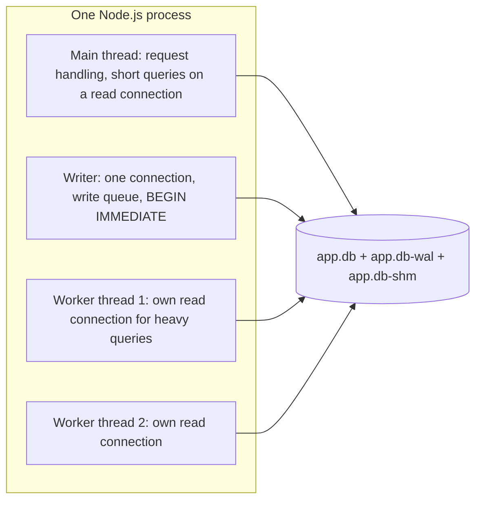
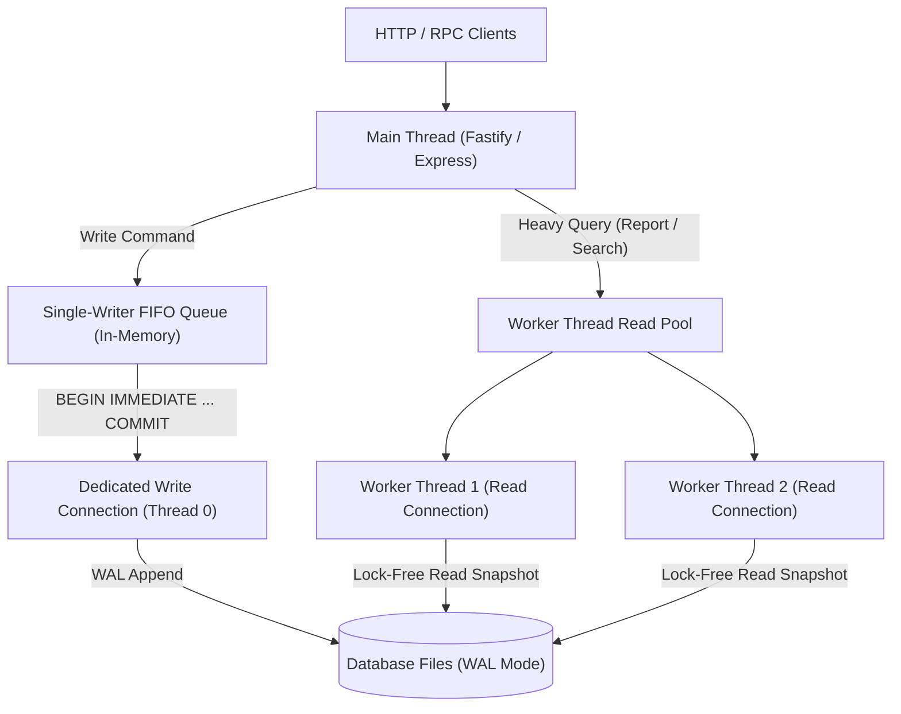

# Module 09: Concurrency in Applications

Modules 05 and 06 described what SQLite guarantees: one writer at a time, readers that do not block it in WAL mode, and `SQLITE_BUSY` when a lock is not available. This module is about building services on top of those guarantees. It covers how many writes per second "one writer" really allows, how to arrange connections across threads and processes, why synchronous Node drivers need care, how to serialise writes without `SQLITE_BUSY` storms, and which deployment environments (network filesystems, some container volumes, `fork()`) break SQLite's assumptions altogether.

> **Owned elsewhere.** Concurrency theory (locks, races, queues) is planned for `algorithms/dsa`. Lost updates and write skew as anomalies: [data-systems Module 05 § 2](../../../architecture/data-systems/modules/05-transactions-acid-and-isolation-levels.md#2-the-concurrency-anomaly-hierarchy-berenson-and-adya-frameworks). The Node.js event loop is covered in [languages/javascript](../../../languages/javascript/README.md).

Proofs: [`examples/ts/09-application-concurrency.test.ts`](../examples/ts/09-application-concurrency.test.ts), using `worker_threads`, and [`examples/ts/write-queue.ts`](../examples/ts/write-queue.ts).

---

## 1. A capacity model for "one writer"

Because write transactions are serialised, write throughput is bounded by how long each one holds the write lock:

$$\text{max write transactions per second} \approx \frac{1}{t_{\text{lock held}}}$$

| Write transaction shape | _t_<sub>lock</sub> (typical NVMe, WAL, `synchronous=NORMAL`) | Ceiling |
| --- | --- | --- |
| One small `INSERT`, autocommit | 20–100 µs | 10,000–50,000 / s |
| Same with `synchronous=FULL` | dominated by one `fsync` (0.1–2 ms) | 500–10,000 / s |
| Read-modify-write of a few rows | 100–300 µs | 3,000–10,000 / s |
| Transaction that awaits an HTTP call while holding the lock | 50–500 ms | **2–20 / s** |

(The first three rows are orders of magnitude, not measurements from this track; measure your own hardware.)

Two conclusions shape every design in this module:

1. **Never hold a write transaction across I/O that is not SQLite**: network calls, `await` on anything slow, user think time. Read what you need, compute, call external services, and _then_ open a short `BEGIN IMMEDIATE` transaction that re-validates and writes.
2. **Batch.** Many writes in one transaction share one commit (and one `fsync`). The test inserts 1,000 rows with `synchronous = FULL` and the batched version is consistently faster than 1,000 autocommits. Group commit (§ 4) applies the same idea across independent requests.

Reads scale differently. In WAL mode any number of connections read in parallel, limited only by CPU and I/O. A read-heavy service with one writer is SQLite's sweet spot.

---

## 2. Connections, threads and processes



The rules:

- **One connection per thread.** better-sqlite3 is built multi-thread (`THREADSAFE=2`): a connection must never be used by two threads at once ([Module 01 § 2.2](./01-what-sqlite-is-bindings-and-cli.md#22-threading-modes)). In Node a connection object cannot even be passed to a worker; each worker opens its own. Python's `sqlite3` enforces `check_same_thread=True` by default for the same reason.
- **One writer connection per process** (plus the queue in § 4) avoids in-process contention entirely. Several processes, such as PM2 or gunicorn workers, still contend with each other at the file level, so each needs `busy_timeout` and `BEGIN IMMEDIATE`.
- **Many reader connections** are cheap in WAL mode. Each has its own page cache ([Module 04 § 3.1](./04-file-format-and-b-trees.md#31-from-pages-on-disk-to-pages-in-memory)), so budget `cache_size × connections` of memory.
- **Open connections once and keep them.** Opening a connection parses the whole schema. Per-request open and close also loses the page cache, and in WAL mode the last close runs a checkpoint.

#### Python sqlite3: check_same_thread and PEP 249 autocommit modes

In Python's standard library `sqlite3` module, concurrency semantics differ significantly from Node.js:

- **`check_same_thread=True` (default)**: Python validates that every call on a connection originates from the exact OS thread that initialized it. Attempting to use the connection in a different thread throws `sqlite3.ProgrammingError: SQLite objects created in a thread can only be used in that same thread`.
- **`check_same_thread=False`**: Disables the thread identity check. While safe for handing a connection sequentially from one thread to another (e.g. across coroutines in cooperative async frameworks), simultaneous concurrent execution across multiple threads causes race conditions in C memory structures because Python's wrapper does not serialize calls.
- **Legacy transaction management (`isolation_level`)**: Historically, Python's `sqlite3` parsed SQL with regular expressions and implicitly issued `BEGIN` before DML statements (`INSERT`, `UPDATE`, `DELETE`), but not before `SELECT`. This caused subtle bugs: `SELECT` read from an uncommitted snapshot, and explicit `BEGIN IMMEDIATE` calls failed with `cannot start a transaction within a transaction`. Setting `isolation_level = None` put the connection into autocommit mode, requiring manual transaction control.
- **Modern PEP 249 `autocommit` (Python 3.12+)**: Python 3.12 introduced the explicit `autocommit` parameter:
  - `autocommit=False`: Standard PEP 249 compliant behavior where transactions begin automatically before DML/DDL.
  - `autocommit=True`: Disables implicit transactions. Statements run in autocommit mode unless wrapped in explicit transactions. The recommended production pattern for high-concurrency Python services is:

```python
import sqlite3

# Production-recommended connection setup for concurrent writers
conn = sqlite3.connect("app.db", timeout=10.0, autocommit=True)
conn.execute("PRAGMA journal_mode = WAL")
conn.execute("PRAGMA synchronous = NORMAL")
conn.execute("PRAGMA busy_timeout = 10000")

def transfer_funds(source_id: int, target_id: int, amount: int) -> None:
    # Explicit BEGIN IMMEDIATE avoids deferred upgrade deadlocks
    conn.execute("BEGIN IMMEDIATE")
    try:
        conn.execute("UPDATE accounts SET balance = balance - ? WHERE id = ?", (amount, source_id))
        conn.execute("UPDATE accounts SET balance = balance + ? WHERE id = ?", (amount, target_id))
        conn.execute("COMMIT")
    except Exception:
        conn.execute("ROLLBACK")
        raise
```

---

## 3. Synchronous drivers and the event loop

better-sqlite3 and `node:sqlite` run queries **on the calling thread**. That makes small queries extremely fast and transactions simple, but a slow query freezes the event loop. The test measures it: a 3-million-step recursive CTE delays a 5 ms timer by at least half of the query's own duration. The same query in a worker thread, with its own connection, leaves the timer on time.

```ts
const w = new Worker(
  `
  const { parentPort, workerData } = require('node:worker_threads');
  const Database = require(${JSON.stringify(b3)});
  const db = new Database(workerData.path);
  parentPort.postMessage(db.prepare(workerData.sql).pluck().get());`,
  { eval: true, workerData: { path, sql } },
);
```

Guidelines:

| Query cost | Where to run it |
| --- | --- |
| < 1 ms (point lookups, small pages) | main thread; the sync API is the fastest option |
| 1–50 ms | main thread is acceptable at low concurrency; watch event-loop lag metrics |
| > 50 ms (reports, exports, `VACUUM`, `ANALYZE`, big `PRAGMA integrity_check`) | a worker thread or a separate process with its own connection |

Async wrappers that run a synchronous driver on libuv's thread pool exist, but they add a boundary crossing to every query and share a small pool (four threads by default) with file I/O and DNS lookups. A small pool of dedicated workers for heavy queries is usually better. `@libsql/client` and `@tursodatabase/database` are Promise-based ([Module 12](./12-libsql-and-turso.md)), but their local engines still do the work in native code; check whether they block before assuming they do not.

#### Dedicated single-writer queue and worker_threads read-pool architecture

For Node.js services serving mixed read/write workloads, coupling a dedicated single-writer queue with a thread-pool of read connections isolates the event loop from database stalls while eliminating write contention:



Implementation design principles:

1. **Dedicated writer thread/queue**: All mutating operations are enqueued into a bounded in-memory queue. The writer holds a single connection with `PRAGMA busy_timeout = 10000` and issues `BEGIN IMMEDIATE` to batch writes without contention.
2. **Worker thread read pool**: Long-running analytical or heavy scan queries (`> 10 ms`) are dispatched to a worker pool (using Node.js `worker_threads`). Each worker opens its own read-only connection:

```ts
// reader-worker.ts - Dedicated reader connection
import { parentPort } from 'node:worker_threads';
import Database from 'better-sqlite3';

const db = new Database('app.db', { readonly: true, fileMustExist: true });
db.pragma('query_only = ON');
db.pragma('cache_size = -16000'); // 16 MiB cache

parentPort?.on('message', ({ id, sql, params }: { id: number; sql: string; params: unknown[] }) => {
  try {
    const stmt = db.prepare(sql);
    const result = stmt.all(...params);
    parentPort?.postMessage({ id, result });
  } catch (err: unknown) {
    const message = err instanceof Error ? err.message : String(err);
    parentPort?.postMessage({ id, error: message });
  }
});
```

The main thread coordinates incoming read queries through a worker pool dispatcher:

```ts
// read-pool.ts - Dispatcher managing worker thread pool
import { Worker } from 'node:worker_threads';

export class ReadWorkerPool {
  #workers: Worker[] = [];
  #idleWorkers: Worker[] = [];
  #pendingTasks: Array<{
    id: number;
    sql: string;
    params: unknown[];
    resolve: (v: unknown) => void;
    reject: (e: Error) => void;
  }> = [];
  #nextId = 1;
  #inFlight = new Map<number, { resolve: (v: unknown) => void; reject: (e: Error) => void }>();

  constructor(poolSize: number, workerScript: string) {
    for (let i = 0; i < poolSize; i++) {
      const worker = new Worker(workerScript);
      worker.on(
        'message',
        ({ id, result, error }: { id: number; result?: unknown; error?: string }) => {
          const handler = this.#inFlight.get(id);
          if (handler) {
            this.#inFlight.delete(id);
            if (error) handler.reject(new Error(error));
            else handler.resolve(result);
          }
          this.#idleWorkers.push(worker);
          this.#dispatchNext();
        },
      );
      this.#workers.push(worker);
      this.#idleWorkers.push(worker);
    }
  }

  query<T = unknown>(sql: string, params: unknown[] = []): Promise<T> {
    return new Promise((resolve, reject) => {
      const id = this.#nextId++;
      this.#pendingTasks.push({
        id,
        sql,
        params,
        resolve: resolve as (v: unknown) => void,
        reject,
      });
      this.#dispatchNext();
    });
  }

  #dispatchNext(): void {
    if (this.#idleWorkers.length === 0 || this.#pendingTasks.length === 0) return;
    const worker = this.#idleWorkers.pop()!;
    const task = this.#pendingTasks.shift()!;
    this.#inFlight.set(task.id, { resolve: task.resolve, reject: task.reject });
    worker.postMessage({ id: task.id, sql: task.sql, params: task.params });
  }
}
```

3. **Event-loop latency preservation**: Short primary-key lookups run synchronously on the main thread for minimum overhead, while heavy analytical scans execute off-thread without inducing event-loop jitter.

---

## 4. Serialising writes

### 4.1 Contending connections versus a queue

There are two ways to get many writers through one lock:

| Approach | How | Weakness |
| --- | --- | --- |
| **Contention** | every request uses its own connection and `BEGIN IMMEDIATE`, and relies on `busy_timeout` | The busy handler _sleeps and polls_; it is not a FIFO queue. Waiters wake on a back-off schedule, so tail latency grows and unlucky requests can time out while others pass. |
| **Queue** | all writes in the process go through one connection and a FIFO queue | Only serialises within one process. Several processes still contend, so keep `busy_timeout` and `BEGIN IMMEDIATE` as a backstop. |

### 4.2 Group commit

[`write-queue.ts`](../examples/ts/write-queue.ts) implements a queue with **group commit**: jobs enqueued in the same event-loop tick share one `BEGIN IMMEDIATE … COMMIT`, and each job runs inside its own `SAVEPOINT`:

```ts
#flush(): void {
  const batch = this.#pending.splice(0);
  db.exec('BEGIN IMMEDIATE');
  for (const job of batch) {
    db.exec('SAVEPOINT job');
    try { const value = job.fn(db); db.exec('RELEASE job'); settled.push(() => job.resolve(value)); }
    catch (e) { db.exec('ROLLBACK TO job; RELEASE job'); settled.push(() => job.reject(e)); }
  }
  db.exec('COMMIT');
  settled.forEach((s) => s());          // resolve only after the commit
}
```

The tests prove three properties:

- **Throughput.** 500 concurrent `enqueue` calls commit in fewer than 10 transactions, with 500 distinct ids.
- **Isolation of failures.** A job that violates a primary key is rolled back to its savepoint and rejects its own promise; the jobs before and after it commit (`['fulfilled', 'rejected', 'fulfilled']`).
- **Durability before acknowledgement.** Promises resolve only after `COMMIT` returns. Resolving earlier would tell a client "saved" for data that a crash could still lose.

This is the same idea as group commit in client/server databases ([data-systems Module 06 § 5](../../../architecture/data-systems/modules/06-durability-wal-and-crash-recovery.md#5-group-commit-and-torn-page-protection)), implemented in the application because SQLite has no server process to do it.

#### Multi-process worker contention and group-commit batching math

In multi-process deployments (such as PM2 cluster mode or Gunicorn running multiple worker processes), each process maintains its own independent SQLite write connection. Because WAL mode permits only one active writer across the entire host, write contention occurs at the OS file-locking layer.

##### Locking contention model

Suppose $N$ worker processes generate write transactions following a Poisson arrival process with aggregate rate $\lambda$ (transactions per second). Each transaction holds the exclusive WAL write lock for duration $T_{\text{lock}}$. The probability that an arriving write encounters a busy lock is:

$$P(\text{contention}) \approx 1 - e^{-\lambda \cdot T_{\text{lock}}}$$

When contention occurs:

- The worker's busy handler executes exponential backoff with random jitter, polling the OS lock repeatedly.
- If $N$ processes contend simultaneously, tail latency ($p99$) degrades rapidly as waiters repeatedly fail to acquire the lock before their `busy_timeout` expires.
- Uncoordinated polling causes CPU thrashing and lock starvation for unlucky workers.

##### Group-commit batching math

To maximize write throughput and eliminate contention, requests can be accumulated over an aggregation window $\Delta t$ (e.g. 2–5 ms) or until reaching a maximum batch capacity $B_{\text{max}}$:

$$B = \min(B_{\text{max}}, \max(1, \lambda \cdot \Delta t))$$

The total time required to execute and commit a batch of $B$ writes is:

$$T_{\text{batch}} = T_{\text{begin}} + B \cdot T_{\text{step}} + T_{\text{fsync}}$$

Where $T_{\text{begin}} \approx 10\ \mu\text{s}$ to acquire `BEGIN IMMEDIATE`, $T_{\text{step}} \approx 15\ \mu\text{s}$ per row insert, and $T_{\text{fsync}} \approx 500\ \mu\text{s}$ (NVMe disk flush). The amortized commit time per write transaction becomes:

$$T_{\text{amortized}}(B) = \frac{T_{\text{begin}} + T_{\text{fsync}}}{B} + T_{\text{step}}$$

| Batch Size ($B$) | Total Batch Time ($T_{\text{batch}}$) | Amortized Time / Write ($T_{\text{amortized}}$) | Theoretical Write Throughput |
| --- | --- | --- | --- |
| 1 (Autocommit) | $525\ \mu\text{s}$ | $525\ \mu\text{s}$ | $\sim 1,900$ writes/s |
| 10 | $660\ \mu\text{s}$ | $66\ \mu\text{s}$ | $\sim 15,100$ writes/s |
| 50 | $1,260\ \mu\text{s}$ | $25.2\ \mu\text{s}$ | $\sim 39,600$ writes/s |
| 200 | $3,510\ \mu\text{s}$ | $17.5\ \mu\text{s}$ | $\sim 57,000$ writes/s |

Amortizing the `fsync` overhead across 50–200 grouped writes increases write capacity by more than $20\times$ while reducing OS lock acquisition frequency.

---

## 5. Lost updates and how to avoid them

SQLite's isolation is serializable _per transaction_. A read and a write in **two separate autocommit statements** are two transactions, so the classic lost update is still possible, and the test reproduces it deterministically with two connections: both read 100, both write 101, and one increment vanishes.

Three correct patterns, all proven:

1. **Atomic statements**: `UPDATE c SET n = n + 1 WHERE id = 1`. The read and write happen in one statement, under one write lock.
2. **`BEGIN IMMEDIATE` around read-then-write**: the write lock is taken before the read, so no other writer can interleave. Eight worker threads × 200 increments with `.immediate()` end at exactly 1,600 with zero errors.
3. **Optimistic concurrency**: a version column, `UPDATE … SET v = v + 1, … WHERE id = ? AND v = ?`, and a check that `changes = 1`. This is useful when the read happens in one request and the write in a later one.

The negative test runs the same eight workers with **deferred** transactions in WAL mode. Some transactions fail with `SQLITE_BUSY` or `SQLITE_BUSY_SNAPSHOT` despite a 10-second busy timeout: they read under an old snapshot and then tried to write ([Module 06 § 4](./06-wal-mode.md#4-writing-one-writer-latest-snapshot-only)). Every _successful_ transaction is still counted exactly once (final count = 1600 − failures). SQLite never loses an update inside a transaction; it refuses instead, and the application must retry ([`retry.ts`](../examples/ts/retry.ts), [Module 05](./05-transactions-locking-and-rollback-journal.md#7-sqlite_busy-and-the-busy-handler)).

---

## 6. Network filesystems and containers

SQLite's correctness depends on two OS services: **POSIX advisory locks** that work across all processes using the file, and, in WAL mode, **shared memory** (`mmap` of the `-shm` file) that is coherent across those processes. The [file-locking](https://www.sqlite.org/lockingv3.html) and [How To Corrupt](https://www.sqlite.org/howtocorrupt.html) pages are explicit about where those break:

| Environment | Rollback mode | WAL mode | Why |
| --- | --- | --- | --- |
| Local disk (ext4, XFS, APFS, NTFS) | safe | safe | correct locks and shared memory |
| Several containers on **one host**, same local volume | safe | safe | same kernel, same locks and page cache |
| NFS, SMB/CIFS, other network filesystems | **unsafe** | **unsupported** | locks are often broken or advisory-only on the server; no shared memory across hosts |
| Kubernetes `ReadWriteMany` volume mounted on several nodes | unsafe | unsupported | a network filesystem underneath |
| Cloud block volume (EBS, Persistent Disk) attached to **one** node | safe | safe | it is a local disk to that node |
| Docker Desktop bind mounts from macOS or Windows hosts | use with caution | use with caution | the file-sharing layer between VM and host may not propagate locks; keep the database inside the VM's filesystem or a named volume |
| Object storage via FUSE (S3, GCS mounts) | unsafe | unsafe | no locking semantics, no atomic partial writes |

The one-line rule: **every process that opens the database must run under the same kernel, on a local filesystem.** To share a database between machines, put a server in front of it, replicate it (Litestream, LiteFS, libSQL, rqlite: [Module 11](./11-edge-and-distributed-sqlite.md)), or use a client/server DBMS.

Read-only access over a network share is the one safe exception, provided nothing writes: open with `immutable=1` (no locking at all) or `mode=ro` on a `journal_mode = DELETE` database.

#### POSIX fcntl lock failure modes and distributed mmap incoherence on network filesystems

When deploying SQLite on network filesystems (NFS, SMB/CIFS, AWS EFS, Azure Files), applications encounter severe low-level failure modes that break ACID guarantees:

| Network Storage Protocol | Underlying Locking Mechanism | Failure Mode | Corruption Impact |
| --- | --- | --- | --- |
| NFSv3 | Network Lock Manager (`rpc.lockd` / NLM) | NLM is asynchronous and stateful; network partitions or server reboots cause lock state loss without notifying clients. | Two processes on different nodes obtain concurrent `EXCLUSIVE` locks, producing overwritten pages and B-tree corruption. |
| NFSv4 | Lease-based locking protocol | Lock revocation on lease renewal failure during high network latency; lock leases expire while transaction is in-flight. | Server grants write lock to another node while first node still flushes uncommitted dirty pages. |
| SMB3 / CIFS | Opportunistic Locks (Oplocks) & Byte-Range Locks | Client-side aggressive write caching postpones flushing; oplock breaks fail under concurrent access across nodes. | Readers observe stale snapshots; write-after-read consistency is violated. |
| AWS EFS / Azure Files | NFSv4 / SMB network abstraction | Latency spikes on `fsync` (10–50 ms); POSIX byte-range locking lacks guaranteed atomic lock upgrades (`SHARED` to `RESERVED`). | Catastrophic drop in throughput; frequent `SQLITE_BUSY` timeouts under minimal load. |
| Object Storage (S3 / GCS via FUSE) | Userspace FUSE translation | FUSE object drivers lack byte-range locking and partial page overwrites; uploads replace entire objects. | Instant data corruption or silent file truncation on concurrent writes. |

##### The fatal flaw: lack of coherent distributed shared memory (`mmap`)

WAL mode relies fundamentally on the memory-mapped `-shm` wal-index. The POSIX specification does not mandate distributed coherent memory across independent machine kernels. When Host A updates a frame index in its local memory-mapped `-shm` buffer:

- The updated memory pages are not automatically mirrored to the kernel page cache of Host B.
- Host B's wal-index reads stale snapshot markers, failing to see committed frames.
- Checkpointing nodes read desynchronized read marks, backfilling frames into the main database while readers are actively querying those pages.

Consequently, running WAL mode over network shares results in deterministic split-brain corruption.

---

## 7. `fork()`, process pools and lock lifetimes

- **Never use a connection across `fork()`.** The child inherits the parent's file descriptors, locks, and in-memory state (page cache, transaction state), and two processes then drive one connection's state independently. [How To Corrupt § 2.6](https://www.sqlite.org/howtocorrupt.html) lists this. Open connections _after_ forking. Node's `cluster` and `child_process` start fresh processes, so the danger is mainly in Python's `multiprocessing` with the `fork` start method and in pre-forking servers (gunicorn with `preload_app`) that open the database before forking.
- **POSIX locks are per process.** Two connections in the same process are coordinated by SQLite internally. Code that opens and closes the database file outside SQLite drops those locks ([Module 05 § 2.1](./05-transactions-locking-and-rollback-journal.md#21-how-the-locks-are-implemented)).
- **Blocking locks.** Since 3.50.0, `sqlite3_setlk_timeout()` lets builds with `SQLITE_ENABLE_SETLK_TIMEOUT` wait on locks inside the OS (with `F_SETLKW`) instead of sleeping and polling. That gives fairer queuing between processes. Neither Node binding exposes it.

---

## 8. Choosing a topology

```text
CHOOSE-TOPOLOGY(service)
  1  if all writers live in one process
  2      one writer connection + write queue (§ 4); WAL; reader connections per thread
  3  else if writers are several processes on one host
  4      WAL; busy_timeout ≥ 5 s; BEGIN IMMEDIATE everywhere; keep transactions short; retry wrapper
  5  else if writers are on several hosts
  6      do not share the file: route writes to one host (a primary), replicate reads (Module 11),
  7      or use Turso/libSQL, rqlite, or a client/server DBMS (Module 11, Module 12)
  8  in every case: no write transaction spans external I/O; heavy reads off the event loop
```

---

## 9. Then vs now

| Topic | Then | Now |
| --- | --- | --- |
| Node drivers | `sqlite3` (async, callback API on the thread pool) | synchronous better-sqlite3 and built-in `node:sqlite`; worker threads for heavy work |
| Moving work off the main thread | separate processes | `worker_threads` (Node 12+) with one connection per worker |
| Lock waiting | sleep-and-poll busy handler only | plus `sqlite3_setlk_timeout()` blocking locks (3.50.0+, opt-in builds) |
| Concurrent writers | never | still never upstream; Turso MVCC offers `BEGIN CONCURRENT` ([Module 12](./12-libsql-and-turso.md)) |

---

## 10. Production failure modes

1. **Write transaction held across an HTTP call** collapses throughput to a handful of writes per second.
2. **Event-loop stalls** from a report query on the main thread. Proven.
3. **Lost updates** from read-modify-write in separate statements. Proven.
4. **`SQLITE_BUSY_SNAPSHOT` under load** from deferred write transactions. Proven.
5. **Tail-latency spikes** under contention because busy handlers poll instead of queueing. Use a write queue.
6. **Corruption on NFS, SMB or `ReadWriteMany` volumes.**
7. **Connections opened before `fork()`**, as in pre-forking Python servers.
8. **Opening a connection per request**, which re-parses the schema and loses the cache each time.
9. **Promises resolved before `COMMIT`**, acknowledging writes that are not yet durable.

---

## Interview Drill

<details><summary>1. Estimate the write capacity of an SQLite-backed API and say what destroys it.</summary>

Writes are serialised, so throughput is about 1 / (time the write lock is held). Short transactions in WAL mode with `synchronous=NORMAL` hold it for tens of microseconds, which allows thousands to tens of thousands per second. With `FULL`, each commit pays an fsync. It collapses when a transaction holds the lock during slow work, such as a network call or an `await` on another service, which cuts throughput to the inverse of that latency.
</details>

<details><summary>2. Why do better-sqlite3 and node:sqlite use synchronous APIs, and how do you avoid blocking the event loop?</summary>

Typical queries finish in microseconds, so thread-pool hand-offs would cost more than the work, and synchronous transactions cannot be interleaved by other JavaScript. Slow queries do block the loop, so move them to worker threads, each with its own connection (connections cannot be shared across threads), and monitor event-loop lag.
</details>

<details><summary>3. Two requests increment a counter with SELECT then UPDATE and one increment is lost. Give three fixes.</summary>

Use an atomic `UPDATE … SET n = n + 1`; wrap the read and write in a `BEGIN IMMEDIATE` transaction so no other writer can interleave; or use optimistic concurrency with a version column and check that exactly one row changed, retrying otherwise.
</details>

<details><summary>4. Why is a write queue with group commit better than many connections relying on busy_timeout?</summary>

The busy handler sleeps and retries on a back-off schedule. It is not FIFO, so latency becomes unpredictable and some requests time out while others get through, and each request still pays its own commit. A single writer with a FIFO queue serialises writes without polling, and grouping the jobs of one tick into one transaction amortises the commit cost. Per-job savepoints keep failures isolated. It only works within one process, so cross-process contention still needs `busy_timeout` and `BEGIN IMMEDIATE`.
</details>

<details><summary>5. Can two Kubernetes pods share one SQLite file?</summary>

Only if they run on the same node with the file on a local volume, so that they share a kernel, POSIX locks and shared memory. A `ReadWriteMany` volume across nodes is a network filesystem, where locks are unreliable and WAL's shared memory does not work, so it will eventually corrupt. Run one writer pod and replicate, or use a server-based solution.
</details>

<details><summary>6. What goes wrong if a Python service opens SQLite and then forks worker processes?</summary>

Each child inherits the same open file descriptors and the connection's in-memory state (page cache, lock state, transaction state). They then act on the file as if each were the only owner, which can release each other's locks and write inconsistent pages. Open connections in each worker after the fork (for example in a post-fork hook).
</details>

<details><summary>7. When should a write promise be resolved in a queued writer, and why?</summary>

Only after the `COMMIT` of the transaction containing the job has returned successfully, and with `synchronous=FULL` if the acknowledgement must survive power loss. Resolving after the job's statement but before the commit would acknowledge writes that a later failure of the batch, or a crash, could still undo.
</details>
