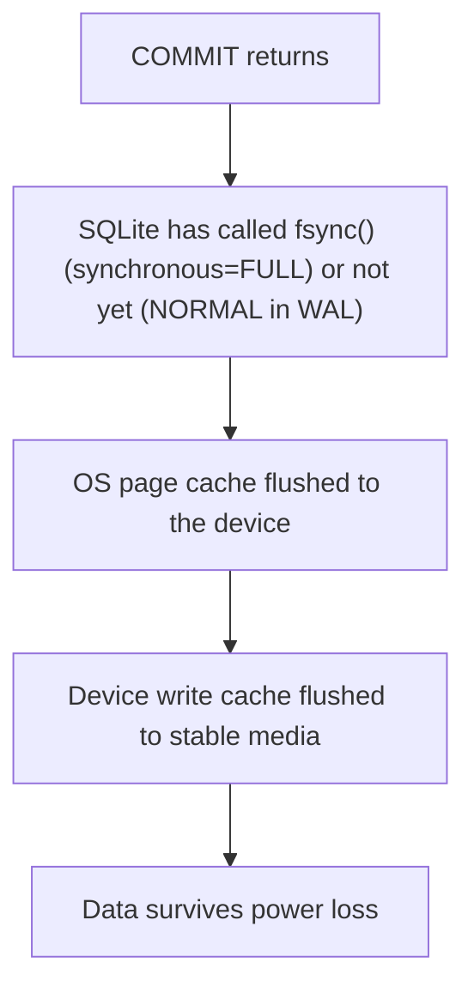

# Module 10: Durability, Backup and Operations

Running SQLite in production means owning the jobs a database administrator does for a server: deciding what "committed" means, taking backups of a database that is being written to, detecting and repairing corruption, migrating the schema, and monitoring. SQLite gives precise tools for each job, and some tempting shortcuts that lose data. This module covers both. It ends with the session extension, which records changes as portable changesets, the building block of several sync systems.

> **Owned elsewhere.** WAL/ARIES recovery theory, fsync semantics and the 2018 "fsyncgate" are in [data-systems Module 06](../../../architecture/data-systems/modules/06-durability-wal-and-crash-recovery.md) and [Module 04 § 5](../../../architecture/data-systems/modules/04-buffer-management-and-operating-system-io.md#5-linux-storage-mechanics-the-fsyncgate-flaw-o_direct-and-io_uring). Backup and PITR for a client/server database: [technologies/postgres Module 12](../../postgres/modules/12-durability-backup-and-pitr.md).

Proofs: [`examples/ts/10-durability-backup-and-operations.test.ts`](../examples/ts/10-durability-backup-and-operations.test.ts) (14 tests) and [`examples/ts/migrate.ts`](../examples/ts/migrate.ts).

---

## 1. The durability chain

A commit is durable only if every layer below SQLite keeps its promise:



| Layer | SQLite's control | Where it can lie |
| --- | --- | --- |
| SQLite | `PRAGMA synchronous` (OFF / NORMAL / FULL / EXTRA) | NORMAL in WAL mode skips the per-commit sync by design ([Module 06 § 5](./06-wal-mode.md#5-durability-synchronousnormal-versus-full)) |
| OS | `fsync()` / `fdatasync()`; on macOS, `F_FULLFSYNC` | macOS `fsync()` does **not** flush the drive's cache. SQLite uses `F_FULLFSYNC` only when `PRAGMA fullfsync = ON` (and `checkpoint_fullfsync` for checkpoints). Both are off by default. |
| Hypervisor and virtual disk | none | Some virtual disks acknowledge flushes they cache ("writeback" modes). |
| Device | none | Consumer SSDs without power-loss protection may acknowledge a flush early. |

#### System calls and barrier semantics: fsync vs fdatasync vs macOS F_FULLFSYNC

The exact syscall executed during SQLite commit points determines whether bytes have physically reached non-volatile NAND or magnetic media:

- **Linux `fdatasync(fd)`**: Flushes modified file data pages and minimal metadata required to read them (such as file length), omitting directory entry modification timestamps (`mtime`). This avoids a second seek and metadata commit to the filesystem journal (e.g. JBD2 in ext4).
- **POSIX `fsync(fd)`**: Flushes data pages and all associated inode metadata. On Linux and BSD, this instructs the storage controller to commit data to persistent storage.
- **macOS `fsync(fd)` and `fcntl(fd, F_FULLFSYNC)`**: Under Darwin (macOS/iOS), POSIX `fsync()` flushes dirty pages from the kernel page cache into the storage device's **on-board volatile RAM write buffer**, but does _not_ issue a hardware cache flush command across the bus. If power fails or the battery disconnects, data in the device's volatile cache is lost. Apple provides `fcntl(fd, F_FULLFSYNC)` to force the drive controller to flush its volatile cache directly to physical NAND. Because `F_FULLFSYNC` adds 2–15 ms latency per commit, SQLite disables it by default (`PRAGMA fullfsync = OFF`). Financial ledgers and mission-critical audit trails on macOS must set `PRAGMA fullfsync = ON`.

**What you can and cannot prove on a laptop.** Process crashes are provable, and [Module 05](./05-transactions-locking-and-rollback-journal.md#5-hot-journals-and-recovery) proves recovery after `SIGKILL`. Power loss is not provable without hardware fault injection: a killed process leaves its writes in the OS page cache, where they survive. Tests that "prove durability" with `kill -9` prove crash-atomicity, not durability.

Choosing a level:

| Data | Setting |
| --- | --- |
| Caches, derived data, anything rebuildable | WAL + `synchronous = NORMAL` |
| Typical web application state | WAL + `NORMAL`, accepting that the last commits before a power cut may roll back (never corrupt) |
| Ledgers, acknowledged messages, "saved" promises to users | WAL + `synchronous = FULL`; on macOS also `fullfsync = ON` |
| Bulk loads you can redo | `synchronous = OFF` for the load, then back to your normal level, followed by a checkpoint |

---

## 2. How SQLite databases get corrupted

SQLite is very resistant to corruption _from its own crashes_. The documented causes ([howtocorrupt](https://www.sqlite.org/howtocorrupt.html)) are almost all _outside_ SQLite:

| Category | Examples | Covered in |
| --- | --- | --- |
| File overwritten by something else | a stray write from another program or thread; restoring an old `-journal` or `-wal` next to a newer database; a backup tool copying a live file | § 2.1 (proven) |
| Locking failures | network filesystems; two copies of SQLite in one process with different lock tables; POSIX locks dropped by an unrelated `close()`; renaming or unlinking a database while it is open | [Module 05](./05-transactions-locking-and-rollback-journal.md#21-how-the-locks-are-implemented), [Module 09](./09-application-concurrency.md#6-network-filesystems-and-containers) |
| Failed syncs | disks or VMs that ignore flushes; `synchronous = OFF`; `journal_mode = MEMORY` or `OFF` with a crash | § 1, [Module 05](./05-transactions-locking-and-rollback-journal.md#6-journal-modes) (proven) |
| Deleting a hot journal or `-wal` | "cleaning up" stray files | § 2.2 (proven) |
| Hardware faults | bad memory, failing flash | – |
| Misuse of advanced features | `PRAGMA writable_schema` edits; `fork()` with open connections; memory-mapped I/O with buggy drivers | [Module 09](./09-application-concurrency.md#7-fork-process-pools-and-lock-lifetimes) |
| SQLite bugs | rare; the WAL-reset race of 2010–2026 is the notable recent one | [Module 06](./06-wal-mode.md#7-the-wal-reset-bug-20102026) |

### 2.1 Detecting and repairing corruption

The test simulates a stray write: it zeroes 512 bytes in the middle of an index leaf page, from outside SQLite. Then:

- `PRAGMA integrity_check` reports problems instead of `ok`.
- Because only an **index** was damaged, `REINDEX t_v` rebuilds it from the table, and `integrity_check` returns `ok` again (proven).

| Check | What it verifies | Cost |
| --- | --- | --- |
| `PRAGMA quick_check` | page structure, cell order within pages, `NOT NULL` and `CHECK` | O(N) |
| `PRAGMA integrity_check` | all of the above, plus that every index matches its table | O(N log N); minutes on large files |
| `PRAGMA integrity_check(table)` (3.33+) | one table and its indexes | proportional |
| `PRAGMA foreign_key_check` | referential integrity | per FK |

Repair options, from least to most invasive:

1. **Index-only damage**: `REINDEX`.
2. **Table damage with a readable file**: `.recover` in the CLI (or the `sqlite3_recover` API), which salvages as many rows as possible into SQL text or a new database, including rows from free pages. It is better than `.dump`, which stops at the first error.
3. **Restore from backup** and replay what you can.

#### Forensics procedure: interpreting integrity_check errors and .recover triage

When `PRAGMA integrity_check` reports errors, triage follows a deterministic forensics runbook:

1. **Freeze and isolate**: Immediately set write permissions to read-only (`chmod 444 app.db*`) to prevent checkpointing or auto-vacuum from modifying damaged pages.
2. **Catalog corruption patterns**:
   - `Rowid X out of order (previous was Y)`: B-tree leaf ordering violated; indicates torn write or bit flip.
   - `Page N: free space corruption`: Freelist pointer corruption; harmless to active data unless freelist is reallocated.
   - `Index X entries do not match table Y`: Index leaf corruption. If the table itself has no corrupted cells, `REINDEX X;` completely repairs the database without data loss.
3. **Execute low-level recovery via `.recover`**: The standard `.dump` command navigates B-tree pointer hierarchies from root pages downward, failing completely when encountering a broken interior pointer. In contrast, the `.recover` tool (and `sqlite3_recover` C API) sweeps the file sequentially page by page:
   - Identifies candidate leaf page headers and serial record types directly from raw bytes.
   - Salvages uncorrupted rows even from orphaned pages disconnected from B-tree root nodes.
   - Extracts payload records from the freelist.

```bash
# Production forensic recovery pipeline
sqlite3 app.db "PRAGMA integrity_check;" > /tmp/integrity_errors.log
sqlite3 app.db ".recover" | sqlite3 recovered.db
sqlite3 recovered.db "PRAGMA integrity_check;"
sqlite3 recovered.db "PRAGMA foreign_key_check;"
```

Corruption that keeps recurring is a symptom of one of the categories above. Find the cause before restoring, or the restored copy will be corrupted too.

### 2.2 Never delete `-wal` or `-journal`

The negative test copies only the main file of a live WAL database, which is equivalent to deleting `-wal` after a crash. A table created after the last checkpoint does not exist in the result. Deleting a hot rollback journal is worse: it leaves half-written pages in place ([Module 05 § 5](./05-transactions-locking-and-rollback-journal.md#5-hot-journals-and-recovery)).

### 2.3 Checksums

The file format has no per-page checksums by default. The `cksumvfs` extension stores an 8-byte checksum in each page's **reserved bytes** ([Module 04 § 2](./04-file-format-and-b-trees.md#2-the-100-byte-header), offset 20) and verifies it on every read, so silent media corruption becomes an `SQLITE_IOERR_DATA` error instead of wrong answers. It must be enabled when the database is created, or applied with `VACUUM` after setting the reserve size.

---

## 3. Backing up a live database

| Method | Consistent? | Includes WAL-only commits? | Locks | Notes |
| --- | --- | --- | --- | --- |
| `cp app.db` while in use | **no** | **no** (proven) | none | Can capture a torn mix of pages, or miss the WAL. Unsafe. |
| Filesystem or volume snapshot (LVM, ZFS, EBS) | crash-consistent, _if_ it captures `db`, `-wal` and `-journal` atomically | yes | none | Restoring it is like recovering from a power cut. |
| `.dump` / `iterdump()` | yes (one read transaction) | yes | read snapshot | Logical SQL text; slow to restore; portable across versions. |
| **`VACUUM INTO 'file'`** (3.27+) | yes | yes (proven) | read transaction | Compact, self-contained copy in rollback mode (proven); fails if the target exists and is not empty (proven). |
| **Online backup API** | yes | yes | short read locks per step | Incremental; see § 3.1. |
| `serialize()` | yes | yes | read transaction | Whole database into memory; for small databases and tests. |
| Litestream-style WAL shipping | continuous | yes | none on the source | Point-in-time recovery; see [Module 11](./11-edge-and-distributed-sqlite.md). |

### 3.1 The online backup API

`sqlite3_backup_init/step/finish` copies a database page by page into another database ([backup.html](https://www.sqlite.org/backup.html)):

```text
ONLINE-BACKUP(src, dst, pages_per_step)
  1  b ← backup_init(dst, src)
  2  repeat
  3      rc ← backup_step(b, pages_per_step)   ▹ read transaction on src for the duration of the step
  4      if src was written by ANOTHER connection since the last step
  5          the next step restarts from page 1  ▹ writes through the SAME connection are mirrored instead
  6      sleep or yield between steps            ▹ lets writers in
  7  until rc = SQLITE_DONE
  8  backup_finish(b)
```

better-sqlite3 exposes it as `await db.backup(dest, { progress })`, where `progress` returns the number of pages for the next step. `node:sqlite` exposes `backup(db, path)`. The test runs a backup in steps of five pages while another connection inserts a row after the first step, and the copy passes `integrity_check`.

Line 5 is the operational trap. On a busy database written by _other_ connections, small steps may restart forever: an earlier version of this track's test, which wrote on every step, never finished. Mitigations: use large steps, or `-1` to copy everything in one step under one read transaction (in WAL mode this does not block writers); run the backup through the same connection that does the writing; or use `VACUUM INTO`.

#### Online backup API (`sqlite3_backup_step`) vs `VACUUM INTO`

| Dimension | `sqlite3_backup_step` | `VACUUM INTO 'dest.db'` |
| --- | --- | --- |
| Transaction scope | Short read lock per step (or single read transaction if `pages = -1`) | Single continuous read transaction throughout the entire operation |
| Impact of concurrent writes | Restarts from page 1 if written by an _external_ connection; mirrors writes from the _same_ connection | Readers in WAL mode see snapshot at statement start; writers never interrupt or restart it |
| Storage optimization | Direct page-for-page copy; retains freelist fragmentation and B-tree page sparseness | Completely defragments database; rebuilds B-trees; drops unused freelist pages |
| Output journal mode | Mirrors source database journal mode (or empty destination) | Outputs a clean, single-file rollback-mode database (`journal_mode = DELETE`) |
| Destination precondition | Destination file must be openable via SQLite | Destination file must **not** exist (fails with `SQLITE_ERROR` if target exists) |
| I/O throttle control | Yes; caller can pause and sleep between steps to yield I/O bandwidth to application traffic | No; runs as a single batch SQL statement to completion |

```ts
// backup-comparison.ts - Contrasting incremental backup with VACUUM INTO
import Database from 'better-sqlite3';

const db = new Database('production.db');

// Strategy 1: Throttled incremental online backup (non-blocking for I/O)
await db.backup('incremental-backup.db', {
  progress({ totalPages, remainingPages }) {
    console.info(`Backup progress: ${((1 - remainingPages / totalPages) * 100).toFixed(1)}%`);
    return 100; // Copy in 100-page increments (yields to OS I/O scheduler)
  },
});

// Strategy 2: Instant snapshot defragmentation (fastest, guaranteed atomic snapshot)
db.exec("VACUUM INTO 'compact-snapshot.db'");
```

### 3.2 Restore drills

A backup that has never been restored is a hope, not a backup. A restore drill for SQLite is cheap: copy the backup to a scratch path, open it, run `PRAGMA integrity_check`, run `PRAGMA foreign_key_check`, compare row counts with expectations, and check `user_version` against the application's migration list.

#### Litestream continuous WAL shipping and point-in-time recovery (PITR) drill runbook

Litestream operates as an independent background daemon that observes the `-wal` file without taking application locks. By tracking byte offsets in the log and streaming compressed LZX/Zstandard frame slices to S3-compatible object storage, it provides sub-second Recovery Point Objectives (RPO):

##### Architecture of WAL shipping

- **Generations**: Each time SQLite resets its WAL header (changing Salt-1 and Salt-2 during a checkpoint), Litestream creates a new replication _generation_, ensuring historical WAL streams are immutable.
- **Shadow WAL index**: Litestream maintains an internal shadow index tracking uploaded frame offsets, ensuring checkpointers backfilling the main database do not invalidate in-flight WAL uploads.

##### PITR drill runbook

Execute this verified recovery drill periodically in CI or staging to validate point-in-time recovery to a timestamp prior to an operational mishap:

```bash
# 1. Enumerate available replication generations in remote storage
litestream generations s3://backups.example.com/production-db

# 2. Inspect active replica status and maximum replicated transaction timestamp
litestream status -v /var/lib/app.db

# 3. Simulate recovery to a point in time (e.g. 1 second prior to accidental data deletion)
litestream restore \
  -timestamp "2026-11-07T12:00:00Z" \
  -o /tmp/restored-app.db \
  s3://backups.example.com/production-db

# 4. Programmatic health and integrity gate on restored database
sqlite3 /tmp/restored-app.db <<'EOF'
PRAGMA quick_check;
PRAGMA foreign_key_check;
SELECT 'Schema Version:', user_version FROM pragma_user_version();
SELECT 'Row Count Verification:', count(*) FROM orders;
EOF
```

---

## 4. Monitoring

| Signal | How | Alert when |
| --- | --- | --- |
| WAL size | `stat app.db-wal`; `wal_checkpoint(NOOP)` (3.51+) or `PASSIVE` results | far above `wal_autocheckpoint × page_size` ([Module 06 § 6.3](./06-wal-mode.md#63-checkpoint-starvation)) |
| Busy errors | count `SQLITE_BUSY*` in the data layer | any sustained rate |
| Free pages | `PRAGMA freelist_count` vs `page_count` | large fraction after deletes ([Module 04](./04-file-format-and-b-trees.md#7-free-space-vacuum-and-auto_vacuum)) |
| Change detection | `PRAGMA data_version` | – (used for cache invalidation, below) |
| Integrity | `quick_check` on a schedule, `integrity_check` on backups | anything but `ok` |
| Slow statements | timings in the application; `.timer on` / `.eqp on` in the CLI | – |

`PRAGMA data_version` returns a value that changes when **another** connection commits, and stays the same for the connection's own commits (proven). An in-process cache can check it before serving and invalidate itself when someone else wrote. It is cheaper than polling the data.

---

## 5. Schema migrations with `user_version`

`PRAGMA user_version` is a 32-bit integer in the database header (offset 60) that SQLite never interprets. It is the conventional schema version. [`migrate.ts`](../examples/ts/migrate.ts) applies a list of migrations:

```ts
export function migrate(db: Database.Database, migrations: readonly Migration[]): number {
  const current = db.pragma('user_version', { simple: true }) as number;
  if (current > migrations.length) {
    throw new Error(
      `database is at version ${current}, newer than this code (${migrations.length})`,
    );
  }
  for (let v = current; v < migrations.length; v++) {
    db.exec('BEGIN IMMEDIATE');
    try {
      if ((db.pragma('user_version', { simple: true }) as number) !== v) {
        db.exec('ROLLBACK');
        continue;
      }
      migrations[v]!(db);
      db.pragma(`user_version = ${v + 1}`);
      const fk = db.pragma('foreign_key_check') as unknown[];
      if (fk.length > 0)
        throw new Error(`migration ${v + 1} left ${fk.length} foreign key violations`);
      db.exec('COMMIT');
    } catch (e) {
      if (db.inTransaction) db.exec('ROLLBACK');
      throw e;
    }
  }
  return db.pragma('user_version', { simple: true }) as number;
}
```

The properties it relies on, all proven:

- **DDL is transactional in SQLite.** A failed migration rolls back its `ALTER TABLE` _and_ its version bump together, leaving the database at version 3 with no half-added column.
- **Idempotent**: running it twice applies nothing the second time.
- **Refuses downgrades**: old code against a newer database throws instead of running against a schema it does not understand.
- The version is re-checked **under the write lock**, so two processes starting at once do not both apply the same migration.

Migrations that need the 12-step rebuild must turn `foreign_keys` off _outside_ the transaction ([Module 03 § 7](./03-sql-dialect-and-features.md#7-alter-table-and-the-12-step-rebuild)), so they need a variant of this loop that toggles the pragma around `BEGIN` and `COMMIT`.

#### Deterministic migration harness with 12-step table rebuilds and safety gates

For schema transformations beyond `ALTER TABLE ADD COLUMN` (such as renaming columns, altering column types, modifying constraints, or dropping columns in SQLite versions prior to 3.35.0), migration harnesses must execute the official 12-step table rebuild safely:

```ts
// table-rebuild-migration.ts - Safe 12-step schema migration harness
export function rebuildTableMigration(db: Database.Database): void {
  // Step 1: Foreign key enforcement must be disabled outside an active transaction
  db.pragma('foreign_keys = OFF');
  db.exec('BEGIN IMMEDIATE');
  try {
    // Step 2: Create temporary table with desired target schema
    db.exec(`
      CREATE TABLE users_new (
        id INTEGER PRIMARY KEY,
        email TEXT NOT NULL UNIQUE,
        role TEXT NOT NULL DEFAULT 'viewer',
        created_at INTEGER NOT NULL
      );
    `);

    // Step 3: Copy data from surviving columns
    db.exec(
      'INSERT INTO users_new (id, email, role, created_at) SELECT id, email, role, created_at FROM users;',
    );

    // Step 4: Drop old table and rename new table
    db.exec('DROP TABLE users;');
    db.exec('ALTER TABLE users_new RENAME TO users;');

    // Step 5: Recreate indexes, triggers, and views
    db.exec('CREATE INDEX idx_users_role ON users (role);');

    // Step 6: Post-rebuild integrity verification gate
    const fkErrors = db.pragma('foreign_key_check') as unknown[];
    if (fkErrors.length > 0)
      throw new Error(`Rebuild failed: ${fkErrors.length} foreign key errors`);

    db.exec('COMMIT');
  } catch (err) {
    db.exec('ROLLBACK');
    throw err;
  } finally {
    // Step 7: Restore foreign key enforcement
    db.pragma('foreign_keys = ON');
  }
}
```

---

## 6. Sessions and changesets

The [session extension](https://www.sqlite.org/sessionintro.html) (compile option `SQLITE_ENABLE_SESSION`; built into `node:sqlite`, not into better-sqlite3) records the changes made to attached tables and serialises them as a **changeset**: for each changed row, the operation, the primary key, the old values and the new values. A **patchset** is a smaller variant without old values for updates.

```ts
const session = a.createSession({ table: 'item' });
a.exec("UPDATE item SET qty = 7 WHERE id = 1; INSERT INTO item VALUES (2, 'pear', 1)");
b.applyChangeset(session.changeset()); // true: b now has the same changes
```

Applying a changeset checks each change against the target. An `UPDATE` whose recorded _old_ values no longer match the target row is a **conflict**. `node:sqlite`'s default conflict handler aborts, and the test shows `applyChangeset` returning `false` and leaving the diverged target untouched. A custom `onConflict` can choose to omit the change, replace the row, or abort.

Uses and limits:

- Offline sync: record changes on a device, ship the changeset, apply it on the server with a conflict policy.
- Undo: `sqlite3changeset_invert()` produces the inverse changeset.
- Audit and replication of selected tables.
- **Only tables with a declared `PRIMARY KEY` are tracked**; changes made by the schema itself (DDL) are not recorded.

The session extension is the low-level mechanism. CRDT-based systems (cr-sqlite) and Turso's sync add conflict-free or last-push-wins semantics on top of similar ideas ([Module 11](./11-edge-and-distributed-sqlite.md), [Module 12](./12-libsql-and-turso.md)).

---

## 7. Encryption at rest

Upstream SQLite stores pages in plain text. Options, for orientation only (out of scope for proofs):

| Option | Kind |
| --- | --- |
| SEE (SQLite Encryption Extension) | proprietary, from the SQLite developers |
| SQLCipher | open-source fork with AES-256 page encryption |
| libSQL / Turso encryption | fork-specific ([Module 12](./12-libsql-and-turso.md)) |
| Full-disk or volume encryption | transparent to SQLite; protects against stolen disks, not a compromised host |

All page-level schemes use the per-page **reserved bytes** for an IV and MAC, which is why the reserved-space field exists in the header.

---

## 8. Then vs now

| Topic | Then | Now |
| --- | --- | --- |
| Live backups | `.dump`, or the backup API (3.6.11+, 2009) | `VACUUM INTO` (3.27.0, 2019) for compact one-shot copies; WAL shipping for continuous backup |
| Salvaging corrupt files | `.dump` (stops at errors) | `.recover` (3.29.0+) and the `sqlite3_recover` API (3.40.0+) |
| Per-table checks | whole database only | `integrity_check(table)` (3.33.0+) |
| Space reports | `sqlite3_analyzer` | `.diskused` (3.54.0) |
| WAL inspection | PASSIVE checkpoint as a probe | `wal_checkpoint(NOOP)` (3.51.0) |
| Restored indexes on expressions after upgrades | – | `REINDEX EXPRESSIONS` (3.53.0) after the 3.52 incident |

---

## 9. Production failure modes

1. **`cp` of a live database** as the backup. Proven to miss data.
2. **Backup API that never finishes** because other connections write between steps.
3. **Deleting `-wal` or `-journal`** during "cleanup". Proven to lose data.
4. **macOS durability assumed from `fsync()`** without `fullfsync`.
5. **Restoring from a backup without finding the cause** of corruption.
6. **Migrations without a version check under the write lock**, run twice by two processes.
7. **Old code running against a newer schema** because the migration tool did not refuse downgrades.
8. **Changesets applied without a conflict policy** on diverged replicas.
9. **Untested restores.**

---

## 10. Interview Drill

<details><summary>1. How do you back up a SQLite database that is being written to?</summary>

Use `VACUUM INTO 'backup.db'`, which produces a consistent, compact, self-contained copy from one read transaction, or the online backup API, which copies pages incrementally. In WAL mode neither blocks writers for long. For continuous backups with point-in-time recovery, ship WAL frames with a tool like Litestream. Never `cp` the main file while it is in use: it misses WAL-only commits and can capture torn pages.
</details>

<details><summary>2. Why might an online backup never complete?</summary>

If another connection writes to the source between steps, the backup restarts from the first page at the next step. With small steps on a busy database it can restart forever. Use large steps or a single step (`-1`), run it through the connection that does the writes (whose changes are mirrored instead), or use `VACUUM INTO`.
</details>

<details><summary>3. <code>PRAGMA integrity_check</code> reports errors. What do you do?</summary>

Stop writes and take a copy of the files as they are (including `-wal`). If only indexes are affected, `REINDEX` repairs them. Otherwise salvage with `.recover` into a new database, or restore from the last good backup. Then find the cause using the documented categories (stray writes, network filesystems, deleted journals, failing syncs or hardware), or the corruption will recur.
</details>

<details><summary>4. Is a commit durable after <code>COMMIT</code> returns?</summary>

Only as durable as the settings and hardware allow. With `synchronous=FULL` SQLite has called fsync, so the data survives power loss if the OS, hypervisor and drive honour flushes. On macOS that also requires `fullfsync`. With WAL and `synchronous=NORMAL`, the last commits can roll back after power loss, though the database stays consistent. A process crash alone never loses a committed transaction.
</details>

<details><summary>5. How would you implement schema migrations for an embedded SQLite database?</summary>

Store the schema version in `PRAGMA user_version`. On startup, apply each pending migration in its own `BEGIN IMMEDIATE` transaction together with the version bump (DDL is transactional, so failures roll back cleanly), re-check the version under the write lock to avoid double application by concurrent processes, run `foreign_key_check`, and refuse to run when the database version is newer than the code knows. Table rebuilds need foreign keys toggled outside the transaction.
</details>

<details><summary>6. What is a changeset, and what is a conflict when applying one?</summary>

A serialised record, produced by the session extension, of row-level changes to tables with primary keys: operation, primary key, old values and new values. When applied to another database, a change conflicts if the target row is missing, already exists, or its current values differ from the recorded old values. The conflict handler decides whether to omit the change, replace the row, or abort the whole application.
</details>

<details><summary>7. How can an application cheaply detect that another process changed the database?</summary>

`PRAGMA data_version` returns a value that changes whenever another connection commits, and not for the connection's own commits. Checking it before reading from an in-process cache allows precise invalidation without polling the data.
</details>
