# Module 11: SQLite at the Edge and Distributed SQLite

SQLite is a single-file, single-host engine, yet some of the most interesting systems of the 2020s are built on it: databases that run inside the browser, edge platforms that place a SQLite database next to each user, and replication layers that ship SQLite's WAL to object storage or through a consensus protocol. This module explains how each design works in terms of the mechanisms from Modules 04–06, what it guarantees, and when to stop stretching SQLite and move to a client/server database.

> **Owned elsewhere.** Replication topologies, replication lag anomalies and CDC: [data-systems Module 07](../../../architecture/data-systems/modules/07-replication-mechanics-and-consensus.md). Consensus (Raft) and CRDTs are owned by `architecture/distributed-systems`. Cloudflare D1 and Durable Objects internals belong to the planned Cloudflare/edge track; this module only compares them. libSQL and Turso get their own module: [Module 12](./12-libsql-and-turso.md).

Proofs: [`examples/ts/11-edge-and-distributed.test.ts`](../examples/ts/11-edge-and-distributed.test.ts). It runs the official WASM build in Node, moves a database file built in WASM to native SQLite, and reproduces the WAL-shipping idea behind Litestream, including a torn shipment.

---

## 1. SQLite in the browser: the official WASM build

The SQLite project publishes its own WebAssembly build ([sqlite.org/wasm](https://sqlite.org/wasm)), on npm as `@sqlite.org/sqlite-wasm`. Version `3.54.1-build1` bundles **exactly 3.54.1** (proven), which makes it the newest engine of all the bindings in this track ([README](../README.md#bindings-and-bundled-sqlite-versions)).

Its build differs from the native bindings in ways that follow from the platform (proven from `PRAGMA compile_options`):

| Option | Value | Why |
| --- | --- | --- |
| `THREADSAFE=0` | no mutexes | A WASM instance is single-threaded; concurrency comes from several workers, each with its own instance. |
| `OMIT_LOAD_EXTENSION` | no `.so` loading | There are no shared libraries in WASM. Extensions must be compiled in. |
| `DEFAULT_PAGE_SIZE=8192` | 8 KiB pages | Fewer, larger I/O calls through the slow storage APIs of the browser. |
| `ENABLE_BYTECODE_VTAB`, `ENABLE_SESSION`, `ENABLE_DBPAGE_VTAB` | enabled | `SELECT … FROM bytecode('…')` works (proven); changesets for sync. |

### 1.1 Persistence: VFSes for the browser

A browser has no POSIX filesystem, so persistence is a choice of **VFS** ([persistence docs](https://sqlite.org/wasm/doc/trunk/persistence.md)):

| VFS | Storage | Requirements | Concurrency |
| --- | --- | --- | --- |
| in-memory | none | – | – |
| `kvvfs` | `localStorage` / `sessionStorage` | main thread; ~5 MB limit | single tab |
| `opfs` | Origin Private File System | a **Worker**, `SharedArrayBuffer`, so the page needs **COOP/COEP headers** (`Cross-Origin-Opener-Policy: same-origin`, `Cross-Origin-Embedder-Policy: require-corp`) | several tabs possible; contention surfaces as `SQLITE_BUSY`, so keep transactions short |
| `opfs-wl` | OPFS with Web Locks | Worker, `Atomics.waitAsync()` | FIFO-fair locking |
| `opfs-sahpool` | OPFS sync access handles, pooled | a Worker; **no** COOP/COEP needed; fastest | **one connection**: a second tab fails unless the app pauses and unpauses the VFS |

#### Browser OPFS worker initialization with sqlite3Worker1Promiser

The recommended browser pattern uses a dedicated Web Worker communicating with the main thread via the official `sqlite3Worker1Promiser` wrapper:

```ts
// worker.ts - Browser SQLite WASM initialization with OPFS
import { sqlite3Worker1Promiser } from '@sqlite.org/sqlite-wasm';

const promiser = await new Promise((resolve) => {
  const p = sqlite3Worker1Promiser({
    onready: () => resolve(p),
  });
});

// Open persistent database stored directly in the browser's Origin Private File System
const openResponse = await promiser('open', {
  filename: 'app.sqlite3',
  vfs: 'opfs',
});
const dbId = openResponse.result.dbId;

// Execute schema initialization
await promiser('exec', {
  dbId,
  sql: 'CREATE TABLE IF NOT EXISTS notes (id INTEGER PRIMARY KEY, content TEXT NOT NULL);',
});

// Insert and query rows
await promiser('exec', {
  dbId,
  sql: 'INSERT INTO notes (content) VALUES (?);',
  bind: ['Persistent client-side note'],
});
```

| Browser VFS | Storage Backing | Safari / WebKit Support | Chromium Support | Firefox Support | Header Requirements |
| --- | --- | --- | --- | --- | --- |
| `opfs` | OPFS FileSystemFileHandle | Full (16.4+) | Full (102+) | Full (111+) | Requires `COOP: same-origin` and `COEP: require-corp` |
| `opfs-sahpool` | Pre-allocated SyncAccessHandles | Full (17.0+) | Full (108+) | Full (115+) | **Zero special headers**; runs in standard CORS contexts |
| `kvvfs` | `window.localStorage` | Universal | Universal | Universal | No headers; restricted to ~5 MiB quota |

In Node none of the OPFS VFSes exists (proven: `sqlite3_vfs_find('opfs')` returns 0), which is why the tests use in-memory databases and export the image.

### 1.2 The file format is the API

A database created in the browser can be exported (`sqlite3_js_db_export`) and opened by any native SQLite (proven: better-sqlite3 opens the WASM-built image, keeps its 8 KiB page size, and passes `integrity_check`). The reverse also works. Local-first applications rely on this: the same file can be built on a server, downloaded, queried offline, and synchronised with changesets ([Module 10 § 6](./10-durability-backup-and-operations.md#6-sessions-and-changesets)).

---

## 2. Replicating SQLite: the design space

Every distributed-SQLite system answers three questions: **what is shipped** (pages, WAL frames, SQL statements, row changes), **who may write** (one primary or many), and **what readers may observe** (how stale, whether they read their own writes).

```mermaid
flowchart TD
    subgraph S1["1. WAL Shipping (Litestream)"]
        W1["Primary SQLite"] -->|"Appends frames"| WAL1["Local WAL"]
        Daemon1["Litestream Daemon"] -->|"Reads frames"| WAL1
        Daemon1 -->|"Compressed LTX"| S3["S3 / Object Store"]
        S3 -->|"Point-in-time restore"| R1["Replica / Restored Node"]
    end
    subgraph S2["2. FUSE Primary-Lease (LiteFS)"]
        W2["App (Primary)"] -->|"Writes"| FUSE["LiteFS FUSE Driver"]
        FUSE -->|"LTX Stream"| Lease["Consul / Lease Coordinator"]
        FUSE -->|"Forwarded frames"| R2["App (Replica Node)"]
    end
    subgraph S3_grp["3. Raft Consensus (rqlite)"]
        Leader["rqlite Leader"] -->|"Raft Log of SQL"| Follower1["rqlite Follower 1"]
        Leader -->|"Raft Log of SQL"| Follower2["rqlite Follower 2"]
        Follower1 -->|"Local execution"| SQLite1["SQLite Engine 1"]
        Follower2 -->|"Local execution"| SQLite2["SQLite Engine 2"]
    end
    subgraph S4["4. CRDT Multi-Writer (cr-sqlite)"]
        NodeA["Local Replica A"] <-->|"Bidirectional CRDT delta sync"| NodeB["Local Replica B"]
        NodeA -->|"Per-column clocks"| LWW["Last-Write-Wins Convergence"]
        NodeB -->|"Per-column clocks"| LWW
    end
    subgraph S5["5. Edge Hierarchy (Cloudflare D1 & DO)"]
        Client["Edge Worker Request"] -->|"Session Bookmark"| D1Replica["D1 Edge Read Replica"]
        Client -->|"Actor ID Routing"| DO["Durable Object (Private SQLite)"]
        D1Replica -->|"Monotonic sync"| D1Primary["D1 Primary Storage Engine"]
    end
```



| System | Transport & Interception | Topology | Write Path & Latency | Read Consistency | Failure Mode & Recovery |
| --- | --- | --- | --- | --- | --- |
| Litestream | WAL polling & S3 streaming | 1 Writer, $N$ Object Replicas | Local NVMe write ($< 1\text{ ms}$); async upload | Async snapshot; PITR restore | Host loss loses unstreamed frames ($\le 1\text{ s}$) |
| LiteFS | FUSE filesystem hook (LTX) | 1 Leaseholder Primary, $N$ Read Nodes | Forwarded to primary leaseholder; local FUSE overhead | Asynchronous replicas; potential stale reads | Lease partition causes split-brain without distributed coordinator |
| rqlite | HashiCorp Raft log replication | Raft Leader, $N-1$ Followers | Consensus round-trip ($10-50\text{ ms}$) across quorum | Configurable: `none` (local stale), `weak`, or `linearizable` | Quorum loss ($\lfloor N/2 \rfloor + 1$ offline) halts all writes |
| cr-sqlite | SQLite loadable extension (CRRs) | Multi-master (All nodes read/write) | Zero-latency local commit; async delta sync | Eventual consistency; causal column convergence | Silent overwrite on concurrent conflicting writes; tombstone bloat |
| Session extension (DIY) | Changeset / patchset blobs | Peer-to-peer / hub-spoke | Local transaction; periodic changeset exchange | Application-controlled resolution | Conflict handler required for concurrent update races |
| libSQL / Turso | Hrana protocol & frame replication | Primary + Edge Embedded Replicas | Writes forwarded to remote primary via HTTP/WS | Monotonic read-your-writes with frame bookmarks | Primary outage prevents writes; read replicas continue serving |
| Cloudflare D1 | V8 isolate bindings & storage backend | Edge Replicas, Regional Primary | Forwarded to primary region | Session bookmarks guarantee monotonic read-your-writes | Cold starts on un-cached edge locations; batch execution caps |
| Cloudflare Durable Objects | In-isolate actor colocation | 1 Actor per ID (Single-threaded) | Local memory/storage commit within isolate | Strictly linearizable per object instance | Regional evacuation during data center maintenance |

---

## 3. WAL shipping and Litestream

### 3.1 The principle, proven

The WAL is a sequence of whole-page images with commit markers ([Module 06 § 2](./06-wal-mode.md#2-the-three-files)). Therefore _a snapshot of the main file plus every WAL frame written after it reproduces the database_ at any commit point. The test proves this with nothing but file copies:

1. On the primary, disable automatic checkpoints and run `wal_checkpoint(TRUNCATE)`. The main file now holds everything, and the WAL is empty, so copying the main file gives a consistent **snapshot**.
2. Commit two more rows; they exist only in the primary's `-wal`.
3. Copy the `-wal` file next to the snapshot.
4. Open the replica: all three rows are visible and `integrity_check` is `ok`.

The negative test ships a **torn** WAL, missing its last 100 bytes. The replica shows the first transaction and silently drops the incomplete second one, because WAL recovery stops at the last frame with a valid checksum and commit marker ([Module 06 § 2.4](./06-wal-mode.md#24-recovery-rebuilding-the-wal-index)). Shipping is safe against partial uploads by construction.

### 3.2 What Litestream adds

[Litestream](https://litestream.io) (v0.5.18, 2026-11-03) runs beside the application and does this continuously and safely:

- It holds a **long-lived read transaction** so that SQLite cannot reset the WAL before Litestream has copied it. It then performs the checkpoints itself, at moments it controls. This is a deliberate use of the checkpoint-starvation mechanism from [Module 06 § 6.3](./06-wal-mode.md#63-checkpoint-starvation).
- It uploads changes as files in its own **LTX** format to S3-compatible storage, compacts them into levels, and periodically writes new snapshots.
- `litestream restore` rebuilds the database at the latest position or a chosen **point in time**.
- An experimental VFS extension reads a replica directly from object storage, read-only.

#### Litestream configuration and LTX compaction levels

A production `litestream.yml` specification manages WAL replication and compaction:

```yaml
# litestream.yml - Continuous WAL streaming to S3
dbs:
  - path: /var/lib/app.db
    replicas:
      - type: s3
        bucket: production-sqlite-backups
        path: db
        endpoint: https://s3.us-east-1.amazonaws.com
        sync-interval: 1s
        retention: 72h
        retention-check-interval: 1h
```

LTX files in object storage are arranged in a multi-tier compaction hierarchy:

- **Level 0 (L0)**: Raw WAL frame chunks emitted every 1 second or upon transaction commit. Small, fast to upload.
- **Level 1 (L1)**: Formed by coalescing 10–50 L0 files into a single compacted LTX file where overwritten pages within the window are deduplicated.
- **Level 2 (L2)**: Daily consolidated snapshot files containing the complete, non-redundant database page image.
- **Point-in-Time Recovery**: `litestream restore -timestamp <t>` locates the latest L2 snapshot preceding $t$, overlays subsequent L1 files, and replays exact L0 frame sequences up to timestamp $t$.

Guarantees and limits: replication is **asynchronous**, so a crash of the host loses the commits that were not yet uploaded (typically a second or less). There is exactly one writer, on one host. Applications must not run their own `wal_checkpoint(TRUNCATE)` or `RESTART` schedules that fight with Litestream's.

---

## 4. LiteFS, rqlite and cr-sqlite

### 4.1 LiteFS: FUSE-level transaction replication

**LiteFS** (Fly.io) is a userspace FUSE filesystem that intercepts SQLite file system syscalls (`open`, `write`, `pwrite`, `fcntl`) directed at database and journal files, packaging each commit into an LTX transaction file and streaming it to replicas:

- **LTX (Log Transaction) file structure**: LiteFS groups writes into an immutable, checksummed LTX file format containing a 16-byte header, a sorted page offset directory, and compressed page payloads.
- **Leaseholder election**: A distributed consensus coordinator (such as Consul or the LiteFS lease service) designates a single node as the active primary leaseholder.
- **Transparent write forwarding**: When an application process on a replica attempts to acquire a write lock, LiteFS intercepts the `fcntl` syscall and returns a write-blocked error. In web architectures (such as Fly.io), edge middleware catches this error and returns an HTTP replay header (`Fly-Replay: instance=<primary-id>`), causing the load balancer to re-route the mutating request to the primary node.
- **Failure modes and architectural hazards**:
  1. _Lease split-brain_: If high network latency or CPU starvation causes the primary's lease renewal heartbeat to lapse while its application continues writing, a second node can claim the lease, creating diverging database forks that require manual recovery.
  2. _FUSE context-switch overhead_: Every disk I/O operation incurs two user-to-kernel context switches across the FUSE boundary, increasing $p99$ transaction latency compared to native NVMe storage.

```yaml
# litefs.yml - FUSE primary-lease and proxy configuration
fuse:
  dir: /var/lib/litefs

data:
  dir: /var/lib/litefs-data

lease:
  type: consul
  consul:
    url: http://consul.internal:8500
    key: litefs/primary
    advertise-url: http://node-1.internal:20202

proxy:
  addr: ':8080'
  target: 'localhost:3000'
  db: app.db
```

### 4.2 rqlite: Raft consensus over SQL statements

**rqlite** pairs SQLite with the HashiCorp Raft consensus protocol, creating a clustered, fault-tolerant relational database:

- **Statement-based log replication**: The Raft cluster elects a single leader that accepts write transactions. The leader commits raw SQL command strings (rather than disk pages or WAL frames) to the distributed Raft log before applying them locally.
- **Deterministic function rewriting**: Because Raft followers execute replicated SQL statements independently, non-deterministic SQL functions would cause state divergence across nodes. rqlite's query rewriter intercepts AST nodes and rewrites functions like `random()`, `CURRENT_TIMESTAMP`, and `datetime('now')` into deterministic static literals before replicating the log entry.
- **Tunable read consistency models**:
  - `none`: The query executes against the follower's local SQLite instance without communicating with the leader. Delivers sub-millisecond read latency, but may return stale snapshots.
  - `weak`: The follower queries the leader via a lightweight heartbeat check to verify leader validity, then reads locally.
  - `linearizable`: The leader executes a full Raft read-index consensus round before reading, guaranteeing strict monotonic linearizability across cluster partitions.
- **Failure modes and operational trade-offs**:
  1. _Quorum dependency_: An $N$-node rqlite cluster requires a strict majority ($\lfloor N/2 \rfloor + 1$) to elect a leader and commit writes. If network partitions isolate nodes below quorum, write availability halts entirely.
  2. _Network consensus latency_: Every commit requires a minimum of one network round-trip across a quorum of nodes ($10-50\text{ ms}$), constraining write throughput compared to local WAL writes.

### 4.3 cr-sqlite: Multi-writer convergence with CRDTs

**cr-sqlite** (vlcn.io) is a loadable C extension that converts traditional relational tables into **Conflict-free Replicated Relations (CRRs)**:

- **Causal column-level clock tracking**: Using `SELECT crsql_as_crr('table_name');`, the extension creates auxiliary shadow tables (`<table>__crsql_clock`) tracking `(key, col_id, col_version, db_version, site_id)`.
- **Peer-to-peer delta exchange**: Nodes sync bidirectionally by querying delta changesets: `SELECT * FROM crsql_changes WHERE db_version > ?`. Changes are applied idempotently using Last-Write-Wins (LWW) conflict resolution per individual column.

```sql
-- Convert standard table into a Conflict-free Replicated Relation (CRR)
CREATE TABLE notes (id TEXT PRIMARY KEY, content TEXT, updated_at INT);
SELECT crsql_as_crr('notes');

-- Modifying data updates internal column clocks automatically
INSERT INTO notes VALUES ('note-101', 'First distributed entry', unixepoch());

-- Query incremental delta changeset to transmit to peer nodes
SELECT "table", "pk", "cid", "val", "col_version", "db_version", "site_id"
FROM crsql_changes
WHERE db_version > 0;
```

- **Failure modes and CRDT constraints**:
  1. _Violation of cross-table and relational invariants_: Because every node commits locally without coordinating with peers, global invariants cannot be enforced. A balance constraint (`CHECK (balance >= 0)`) or unique username constraint can pass on two disconnected replicas simultaneously, producing inconsistent state upon merge.
  2. _Tombstone accumulation_: Deleted rows cannot be purged immediately from disk; they must be retained as tombstone markers until all replicas acknowledge the deletion, leading to database bloat over time.

---

## 5. SQLite on edge platforms

Edge platforms place compute close to users and need state there too.

### 5.1 Cloudflare D1: Globally distributed read replicas with session tokens

Cloudflare D1 provides a serverless SQL database designed for Cloudflare Workers:

- **Storage hierarchy**: D1 colocates read replicas in edge data centers running on V8 isolates, backed by an authoritative primary database located in a chosen core region.
- **Monotonic read-your-writes via session bookmarks**: Replicas sync asynchronously. To eliminate replication lag anomalies where a user writes a comment and then refreshes to see it missing, D1 returns a cryptographic _bookmark token_ after each mutating transaction. By binding the subsequent request to that session (`db.withSession(token)`), D1 guarantees that the edge query executes only on an edge replica that has applied all commits up to that bookmark.
- **Statement batching**: To minimize latency over edge-to-storage networks, D1 provides `db.batch([stmt1, stmt2])`, dispatching multiple prepared statements in a single network round-trip:

```ts
// d1-worker.ts - Cloudflare D1 with session tokens and batching
export interface Env {
  DB: D1Database;
}

export default {
  async fetch(request: Request, env: Env): Promise<Response> {
    const bookmark = request.headers.get('x-d1-bookmark') ?? undefined;
    const session = env.DB.withSession(bookmark);

    // Atomic batch execution across edge network
    const results = await session.batch([
      session
        .prepare('INSERT INTO audit_events (action, created_at) VALUES (?, ?)')
        .bind('login', Date.now()),
      session.prepare('SELECT count(*) as total FROM audit_events'),
    ]);

    const newBookmark = session.getBookmark();
    return Response.json(
      { total: results[1].results[0].total },
      { headers: { 'x-d1-bookmark': newBookmark ?? '' } },
    );
  },
};
```

### 5.2 Cloudflare Durable Objects: Private in-isolate actor SQLite

Cloudflare Durable Objects combine the actor model with private SQLite storage:

- **Actor-isolated SQLite instances**: Each Durable Object instance is allocated its own private, isolated SQLite database file.
- **Single-writer by construction**: The Cloudflare routing layer ensures that only one instance of a given actor ID is active in memory globally at any given moment. Because concurrent writes to the same database are impossible, the single-writer constraint is satisfied without lock contention.
- **Micro-database architecture**: Instead of managing a single monolithic database containing millions of customer rows, systems partition state into millions of independent micro-databases (one per tenant, document, or chat room). Each database remains small, fits entirely in RAM, and can be backed up or relocated independently:

```ts
// counter-do.ts - Durable Object actor using in-isolate SQLite
import { DurableObject } from 'cloudflare:workers';

export class CounterActor extends DurableObject {
  constructor(ctx: DurableObjectState, env: unknown) {
    super(ctx, env);
    this.ctx.storage.sql.exec(`
      CREATE TABLE IF NOT EXISTS counters (
        id TEXT PRIMARY KEY,
        count INTEGER NOT NULL DEFAULT 0
      );
    `);
  }

  async increment(id: string, delta: number): Promise<number> {
    this.ctx.storage.sql.exec(
      'INSERT INTO counters (id, count) VALUES (?, ?) ON CONFLICT(id) DO UPDATE SET count = count + ?',
      id,
      delta,
      delta,
    );
    const row = this.ctx.storage.sql.exec('SELECT count FROM counters WHERE id = ?', id).one();
    return row.count as number;
  }
}
```

The idea that unifies these products is **one small database per tenant, per user, or per object** instead of one large shared database. Many small SQLite files each have one writer, fit in memory, back up independently, and can be placed near their user. The costs are cross-tenant queries, fleet-wide schema migrations, and many files to operate.

---

## 6. When to graduate to PostgreSQL

```text
SHOULD-LEAVE-SQLITE(system)
  1  if writers on several hosts must commit to the SAME data with strong consistency
  2      return YES                      ▹ or adopt a consensus layer (rqlite) and accept its latency
  3  if one write transaction must hold locks while waiting on slow work, at high concurrency
  4      return YES                      ▹ row-level locking and MVCC writers help; SQLite serialises them
  5  if you need database-level users, roles, row-level security for many applications
  6      return YES
  7  if the dataset or the working set outgrows one machine's disk or RAM
  8      return YES
  9  if operational needs (PITR, replicas, failover) exceed what Litestream/LiteFS/Turso provide
 10      return PROBABLY
 11  return NO                           ▹ SQLite (WAL, one writer, backups) remains simpler and faster
```

Notice what is _not_ on the list: request rate alone, "it is a production system", or "we might scale later". A single SQLite writer handles thousands of short transactions per second ([Module 09 § 1](./09-application-concurrency.md#1-a-capacity-model-for-one-writer)), and reads scale with cores. The trigger is almost always _multiple writer hosts_ or _long-held write locks_.

Migration path: the dialect differences that bite are covered in this track (affinity vs strict types, `INTEGER PRIMARY KEY` vs identity columns, no `FOR UPDATE`, date handling as text), and the PostgreSQL side is in [technologies/postgres](../../postgres/README.md).

---

## 7. Then vs now

| Topic | Then | Now |
| --- | --- | --- |
| SQLite in browsers | Web SQL (deprecated by the W3C in 2010, removed from Chrome in 2023); third-party sql.js builds with in-memory databases | official WASM build (3.40+, 2022) with OPFS persistence |
| Replicating SQLite | custom triggers, application-level sync | Litestream (2021), LiteFS (2022), libSQL / Turso (2023+), rqlite, cr-sqlite |
| Litestream internals | 0.3.x shipped raw WAL segments | 0.5.x ships LTX files with compaction levels; experimental read-replica VFS |
| Edge state | caches only | per-tenant or per-object SQLite (D1, Durable Objects, Turso) |

---

## 8. Production failure modes

1. **Assuming OPFS works everywhere**: the `opfs` VFS fails without COOP/COEP headers, and `opfs-sahpool` fails in a second tab.
2. **Two writers on two hosts sharing a file** through a network filesystem instead of a replication layer ([Module 09 § 6](./09-application-concurrency.md#6-network-filesystems-and-containers)).
3. **Fighting the replicator**: application-scheduled TRUNCATE checkpoints, or deleting `-wal` files, under Litestream.
4. **Treating asynchronous replication as a backup with zero data loss.** The last second or so of commits is at risk.
5. **Read-your-writes violations** on replicas: a user writes on the primary and reads from a replica that has not caught up ([data-systems Module 07 § 3](../../../architecture/data-systems/modules/07-replication-mechanics-and-consensus.md#3-replication-lag-anomalies)).
6. **CRDT replicas violating invariants** that need coordination, such as unique usernames or non-negative balances.
7. **Statement-based replication with non-deterministic SQL** (random IDs, current time) diverging between nodes.

---

## 9. Interview Drill

<details><summary>1. How can SQLite run in a browser and persist data?</summary>

The official WASM build compiles SQLite to WebAssembly. Persistence comes from a browser VFS: `opfs` (Origin Private File System, needs a Worker and COOP/COEP headers for SharedArrayBuffer), `opfs-sahpool` (a Worker, no special headers, fastest, but one connection at a time), or `kvvfs` on localStorage for small databases. The file format is identical to native SQLite, so databases can be exported and opened elsewhere.
</details>

<details><summary>2. Explain how Litestream can back up SQLite continuously without changing the application.</summary>

In WAL mode, every commit appends whole-page frames to the WAL. Litestream holds a read transaction so SQLite cannot reset the WAL before Litestream copies new frames, uploads them (as LTX files) to object storage, and performs checkpoints itself. A snapshot of the database plus all later frames reproduces any commit point, which gives restore and point-in-time recovery. Replication is asynchronous, so the most recent commits can be lost if the host dies.
</details>

<details><summary>3. Why is shipping WAL frames safe even if an upload is cut off halfway?</summary>

WAL frames carry salts and cumulative checksums, and only frames up to the last valid commit frame are used during recovery. A truncated or torn copy is therefore read as if the incomplete transaction never happened, and the replica stays consistent at an earlier commit.
</details>

<details><summary>4. Compare rqlite and cr-sqlite.</summary>

rqlite replicates SQL statements through a Raft leader: one writer at a time cluster-wide, linearizable writes at the cost of a consensus round trip, and read consistency levels to choose from. Statements must be deterministic. cr-sqlite lets every replica write and merges changes with CRDT semantics, so it is available under partitions and converges eventually, but it cannot enforce global invariants such as uniqueness across replicas.
</details>

<details><summary>5. When is "one SQLite database per tenant" a good architecture?</summary>

When tenants are isolated (few cross-tenant queries), each tenant's data fits comfortably on one machine, and per-tenant write rates are modest. You gain isolation, a single writer per database, easy per-tenant backup and deletion, and placement near users. You pay with fleet-wide migrations, cross-tenant analytics that must aggregate many files, and the operational tooling for thousands of databases.
</details>

<details><summary>6. A team wants to move from SQLite to PostgreSQL "because traffic doubled". How do you evaluate it?</summary>

Measure where the time goes. If write transactions are short, one SQLite writer handles thousands per second and reads scale with cores, so doubled traffic rarely matters. The real triggers are writers on several hosts needing the same data with strong consistency, long-held write transactions under concurrency, database-level access control, data outgrowing one machine, or HA requirements beyond what replication tools provide. If none apply, fix the transaction design instead.
</details>

<details><summary>7. How does Cloudflare D1 maintain read-your-writes consistency across globally distributed edge replicas?</summary>

D1 uses session bookmark tokens. When a write completes against the primary database, the response carries a signed bookmark encoding the transaction's commit position. When subsequent client read requests include this bookmark via `db.withSession(bookmark)`, the Cloudflare edge router forwards the query only to edge replicas that have caught up to that specific commit sequence, preventing time travel or stale reads.
</details>

<details><summary>8. What failure mode occurs when a LiteFS primary node loses its distributed lease?</summary>

If high network latency or an unhandled GC pause delays the primary's lease renewal heartbeat to Consul, the lease expires. A secondary node is elected primary and begins accepting writes. If the old primary continues processing buffered write transactions before detecting its lost lease, the database state forks into two incompatible branches, causing split-brain that cannot be reconciled automatically.
</details>
