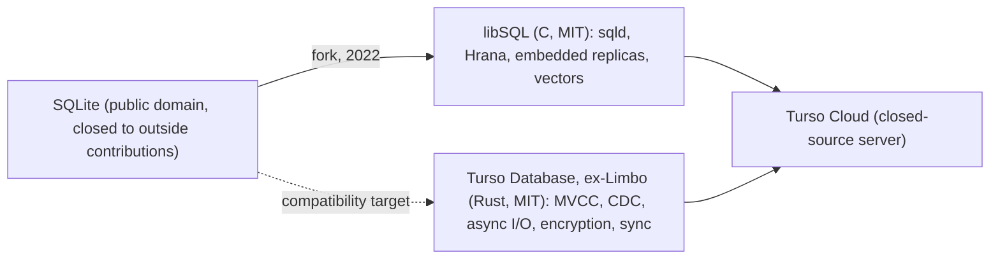

# Module 12: libSQL and Turso

Two different projects share the Turso name, and confusing them causes most of the mistakes people make with them:

1. **libSQL** is an open-contribution **fork of the SQLite C code** (2022). It adds a server (`sqld`), a network protocol, embedded replicas and native vectors. Its SQLite base is **3.45.1**.
2. **Turso Database** (formerly _Limbo_) is a **ground-up rewrite of SQLite in Rust** (announced December 2024, renamed in January 2025). It targets SQLite compatibility (it reports `sqlite_version()` 3.50.4) and adds MVCC concurrent writers, change data capture, local encryption and sync. It is still **0.x**: 0.8.3 is the latest stable (2026-10-12), with 0.9.0-pre.1 released on 2026-10-15.

**Turso Cloud** is the company's hosted platform, which serves both. This module is part of the SQLite track by owner decision, because most of the concepts are SQLite's. It is to be revisited when Turso Database reaches 1.0.

> **Owned elsewhere.** MVCC and optimistic concurrency theory: [data-systems Module 05 § 4](../../../architecture/data-systems/modules/05-transactions-acid-and-isolation-levels.md#4-optimistic-concurrency-control-occ). Replication lag anomalies: [data-systems Module 07 § 3](../../../architecture/data-systems/modules/07-replication-mechanics-and-consensus.md#3-replication-lag-anomalies). Vector ANN (HNSW, DiskANN-style graphs): [data-systems Module 03 § 4](../../../architecture/data-systems/modules/03-indexing-theory-and-vector-search.md#4-vector-search-and-approximate-nearest-neighbors-ann). CDC: [data-systems Module 07 § 4](../../../architecture/data-systems/modules/07-replication-mechanics-and-consensus.md#4-physical-versus-logical-replication-and-change-data-capture-cdc).

Proofs: [`examples/ts/12-libsql-and-turso.test.ts`](../examples/ts/12-libsql-and-turso.test.ts) (11 local tests) and [`examples/ts/integration/embedded-replica.test.ts`](../examples/ts/integration/embedded-replica.test.ts) (needs a remote primary; skips otherwise).

---

## 1. Lineage



| Project | Language, licence | SQLite base | Status (verified 2026-11) |
| --- | --- | --- | --- |
| SQLite | C, public domain | 3.54.1 | upstream |
| libSQL | C fork, MIT | **3.45.1** (proven via `@libsql/client` 0.18.0) | labelled by Turso as "Legacy (libSQL): battle-tested, ORM support", still supported |
| Turso Database | Rust rewrite, MIT | reports **3.50.4** (proven via `@tursodatabase/database` 0.8.3) | 0.x; APIs change between minors |
| Turso Cloud | closed-source server | – | moved to AWS in January 2025; new users lost edge replicas, multi-database schemas and `ATTACH` (per Turso's January 2025 announcement) |

Why fork at all? SQLite does not accept outside contributions ([Module 01 § 1](./01-what-sqlite-is-bindings-and-cli.md#1-formal-definition)), so features such as a network server or vector types cannot be upstreamed. Why rewrite? A fork cannot change SQLite's core architecture (single writer, synchronous I/O, C memory safety) without diverging so far that merging upstream fixes becomes impossible. That is exactly the problem libSQL ran into, as § 2.4 shows.

---

## 2. libSQL

### 2.1 Client, server and protocol

`@libsql/client` speaks to three kinds of target through one API:

| URL | Engine | Transport |
| --- | --- | --- |
| `file:app.db`, `:memory:` | the embedded libSQL library | in-process |
| `libsql://…turso.io`, `https://…` | a remote `sqld` / Turso Cloud | **Hrana** over HTTP or WebSocket |
| `file:replica.db` + `syncUrl` | embedded replica (§ 2.3) | local reads, remote writes |

The API is Promise-based, and statements are sent as `execute()`, `batch()` or interactive `transaction()` calls. Mode names map onto SQLite's transaction types ([Module 05 § 1.1](./05-transactions-locking-and-rollback-journal.md#11-how-the-bindings-expose-transactions)): `'write'` → `BEGIN IMMEDIATE` (proven: a second client gets `SQLITE_BUSY` while the transaction is open), `'read'` → a read-only transaction, `'deferred'` → `BEGIN DEFERRED`. `batch(stmts, 'write')` runs a list in one transaction, so one failing statement rolls back the whole batch (proven). Over the network, a batch is one round trip, which matters far more than it does in-process.

### 2.2 Native vectors

libSQL adds vector column types (`F32_BLOB(n)`, also `F64_BLOB`, `F8_BLOB`, `F1BIT_BLOB`), constructor functions (`vector32('[…]')`), distance functions, and an **approximate nearest-neighbour index based on DiskANN**:

```sql
CREATE TABLE doc(id INTEGER PRIMARY KEY, title TEXT, emb F32_BLOB(3));
CREATE INDEX doc_emb ON doc(libsql_vector_idx(emb));
SELECT d.title
FROM vector_top_k('doc_emb', vector32('[1,0,0]'), 2) AS k
JOIN doc AS d ON d.rowid = k.id;
```

The test finds the two nearest documents through the index, and the exact nearest by `ORDER BY vector_distance_cos(...)`. The negative test shows an SQLite-flavoured trap: `F32_BLOB(3)` is a declared type with **affinity, not enforcement** ([Module 02 § 1.2](./02-type-system-and-schema.md#12-type-affinity-the-five-rules)). A 2-dimensional vector is stored in it without complaint. Only the vector index rejects it ("dimensions are different: 2 != 3"), and distance functions reject mismatched lengths. Validate dimensions in a `CHECK (vector_extract(...) …)` or in code if the column is not indexed.

`vector_top_k` returns **approximate** neighbours (it is an ANN index), and a selective `WHERE` filter applied after the top-k can return fewer rows than asked for: the "recall collapse under filters" problem from [data-systems Module 03 § 6](../../../architecture/data-systems/modules/03-indexing-theory-and-vector-search.md#1-vector-search-recall-collapse-under-selective-relational-filters). Over-fetch (ask for k × 10) and filter, or filter first and use exact distance on the smaller set.

#### Hybrid search and DiskANN indexing options

libSQL enables composite queries joining structured relational filters with vector embeddings:

```sql
-- Hybrid semantic search: relational filtering combined with DiskANN top-k
SELECT d.id, d.title, d.category,
       vector_distance_cos(d.emb, vector32('[0.15, -0.42, 0.88]')) AS cos_dist
FROM vector_top_k('doc_emb', vector32('[0.15, -0.42, 0.88]'), 20) AS k
JOIN doc AS d ON d.rowid = k.id
WHERE d.category = 'engineering'
ORDER BY cos_dist ASC
LIMIT 5;
```

| Vector Parameter | Function / Syntax | Semantic Meaning |
| --- | --- | --- |
| Column Declaration | `emb F32_BLOB(1536)` | Allocates contiguous IEEE 754 32-bit float array matching embedding model dimensions |
| Index Construction | `CREATE INDEX idx ON tbl(libsql_vector_idx(col))` | Builds a Vamana graph on disk with configurable out-degree ($R$) and search list ($L$) |
| Cosine Distance | `vector_distance_cos(v1, v2)` | Computes $1 - \frac{v_1 \cdot v_2}{\|v_1\| \|v_2\|}$; ideal for normalized language model embeddings |
| L2 Euclidean Distance | `vector_distance_l2(v1, v2)` | Computes $\sqrt{\sum (v_{1i} - v_{2i})^2}$ for unnormalized coordinate spaces |

### 2.3 Embedded replicas

An embedded replica is a local libSQL database file kept in sync with a remote primary:

```ts
const db = createClient({
  url: 'file:replica.db',
  syncUrl: 'libsql://<db>-<org>.turso.io',
  authToken: process.env.TURSO_AUTH_TOKEN,
  syncInterval: 60, // seconds between background syncs (optional)
});
await db.sync(); // pull new frames from the primary
```

Semantics, from the Turso documentation: **reads are local; writes are sent to the primary and then reflected back to the replica**. Write transactions are forwarded and cannot run in parallel; read transactions run locally in parallel. Replication is WAL-frame based, the same principle proven in [Module 11 § 3.1](./11-edge-and-distributed-sqlite.md#31-the-principle-proven).

The consequence is the classic replication-lag anomaly. With `readYourWrites: false` (an option in the 0.18 client config), a value written through the primary is invisible to local reads until the next `sync()`. The integration test proves exactly that window against a real primary. The client's `readYourWrites` option exists to make a connection see its own writes after it writes; it does not make _other_ processes' writes visible. Reads of other clients' writes are stale by up to the sync interval.

### 2.4 The cost of the fork: version lag

libSQL's base is 3.45.1 (2024-01). Everything upstream since then is missing, and the test proves a representative sample:

| Missing feature | Upstream version | Proven |
| --- | --- | --- |
| `json_pretty()` | 3.46.0 | yes |
| two-argument `iif()` | 3.48.0 | yes |
| `unistr()` | 3.50.0 | yes |
| `jsonb_each`, `jsonb_tree`, `PRAGMA wal_checkpoint(NOOP)` | 3.51.0 | – |
| `ALTER COLUMN … SET NOT NULL`, `json_array_insert` | 3.53.0 | – |
| `end of month`, `weekday -N`, `%j` / `%J` | 3.54.0 | yes (`NULL`) |
| planner improvements of 3.46–3.54 | various | – |
| **the WAL-reset race fix** | 3.51.3 / 3.53.0 (backports 3.44.6, 3.50.7) | whether libSQL backported it could not be verified |

What libSQL _does_ have, proven: `STRICT` tables (3.37) and JSONB (3.45). The research brief for this track assumed those were missing; they are not. Never assume: assert.

---

## 3. Turso Database

### 3.1 What the rewrite changes

| Area | SQLite | Turso Database 0.8.3 |
| --- | --- | --- |
| Concurrency | one writer ([Module 05](./05-transactions-locking-and-rollback-journal.md), [Module 06](./06-wal-mode.md)) | **MVCC** journal mode with `BEGIN CONCURRENT` (§ 3.2) |
| I/O | synchronous VFS calls | asynchronous I/O (io_uring on Linux) |
| Change capture | session extension (opt-in build) | built-in CDC table (§ 3.3) |
| Encryption | none upstream (SEE, SQLCipher) | local page encryption with AEGIS or AES-GCM ciphers (§ 3.4) |
| Extensions | C loadable extensions, FTS5, R*Tree | its own extension format; **no FTS3/4/5** (proven), no SQLite `.so` loading; vector, UUID, regexp built in |
| Sync | – | Turso Sync push/pull (§ 3.5) |

### 3.2 MVCC and BEGIN CONCURRENT

[Concurrent writes](https://docs.turso.tech/tursodb/concurrent-writes) are enabled per connection and transaction:

```sql
PRAGMA journal_mode = 'mvcc';
BEGIN CONCURRENT;
UPDATE h SET n = n + 1 WHERE id = 2;
COMMIT;
```

The tests prove both halves of the semantics, with two connections on one file:

- **Disjoint rows commit concurrently.** Two `BEGIN CONCURRENT` transactions update rows 1 and 2 and both commit. In SQLite the second writer would have received `SQLITE_BUSY`.
- **Same row: one loses.** The second writer's `UPDATE` fails immediately with a **write-write conflict**, which ends its transaction (an explicit `ROLLBACK` afterwards fails with "no transaction is active"). Retrying the whole transaction succeeds, and the final value counts both increments: no lost update.

This is optimistic concurrency control with row-level conflict detection: transactions proceed without locks and the conflict is detected when two transactions write the same row. Compared with SQLite's design:

|  | SQLite WAL | Turso MVCC |
| --- | --- | --- |
| Writers at once | 1 | many (`BEGIN CONCURRENT`) |
| Conflict granularity | whole database | row |
| Writer waits for writer | yes (busy handler) | no; a conflicting writer fails and retries |
| Hot rows | serialised, no wasted work | repeated conflicts and retries: throughput can collapse below SQLite's |

The last row is the important caveat. MVCC helps workloads whose writes are spread over many rows. A counter that every request increments is faster under SQLite's plain serialisation than under optimistic retries.

The 0.8.0 release notes include a change to "stop calling MVCC experimental". Other features still sit behind an `experimental` option list in the JavaScript binding's types (for example `encryption`), so check per feature.

#### Production transaction retry loop for MVCC write-write conflicts

Because optimistic concurrency fails fast upon detecting intersecting row mutations, application drivers must wrap `BEGIN CONCURRENT` in a bounded retry harness with randomized exponential backoff:

```ts
// mvcc-retry.ts - Resilient retry harness for Turso concurrent write transactions
export async function withMvccRetry<T>(
  db: any,
  operation: (txDb: any) => Promise<T>,
  maxRetries = 5,
): Promise<T> {
  for (let attempt = 0; attempt < maxRetries; attempt++) {
    try {
      db.exec('BEGIN CONCURRENT');
      const result = await operation(db);
      db.exec('COMMIT');
      return result;
    } catch (err: any) {
      if (db.inTransaction) {
        try {
          db.exec('ROLLBACK');
        } catch {}
      }
      const isConflict = err.message?.includes('conflict') || err.message?.includes('busy');
      if (!isConflict || attempt === maxRetries - 1) throw err;
      // Randomized exponential backoff with jitter to disperse contending writers
      const delayMs = Math.min(100, Math.floor(Math.random() * (2 ** attempt * 10)));
      await new Promise((resolve) => setTimeout(resolve, delayMs));
    }
  }
  throw new Error('Transaction exceeded maximum retry threshold');
}
```

### 3.3 Change data capture

```sql
PRAGMA capture_data_changes_conn('full');
```

After this, every change on the connection is appended to the `turso_cdc` table, with a change id, time, transaction id, change type (1 insert, 0 update, −1 delete, proven in that order), table name, row id, and before/after images in `full` mode. It is the built-in equivalent of the session extension ([Module 10 § 6](./10-durability-backup-and-operations.md#6-sessions-and-changesets)) and of a trigger-based audit table, and it feeds sync and downstream consumers. As with any CDC table, someone must consume and trim it, or it grows forever.

### 3.4 Encryption at rest

With `experimental: ['encryption']` and an `encryption: { cipher, hexkey }` option, Turso Database encrypts pages locally. The test proves that the file contains no plaintext and no `SQLite format 3` header, that opening it without the key fails with "not a database", and that the right key reads it back. Key management is the application's problem: a lost key is a lost database, and a key in source code is no protection. Turso Cloud additionally offers encryption on the server side (details out of scope).

### 3.5 Turso Sync

`@tursodatabase/sync` provides **local-first** databases: every device writes locally, `push()` sends local changes to Turso Cloud, and `pull()` fetches remote changes. The [usage docs](https://docs.turso.tech/sync/usage) state the conflict strategy as **"last push wins"**, and that pushes send logical statements. The documented usage requires a Turso Cloud account, so it is not proven here.

|           | libSQL embedded replica                      | Turso Sync                         |
| --------- | -------------------------------------------- | ---------------------------------- |
| Writes    | forwarded to the primary (need connectivity) | local, offline-capable             |
| Reads     | local, stale until `sync()`                  | local                              |
| Conflicts | none (single primary)                        | last push wins                     |
| Fits      | read-heavy edge caches                       | offline-first apps that accept LWW |

Last-push-wins means a concurrent edit can silently overwrite another. For data where that is unacceptable (counters, inventories, balances), use server-side operations, CRDTs ([Module 11 § 4](./11-edge-and-distributed-sqlite.md#4-litefs-rqlite-and-cr-sqlite)), or application-level conflict handling.

### 3.6 Compatibility matrix

From Turso's [COMPAT.md](https://github.com/tursodatabase/turso/blob/main/COMPAT.md) (read 2026-11-04), with this track's own observations where tested:

| Feature | Turso Database 0.8.x |
| --- | --- |
| STRICT tables, views, triggers, ATTACH, savepoints | supported (`INSTEAD OF` triggers on views: no) |
| `WITH RECURSIVE` | listed as not supported in COMPAT.md, but a simple recursive CTE ran in this track's probe; treat as partial |
| Window functions | partial: no `ntile`, `percent_rank`, `cume_dist`, `lag`, `lead` per COMPAT.md; custom frames unsupported |
| Generated columns | partial (virtual only, behind a flag) |
| `WITHOUT ROWID` | partial (behind a flag, effectively insert-only) |
| `VACUUM` | `VACUUM INTO` yes; in-place `VACUUM` experimental |
| Aggregate `FILTER (WHERE …)` | no |
| FTS3/4/5 | no (proven); Turso has its own `USING fts` index |
| SQLite loadable extensions, virtual tables, backup API, user-defined functions from the C API | no |
| Pragmas | many missing, including `optimize`, `wal_autocheckpoint`, `journal_size_limit`, `mmap_size` |
| Mixed SQLite and Turso processes on one file | not supported |
| DQS misfeature | still accepted ([Module 01](./01-what-sqlite-is-bindings-and-cli.md#4-compile-time-defaults-the-hidden-configuration), proven) |

ORM integration (Drizzle, Prisma) still goes through `@libsql/client` or a compatibility package, according to Turso's documentation at the time of the research brief.

---

## 4. Decision guide

| Need | Choose |
| --- | --- |
| One server, one writer process, backups with PITR | **plain SQLite + Litestream** ([Module 11](./11-edge-and-distributed-sqlite.md)) |
| Read-heavy app on many edge nodes, writes can go to one primary | libSQL embedded replicas (Turso Cloud or self-hosted `sqld`) |
| Offline-first clients that write locally and tolerate last-write-wins | Turso Sync |
| Many concurrent writers on _different_ rows in one database, on one host | Turso Database with MVCC (accepting 0.x maturity) |
| Cloudflare Workers | D1 or Durable Objects ([Module 11 § 5](./11-edge-and-distributed-sqlite.md#5-sqlite-on-edge-platforms)) |
| Strong consistency across hosts, rich access control, or long write transactions | PostgreSQL ([Module 11 § 6](./11-edge-and-distributed-sqlite.md#6-when-to-graduate-to-postgresql)) |
| The newest SQLite features and fixes, FTS5, extensions | upstream SQLite (better-sqlite3, `node:sqlite`, WASM) |

---

## 5. Version history for practitioners

The major SQLite releases this track refers to, in one table. Use it to judge what an old binding, or libSQL's 3.45.1 base, can do.

| Version | Date | Practitioner-relevant change |
| --- | --- | --- |
| 3.6.19 | 2009-10 | Foreign key enforcement (off by default ever since) |
| 3.7.0 | 2010-07 | **WAL mode** |
| 3.8.0 | 2013-08 | Next-Generation Query Planner |
| 3.9.0 | 2015-10 | FTS5; JSON1 extension |
| 3.12.0 | 2016-03 | Default page size 4096 |
| 3.24.0 | 2018-06 | UPSERT |
| 3.25.0 | 2018-09 | Window functions; `RENAME COLUMN` |
| 3.27.0 | 2019-02 | `VACUUM INTO` |
| 3.31.0 | 2020-01 | Generated columns |
| 3.32.0 | 2020-05 | `SQLITE_MAX_VARIABLE_NUMBER` default 999 → 32766 |
| 3.35.0 | 2021-03 | `RETURNING`, `DROP COLUMN`, `MATERIALIZED` CTEs |
| 3.37.0 | 2021-11 | **STRICT tables** |
| 3.38.0 | 2022-02 | JSON built in; `->`/`->>`; Bloom filters |
| 3.39.0 | 2022-06 | `RIGHT`/`FULL OUTER JOIN` |
| 3.40.0 | 2022-11 | Official WASM build |
| 3.45.0 | 2024-01 | **JSONB**; max page count default 4294967294 (libSQL's base is 3.45.1) |
| 3.46.0 | 2024-05 | `PRAGMA optimize` improvements; `json_pretty` |
| 3.48.0 | 2025-01 | two-argument `iif()` |
| 3.50.0 | 2025-05 | `unistr()`; `sqlite3_setlk_timeout()` |
| 3.51.0 | 2025-11 | `jsonb_each`/`jsonb_tree`; STRICT checks on generated columns; `wal_checkpoint(NOOP)` |
| 3.51.3 | 2026-03-13 | **WAL-reset bug fixed** (present since 3.7.0) |
| 3.52.0 | 2026-03-06 | **Withdrawn** (backward-incompatibility with some expression indexes) |
| 3.53.0 | 2026-04-09 | Re-release of 3.52 features with fixes; `SET`/`DROP NOT NULL`; `REINDEX EXPRESSIONS` |
| 3.54.0 | 2026-10-09 | `end of`, `weekday -N`; `%j`/`%J`; `SQLITE_LIMIT_SCHEMA`; `.diskused`; ~4 % faster |
| 3.54.1 | 2026-10-16 | Fixes a heap overflow on some 32-bit builds |

---

## Then vs now: classic SQLite vs libSQL and Turso

The evolution from single-machine SQLite to libSQL and the Turso Rust rewrite transforms an in-process embedded engine into a globally distributed edge database with concurrent writing:

| Architecture Dimension | Classic Local-File SQLite (Then) | libSQL / `sqld` Hrana Protocol (Now) | Turso Database Rust Rewrite (Now) |
| --- | --- | --- | --- |
| Transport & Wire Protocol | In-process C FFI; no network daemon; remote access requires custom wrappers or SSH | Hrana protocol (v2/v3) over WebSocket and HTTP; stream pipelines with baton tokens | Native async TCP/TLS server; Hrana compatibility; embedded Rust driver |
| Transaction Execution Model | Synchronous thread-bound execution; POSIX file locking; one writer across host | Interactive transactions via Hrana streams; baton-bound pipelines; server-side connection pinning | Optimistic MVCC; page-level and row-level conflict detection via `BEGIN CONCURRENT` |
| Edge Read Replication | Manual file copy; rsync; custom SQLite session changesets | Embedded replicas: local SQLite file pulls WAL frames via `sync()` or background `syncInterval` | Local and remote vector replication; peer-to-peer sync engine with frame generation tokens |
| Read-Your-Writes Guarantees | Local-only; custom application fencing for distributed sync | Monotonic frame tracking via `readYourWrites: true`; client connection awaits primary WAL frame propagation | In-engine MVCC snapshot bookmarks and generation vectors |
| Vector & Similarity Search | None in core; requires third-party extension (`sqlite-vec`, `vec0` virtual table, brute force) | Native `F32_BLOB` column type; DiskANN-based Approximate Nearest Neighbor (`libsql_vector_idx`) | Native vector storage; integrated cosine and L2 distance search |
| Concurrency & Writer Scalability | Strict single-writer limit; file-level WAL write lock serializes all mutations | Single primary writer at `sqld` server; embedded replicas forward mutating requests | Concurrent non-conflicting writers on distinct rows/pages; lock-free read transactions |

### Hrana protocol, stream pipelines, and baton tokens

In classic SQLite, executing a transaction over a network boundary required keeping a stateful TCP connection or worker thread open on the server throughout the transaction lifetime. If an HTTP client paused between `BEGIN` and `COMMIT`, database locks were held hostage, stalling other clients.

The libSQL **Hrana protocol** solves this over stateless HTTP and multiplexed WebSockets using stream pipelines and baton tokens:

- **Baton session tokens**: When opening an interactive transaction over HTTP, `sqld` returns an ephemeral string token called a `baton`. The client passes this baton in subsequent requests (`POST /v2/pipeline`), binding each statement to the same server-side SQLite transaction context.
- **Pipelined execution**: Instead of issuing round-trips for each individual statement, the client batches statements into a single pipeline payload (`[BEGIN, INSERT, UPDATE, COMMIT]`), eliminating intermediate network latency.
- **Automatic timeout and cleanup**: If a client disconnects or crashes mid-transaction, `sqld` expires the baton after a configured timeout (e.g. 5–10 seconds) and automatically executes a rollback, preventing orphaned write locks.

```ts
// hrana-transaction.ts - Pipelined interactive transaction via @libsql/client
import { createClient } from '@libsql/client';

const client = createClient({
  url: 'https://database.turso.io',
  authToken: process.env.TURSO_AUTH_TOKEN,
});

// Interactive transaction using Hrana streams and baton tokens under the hood
const tx = await client.transaction('write');
try {
  await tx.execute({
    sql: 'UPDATE accounts SET balance = balance - ? WHERE id = ?',
    args: [100, 1],
  });
  await tx.execute({
    sql: 'UPDATE accounts SET balance = balance + ? WHERE id = ?',
    args: [100, 2],
  });
  await tx.commit();
} catch (err) {
  await tx.rollback();
  throw err;
}
```

### Embedded replicas and monotonic read-your-writes tracking

In classic architectures, distributed replicas required heavy client/server replication stacks. libSQL embedded replicas bring the database file directly to the application host while offloading writes:

- **Local read latency**: Reads query the local disk file directly via SQLite B-tree lookups without network hops ($< 1\text{ ms}$).
- **Automatic write forwarding**: Any mutating statement (`INSERT`, `UPDATE`, `DELETE`) is automatically forwarded to the primary `sqld` instance over Hrana.
- **Monotonic frame tracking (`readYourWrites`)**: A common replication pitfall is the read-your-writes violation: a client writes to the primary, but its immediate subsequent read hits a local replica that has not yet pulled the resulting WAL frame. When `readYourWrites: true` is configured, the client tracks the monotonic frame index returned by the primary write, and local reads automatically await replica frame synchronization before serving queries.

```ts
// embedded-replica.ts - Initializing an embedded replica with monotonic frame synchronization
import { createClient } from '@libsql/client';

const client = createClient({
  url: 'file:/var/lib/app/local-replica.db',
  syncUrl: 'https://primary-db.turso.io',
  authToken: process.env.TURSO_AUTH_TOKEN,
  syncInterval: 60000, // Background sync every 60 seconds
  readYourWrites: true, // Guarantees local queries observe own committed mutations
});

// Synchronize local replica with primary WAL frames on startup
await client.sync();
```

### Native F32_BLOB and DiskANN vector indexes

While upstream SQLite requires virtual table extensions (such as `sqlite-vec` or custom C modules) for vector embeddings, libSQL integrates vector primitives directly into the core engine:

- **`F32_BLOB(dimension)`**: Declares a column storing dense 32-bit floating point vectors as compact contiguous byte arrays.
- **DiskANN vector indexing**: Using `CREATE INDEX idx ON tbl(libsql_vector_idx(col))`, libSQL builds a DiskANN approximate nearest neighbor graph index directly within database pages, enabling logarithmic seek times over million-vector datasets.
- **Vector search**: Lookups use `vector_top_k('idx_name', vector('[0.1, 0.2, ...]'), k)` joined back to table rowids.

### Turso Database Rust rewrite: BEGIN CONCURRENT MVCC vs SQLite WAL single-writer

The central constraint of classic SQLite is that WAL mode permits **strictly one writer at a time across the entire database**:

- If Transaction A updates row 1 of table `users`, and Transaction B updates row 100 of table `orders`, Transaction B must block until Transaction A completes its commit and releases the write lock.
- Turso Database (formerly Limbo) replaces SQLite's single-writer pager with a multi-version concurrency control (MVCC) engine:
  - Transactions start with `BEGIN CONCURRENT`, executing reads and writes against a private transaction snapshot.
  - Conflicts are tracked at page and row granularity. If Transactions A and B modify disjoint rows on different pages, both commit in parallel without blocking.
  - If both transactions attempt to mutate the same row, a write-write conflict is triggered at commit time. The second committing transaction fails fast with a serialization conflict, allowing the application to retry cleanly.

---

## 6. Production failure modes

1. **Confusing libSQL with Turso Database**: different engines, different features, different maturity.
2. **Assuming upstream features in libSQL**: everything after 3.45.1 is missing, and some of it fails silently (date modifiers return `NULL`). Proven.
3. **Read-your-writes violations on embedded replicas** for writes made by other clients. Proven in the integration test.
4. **Unvalidated vector dimensions** in unindexed `F32_BLOB` columns. Proven.
5. **MVCC on hot rows**: conflict-and-retry storms that are slower than SQLite's serial writes.
6. **Not retrying conflicts**, or retrying only the failed statement instead of the whole transaction. Proven: the transaction is already gone.
7. **Last-push-wins sync used for data that needs merging.**
8. **Following pre-2025 tutorials** that use deprecated Turso Cloud features (edge replicas, multi-database schemas, `ATTACH`).
9. **Unpinned 0.x dependencies**: APIs change between minors. This track pins exact versions.
10. **Encrypted databases with keys in code**, or lost keys.

---

## Interview Drill

<details><summary>1. What is the difference between libSQL and Turso Database?</summary>

libSQL is a fork of the SQLite C code (base 3.45.1) that adds a server (`sqld`), the Hrana network protocol, embedded replicas and native vector search. Turso Database is a new implementation of SQLite in Rust (formerly Limbo), still 0.x, that targets compatibility and adds MVCC concurrent writes, built-in CDC, async I/O, local encryption and sync. Turso Cloud hosts both.
</details>

<details><summary>2. How do embedded replicas work, and what consistency do they give?</summary>

The replica is a local database file that pulls WAL frames from a remote primary on `sync()` or on a `syncInterval`. Reads are served locally; writes are forwarded to the primary and then reflected back. Readers therefore see data that is stale by up to the sync interval, which is a read-your-writes and monotonic-read hazard for writes made elsewhere. The client's `readYourWrites` option only covers the connection's own writes.
</details>

<details><summary>3. Explain <code>BEGIN CONCURRENT</code> in Turso and when it is slower than SQLite.</summary>

With `journal_mode = 'mvcc'`, several connections can run `BEGIN CONCURRENT` transactions at once. Conflicts are detected at row level: if two transactions write the same row, one gets a write-write conflict, its transaction ends, and the application must retry it from the beginning. Disjoint writes commit in parallel. For contended rows, such as a global counter, transactions keep conflicting and redoing work, and plain serialised writes (SQLite) are faster.
</details>

<details><summary>4. Your app works on better-sqlite3 but returns NULL dates on Turso Cloud via libSQL. Why?</summary>

libSQL is based on SQLite 3.45.1. Newer date modifiers such as `end of month` (3.54) are unknown there, and SQLite's date functions return NULL for unknown modifiers instead of raising an error. Check `sqlite_version()` on every backend, and use portable idioms or upgrade the engine.
</details>

<details><summary>5. libSQL's vector index: how is it used and what are its pitfalls?</summary>

Declare a vector column (`F32_BLOB(n)`), create an index with `libsql_vector_idx(column)` (DiskANN-based ANN), and query with `vector_top_k(index, query_vector, k)` joined back to the table by rowid. Pitfalls: results are approximate; filtering after top-k can return too few rows; and the column type does not enforce the dimension unless the column is indexed.
</details>

<details><summary>6. How do you choose between Litestream, libSQL embedded replicas, Turso Sync and PostgreSQL?</summary>

Litestream: one writer on one host and you want continuous backups with PITR. Embedded replicas: read-heavy, globally distributed reads with writes funnelled to one primary. Turso Sync: offline-first clients that write locally and accept last-push-wins. PostgreSQL: several hosts must write the same data with strong consistency, or you need long transactions, roles and server-side features.
</details>

<details><summary>7. What does Turso Database not support that a SQLite user may rely on?</summary>

FTS3/4/5 and other SQLite C extensions, virtual tables and user-defined functions through the C API, the backup API, several window functions and aggregate `FILTER`, full `WITHOUT ROWID` and generated-column support, and many pragmas (`optimize`, `wal_autocheckpoint`, `mmap_size`, …). It also does not support mixing SQLite and Turso processes on the same file. Check its COMPAT.md for the version you pin.
</details>
