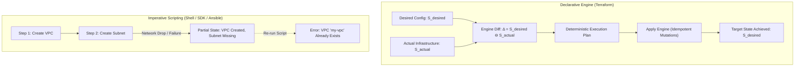
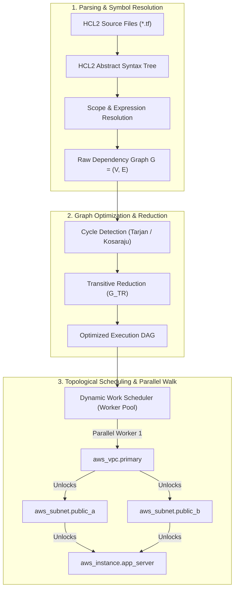
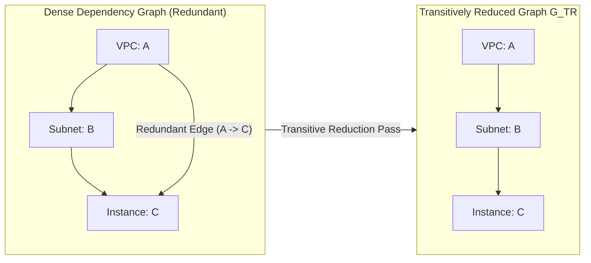
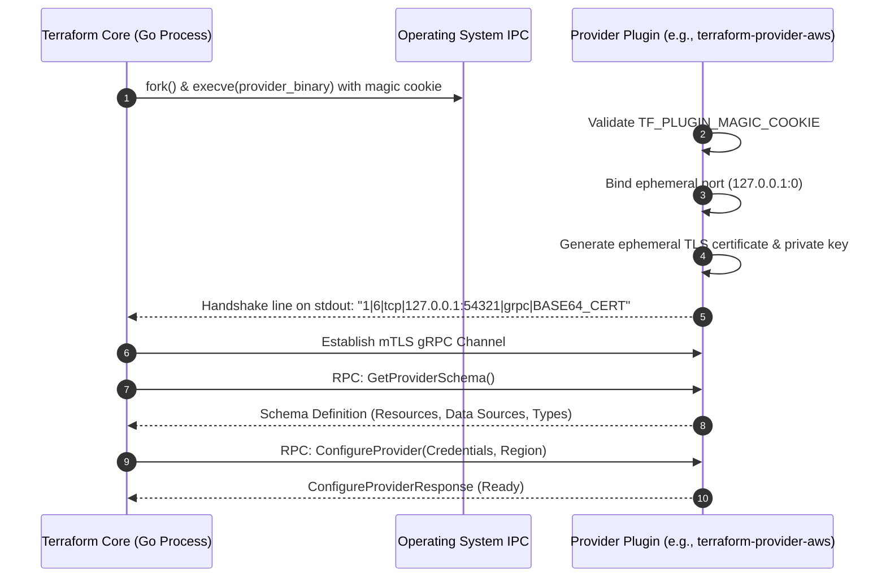

# Module 01: Infrastructure as Code and the Terraform Execution Model: DAGs, Providers, and Ecosystem Comparison

Welcome to **Module 01** of the Terraform curriculum. This module establishes the formal mathematical, algorithmic, and systems engineering foundations of Infrastructure as Code (IaC) and the Terraform execution engine. We examine declarative convergence versus imperative orchestration through fixed-point algebra, dissect the Directed Acyclic Graph (DAG) construction, cycle detection, and transitive reduction algorithms that power Terraform's planning and application phases, analyze the out-of-process gRPC provider plugin architecture, and evaluate the trade-offs of modern IaC engines including HashiCorp Terraform, OpenTofu, Pulumi, AWS CloudFormation, and Kubernetes Crossplane.

---

## 1. Core Terminology & Formal Mathematical Definitions

- **Infrastructure as Code (IaC)**: The software engineering discipline of specifying, provisioning, configuring, and lifecycle-managing cloud and on-premises computing infrastructure through declarative or imperative machine-readable artifacts, managed in version-controlled repositories and processed via automated validation and execution pipelines.
- **Declarative Configuration Model**: An execution paradigm wherein the practitioner declares the desired terminal state $S_{\text{desired}}$ of an infrastructure system without dictating the procedural operational sequence. The underlying engine computes an execution delta $\Delta = S_{\text{desired}} \ominus S_{\text{actual}}$ and executes an ordered plan to achieve convergence: $$\lim_{t \to \infty} S_t = S_{\text{desired}}$$
- **Imperative Orchestration Model**: An operational paradigm wherein the practitioner scripts sequential state mutations $S_{k} = f_k(S_{k-1})$. In the absence of strict end-to-end idempotency, transient failures at step $j < n$ leave the system in an intermediate, undocumented state $S_j$ that cannot be safely re-executed without side effects.
- **Fixed-Point Convergence**: The algebraic property ensuring that applying the reconciliation function $R$ to the terminal state yields no further mutations: $$R(S_{\text{desired}}) = S_{\text{desired}}$$
- **Directed Acyclic Graph (DAG)**: A finite directed graph $G = (V, E)$ consisting of a set of vertices $V$ and directed edges $E \subseteq V \times V$, containing no directed cycles ($v_0 \to v_1 \to \dots \to v_k \to v_0$). In Terraform, vertices represent configuration blocks, resources, modules, and providers, while directed edges represent semantic dependency relationships.
- **Transitive Reduction**: For any finite DAG $G = (V, E)$, the transitive reduction $G_{\text{TR}} = (V, E_{\text{TR}})$ is the unique graph with minimal cardinality $|E_{\text{TR}}|$ such that the reflexive and transitive closure of $G_{\text{TR}}$ equals that of $G$: $$G_{\text{TR}}^+ = G^+$$ Transitive reduction eliminates redundant operational edges, maximizing concurrent execution during graph walks.
- **Topological Sorting**: A linear ordering of all vertices in a DAG such that for every directed edge $(u, v) \in E$, vertex $u$ precedes vertex $v$ in the sequence. A valid topological sort exists if and only if the graph contains no directed cycles.
- **Provider Plugin**: An independent compiled binary executing in a separate operating system process that interfaces with Terraform Core over an inter-process communication (IPC) channel via gRPC, encapsulating cloud API bindings, schema definitions, and resource reconciliation logic.
- **Tri-State Reconciliation Triad**: The three representations of reality reconciled by Terraform during every operational cycle:
  1. _Desired Configuration State ($S\_{\text{desired}}$)_: The declarative HCL files stored on disk.
  2. _Recorded State ($S\_{\text{state}}$)_: The persisted JSON metadata file (`.tfstate`) representing the engine's last known view of managed resources.
  3. _Actual Cloud State ($S\_{\text{actual}}$)_: The live attributes returned by cloud provider APIs via read queries.

---

## 2. Declarative Convergence vs. Imperative Orchestration

The core architectural justification for Terraform lies in the formal mathematical properties of declarative convergence.



### Algebraic Comparison of State Models

Let $\mathcal{S}$ denote the state space of an infrastructure environment. Let $\mathcal{O}$ denote the set of operational mutations exposed by cloud provider APIs.

In an imperative workflow, an automation script is an ordered tuple of operations:

$$P = \langle o_1, o_2, \dots, o_n \rangle, \quad o_i \in \mathcal{O}$$

The state transition path is path-dependent:

$$S_k = o_k(o_{k-1}(\dots o_1(S_0)\dots))$$

If operation $o_m$ aborts (e.g., due to an AWS service quota error or an HTTP 503 gateway timeout), the system remains stranded in state $S_{m-1}$. The operator must manually inspect the infrastructure to determine which resources were provisioned, write corrective scripts, or manually delete partial resources before re-attempting execution.

In Terraform's declarative model, the user provides a total specification $S_{\text{desired}}$. The execution engine evaluates:

$$\Delta(t) = S_{\text{desired}} \ominus S_{\text{actual}}(t)$$

The plan step produces an ordered set of discrete actions $A = \{a_1, a_2, \dots, a_m\}$ where each action $a_i \in \{\text{Create}, \text{Read}, \text{Update}, \text{Delete}, \text{NoOp}\}$. The application of $A$ satisfies confluence: regardless of minor variations in network latency or execution ordering among independent nodes, the target state converges deterministically to $S_{\text{desired}}$.

---

## 3. The Terraform Execution Model & Graph Theory

Terraform models infrastructure dependencies as a Directed Acyclic Graph. Rather than evaluating configuration files line by line or file by file, Terraform merges all `.tf` files in a directory into a unified Abstract Syntax Tree (AST), extracts resource symbols, derives dependency edges, and builds a comprehensive graph.

For formal graph data structures, topological sort algorithms, and complexity analyses, see [`algorithms/dsa/README.md`](../../../algorithms/dsa/README.md).



### Graph Vertex Anatomy

Vertices in the Terraform execution graph are not limited to physical cloud resources. The graph engine instantiates typed vertices representing every operational phase and boundary:

- `NodeValidatableResource`: Performs schema validation against provider constraints before state refresh or planning.
- `NodeApplyableResource`: Manages resource lifecycle transitions (Create, In-Place Update, Destroy-Before-Create, Create-Before-Destroy).
- `NodeApplyableDataResource`: Manages data source queries. If all arguments are known at plan time, data sources evaluate during the plan phase; if arguments depend on computed resource outputs, evaluation is deferred to the apply phase.
- `NodeApplyableProvider`: Configures provider instances with credentials, endpoints, and region parameters. All resource instances associated with a provider maintain an implicit directed edge pointing to their respective provider configuration vertex.
- `NodeApplyableOutput`: Computes root module and child module output expressions once all referenced resources have reached terminal states.
- `NodeDestroyResource`: Evaluates destruction ordering during teardown operations, inverting the normal dependency arrows so dependencies are destroyed in strict reverse order.

### Deriving Dependencies: Implicit vs. Explicit

Dependency edges determine the scheduling boundaries of the worker pool.

#### Implicit Dependencies

Implicit dependencies are automatically inferred by the HCL expression engine during AST traversal. When an expression inside resource $B$ references an attribute of resource $A$ (e.g., `subnet_id = aws_subnet.primary.id`), the compiler extracts the referenced identifier and inserts a directed edge into the adjacency list:

$$e = (\text{aws-subnet.primary}, \text{aws-instance.web}) \in E$$

This guarantees that `aws_subnet.primary` reaches a finalized state with an assigned subnet ID before `aws_instance.web` initiates its provisioning call.

#### Explicit Dependencies

Explicit dependencies are declared using the `depends_on` meta-argument. Explicit edges are mandatory when an ordering dependency exists at the infrastructure or application layer that is not expressed via attribute data flow.

```hcl
resource "aws_iam_role_policy_attachment" "cluster_admin" {
  role       = aws_iam_role.cluster.name
  policy_arn = "arn:aws:iam::aws:policy/AdministratorAccess"
}

resource "aws_eks_cluster" "main" {
  name     = "production-cluster"
  role_arn = aws_iam_role.cluster.arn

  # Explicit edge: EKS API returns 400 if the role lacks permissions upon cluster creation
  depends_on = [
    aws_iam_role_policy_attachment.cluster_admin
  ]
}
```

### Transitive Reduction Mechanics

In complex architectures, redundant edges naturally accumulate. If resource $A$ provisions a VPC, resource $B$ provisions a subnet within that VPC, and resource $C$ places an EC2 instance in that subnet while explicitly declaring `depends_on = [aws_vpc.main]`, the graph contains edges:

$$E_{\text{raw}} = \{(A, B), (B, C), (A, C)\}$$

The edge $(A, C)$ is mathematically redundant because reachability from $A$ to $C$ is already satisfied via path $\langle A, B, C \rangle$. Retaining redundant edges in the graph engine creates artificial constraints on dynamic scheduler queues and consumes memory.



### CLRS-Style Transitive Reduction Algorithm

The following algorithm formally specifies the transitive reduction process executed by Terraform Core prior to initiating a graph walk.

```text
ALGORITHM: TRANSITIVE-REDUCTION(V, E)
INPUT: A Directed Acyclic Graph G = (V, E) where V is the set of graph vertices and E is the set of directed dependency edges.
OUTPUT: A transitively reduced DAG G_TR = (V, E_TR) containing the minimum edge set preserving identical reachability.

PRECONDITIONS:
  1. G is a finite graph: |V| < infinity and |E| < infinity.
  2. G is strictly acyclic: For all v in V, there is no non-empty path v -> ... -> v.

1. Let E_TR = copy(E)
2. Let N = |V|
3. Let Reachable be an N x N boolean matrix initialized to FALSE
4. Let Dist be an N x N integer matrix initialized to infinity

5. FOR EACH v_i in V:
6.     Dist[i][i] = 0
7.     Reachable[i][i] = TRUE

8. FOR EACH edge (v_i, v_j) in E:
9.     Dist[i][j] = 1
10.    Reachable[i][j] = TRUE

// Phase 1: Compute transitive closure and longest path lengths using dynamic programming
11. FOR EACH k FROM 1 TO N:
12.    LOOP INVARIANT: At the start of iteration k, Dist[i][j] represents the length of the longest
                      directed path from v_i to v_j using intermediate vertices strictly from {v_1, ..., v_k-1}.
13.    FOR EACH i FROM 1 TO N:
14.        FOR EACH j FROM 1 TO N:
15.            IF Reachable[i][k] AND Reachable[k][j]:
16.                Reachable[i][j] = TRUE
17.                IF Dist[i][k] + Dist[k][j] > Dist[i][j]:
18.                    Dist[i][j] = Dist[i][k] + Dist[k][j]

// Phase 2: Eliminate redundant edges where alternative longer paths exist
19. FOR EACH edge (v_i, v_j) in E:
20.    LOOP INVARIANT: For every edge (v_u, v_w) processed prior to current step, (v_u, v_w) is retained in
                      E_TR if and only if no directed path of edge length >= 2 exists from v_u to v_w in G.
21.    FOR EACH m FROM 1 TO N:
22.        IF m != i AND m != j:
23.            IF Reachable[i][m] AND Reachable[m][j]:
24.                // A path of length >= 2 exists through intermediate vertex v_m
25.                E_TR = E_TR \ {(v_i, v_j)}
26.                BREAK

POSTCONDITIONS:
  1. For all v_a, v_b in V, a directed path exists from v_a to v_b in G_TR if and only if a directed path exists in G.
  2. No edge e in E_TR can be removed without altering the reachability relation of G_TR.
  3. |E_TR| <= |E|.
27. RETURN (V, E_TR)
```

### Concurrent Graph Walk Scheduling

Once transitively reduced, graph execution proceeds via a parallel worker pool. The scheduler maintains an in-degree counter for every vertex $v \in V$:

$$\text{in-degree}(v) = |\{u \in V \mid (u, v) \in E_{\text{TR}}\}|$$

1. **Initial Frontier**: All vertices with $\text{in-degree}(v) = 0$ (leaf nodes with no unmet dependencies) are enqueued into a thread-safe task channel.
2. **Worker Execution**: A pool of $W$ concurrent workers (governed by `-parallelism=N`, default 10) dequeues vertices and calls the appropriate provider RPC method.
3. **Cascading Release**: Upon successful completion of vertex $u$, the worker atomically decrements the in-degree of all adjacent successor vertices: $$\forall w \in \text{Adj}[u]: \quad \text{in-degree}(w) \leftarrow \text{in-degree}(w) - 1$$ If any successor's in-degree reaches 0, it is immediately enqueued into the runnable work queue.
4. **Error Propagation**: If an operation fails, the worker marks vertex $u$ as failed. Downstream dependent vertices are canceled and skipped, while independent subgraphs continue execution unaffected.

---

## 4. Provider Plugin Architecture & The gRPC Wire Protocol

A fundamental architectural principle of Terraform is the clean decoupling between **Terraform Core** and **Terraform Providers**. Terraform Core possesses no knowledge of cloud APIs, authentication mechanisms, or vendor rate limits. Core is strictly an orchestrator of state, HCL evaluation, and graph algorithms.

Providers are standalone, compiled executables running out-of-process. Communication occurs across an inter-process communication (IPC) boundary using gRPC over local loopback sockets or Unix domain sockets.



### The Magic Cookie Handshake

To prevent accidental interactive execution from a user's terminal, every provider binary compiled with the HashiCorp plugin framework checks its environment for a secret handshake token upon startup:

```go
const HandshakeConfig = plugin.HandshakeConfig{
    MagicCookieKey:   "TF_PLUGIN_MAGIC_COOKIE",
    MagicCookieValue: "d302bf78242d7076527e4039d494084f634e702f3226c4447e7b329794518176",
}
```

If the binary is launched directly without this environment variable, it outputs a human-readable diagnostic message explaining that it is a plugin and terminates with exit code 1.

### Ephemeral mTLS Negotiation

When spawned by Terraform Core:

1. The provider generates an ephemeral, self-signed X.509 certificate and private key in memory.
2. The provider binds to an unallocated loopback port on `127.0.0.1` (or creates a Unix domain socket under `/tmp` on Unix-like operating systems).
3. The provider outputs a formatted pipe-delimited handshake string to standard output (e.g. `1|6|tcp|127.0.0.1:52184|grpc|LS0tLS1CRUdJTi...`). The components denote `CoreProtocolVersion | AppProtocolVersion | NetworkType | Address | RPCProtocol | Base64EncodedTLSCertificate`.
4. Terraform Core parses this single line from the child's `stdout`, configures its internal gRPC dialer with the provided certificate, and establishes an encrypted mutual TLS session. This prevents local unprivileged users from intercepting sensitive infrastructure payloads on shared host systems.

### Protocol Buffers Interface (`tfplugin6.proto`)

Modern Terraform providers implement **Plugin Protocol v6**. The primary gRPC service interface defines the lifecycle operations:

```protobuf
syntax = "proto3";
package tfplugin6;

service Provider {
  rpc GetProviderSchema(GetProviderSchema.Request) returns (GetProviderSchema.Response);
  rpc ValidateProviderConfig(ValidateProviderConfig.Request) returns (ValidateProviderConfig.Response);
  rpc ValidateResourceConfig(ValidateResourceConfig.Request) returns (ValidateResourceConfig.Response);
  rpc ValidateDataResourceConfig(ValidateDataResourceConfig.Request) returns (ValidateDataResourceConfig.Response);
  rpc UpgradeResourceState(UpgradeResourceState.Request) returns (UpgradeResourceState.Response);
  rpc ConfigureProvider(ConfigureProvider.Request) returns (ConfigureProvider.Response);
  rpc ReadResource(ReadResource.Request) returns (ReadResource.Response);
  rpc PlanResourceChange(PlanResourceChange.Request) returns (PlanResourceChange.Response);
  rpc ApplyResourceChange(ApplyResourceChange.Request) returns (ApplyResourceChange.Response);
  rpc ImportResourceState(ImportResourceState.Request) returns (ImportResourceState.Response);
  rpc ReadDataSource(ReadDataSource.Request) returns (ReadDataSource.Response);
}
```

During the `PlanResourceChange` RPC call, Core transmits:

- `prior_state`: The resource attributes currently recorded in the state file.
- `proposed_new_state`: The desired attributes parsed from the HCL configuration.
- `provider_meta`: Optional global metadata.

The provider returns `planned_state`, in which dynamically assigned attributes (such as an AWS EC2 instance ID or an ARN) are represented as unknown values (`cty.UnknownVal`). During `ApplyResourceChange`, the provider receives `planned_state` and executes the physical cloud API calls, returning the final `new_state` populated with concrete values.

---

## 5. Comprehensive Comparative Ecosystem Analysis

Selecting an infrastructure provisioning platform requires evaluating programming models, state storage requirements, drift reconciliation loops, and licensing models.

| Architectural Dimension | HashiCorp Terraform (v1.16 / v1.17) | OpenTofu (v1.13) | Pulumi | AWS CloudFormation | Kubernetes Crossplane |
| :-- | :-- | :-- | :-- | :-- | :-- |
| **Language Paradigm** | Declarative DSL (HCL2) | Declarative DSL (HCL2) | General Purpose (TypeScript, Go, Python, C#) | Declarative JSON / YAML | Declarative YAML (Kubernetes CRDs) |
| **Open Source License** | Business Source License 1.1 (BSL) | MPL-2.0 (Linux Foundation / CNCF) | Apache 2.0 | Proprietary (AWS Service) | Apache 2.0 (CNCF Incubating) |
| **Execution Architecture** | Client-side CLI DAG Engine | Client-side CLI DAG Engine | Client-side Language Host + Engine | Cloud-side Managed Service | Cluster-native Continuous Controller |
| **State Storage Model** | Plaintext JSON (Remote Backends) | JSON (Remote Backends + Client-Side Encryption) | JSON (Managed SaaS or Self-Hosted Object Store) | Managed AWS Internal Service DB | Distributed etcd Storage |
| **Drift Detection Cadence** | Episodic (On CLI invocation) | Episodic (On CLI invocation) | Episodic (On CLI invocation) | On-demand via Drift Detection API | Continuous automated loop (e.g., every 60s) |
| **Extensibility Model** | Out-of-process gRPC Plugins | Out-of-process gRPC Plugins + OCI Registries | Out-of-process Providers (wraps TF providers) | CloudFormation Registry Extensions | Kubernetes Custom Resource Definitions |
| **Multi-Cloud Reach** | Universal (4,000+ providers) | Universal (Compatible with TF & Tofu Registries) | Universal (Any Terraform or Native Provider) | AWS Native (Third-party extensions complex) | Universal (Crossplane Provider Ecosystem) |
| **Type Verification** | Structural Typing (HCL2 cty) | Structural Typing (HCL2 cty) | Native Language Compiler (tsc, go build, etc.) | CloudFormation Spec Schema | OpenAPI v3 Validation in K8s API |

### Detailed Architectural Trade-Offs

#### 1. HashiCorp Terraform vs. OpenTofu

Following HashiCorp's August 2023 license transition from MPL-2.0 to the non-compete Business Source License 1.1 (BSL), the Linux Foundation launched OpenTofu. While maintaining backward compatibility with Terraform 1.5.x configurations and state schemas, OpenTofu has introduced critical architectural divergence:

- **Client-Side State Encryption**: OpenTofu natively supports end-to-end encryption of state files, plan files, and backend payloads using AES-GCM with customer-managed keys (AWS KMS, GCP KMS, or local passphrases). In Terraform, state files in backends remain unencrypted at the application layer, relying entirely on storage-level encryption (e.g., S3 SSE).
- **OCI Registry Integration**: OpenTofu can download modules and providers directly from Open Container Initiative (OCI) image registries (such as Harbor, Quay, or GitHub Packages) using standard container authentication, bypassing the proprietary Terraform Registry API.
- **Dynamic Lifecycle Directives**: OpenTofu allows expressions inside `lifecycle { prevent_destroy = var.enable_protection }`, whereas Terraform mandates that `prevent_destroy` accept only static boolean literals.

#### 2. Declarative HCL (Terraform/OpenTofu) vs. Imperative General-Purpose Languages (Pulumi)

Pulumi executes programs written in real programming languages (TypeScript, Python, Go) against a language-agnostic deployment engine.

- _Expressiveness_: Pulumi allows developers to use standard package managers (`npm`, `pip`), object-oriented abstractions, loops, and native unit testing frameworks (`jest`, `pytest`).
- _Determinism Risk_: General-purpose programming environments permit arbitrary I/O inside the infrastructure definition. A program that queries a system clock, generates a random number with an unseeded generator, or makes an unauthenticated HTTP GET request can produce non-deterministic plans where two consecutive runs against the same infrastructure generate different execution graphs. Terraform's HCL2 intentionally avoids general-purpose execution, guaranteeing purely functional graph generation.

#### 3. Client-Driven Execution (Terraform) vs. Control-Plane Reconciliation (Crossplane)

Terraform operates as an episodic CLI tool: it reads state, calculates deltas, executes mutations, and exits. Between executions, out-of-band changes (infrastructure drift) remain undetected. Crossplane shifts infrastructure management into a continuous control plane inside Kubernetes. Every cloud resource is modeled as a Kubernetes Custom Resource (CR). Controllers continuously monitor the live cloud API and automatically reconcile drift without human intervention, treating external VPCs and databases identically to in-cluster pods.

---

## 6. Then vs. Now: Graph Engine & Architecture Evolution

| Feature / Architecture | Legacy Terraform ($\le$ 0.11) | Modern Terraform (0.12 – 1.15) | Current Terraform (1.16 – 1.17) & OpenTofu (1.13) |
| :-- | :-- | :-- | :-- |
| **Configuration Engine** | HCL1; string interpolation syntax (`${var.foo}`); untyped variables | HCL2; first-class expressions, static structural typing, `optional()` attributes | HCL2 with `convert()` functions, variable deprecation notices, dynamic providers |
| **Graph Generation** | Multi-pass graph walk; separate graphs for validation, planning, and destruction | Unified single-pass DAG; dynamic resource expansion during walk | Unified DAG with native Mermaid export (`terraform graph -type=plan`); module-level imports |
| **Refresh Mechanics** | Full synchronous refresh of every resource via cloud APIs on every plan | Full refresh or dangerous skip via `-refresh=false` | Terraform 1.17: `-minimal-refresh` intelligently targets affected subgraphs; `-refresh-only` plans |
| **State Security** | Plaintext JSON stored directly on disk or unencrypted remote backend | Plaintext JSON; security delegates to backend ACLs and S3 KMS | OpenTofu: Native client-side state encryption; Terraform: HCP-managed remote state |
| **Licensing** | Mozilla Public License 2.0 (MPL-2.0) | MPL-2.0 (up to 1.5.7) | Terraform: Business Source License 1.1 (BSL); OpenTofu: MPL-2.0 (CNCF Project) |
| **Resource Tainting** | Imperative state modification: `terraform taint aws_instance.web` | Deprecated `taint`; introduced `terraform apply -replace="aws_instance.web"` | Declarative replacement via `-replace` and `lifecycle { replace_triggered_by = [...] }` |

---

## 7. Exam Delta: Terraform Associate 004 vs. Modern Realities

> [!NOTE]
> The HashiCorp Certified: Terraform Associate (004) exam targets **Terraform 1.12**. Candidates and engineers must recognize the explicit boundaries between exam expectations and modern production practice:
>
> 1. **Licensing & Governance**: Exam 004 treats Terraform strictly as a single-vendor HashiCorp product integrated with HCP Terraform. Questions will not cover OpenTofu, MPL-2.0 vs. BSL 1.1 licensing implications, or state encryption features.
> 2. **Provider Locking**: The exam heavily tests `.terraform.lock.hcl`, introduced in version 0.14. Candidates must know that `h1:` hashes represent unpacked provider directory checksums and `zh:` hashes represent zip archive checksums retrieved from registries.
> 3. **Graph Output Formats**: Exam 004 questions assume `terraform graph` outputs exclusively in Graphviz DOT format (`digraph G { ... }`). Terraform 1.16 introduced native Mermaid graph output, but candidates must expect DOT-related questions on the exam.
> 4. **CLI Flags**: Exam 004 tests the replacement of `terraform taint` with `terraform apply -replace`, but does not test Terraform 1.17's `-minimal-refresh` flag or Terraform 1.16's `lifecycle { destroy = false }` block.

---

## 8. Production Failure Modes & Operational Gotchas

### 1. Graph Cycles via Circular Attribute References

Graph cycles occur when two resources inadvertently depend on one another. The most common scenario involves security groups that reference each other for cross-tier communication:

```hcl
resource "aws_security_group" "web" {
  name   = "web-tier"
  vpc_id = aws_vpc.main.id
  ingress {
    from_port       = 443
    to_port         = 443
    protocol        = "tcp"
    security_groups = [aws_security_group.app.id] # web depends on app
  }
}

resource "aws_security_group" "app" {
  name   = "app-tier"
  vpc_id = aws_vpc.main.id
  ingress {
    from_port       = 8080
    to_port         = 8080
    protocol        = "tcp"
    security_groups = [aws_security_group.web.id] # app depends on web!
  }
}
```

When evaluated, the graph compiler throws an unrecoverable cycle error:

```text
Error: Cycle: aws_security_group.app, aws_security_group.web
```

**Production Remediation**: Decouple the resource definitions. Define bare security group shells without inline ingress rules, and attach standalone `aws_security_group_rule` resources. The security group rule vertices evaluate downstream of both security groups in the DAG, eliminating the cycle.

### 2. High Parallelism Exhausting Cloud API Rate Limits

By default, Terraform executes concurrent operations using `-parallelism=10`. In large infrastructures containing thousands of resources, practitioners frequently set `-parallelism=50` or `-parallelism=100` in CI/CD pipelines to minimize execution time.

Cloud provider APIs enforce token-bucket rate limits per account and region. When hundreds of concurrent API calls arrive simultaneously:

- AWS returns `HTTP 429: RequestLimitExceeded`.
- The provider client's exponential backoff retry buffer exhausts its maximum timeout.
- The apply run aborts mid-execution, leaving the state file synchronized for completed vertices while dependent downstream vertices fail to execute.

### 3. Out-of-Process Provider Crashes (SIGSEGV / OOM)

Because provider plugins run as independent child processes, they are subject to host operating system kernel limits (such as the Linux OOM Killer). When managing massive Kubernetes manifests or Helm charts, a provider may consume excessive heap memory and receive `SIGKILL` (`signal: killed`):

```text
Error: The gRPC provider process exited unexpectedly: signal: killed
```

When this occurs, the gRPC IPC socket disconnects abruptly. Terraform Core cannot determine whether an in-flight API mutation succeeded on the remote cloud provider. The state file remains in its prior uncommitted state, producing immediate drift that requires manual inspection via `terraform refresh` or `terraform state` commands.

---

## Interview Drill

<details><summary>1. Explain the formal algorithmic purpose of Transitive Reduction in Terraform's DAG engine. Why is topological sorting alone insufficient?</summary>

Topological sorting establishes a valid sequential execution order for a DAG, but it does not optimize concurrent execution. In a complex configuration, redundant edges accumulate naturally (e.g., edge $(A, C)$ alongside edges $(A, B)$ and $(B, C)$). If a dynamic thread pool schedules tasks where any vertex with in-degree 0 is runnable, redundant edges artificially constrain the scheduler. Vertex $C$ would be forced to wait on $A$ through two separate dependency paths, consuming scheduler memory and locking worker threads. Transitive reduction eliminates every edge $(u, v)$ for which an alternate directed path of length $\ge 2$ exists from $u$ to $v$. This produces the minimal reachability-equivalent graph $G_{\text{TR}}$, maximizing the number of concurrently eligible leaf vertices during graph walks.

- Ref: Aho, Garey, & Ullman, _The Transitive Reduction of a Directed Graph_ (SIAM Journal on Computing).

</details>

<details><summary>2. How does the gRPC plugin architecture prevent provider execution failures from corrupting Terraform Core, and what performance trade-off does it introduce?</summary>

Terraform Core and provider plugins execute in separate OS processes and separate virtual memory spaces. Communication occurs over local loopback sockets or Unix domain sockets using Protocol Buffers over gRPC. If a provider plugin crashes due to a null-pointer dereference, memory corruption, or operating system SIGSEGV, Terraform Core intercepts the broken IPC connection without crashing its own runtime, corrupting its heap, or abandoning state file locks. The trade-off is IPC serialization overhead: every resource schema, configuration value, and state attribute must be serialized into Protocol Buffer messages, transferred across the socket boundary, and deserialized for every single graph vertex. For configurations with 10,000+ resources, IPC serialization accounts for a noticeable percentage of total plan latency.

- Ref: HashiCorp `go-plugin` Architecture & Specification.

</details>

<details><summary>3. Contrast the drift detection and reconciliation models of Terraform versus Kubernetes Crossplane.</summary>

Terraform uses an episodic, client-driven reconciliation model. It calculates drift only when an operator or CI/CD runner explicitly invokes `terraform plan` or `terraform apply`. Between executions, external out-of-band mutations to cloud infrastructure remain undetected. In contrast, Crossplane utilizes a continuous, server-driven reconciliation loop hosted inside a Kubernetes cluster. Custom controllers continuously poll cloud provider APIs at bounded intervals (e.g., every 60 seconds). When drift is detected between the declared Kubernetes Custom Resource (CR) in etcd and the actual cloud API, Crossplane automatically applies corrective mutations to bring the physical infrastructure back into compliance without human intervention.

- Ref: Kubernetes Operator Pattern & Crossplane Architecture Documentation.

</details>

<details><summary>4. What is the "magic cookie" in Terraform provider execution, and what operational failure does it prevent?</summary>

The magic cookie is a predefined environment variable key-value pair (`TF_PLUGIN_MAGIC_COOKIE`) injected by Terraform Core into the child process environment upon invoking `execve()`. When a provider binary starts, its entry point verifies the presence and exact value of this token before allocating resources or binding network sockets. If the variable is absent, the binary prints an explanatory message and immediately terminates. This prevents human operators or automated scripts from executing provider binaries directly inside an interactive shell, which would otherwise launch an unauthenticated gRPC listener bound to a local TCP port.

- Ref: `hashicorp/go-plugin` Handshake Specification.

</details>

<details><summary>5. Under what conditions will a syntactically valid HCL configuration fail during Terraform's graph compilation phase?</summary>

Graph compilation occurs after HCL syntax parsing. A syntactically valid configuration fails during graph compilation if:

1. A circular dependency exists across resources (e.g., resource $A$ requires an output from resource $B$, which requires an output from resource $A$).
2. A resource's `count` or `for_each` meta-argument depends on a computed attribute whose value cannot be determined until apply time (an "unknown value"). Because the graph compiler must know the exact number of vertices to instantiate at plan time, unknown vertex multiplicity prevents DAG construction and aborts execution.

- Ref: Terraform Core Graph Builder Internals.

</details>

<details><summary>6. How did the 2023 HashiCorp license transition impact the architectural evolution of OpenTofu?</summary>

HashiCorp moved Terraform from the Mozilla Public License 2.0 (MPL-2.0) to the Business Source License 1.1 (BSL), prohibiting commercial competitive hosting. In response, the open-source community created OpenTofu under the Linux Foundation with an MPL-2.0 license. Architecturally, OpenTofu has introduced independent features: native client-side state file and plan file encryption at rest using AES-GCM (supporting AWS KMS, GCP KMS, and custom keys), support for OCI registries for direct module/provider distribution, and dynamically evaluated lifecycle rules (e.g., `prevent_destroy = var.protected`).

- Ref: OpenTofu Foundation Charter & Technical Specifications.

</details>

<details><summary>7. What is the operational impact of setting `-parallelism=1` versus `-parallelism=100` during `terraform apply`?</summary>

Setting `-parallelism=1` forces strictly sequential, single-threaded graph execution. While this eliminates cloud API rate limiting and provides linear console log output, execution time scales linearly ($O(N)$), resulting in unacceptable multi-hour deployment times for large enterprise infrastructures. Conversely, setting `-parallelism=100` permits up to 100 concurrent worker threads to execute ready graph vertices. This frequently triggers cloud provider API throttling (HTTP 429), exhausts OS file descriptors, and saturates local socket pools during gRPC communication. The default setting of 10 balances throughput against provider API quotas.

- Ref: Terraform CLI Execution Parameter Reference.

</details>

---

## 10. Proof Map & Executable Verifications

The theoretical models, DAG algorithms, and provider handshake protocols detailed in this module are backed by executable proofs in the test suite:

| Theoretical Concept | Test Assertion / Specification | Test File Reference |
| :-- | :-- | :-- |
| **DAG Construction & Node Registration** | `DAG builder registers provider, data, and resource nodes` | [`../examples/ts/01-iac-and-terraform-model.test.ts`](../examples/ts/01-iac-and-terraform-model.test.ts) |
| **Topological Sort Invariant** | `topological sort executes dependencies before dependents` | [`../examples/ts/01-iac-and-terraform-model.test.ts`](../examples/ts/01-iac-and-terraform-model.test.ts) |
| **Cyclic Dependency Detection** | `negative test: cyclic dependency triggers CycleError with accurate cycle path` | [`../examples/ts/01-iac-and-terraform-model.test.ts`](../examples/ts/01-iac-and-terraform-model.test.ts) |
| **Transitive Reduction Invariant** | `transitive reduction eliminates redundant indirect dependency edges` | [`../examples/ts/01-iac-and-terraform-model.test.ts`](../examples/ts/01-iac-and-terraform-model.test.ts) |
| **Targeted Apply & Drift Gotcha** | `targeted apply (-target) identifies skipped dependents and partial graph drift risk` | [`../examples/ts/01-iac-and-terraform-model.test.ts`](../examples/ts/01-iac-and-terraform-model.test.ts) |
| **Property: Causal Ordering on Random DAGs** | `property: topological sort on random DAGs always preserves causal order` | [`../examples/ts/01-iac-and-terraform-model.test.ts`](../examples/ts/01-iac-and-terraform-model.test.ts) |
