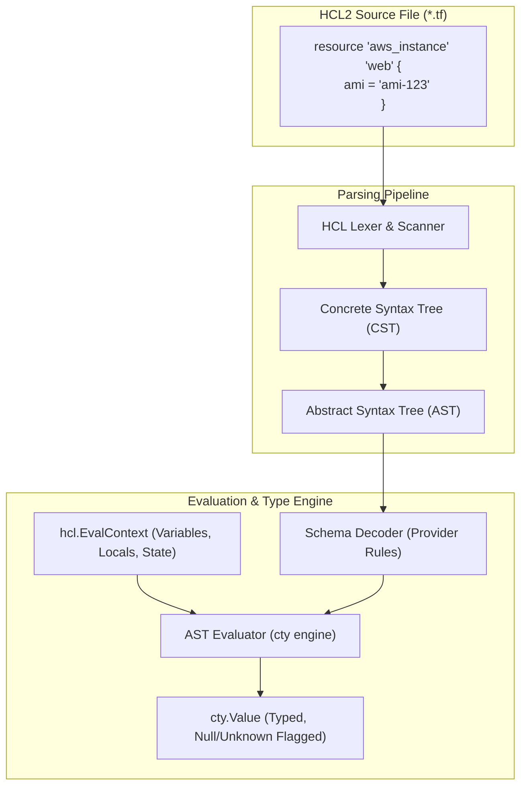
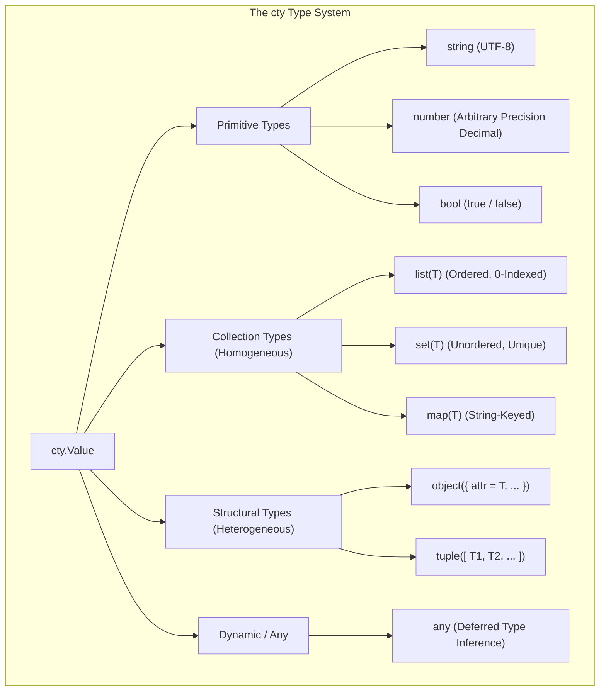
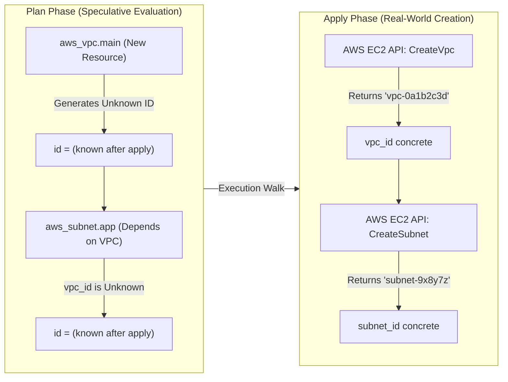

# Module 02: HCL Semantics, Type System, Expressions, Dynamic Blocks, and Unknown Value Propagation

Welcome to **Module 02** of the Terraform curriculum. This module provides an exhaustive, academically rigorous examination of HashiCorp Configuration Language 2 (HCL2), its underlying abstract syntax tree (AST) evaluation engine, the `cty` type system, and the algebraic propagation of unknown values. We explore how HCL2 achieves deterministic, purely functional expression evaluation, model Kleene three-valued logic over deferred runtime variables, dissect complex structural type unification and optional attribute mechanics, and analyze the operational constraints of dynamic blocks and comprehension pipelines.

---

## 1. Core Terminology & Formal Mathematical Definitions

- **HCL2 (HashiCorp Configuration Language 2)**: A deterministic, declarative domain-specific configuration language designed to balance human read/write ergonomics with machine AST parseability. It provides structural typing, first-class expression evaluation, and lexical scoping without general-purpose ambient authority (e.g., arbitrary disk or network I/O during evaluation).
- **Concrete Syntax Tree (CST)**: A full-fidelity parse tree produced by the HCL lexer and parser representing every token in the source document, including whitespace, comments, newlines, and delimiter punctuation, used primarily by formatting tools like `terraform fmt`.
- **Abstract Syntax Tree (AST)**: A structural representation of source code omitting syntactic trivia, capturing the hierarchical organization of configuration blocks, attribute assignments, literals, and expression operations.
- **`hcl.EvalContext`**: The execution scope and symbol table passed to the AST evaluator, binding variable identifiers, local values, resource references, and built-in pure functions to concrete or deferred `cty.Value` objects.
- **`cty.Value`**: The underlying Go type system used across Terraform Core and providers. A `cty.Value` encapsulates a concrete type, a value payload, and two operational metadata flags: _Null_ (representing an absent value) and _Unknown_ (representing a value that cannot be computed until apply time).
- **Unknown Value (`cty.UnknownVal`)**: An algebraic representation of a deferred value. An unknown value possesses a defined, invariant type constraint (e.g., an unknown `string` or an unknown `object({ id = string })`), but its concrete scalar payload is deferred until an out-of-process provider creates the resource during the apply phase.
- **Kleene Three-Valued Logic ($K_3$)**: A formal non-classical logic system defining truth operations over the ternary truth-value set $\mathcal{T} = \{\text{True}, \text{False}, \text{Unknown}\}$. HCL evaluates boolean operators (`&&`, `||`, `!`) according to Kleene logic to determine whether expressions can resolve deterministically despite missing inputs.
- **Type Unification & Structural Subtyping**: The process by which the HCL type engine determines a common supertype for heterogeneous collections or validates that an assigned object conforms to a declared schema constraint, including automatic type widening (e.g., integer to arbitrary-precision decimal).
- **Dynamic Block**: An HCL construct that programmatically generates repeated nested configuration blocks inside a resource or data source by iterating over a collection at evaluation time.

---

## 2. HCL Grammar, Syntax Architecture, and AST Evaluation

The grammar of HCL2 defines two fundamental structural primitives: **Blocks** and **Attributes**.



### Blocks vs. Attributes: Syntactic Separation

In HCL2, blocks and attributes represent fundamentally distinct grammatical entities:

1. **Attributes**: Key-value assignments following the production `Identifier = Expression`. An attribute assigns a value to a named property defined within a schema. Attribute evaluation is purely functional:
   ```hcl
   instance_type = var.environment == "prod" ? "m5.large" : "t3.micro"
   ```
2. **Blocks**: Container objects defined by a block type identifier, zero or more string block labels, and a body delimited by curly braces:
   ```hcl
   # BlockType: resource | Labels: "aws_security_group", "web" | Body: { ... }
   resource "aws_security_group" "web" {
     name        = "web-sg"
     description = "Web security group"

     # Nested BlockType: ingress | Labels: none | Body: { ... }
     ingress {
       from_port   = 443
       to_port     = 443
       protocol    = "tcp"
       cidr_blocks = ["0.0.0.0/0"]
     }
   }
   ```

> [!IMPORTANT]
> Blocks cannot be assigned using the assignment operator (`=`). Writing `ingress = { ... }` treats `ingress` as an attribute rather than a block. If the underlying provider schema expects a block definition, the schema decoder rejects the configuration with a structural type error.

### Lexical Scoping and Evaluation Context

When evaluating expressions, Terraform constructs an `hcl.EvalContext` containing namespaces:

- `var.<name>`: Resolved input variables passed into the module.
- `local.<name>`: Locally evaluated expressions declared in `locals` blocks.
- `path.module`, `path.root`, `path.cwd`: Filesystem metadata strings.
- `<resource_type>.<resource_name>.<attribute>`: References to managed resources.
- `data.<data_type>.<data_name>.<attribute>`: References to data sources.
- Built-in functions (`max()`, `substr()`, `jsonencode()`).

Expression evaluation is purely functional and side-effect free. Terraform does not allow user-defined imperative functions, global mutable state, or un-scoped loops, ensuring that AST evaluation is confluent and deterministic.

---

## 3. The `cty` Type System in Depth

Terraform relies on the `cty` type system (developed by HashiCorp in Go) to enforce static typing across HCL configurations and provider schemas. The type system divides types into three categories: **Primitives**, **Collections**, and **Structural Types**.



### 1. Primitive Types

- **`string`**: A sequence of UTF-8 encoded Unicode characters. Strings support interpolation, multiline formatting, and standard string manipulation functions.
- **`number`**: Unlike standard programming languages that use binary floating-point representations (`float64`) susceptible to roundoff errors (e.g., $0.1 + 0.2 \ne 0.3$), HCL2 numbers are arbitrary-precision decimal numbers implemented via Go's `big.Float` and `big.Int`. This ensures absolute precision when specifying network subnets, financial metrics, and memory allocations.
- **`bool`**: Standard boolean scalars representing `true` or `false`.

### 2. Collection Types (Homogeneous)

Collection types require that every contained element share an identical type $T$:

- **`list(T)`**: A sequentially ordered collection indexed by zero-based integers. Elements can be accessed via bracket notation (`var.subnets[0]`).
- **`set(T)`**: An unordered collection of unique values. Duplicate values are deduplicated upon construction. Sets cannot be indexed by integer position; they must be traversed via `for` expressions or passed to functions expecting sets (`toset()`).
- **`map(T)`**: A collection of key-value pairs where keys are strictly strings and all values must conform to type $T$.

### 3. Structural Types (Heterogeneous)

Structural types allow heterogeneous grouping of distinct types:

- **`object({ <attribute> = <type>, ... })`**: A named set of attributes where each attribute possesses its own distinct type constraint. Since Terraform 1.3, object attributes can be marked optional with fallback defaults using `optional(T, default)`:
  ```hcl
  variable "database_config" {
    type = object({
      allocated_storage = number
      instance_class    = string
      multi_az          = optional(bool, false)
      iops              = optional(number, 3000)
    })
  }
  ```
- **`tuple([ <type_1>, <type_2>, ... ])`**: A fixed-length, sequentially ordered collection where each position defines its own specific type. For example, `tuple([string, number, bool])` requires exactly three elements matching those precise types in that exact order.

### Type Unification and Automatic Widening

When an expression constructs a collection from heterogeneous literals, HCL attempts type unification:

1. If all elements in a list literal are numbers, the type resolves to `list(number)`.
2. If elements mix numbers and strings, HCL widens the numbers to strings, unifying the result to `list(string)`:
   ```hcl
   # Evaluates to list(string): ["10", "hello", "20"]
   locals {
     mixed = [10, "hello", 20]
   }
   ```
3. If unification cannot find a common primitive projection, the collection is preserved as a `tuple(...)`.

---

## 4. Unknown Value Propagation & Kleene Three-Valued Logic

During the `terraform plan` phase, resources that do not yet exist in the cloud provider cannot report their physical identifiers, generated certificates, or allocated IP addresses. Terraform Core models these outputs as **Unknown Values** (`cty.UnknownVal`).

An unknown value is distinct from `null`:

- `null`: Represents the intentional absence of a value.
- `Unknown`: Represents a value that will exist in the future, whose type is known, but whose concrete bytes cannot be known until the resource is physically applied.



### Strictness and Propagation Rules

In standard functions, unknown values are strictly propagated:

$$f(x_1, \dots, \text{Unknown}, \dots, x_n) = \text{Unknown}$$

For example, calling `upper(aws_instance.web.id)` during the plan phase immediately yields an unknown `string`. Terraform Core does not invoke the string formatting logic; it short-circuits evaluation and outputs a typed unknown value.

### Kleene Three-Valued Logic ($K_3$)

When evaluating boolean expressions involving unknown values (such as condition checks or dynamic filtering), HCL applies Kleene three-valued logic. Under Kleene logic, operations resolve deterministically if an input dominates the operation regardless of the unknown operand's eventual concrete value.

#### Kleene Truth Tables

| Operand $A$ | Operand $B$ | NOT $A$ (`!A`) | $A$ AND $B$ (`A && B`) | $A$ OR $B$ (`A \|\| B`) |
| :---------- | :---------- | :------------- | :--------------------- | :---------------------- |
| **True**    | **True**    | False          | True                   | True                    |
| **True**    | **False**   | False          | False                  | True                    |
| **True**    | **Unknown** | False          | **Unknown**            | **True**                |
| **False**   | **True**    | True           | False                  | True                    |
| **False**   | **False**   | True           | False                  | False                   |
| **False**   | **Unknown** | True           | **False**              | **Unknown**             |
| **Unknown** | **True**    | Unknown        | **Unknown**            | **True**                |
| **Unknown** | **False**   | Unknown        | **False**              | **Unknown**             |
| **Unknown** | **Unknown** | Unknown        | **Unknown**            | **Unknown**             |

Notice the critical dominating evaluations:

- `True || Unknown` evaluates to **`True`**, because regardless of whether the unknown operand resolves to true or false at apply time, the disjunction is guaranteed to be true.
- `False && Unknown` evaluates to **`False`**, because the conjunction cannot be true regardless of the unknown operand's eventual value.

### Short-Circuiting in Ternary Conditionals

For the ternary operator `cond ? expr_true : expr_false`:

1. If `cond` is known `true`, `expr_true` is evaluated and returned. If `expr_false` contains an unknown reference or would otherwise fail, it is ignored entirely.
2. If `cond` is known `false`, `expr_false` is evaluated and returned.
3. If `cond` is **`Unknown`**, the entire ternary expression evaluates to **`Unknown`**, even if both branches return concrete values of identical type.

### The Static Cardinality Barrier: Why `count` and `for_each` Reject Unknowns

The most frequent error encountered in advanced Terraform architectures is the evaluation of `count` or `for_each` against an unknown value:

```text
Error: Invalid count argument

  on main.tf line 42, in resource "aws_subnet" "workers":
  42:   count = length(data.aws_availability_zones.available.names)

The "count" value depends on resource attributes that cannot be determined until apply.
```

### The Theoretical Cardinality Barrier

To execute a graph walk, Terraform must construct the Directed Acyclic Graph during the plan phase. Every resource instance represented by `aws_subnet.workers[0]`, `aws_subnet.workers[1]`, etc., must exist as a concrete vertex in memory. If the cardinality $N$ depends on an unknown value, the graph engine cannot determine whether to instantiate 0, 1, or 50 vertices. Because the topology of the DAG must be static before graph execution begins, Terraform aborts the plan.

---

## 5. CLRS-Style HCL Expression Evaluator Algorithm

The following algorithm formally models HCL AST evaluation with support for typed unknowns, short-circuit conditionals, and Kleene logic.

```text
ALGORITHM: EVALUATE-HCL-EXPRESSION(Expr, Context)
INPUT: An AST expression node Expr and an evaluation context Context containing symbol bindings.
OUTPUT: A cty.Value containing a type constraint, value payload, and Null/Unknown metadata flags.

PRECONDITIONS:
  1. Expr is a syntactically valid HCL2 AST node.
  2. Context contains all in-scope symbol bindings for the active lexical frame.

1. MATCH Expr.Kind:
2.     CASE LiteralValue:
3.         RETURN cty.CreateValue(Expr.Type, Expr.RawData, IsNull=FALSE, IsUnknown=FALSE)

4.     CASE VariableReference:
5.         Let Symbol = Expr.Identifier
6.         IF Symbol NOT IN Context:
7.             RAISE DiagnosticError("Reference to undeclared identifier", Expr.SourceRange)
8.         RETURN Context.Lookup(Symbol)

9.     CASE ConditionalOperator (cond ? true_expr : false_expr):
10.        Let CondVal = EVALUATE-HCL-EXPRESSION(Expr.Condition, Context)
11.        IF CondVal.Type != cty.Bool:
12.            RAISE DiagnosticError("Condition must evaluate to a boolean", Expr.SourceRange)
13.        IF CondVal.IsUnknown:
14.            // Cannot determine execution path; result type is unified branch type
15.            Let TypeTrue = INFER-TYPE(Expr.TrueBranch, Context)
16.            Let TypeFalse = INFER-TYPE(Expr.FalseBranch, Context)
17.            Let UnifiedType = UNIFY-TYPES(TypeTrue, TypeFalse)
18.            RETURN cty.UnknownVal(UnifiedType)
19.        ELSE IF CondVal.Payload == TRUE:
20.            RETURN EVALUATE-HCL-EXPRESSION(Expr.TrueBranch, Context)
21.        ELSE:
22.            RETURN EVALUATE-HCL-EXPRESSION(Expr.FalseBranch, Context)

23.    CASE BinaryLogicalOperator (Left && Right):
24.        Let LVal = EVALUATE-HCL-EXPRESSION(Expr.Left, Context)
25.        Let RVal = EVALUATE-HCL-EXPRESSION(Expr.Right, Context)
26.        // Apply Kleene logic
27.        IF (NOT LVal.IsUnknown AND LVal.Payload == FALSE) OR (NOT RVal.IsUnknown AND RVal.Payload == FALSE):
28.            RETURN cty.CreateValue(cty.Bool, FALSE, IsNull=FALSE, IsUnknown=FALSE)
29.        IF LVal.IsUnknown OR RVal.IsUnknown:
30.            RETURN cty.UnknownVal(cty.Bool)
31.        RETURN cty.CreateValue(cty.Bool, LVal.Payload AND RVal.Payload, IsNull=FALSE, IsUnknown=FALSE)

32.    CASE ForComprehension ([FOR k, v IN coll : expr IF filter]):
33.        Let CollVal = EVALUATE-HCL-EXPRESSION(Expr.Collection, Context)
34.        IF CollVal.IsUnknown:
35.            RETURN cty.UnknownVal(cty.List(INFER-TYPE(Expr.YieldExpr, Context)))
36.        Let ResultList = []
37.        FOR EACH (Key, Element) in CollVal.Payload:
38.            LOOP INVARIANT: ResultList contains transformed elements for all collection entries
                              processed up to current iteration satisfying the filter predicate.
39.            Let NestedContext = Context.Extend({Expr.KeyVar: Key, Expr.ValVar: Element})
40.            IF Expr.HasFilter:
41.                Let FilterVal = EVALUATE-HCL-EXPRESSION(Expr.Filter, NestedContext)
42.                IF FilterVal.IsUnknown:
43.                    RETURN cty.UnknownVal(cty.List(INFER-TYPE(Expr.YieldExpr, Context)))
44.                IF FilterVal.Payload != TRUE:
45.                    CONTINUE
46.            Let YieldVal = EVALUATE-HCL-EXPRESSION(Expr.YieldExpr, NestedContext)
47.            ResultList.Append(YieldVal)
48.        RETURN cty.CreateValue(cty.List(UNIFY-ELEMENT-TYPES(ResultList)), ResultList)

POSTCONDITIONS:
  1. Returned value is a strictly typed cty.Value.
  2. If any mandatory input is unknown and does not short-circuit under Kleene logic, returned value has IsUnknown=TRUE.
```

---

## 6. Expressions, Comprehensions, and Dynamic Blocks

HCL2 provides powerful expression constructs for manipulating data structures without resorting to external scripting languages.

### 1. `for` Expressions and Collection Filtering

Comprehensions allow mapping, projecting, and filtering collections:

```hcl
locals {
  raw_subnets = {
    "us-east-1a" = { cidr = "10.0.1.0/24", public = true }
    "us-east-1b" = { cidr = "10.0.2.0/24", public = false }
    "us-east-1c" = { cidr = "10.0.3.0/24", public = true }
  }

  # List projection with filtering: ["10.0.1.0/24", "10.0.3.0/24"]
  public_cidrs = [for az, sub in local.raw_subnets : sub.cidr if sub.public]

  # Map projection with key-value transformation
  subnet_lookup = {for az, sub in local.raw_subnets : az => sub.cidr}

  # Grouping projection (ellipsis operator): groups items by shared key into a list
  services_by_tier = {
    web = ["api", "frontend"]
    data = ["postgres", "redis"]
  }
}
```

### 2. Splat Expressions: Attribute vs. Full Splat

HCL2 supports two forms of splat operators:

1. **Attribute-Only Splat (`.*`)**: A legacy operator inherited from HCL1. It operates only on list types and fails if applied to a scalar or null value.
2. **Full Splat (`[*]`)**: The modern HCL2 operator. It safely operates on lists, sets, tuples, and even scalar values. If applied to a non-list value, it wraps the value in a single-element tuple before applying the projection. If applied to `null`, it returns an empty tuple (`[]`) rather than throwing a runtime error.

```hcl
# Safe traversal: returns empty list if var.instances is null
locals {
  instance_ids = var.instances[*].id
}
```

### 3. Dynamic Blocks

When a cloud resource schema expects repeated nested blocks rather than an attribute collection (e.g., `ingress` in `aws_security_group` or `setting` in `aws_elastic_beanstalk_environment`), static declarations become redundant. The `dynamic` block constructs nested blocks iteratively:

```hcl
variable "ingress_rules" {
  type = list(object({
    port        = number
    description = string
    cidr_blocks = list(string)
  }))
}

resource "aws_security_group" "firewall" {
  name   = "dynamic-firewall"
  vpc_id = aws_vpc.main.id

  dynamic "ingress" {
    for_each = var.ingress_rules
    iterator = rule # Optional: defaults to the dynamic block name ("ingress")
    content {
      from_port   = rule.value.port
      to_port     = rule.value.port
      protocol    = "tcp"
      description = rule.value.description
      cidr_blocks = rule.value.cidr_blocks
    }
  }
}
```

> [!CAUTION]
> Avoid deeply nested dynamic blocks (e.g., dynamic blocks inside dynamic blocks). Nesting dynamic blocks produces combinatorial AST expansion, significantly increasing plan memory consumption and degrading code readability. Prefer standalone resources over nested blocks whenever the provider exposes both models (e.g., prefer `aws_security_group_rule` over nested `ingress` blocks).

---

## 7. Then vs. Now: Language & Type Evolution

| Capability / Semantics | HCL1 (Terraform $\le$ 0.11) | HCL2 (Terraform 0.12 – 1.2) | Modern HCL (Terraform 1.3 – 1.17 & OpenTofu 1.13) |
| :-- | :-- | :-- | :-- |
| **Expression Syntax** | String interpolation mandated for all variables: `"${var.foo}"` | First-class expressions: `foo = var.foo` | First-class expressions with `convert()` and type coercion |
| **Type Constraints** | Primitive only: `string`, `list`, `map`; no heterogeneous structures | Structural types: `object({...})`, `tuple([...])`, `any` | Structural types with `optional(T, default)` attribute defaults |
| **Unknown Value Handling** | Coarse-grained; computed values caused broad graph blocks | Fine-grained `cty.UnknownVal` tracking with Kleene logic | Unknown value propagation with write-only and ephemeral support |
| **Dynamic Generation** | Impossible; required brittle `count` hacks or Jinja2 pre-processing | Native `dynamic` blocks with `for_each` and `content` | Optimized `dynamic` block evaluation with provider schemas |
| **Splat Operators** | Legacy attribute splat `.*` only; threw errors on nulls | Introduced full splat `[*]`; safe scalar and null handling | Universal full splat `[*]` standard repository-wide |
| **Variable Deprecation** | Unofficial comments or external linters | External linting only (tflint) | Native `deprecated = "message"` attribute on variables and outputs |

---

## 8. Exam Delta: Terraform Associate 004 vs. Modern Realities

> [!NOTE]
> The HashiCorp Certified: Terraform Associate (004) exam targets **Terraform 1.12**. Key distinctions to remember:
>
> 1. **Optional Attribute Defaults**: Terraform 1.3 introduced default values for optional attributes inside `object()` types: `optional(string, "default_val")`. Exam 004 tests basic `optional(string)` syntax (introduced in 0.14/1.0), but may not emphasize the second default argument.
> 2. **Splat Mechanics**: The exam tests both `.*` and `[*]` splat operators. Candidates must know that full splat `[*]` safely handles nulls and scalars, whereas attribute splat `.*` is strictly for collections.
> 3. **The `count` and `for_each` Unknown Limitation**: A high-frequency exam objective requires candidates to identify why `count = length(aws_instance.web.*.id)` fails at plan time when instances are being created in the same apply run.
> 4. **HCL Built-in Functions**: The exam strictly tests built-in functions (`lookup()`, `element()`, `merge()`, `concat()`, `toset()`, `jsonencode()`). Remember that Terraform does not support custom user-defined functions in HCL (though OpenTofu 1.8+ supports provider-defined functions).

---

## 9. Production Failure Modes & Operational Gotchas

### 1. The `count` Value Computed at Apply Time

Consider a configuration attempting to provision subnets based on availability zones retrieved via an un-applied data source or resource:

```hcl
resource "aws_vpc" "main" {
  cidr_block = "10.0.0.0/16"
}

# Subnets attempting to use computed count
resource "aws_subnet" "tiers" {
  count      = length(aws_vpc.main.cidr_block_associations) # Unknown at plan time!
  vpc_id     = aws_vpc.main.id
  cidr_block = "10.0.1.0/24"
}
```

```text
Error: Invalid count argument
The "count" value depends on resource attributes that cannot be determined until apply.
```

**Remediation**: Decouple graph sizing from computed cloud state. Define resource counts and `for_each` keys using static input variables or deterministic local maps known at configuration authoring time.

### 2. Structural Object Schema Violations with `optional()`

When passing maps or objects to modules expecting structural types, omitting an attribute without declaring a default causes compilation failures:

```hcl
variable "cluster_config" {
  type = object({
    node_count = number
    enable_gpu = optional(bool) # Missing fallback default!
  })
}

# If the caller supplies:
# cluster_config = { node_count = 3 }
# local.cluster_config.enable_gpu evaluates to null, not false!
```

If downstream code performs boolean checks like `if local.cluster_config.enable_gpu`, Terraform throws an error: `Condition expression must evaluate to a boolean, but was null`. Always specify the second parameter: `optional(bool, false)`.

### 3. Dynamic Block Over Unordered Sets Triggering Drift

Iterating a dynamic block over an unordered `set(string)` can cause non-deterministic block ordering:

```hcl
dynamic "tag" {
  for_each = toset(["Env:Prod", "Owner:SecOps", "App:Core"])
  content {
    key   = split(":", tag.value)[0]
    value = split(":", tag.value)[1]
  }
}
```

If the underlying provider API treats the ordering of nested blocks as significant (e.g., evaluating firewall rules sequentially), variations in set hash ordering between runs produce persistent, spurious plan diffs. Convert sets to ordered lists with sorting functions (`sort(tolist(var.set))`) before dynamic iteration.

---

## Interview Drill

<details><summary>1. Explain the formal distinction between `null` and `cty.UnknownVal` in the HCL2 evaluation engine.</summary>

In HCL2, `null` represents the intentional absence of a value; it is a terminal, concrete scalar indicating that an attribute should not be set or sent to a provider API. In contrast, `cty.UnknownVal` is an algebraic placeholder indicating that a value will exist in reality, has a definite type constraint (e.g., `string` or `object`), but whose physical contents are mathematically undecidable at plan time because the resource has not yet been provisioned by the cloud hypervisor. Unlike `null`, which can be checked via `var.val == null`, comparing an unknown value to anything yields an unknown boolean value under Kleene logic.

- Ref: HashiCorp `cty` Type System Specification.

</details>

<details><summary>2. How does Kleene three-valued logic resolve the expression `true || unknown` versus `false || unknown`? Why is this distinction vital for Terraform?</summary>

Kleene logic evaluates `true || unknown` to `true` because the truth of a disjunction is dominated by a `true` operand regardless of whether the unknown operand resolves to `true` or `false` at apply time. Conversely, `false || unknown` evaluates to `unknown` because the outcome strictly depends on the deferred value. This distinction is critical for Terraform's plan phase: it allows the execution engine to evaluate condition expressions and feature flags speculatively without halting execution when only a subset of inputs is deferred.

- Ref: Kleene, S. C., _Introduction to Metamathematics_.

</details>

<details><summary>3. Why does HCL2 enforce arbitrary-precision decimal numbers instead of standard IEEE 754 floating-point numbers?</summary>

Standard IEEE 754 binary floating-point numbers (`float64`) cannot precisely represent many decimal fractions (e.g., $0.1 + 0.2 = 0.30000000000000004$). In infrastructure management, numbers frequently represent monetary budgets, disk allocations in gigabytes, CIDR subnet masks, or discrete port numbers. Floating-point roundoff errors could result in off-by-one errors during subnet allocation or cause spurious drift detection during state diffing. HCL2 implements numbers using Go's `big.Float` and `big.Int`, guaranteeing exact decimal precision across all arithmetic evaluations.

- Ref: HCL2 Language Specification & `cty.Number` Implementation.

</details>

<details><summary>4. What is the operational difference between the attribute splat operator `.*` and the full splat operator `[*]`?</summary>

The attribute splat operator `.*` is a legacy HCL1 construct that operates strictly on list types and expects attributes to exist on every element; applying it to `null` or a scalar value produces a runtime error. The modern HCL2 full splat operator `[*]` introduces safe handling: if applied to a scalar value, it treats the scalar as a single-element list and applies the traversal; if applied to `null`, it returns an empty tuple (`[]`) rather than failing. This makes `[*]` safe for handling optional module inputs.

- Ref: Terraform Language Expressions: Splat Expressions.

</details>

<details><summary>5. Under what architectural circumstances should an engineer avoid using `dynamic` blocks inside a resource definition?</summary>

Engineers should avoid `dynamic` blocks when:

1. The cloud provider offers standalone resources representing the same concept (e.g., using `aws_security_group_rule` instead of nested `dynamic "ingress"` blocks). Standalone resources evaluate as independent vertices in the DAG, allowing concurrent provisioning and eliminating blast-radius coupling.
2. Deeply nested dynamic blocks (multiple levels) are required. Nested dynamic loops produce complex, unreadable code and exponential AST evaluation overhead.
3. The iteration depends on a computed unknown collection, which aborts the plan phase.

- Ref: HashiCorp Best Practices: Dynamic Blocks.

</details>

<details><summary>6. How does Terraform 1.3+ handle optional attributes and default values within structural `object()` types?</summary>

Prior to Terraform 1.3, declaring an attribute as optional via `optional(T)` resulted in a `null` value if omitted by the caller, requiring verbose downstream fallback logic like `var.config.timeout != null ? var.config.timeout : 30`. Terraform 1.3 introduced an optional second parameter to the `optional()` modifier: `optional(type, default_value)`. When the caller omits the attribute from the assigned object, the HCL type unification engine automatically injects the specified default value during AST decoding, guaranteeing that consuming modules always receive a fully populated structural type.

- Ref: Terraform 1.3 Release Notes & Object Type Specification.

</details>

<details><summary>7. Explain why passing an unknown value into `for_each` causes Terraform to abort during the plan phase, but passing an unknown value into a resource attribute does not.</summary>

Passing an unknown value into a resource attribute (e.g., `ami = data.aws_ami.ubuntu.id`) is acceptable because the DAG vertex representing the resource already exists; the engine simply records the attribute as `(known after apply)` in the plan. In contrast, `for_each` defines the identity and cardinality of graph vertices themselves. For every key in `for_each`, Terraform must create a discrete node in the DAG (`aws_instance.web["a"]`, `aws_instance.web["b"]`). If `for_each` receives an unknown value, the graph engine cannot determine how many vertices to construct, what their unique string addresses are, or what dependency edges to wire. Because the DAG topology must be fully determined before scheduling the plan walk, execution aborts immediately.

- Ref: Terraform Core Graph Engine Internals.

</details>

---

## 11. Proof Map & Executable Verifications

The type system invariants, Kleene logic truth tables, and unknown value propagation semantics detailed in this module are backed by executable proofs in the test suite:

| Theoretical Concept | Test Assertion / Specification | Test File Reference |
| :-- | :-- | :-- |
| **Primitive & Collection Type Systems** | `primitive type checking and safe conversions` and `collection types: list, set, and map` | [`../examples/ts/02-hcl-semantics-and-type-system.test.ts`](../examples/ts/02-hcl-semantics-and-type-system.test.ts) |
| **Structural Types & Optional Defaults** | `structural types: object with optional attributes and defaults` | [`../examples/ts/02-hcl-semantics-and-type-system.test.ts`](../examples/ts/02-hcl-semantics-and-type-system.test.ts) |
| **Kleene Three-Valued Logic Invariants** | `three-valued Kleene logic truth table invariants` | [`../examples/ts/02-hcl-semantics-and-type-system.test.ts`](../examples/ts/02-hcl-semantics-and-type-system.test.ts) |
| **Unknown Value Dynamic Propagation** | `unknown value propagation in dynamic blocks and attributes` | [`../examples/ts/02-hcl-semantics-and-type-system.test.ts`](../examples/ts/02-hcl-semantics-and-type-system.test.ts) |
| **Nested Type Mismatch Diagnostics** | `negative test: type mismatch in nested structure yields exact path` | [`../examples/ts/02-hcl-semantics-and-type-system.test.ts`](../examples/ts/02-hcl-semantics-and-type-system.test.ts) |
| **Property: Kleene Boolean Involutions** | `property: Kleene AND and OR satisfy involution, commutativity, and de Morgan laws` | [`../examples/ts/02-hcl-semantics-and-type-system.test.ts`](../examples/ts/02-hcl-semantics-and-type-system.test.ts) |
