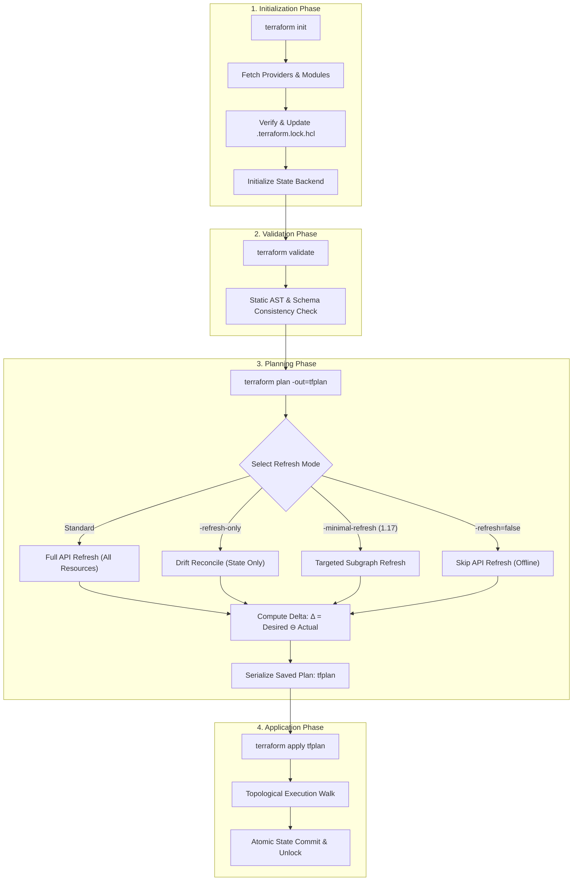
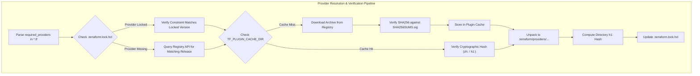
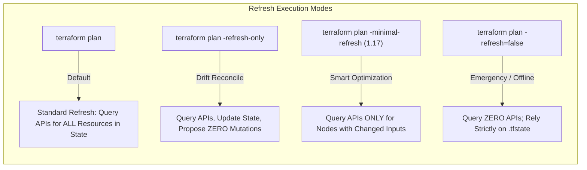

# Module 03: Core Workflow and CLI Mechanics: Init, Lock Files, Plan Refresh Modes, and Apply

Welcome to **Module 03** of the Terraform curriculum. This module provides a comprehensive systems-level analysis of the Terraform Command Line Interface (CLI) execution engine and core lifecycle workflow. We examine the exact cryptographic and filesystem mechanics of `terraform init` and provider dependency locking, analyze AST-level static validation, dissect the refresh subsystems—including standard refresh, `-refresh-only`, and Terraform 1.17's `-minimal-refresh` engine—and establish production best practices for saved plan execution, resource replacement, and diagnostic logging.

---

## 1. Core Terminology & Formal Mathematical Definitions

- **Core Lifecycle Workflow**: The canonical sequence of declarative operations through which infrastructure is initialized, verified, simulated, and applied: $$\text{init} \longrightarrow \text{validate} \longrightarrow \text{plan} \longrightarrow \text{apply} \longrightarrow (\text{destroy})$$
- **State Reconciliation Delta ($\Delta$)**: The formal difference between the desired state declared in HCL configuration ($S_{\text{desired}}$) and the actual live cloud state ($S_{\text{actual}}$): $$\Delta = S_{\text{desired}} \ominus S_{\text{actual}}$$ The plan phase computes $\Delta$; the apply phase executes the minimal set of mutations required to achieve $S_{\text{actual}} = S_{\text{desired}}$.
- **Dependency Lock File (`.terraform.lock.hcl`)**: A version-controlled HCL file containing cryptographic checksums and exact version numbers for every external provider required by the root module and all transitive child modules.
- **`h1:` Cryptographic Checksum**: A base64-encoded SHA-256 hash of the normalized directory tree contents of an unpacked provider binary, ensuring that provider files on disk have not been altered post-extraction.
- **`zh:` Cryptographic Checksum**: A base64-encoded SHA-256 hash of the official `.zip` distribution archive downloaded from the provider registry, validated against the registry's GPG-signed `SHA256SUMS` manifest.
- **Speculative Plan**: An ephemeral execution plan generated during `terraform plan` simulating the consequences of applying changes against live infrastructure without committing changes to state or mutating cloud resources.
- **Saved Plan File (`-out=planfile`)**: An opaque, encrypted or compressed binary archive containing a serialized snapshot of the configuration, the current state, provider locks, and the exact dependency graph mutations computed during the plan phase.
- **Drift Reconciliation**: The operational process of detecting discrepancies between the recorded state file ($S_{\text{state}}$) and the live physical infrastructure ($S_{\text{actual}}$), reconciling state without necessarily mutating cloud resources.

---

## 2. The Core Lifecycle Workflow & CLI Architecture

Terraform is architected around a linear, idempotent lifecycle state machine.



### Idempotence and Convergence Invariants

Let $M$ represent the Terraform engine application function, mapping a configuration $C$ and an infrastructure state $S$ to an updated state $S'$:

$$S' = M(C, S)$$

The engine guarantees strong convergence:

$$M(C, M(C, S)) = M(C, S)$$

Applying the identical configuration against a converged infrastructure yields zero planned actions:

$$\Delta = \emptyset$$

---

## 3. `terraform init` Mechanics & The Dependency Lock File

The `terraform init` command initializes the working directory, downloads required child modules, configures the remote state backend, and populates the local `.terraform/` metadata directory.



### Provider Directory Structure

Providers are installed into an explicit directory hierarchy within `.terraform/`:

```text
.terraform/providers/
└── registry.terraform.io/
    └── hashicorp/
        └── aws/
            └── 5.40.0/
                └── darwin_arm64/
                    └── terraform-provider-aws_v5.40.0_x5
```

### Shared Plugin Cache (`TF_PLUGIN_CACHE_DIR`)

In CI/CD environments or developer workstations containing multiple Terraform projects, downloading gigabytes of identical provider binaries repeatedly is inefficient. Terraform supports a global plugin cache directory:

```bash
export TF_PLUGIN_CACHE_DIR="$HOME/.terraform.d/plugin-cache"
```

When configured, `terraform init` checks the cache directory before issuing network requests. If the requested provider binary exists, Terraform symlinks or copies the binary into `.terraform/providers/`.

> [!CAUTION]
> Terraform's plugin cache does not implement inter-process file locking. If multiple concurrent CI jobs execute `terraform init` simultaneously against a shared network mount or shared directory, they can write to the same `.zip` cache file concurrently, corrupting the downloaded archive and failing subsequent runs with invalid ZIP header errors.

### The Cryptographic Lock File (`.terraform.lock.hcl`)

The `.terraform.lock.hcl` file guarantees supply-chain integrity by recording cryptographic digests of approved provider binaries:

```hcl
provider "registry.terraform.io/hashicorp/aws" {
  version     = "5.40.0"
  constraints = "~> 5.0"
  hashes = [
    "h1:t8jZ87x...",
    "zh:0a1b2c...",
    "zh:3d4e5f...",
    "zh:6a7b8c...",
  ]
}
```

#### `h1:` vs. `zh:` Checksums

1. **`zh:` (Zip Hash)**: The SHA-256 hash of the distribution `.zip` archive for a specific operating system and architecture target. When querying the public Terraform Registry, Terraform downloads the official `SHA256SUMS` manifest signed by the vendor's GPG key, populating the lock file with `zh:` hashes for multiple platforms.
2. **`h1:` (Hash 1)**: A directory-tree hash of the unpacked provider binary. Terraform unpacks the archive, sorts all file paths lexicographically, computes the SHA-256 of each file's contents, and hashes the resulting concatenated digest list. This protects against post-unpacking tampering or filesystem bit rot.

#### Cross-Platform Lock File Generation

When an engineer runs `terraform init` on macOS (ARM64), Terraform only downloads the `darwin_arm64` binary. If the configuration is pushed to Git and executed on an Ubuntu Linux (AMD64) CI runner, the runner fails if the lock file lacks the Linux binary hash:

```text
Error: Failed to install provider
The checksum for provider hashicorp/aws does not match any checksum in the lock file.
```

To pre-populate hashes for all target deployment architectures without executing on those platforms:

```bash
terraform providers lock \
  -platform=linux_amd64 \
  -platform=linux_arm64 \
  -platform=darwin_arm64 \
  -platform=windows_amd64
```

---

## 4. Static Validation & Code Formatting

Terraform provides two primary static analysis commands:

### `terraform fmt`

`terraform fmt` rewrites HCL configuration files into the canonical style. It processes the Concrete Syntax Tree (CST) to standardize:

- Two-space indentation.
- Attribute alignment along the `=` operator within contiguous blocks.
- Consistent newline spacing between resource declarations.

In automated CI pipelines, `terraform fmt -check -diff` verifies compliance, returning exit code 0 if formatted correctly or exit code 3 with a git-style patch diff if formatting violations are detected.

### `terraform validate`

`terraform validate` executes syntactical and internal consistency checks across all `.tf` files in the directory. It:

1. Verifies that all block types, labels, and attribute names match the schema of installed providers.
2. Type-checks expressions (e.g., ensuring a string is not supplied where a number or list is expected).
3. Verifies that referenced input variables, locals, and resources exist within scope.

> [!NOTE]
> `terraform validate` does not access remote state backends, does not acquire state locks, and does not perform cloud provider API calls. It can execute entirely offline once `terraform init` has completed.

---

## 5. Plan Refresh Modes & Speculative Execution

The `terraform plan` command creates an execution plan, reading live cloud state and determining necessary actions.



### Refresh Execution Modes

1. **Standard Refresh (Default)**: Terraform scans every resource instance recorded in `.tfstate` and issues synchronous read queries to cloud provider APIs. For large architectures containing thousands of resources, standard refresh accounts for over 90% of total planning latency and frequently exhausts cloud API rate limits.
2. **Refresh-Only (`-refresh-only`)**: Available since Terraform 1.0. Terraform queries cloud APIs and proposes updates strictly to the state file to reflect external drift (e.g., out-of-band tag modifications or manual deletions), without proposing any infrastructure modifications.
3. **Skip Refresh (`-refresh=false`)**: Skips all cloud API queries, computing the execution plan purely by comparing HCL configuration against the recorded `.tfstate` file. This mode is extremely fast and works offline, but is dangerous if out-of-band changes have occurred.
4. **Minimal Refresh (`-minimal-refresh`, Terraform 1.17)**: Analyzes the dependency graph and configuration changes prior to executing API calls. It only refreshes resources whose inputs have changed in HCL or whose outputs are required by downstream nodes that must be evaluated, drastically reducing API calls and plan duration.

### Saved Plan Execution (`-out=tfplan`)

In production environments and automated CI/CD pipelines, executing an interactive `terraform apply` is an operational hazard: between the time the plan is reviewed and the time apply executes, live cloud state may change or different input variables may be supplied.

Production pipelines mandate two-phase execution via saved plans:

```bash
# Phase 1: Planning Pipeline
terraform plan -out=tfplan -input=false

# Phase 2: Application Pipeline (Manual Approval Gate)
terraform apply -input=false tfplan
```

#### Anatomy of a Saved Plan File

A `.tfplan` file is an encrypted/compressed zip archive containing:

- `tfplan.binary`: The serialized protocol buffer representing the computed dependency graph, actions, and planned values.
- `configuration`: A frozen snapshot of the `.tf` files and input variables used during planning.
- `state`: A snapshot of the state file read at the moment of planning.
- `provider_locks`: Exact provider versions and checksums.

When `terraform apply tfplan` runs:

1. Terraform Core extracts the saved plan.
2. It acquires the remote state backend lock.
3. It validates that the live state's serial number and lineage match the state recorded inside `tfplan`. If another apply ran in the interim, Terraform rejects the plan with a state conflict error.
4. It executes the exact mutations recorded in the plan without re-reading configuration or re-querying cloud APIs.

---

## 6. Apply, Destroy, Target, and Replace

### Declarative Replacement (`-replace`)

Prior to Terraform 0.15, marking a resource for recreation required the imperative `terraform taint` command, which directly mutated the state file. If an operator tainted a resource and an apply failed midway, the resource was left tainted indefinitely.

Modern Terraform enforces declarative replacement during the planning phase:

```bash
terraform plan -replace="aws_instance.web" -out=tfplan
```

This instructs the planner to propose a destroy-and-recreate action for `aws_instance.web` within the speculative plan, leaving the persisted state file untouched until the approved plan is applied.

### Resource Targeting (`-target`) and Blast Radius Hazards

Terraform permits targeting specific subgraphs:

```bash
terraform apply -target="aws_security_group.allow_tls"
```

> [!CAUTION]
> Using `-target` in normal production workflows is a severe anti-pattern. Targeting forces Terraform to construct a partial graph, isolating the target resource from its natural dependencies. Upstream resources that should have been updated may be skipped, downstream dependencies are left in indeterminate states, and subsequent full plans will detect unexpected drift. Restrict `-target` exclusively to emergency disaster recovery scenarios (e.g., bootstrapping a state backend bucket or resolving circular dependency deadlocks).

### Workspaces CLI Mechanics

Terraform CLI workspaces allow managing multiple state instances from a single working directory:

```bash
terraform workspace list
terraform workspace new staging
terraform workspace select production
```

Workspaces segregate state files:

- The default workspace stores state in `terraform.tfstate`.
- Named workspaces store state in `terraform.tfstate.d/<workspace_name>/terraform.tfstate`.

In HCL, the current workspace name is accessible via `terraform.workspace`.

> [!IMPORTANT]
> Do not use workspaces to isolate heterogeneous environments (e.g., Development vs. Production) if those environments require different network architectures, IAM permissions, or provider credentials. Workspaces share identical configuration files and state backends, increasing the blast radius of misconfigurations. Prefer distinct directory layouts with independent state backends for environment isolation.

### Diagnostic Logging & Telemetry

Terraform CLI exposes granular logging controls via environment variables:

- `TF_LOG=TRACE`: Enables maximum debugging output, printing every gRPC RPC payload, HTTP request/response header, and graph evaluation step. (Available levels: `TRACE`, `DEBUG`, `INFO`, `WARN`, `ERROR`).
- `TF_LOG_PATH=/path/to/tf.log`: Redirects log output to a dedicated file, keeping standard output clean for plan parsing.
- `TF_LOG_CORE=TRACE`: Enables logging strictly for Terraform Core (AST evaluation, graph walk, state lock).
- `TF_LOG_PROVIDER=TRACE`: Enables logging strictly for out-of-process provider binaries.

---

## 7. CLRS-Style Provider Initialization & Verification Algorithm

```text
ALGORITHM: SECURE-PROVIDER-INITIALIZATION-AND-VERIFY(Config, LockFile, Registry, CacheDir)
INPUT: Parsed provider constraints Config, active LockFile (.terraform.lock.hcl), remote Registry client, and local CacheDir.
OUTPUT: Installed provider binaries in .terraform/providers/ and an updated, cryptographically verified LockFile.

PRECONDITIONS:
  1. Config contains valid source strings and semantic version constraints.
  2. Operating system network stack is functional and allows outbound TLS to Registry.

1. FOR EACH ProviderReq in Config.RequiredProviders:
2.     LOOP INVARIANT: All providers processed prior to current iteration have their binaries installed
                      in .terraform/providers/ and their cryptographic digests recorded in LockFile.
3.     Let P_Name = ProviderReq.Name
4.     Let Constraint = ProviderReq.Constraint
5.     Let TargetPlatform = CURRENT-OS-ARCH()

6.     IF P_Name IN LockFile:
7.         Let LockedVersion = LockFile[P_Name].Version
8.         IF NOT SATISFIES(LockedVersion, Constraint):
9.             RAISE VersionConflictError("Locked version violates new configuration constraint")
10.        Let SelectedVersion = LockedVersion
11.    ELSE:
12.        // Query registry for highest compatible version
13.        Let AvailableVersions = Registry.GetVersions(P_Name)
14.        Let SelectedVersion = MAX_SATISFYING(AvailableVersions, Constraint)
15.        LockFile.SetVersion(P_Name, SelectedVersion)

16.    Let ArchiveFileName = FORMAT-ARCHIVE-NAME(P_Name, SelectedVersion, TargetPlatform)
17.    Let CachePath = CacheDir + "/" + ArchiveFileName

18.    IF FILE-EXISTS(CachePath):
19.        Let ZipBytes = READ-FILE(CachePath)
20.    ELSE:
21.        Let Manifest = Registry.GetSignedManifest(P_Name, SelectedVersion)
22.        VERIFY-GPG-SIGNATURE(Manifest, Registry.Keyring)
23.        Let ZipBytes = Registry.DownloadArchive(P_Name, SelectedVersion, TargetPlatform)
24.        Let ComputedZh = "zh:" + BASE64(SHA256(ZipBytes))
25.        IF ComputedZh != Manifest.Lookup(TargetPlatform):
26.            RAISE IntegrityError("Downloaded ZIP digest does not match registry signed manifest")
27.        WRITE-FILE(CachePath, ZipBytes)
28.        LockFile.AddHash(P_Name, ComputedZh)

29.    // Unpack binary and compute h1 directory checksum
30.    Let InstallDir = ".terraform/providers/" + P_Name + "/" + SelectedVersion + "/" + TargetPlatform
31.    UNPACK-ZIP(ZipBytes, InstallDir)
32.    Let ComputedH1 = "h1:" + COMPUTE-NORMALIZED-DIRECTORY-HASH(InstallDir)

33.    IF P_Name IN LockFile AND LockFile[P_Name].HasH1Hashes:
34.        IF ComputedH1 NOT IN LockFile[P_Name].Hashes:
35.            RAISE TamperError("Unpacked provider h1 hash violates recorded lock file signature")
36.    ELSE:
37.        LockFile.AddHash(P_Name, ComputedH1)

POSTCONDITIONS:
  1. Target provider executable exists at InstallDir with execute permissions.
  2. LockFile contains verified zh: and h1: hashes for the active platform.
38. SAVE-TO-DISK(LockFile)
39. RETURN SUCCESS
```

---

## 8. Then vs. Now: CLI & Workflow Evolution

| CLI Feature / Mechanism | Legacy Terraform ($\le$ 0.11) | Modern Terraform (0.12 – 1.15) | Current Terraform (1.16 – 1.17) & OpenTofu (1.13) |
| :-- | :-- | :-- | :-- |
| **Provider Locking** | Unlocked; every `terraform init` could pull breaking provider versions | Introduced `.terraform.lock.hcl` (0.14) with `h1:` and `zh:` checksums | Multi-platform locking (`terraform providers lock`); OCI registry support |
| **Resource Tainting** | Imperative `terraform taint <addr>` mutated state immediately | Deprecated `taint`; introduced `terraform plan -replace="<addr>"` | Declarative replacement via `-replace` and `lifecycle { replace_triggered_by }` |
| **Refresh Mechanics** | Monolithic synchronous refresh querying all cloud APIs sequentially | Full refresh or dangerous skip (`-refresh=false`); `-refresh-only` plans | Terraform 1.17: Intelligent `-minimal-refresh` skips unaffected subgraphs |
| **Saved Plan Application** | Binary `.tfplan` format susceptible to state divergence | Saved plan validates exact state serial and lineage before execution | Strict state validation with plan encryption (OpenTofu) and JSON telemetry |
| **Code Formatting** | Basic `terraform fmt` | Full AST-aware `terraform fmt` with `-check` and `-diff` | Universal AST-based formatting integrated with CI linters (oxfmt/oxlint) |

---

## 9. Exam Delta: Terraform Associate 004 vs. Modern Realities

> [!NOTE]
> The HashiCorp Certified: Terraform Associate (004) exam targets **Terraform 1.12**. Candidates must take note of the following exam boundaries:
>
> 1. **`-replace` vs. `taint`**: Exam 004 explicitly tests that `terraform apply -replace="<addr>"` has replaced `terraform taint`. Candidates will be tested on the advantage: `-replace` does not modify the state file until the plan is applied.
> 2. **Provider Lockfile**: The exam expects candidates to know that `.terraform.lock.hcl` should be committed to version control, and that running `terraform init -upgrade` is required to advance provider versions beyond locked constraints.
> 3. **Logging Levels**: Exam questions frequently test the exact order of logging severity: `TRACE` (most verbose), `DEBUG`, `INFO`, `WARN`, `ERROR` (least verbose), and the usage of `TF_LOG_PATH`.
> 4. **Refresh Flags**: Exam 004 tests `-refresh-only` and `-refresh=false`, but does not test Terraform 1.17's `-minimal-refresh`.

---

## 10. Production Failure Modes & Operational Gotchas

### 1. The Cross-Platform Lockfile CI Failure

A developer running macOS ARM64 runs `terraform init`, which downloads the `darwin_arm64` provider binary and writes its `h1:` and `zh:` hashes to `.terraform.lock.hcl`. The file is committed to Git.

When the automated CI/CD pipeline runs on an `x86_64` Linux runner, `terraform init` fails:

```text
Error: Failed to install provider
The checksum of provider hashicorp/aws v5.40.0 for linux_amd64 was not found in the lock file.
```

**Remediation**: Always generate cross-platform hashes before committing lock files by running `terraform providers lock -platform=linux_amd64 -platform=darwin_arm64`.

### 2. Applying Without a Saved Plan in CI/CD

An automated pipeline that executes `terraform plan` in step 1, followed by a manual approval gate, followed by `terraform apply -auto-approve` in step 2:

```bash
# Anti-Pattern CI Pipeline
step_1: terraform plan
step_2: approve_deployment()
step_3: terraform apply -auto-approve # DANGEROUS!
```

Between step 1 and step 3, an external operator could have created resources out-of-band, or a cloud API could have drifted. Step 3 re-reads configuration and re-queries cloud APIs, potentially executing unreviewed resource destruction. Always apply an exact saved plan: `terraform apply tfplan`.

### 3. File Descriptor Exhaustion During Parallel Refresh

In enterprise repositories with thousands of resources, running `terraform plan` opens hundreds of concurrent HTTP and gRPC sockets. If the host operating system has a restrictive `ulimit -n` (e.g., the default 1024 on macOS), Terraform aborts with `socket: too many open files`. Ensure CI runners configure `ulimit -n 65536` prior to running large plans.

---

## 11. Interview Drill: Deep-Dive Architectural Questions

<details>
<summary><strong>Q1. Explain the cryptographic and operational differences between `h1:` and `zh:` hashes in `.terraform.lock.hcl`.</strong></summary>

**Answer**: A `zh:` hash is the SHA-256 digest of the official distribution `.zip` archive downloaded from the provider registry. It matches the checksum published in the registry's GPG-signed `SHA256SUMS` manifest, verifying that the downloaded archive has not been modified in transit. An `h1:` hash is a directory-tree hash computed across the unpacked files of the provider binary on local disk. Terraform lexicographically sorts all file paths in the extracted directory, hashes each file's contents, and computes a root SHA-256 digest. This ensures that provider files have not been modified or corrupted on disk post-extraction.

- Ref: HashiCorp Terraform Dependency Lock File Documentation.

</details>

<details>
<summary><strong>Q2. Why is running `terraform apply -auto-approve` considered an operational hazard in production CI/CD pipelines compared to `terraform apply <planfile>`?</strong></summary>

**Answer**: Running `terraform apply -auto-approve` causes Terraform to re-evaluate HCL source files, re-query cloud APIs during a fresh refresh pass, and generate a new plan immediately before applying. If infrastructure drift occurred or if an out-of-band modification was made between the review step and execution, the apply phase will execute operations that were never reviewed or approved by human operators. In contrast, applying a saved plan file (`terraform apply tfplan`) guarantees strict atomicity: Terraform verifies that the state's lineage and serial match the plan's preconditions, and applies the exact pre-computed mutations without re-reading configuration or recalculating drift.

- Ref: Terraform Production Pipeline Security Standards.

</details>

<details>
<summary><strong>Q3. How does Terraform 1.17's `-minimal-refresh` optimize planning latency compared to standard refresh?</strong></summary>

**Answer**: Standard refresh performs synchronous read queries against cloud APIs for every single resource recorded in `.tfstate`, regardless of whether those resources are touched by configuration changes. In architectures with thousands of resources, this causes massive API latency and triggers provider rate limits. Terraform 1.17's `-minimal-refresh` analyzes the configuration diff and execution graph prior to issuing API calls. It only refreshes resources whose configurations have changed or whose downstream dependants require up-to-date output attributes. Unaffected subgraphs are assumed to be unchanged, reducing plan execution time by orders of magnitude.

- Ref: Terraform 1.17 Release Notes & CLI Execution Specifications.

</details>

<details>
<summary><strong>Q4. Why did HashiCorp deprecate `terraform taint` in favor of `terraform apply -replace`?</strong></summary>

**Answer**: `terraform taint` was an imperative command that immediately mutated the persisted state file, marking the resource instance as tainted. If the operator subsequently ran `terraform plan` and decided not to proceed, or if the CI runner failed, the resource remained tainted in the remote state, forcing recreation on any subsequent execution by any team member. `terraform apply -replace="<addr>"` shifts replacement into the declarative planning phase. It instructs the planner to propose a replacement action within the speculative plan, leaving the state file untouched until the approved plan is applied.

- Ref: HashiCorp Core Engine Architecture & Taint Deprecation Notice.

</details>

<details>
<summary><strong>Q5. What failure mode occurs if multiple parallel CI runners share a single `TF_PLUGIN_CACHE_DIR` without filesystem locking?</strong></summary>

**Answer**: Terraform's plugin cache mechanism does not implement cross-process or cross-host file locking. When multiple CI runners execute `terraform init` concurrently, they may simultaneously determine that a specific provider archive (e.g., `aws_v5.40.0.zip`) is absent from the cache and begin downloading and writing to the identical file path on shared disk. This results in race conditions where files are partially written, truncated, or interleaved, corrupting the cached archive and causing subsequent jobs to crash with invalid ZIP header or unexpected EOF errors.

- Ref: Terraform CLI Configuration: Provider Plugin Cache.

</details>

<details>
<summary><strong>Q6. Under what circumstances does `terraform validate` pass successfully yet `terraform plan` fails immediately afterward?</strong></summary>

**Answer**: `terraform validate` performs purely static analysis: it checks HCL syntax, verifies that resource attributes match provider schemas, and confirms that referenced identifiers exist in scope. It does not communicate with the remote state backend, does not authenticate to cloud APIs, and does not evaluate values that depend on live infrastructure. Consequently, `terraform validate` will pass, but `terraform plan` will fail if:

1. Cloud credentials are invalid or expired.
2. The remote backend state lock cannot be acquired.
3. A `count` or `for_each` argument depends on a computed attribute whose value cannot be determined until apply time.
4. An external data source query fails (e.g., querying an AMI that does not exist).

- Ref: Terraform CLI Commands: Validate vs. Plan.

</details>

<details>
<summary><strong>Q7. Why is using Terraform CLI workspaces for multi-environment isolation (e.g., Dev vs. Prod) considered an anti-pattern?</strong></summary>

**Answer**: Workspaces segregate state files, but share identical HCL configuration files and identical remote backend configurations. In real-world enterprise architectures, Development and Production environments frequently require different IAM trust roles, different cloud accounts/subscriptions, and different architectural sizing. Forcing multiple environments into a single workspace-driven codebase encourages complex conditional logic (e.g., `count = terraform.workspace == "prod" ? 5 : 1`), increases code complexity, and couples the blast radius: a corrupted backend configuration or erroneous apply in the shared working directory can impact production directly. Best practice mandates separate directory structures with isolated state backends for distinct environments.

- Ref: HashiCorp Enterprise Architecture: Multi-Environment Workspaces vs. Directories.

</details>

---

## 12. Proof Map & Executable Verifications

The CLI lifecycle mechanics, cryptographic lock file algorithms, and plan refresh modes detailed in this module are backed by executable proofs in the test suite:

| Theoretical Concept | Test Assertion / Specification | Test File Reference |
| :-- | :-- | :-- |
| **Lock File Verification & Checksums** | `.terraform.lock.hcl verifies provider checksums (zh: and h1:)` | [`../examples/ts/03-core-workflow-and-cli.test.ts`](../examples/ts/03-core-workflow-and-cli.test.ts) |
| **Lockfile HCL Serialization** | `lockfile serialization matches HCL block format` | [`../examples/ts/03-core-workflow-and-cli.test.ts`](../examples/ts/03-core-workflow-and-cli.test.ts) |
| **Refresh Modes & Drift Detection** | `plan refresh modes: normal vs refresh-only vs minimal-refresh (Terraform 1.17)` | [`../examples/ts/03-core-workflow-and-cli.test.ts`](../examples/ts/03-core-workflow-and-cli.test.ts) |
| **CI Drift Gotcha: Saved Plan Immutability** | `CI gotcha: applying without a saved plan applies unreviewed drift` | [`../examples/ts/03-core-workflow-and-cli.test.ts`](../examples/ts/03-core-workflow-and-cli.test.ts) |
