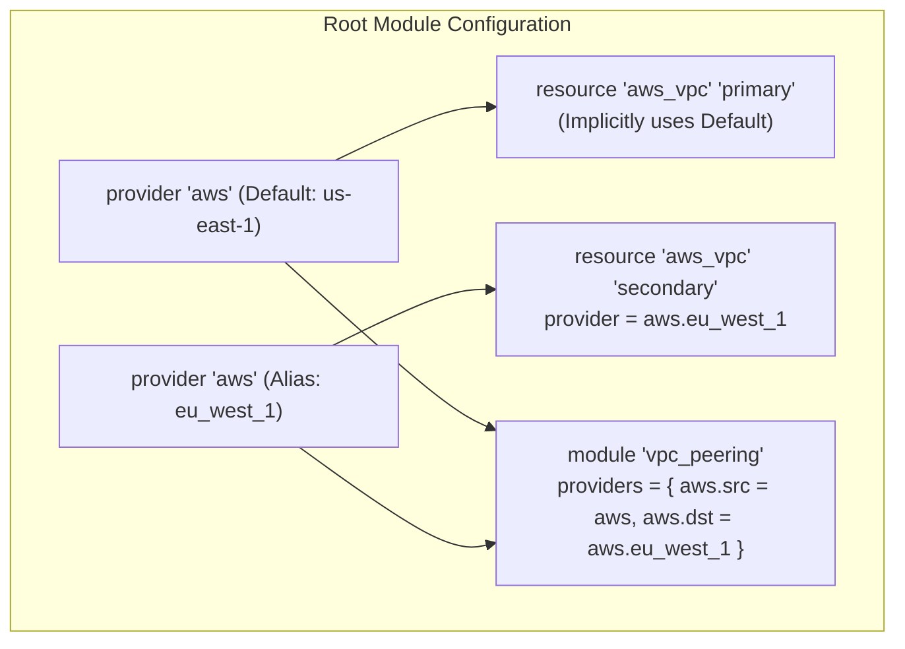
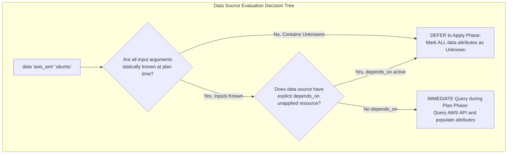
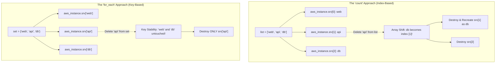
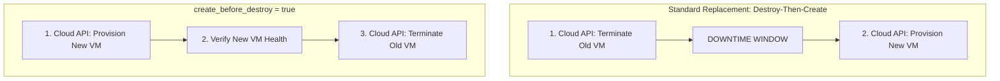

# Module 04: Providers, Resources, Data Sources, Meta-Arguments, and Lifecycle Invariants

Welcome to **Module 04** of the Terraform curriculum. This module provides an in-depth systems engineering examination of Terraform providers, managed resources, data sources, meta-arguments, and lifecycle invariants. We dissect the internal mechanics of provider initialization and aliasing, analyze the operational divergence between managed resources and data sources, demonstrate the algorithmic dangers of array shifting under `count` versus key-stable `for_each`, and evaluate critical lifecycle safeguards including `create_before_destroy`, `replace_triggered_by`, and Terraform 1.16's `lifecycle { destroy = false }` directive.

---

## 1. Core Terminology & Formal Mathematical Definitions

- **Provider**: A pluggable, out-of-process gRPC executable encapsulating the API client, authentication logic, and resource schemas for a specific cloud or infrastructure platform.
- **Provider Alias**: A named secondary configuration instance of a provider (e.g., `aws.eu_west_1`) allowing a single Terraform root configuration to manage resources across multiple cloud regions, subscriptions, or accounts concurrently.
- **Managed Resource (`resource`)**: A declarative declaration of an infrastructure component managed through full CRUD lifecycle transitions (Create, Read, Update, Delete). Terraform tracks the resource in the state file and plans mutations to reconcile drift.
- **Data Source (`data`)**: A declarative read-only query that fetches attributes from external, pre-existing infrastructure entities (such as an existing AWS VPC, a published AMI, or a DNS record) without managing their lifecycle.
- **Meta-Argument**: A top-level keyword built into the Terraform language syntax (e.g., `count`, `for_each`, `depends_on`, `provider`, `lifecycle`) that alters the evaluation behavior, instance multiplicity, or scheduling order of a resource or module.
- **Array Shifting Anomaly**: The catastrophic failure mode occurring when `count` is parameterized by a list and an intermediate element is deleted. The indices of all subsequent elements decrement by one ($k \to k-1$), forcing Terraform to destroy and recreate every subsequent resource instance.
- **`create_before_destroy` Invariant**: A lifecycle scheduling directive that inverts the default destroy-then-create order for replacement actions, ensuring zero-downtime updates by provisioning the new instance before tearing down the old instance.
- **Immutable Resource Replacement**: The cloud architecture constraint where specific resource attributes (e.g., changing the CIDR block of an existing subnet or the instance architecture of a virtual machine) cannot be modified in-place by the cloud provider API, requiring the resource to be destroyed and recreated.

---

## 2. Provider Configuration, Scoping, and Aliases

Providers are configured at the root module level inside `terraform { required_providers { ... } }` and standalone `provider` blocks.



### Provider Aliases for Multi-Region Deployments

When managing infrastructure spanning multiple geographic regions or AWS accounts within a single state file, Terraform uses provider aliases:

```hcl
terraform {
  required_version = ">= 1.16.0"
  required_providers {
    aws = {
      source  = "hashicorp/aws"
      version = "~> 5.40.0"
    }
  }
}

# Primary (default) provider instance
provider "aws" {
  region = "us-east-1"
}

# Secondary provider instance with explicit alias
provider "aws" {
  alias  = "eu_west_1"
  region = "eu-west-1"
}

# Resource explicitly bound to the aliased provider
resource "aws_s3_bucket" "eu_backup" {
  provider = aws.eu_west_1
  bucket   = "enterprise-eu-backup-archive"
}
```

### The Architectural Anti-Pattern: Provider Blocks Inside Child Modules

A common architectural flaw in legacy codebases is embedding `provider` blocks inside reusable child modules:

```hcl
# modules/database/main.tf -- ANTI-PATTERN!
provider "aws" {
  region = var.db_region
}

resource "aws_db_instance" "db" { ... }
```

**Why This Is Prohibited**:

1. **Blocks Module Multiplicity**: If a child module contains a `provider` configuration block, Terraform completely forbids the use of `count` or `for_each` on the `module` block in the parent configuration.
2. **Orphaned State Deadlocks**: If the module is removed from the root configuration, Terraform attempts to destroy the child resources. However, because the module configuration containing the provider credentials and region has been deleted, Terraform Core cannot initialize the provider binary to issue the destroy calls, stranding the resources in cloud accounts.
3. **Best Practice**: Always declare provider configurations in the root module, and pass provider references down to child modules via the `providers` map argument.

---

## 3. Managed Resources vs. Data Sources: Operational Lifecycle

While managed resources and data sources share similar HCL syntax, their evaluation engines and lifecycle models diverge sharply.

| Architectural Dimension | Managed Resource (`resource`) | Data Source (`data`) |
| :-- | :-- | :-- |
| **Lifecycle Capabilities** | Full CRUD (Create, Read, Update, Delete) | Read-Only query against existing infrastructure |
| **State Persistence** | Full resource schema and attributes stored in `.tfstate` | Results cached in state, but refreshed every plan |
| **Destruction Behavior** | Destroyed during `terraform destroy` or block deletion | Untouched; external entity remains unaffected |
| **Evaluation Timing** | Planned during plan phase; mutated during apply phase | Evaluated during plan phase if arguments are known |
| **Deferred Evaluation** | Attributes marked `(known after apply)` | Entire data source deferred to apply if inputs unknown |

### Data Source Evaluation Timing & The `depends_on` Trap

When Terraform executes `terraform plan`, it attempts to evaluate all data sources immediately to populate the configuration graph.



> [!WARNING]
> Adding `depends_on` to a data source forces Terraform to defer reading the data source until the apply phase, even if all input arguments are known static strings. When evaluation is deferred to apply, **every single attribute of the data source becomes unknown (`cty.UnknownVal`) during the plan phase**. This propagates unknown values downstream, preventing the evaluation of `count`, `for_each`, and precondition checks across the entire configuration.

---

## 4. Meta-Arguments: `count` vs. `for_each` and The Shifting Hazard

Terraform provides two meta-arguments to scale resource multiplicity: `count` and `for_each`.



### The Array Shifting Catastrophe

Consider provisioning three production relational database instances using `count`:

```hcl
variable "databases" {
  type    = list(string)
  default = ["analytics", "billing", "users"]
}

resource "aws_db_instance" "db" {
  count          = length(var.databases)
  identifier     = var.databases[count.index]
  instance_class = "db.r6g.large"
  # ...
}
```

Initially, Terraform creates:

- `aws_db_instance.db[0]` $\to$ `analytics`
- `aws_db_instance.db[1]` $\to$ `billing`
- `aws_db_instance.db[2]` $\to$ `users`

Now, suppose the engineering team retires the `"billing"` database and removes it from the list: `["analytics", "users"]`.

During the subsequent `terraform plan`, Terraform evaluates the array indices:

- Index 0 remains `"analytics"` (No action).
- Index 1 was previously `"billing"`, but is now `"users"`. Because RDS instance identifiers cannot be changed in-place, Terraform schedules `aws_db_instance.db[1]` for **destruction and recreation** as `"users"`.
- Index 2 no longer exists. Terraform schedules `aws_db_instance.db[2]` (the original `"users"` database) for **destruction**.

**The Consequence**: The production `"users"` database is destroyed and recreated from scratch, causing catastrophic data loss and downtime simply because an element in the middle of a list was deleted!

### Key-Stable `for_each` Solution

By utilizing `for_each` parameterized by a set of strings or a map, instance addressing is permanently bound to stable, semantic string keys:

```hcl
resource "aws_db_instance" "db" {
  for_each       = toset(var.databases)
  identifier     = each.key
  instance_class = "db.r6g.large"
}
```

When `"billing"` is removed:

- `aws_db_instance.db["analytics"]` is untouched.
- `aws_db_instance.db["users"]` is untouched.
- `aws_db_instance.db["billing"]` is destroyed.

---

## 5. Lifecycle Customization & Safety Invariants

The `lifecycle` block configures how Terraform schedules operations and guards against catastrophic destruction.



### 1. `create_before_destroy = true`

By default, when an immutable attribute forces resource replacement, Terraform destroys the existing resource before creating the replacement. For web servers or reverse proxies, this creates an outage window.

`create_before_destroy = true` inverts the execution sequence:

1. Terraform creates the replacement resource.
2. Terraform updates upstream routing or load balancer target groups.
3. Terraform destroys the old resource.

> [!CAUTION]
> `create_before_destroy` requires unique naming! If a resource has a statically declared name (e.g., `name = "production-app-bucket"` in `aws_s3_bucket`), creating the new bucket fails with an `AlreadyExists` or `BucketAlreadyOwnedByYou` error before the old bucket can be deleted. When using `create_before_destroy`, use `name_prefix = "production-app-"` instead of `name`.

### 2. `prevent_destroy = true`

`prevent_destroy` acts as a compile-time safety assertion:

```hcl
resource "aws_s3_bucket" "financial_records" {
  bucket = "enterprise-financial-records"
  lifecycle {
    prevent_destroy = true
  }
}
```

If an engineer accidentally modifies the configuration such that the resource would be destroyed (or replaced), `terraform plan` aborts with an error:

```text
Error: Instance cannot be destroyed
Resource aws_s3_bucket.financial_records has lifecycle.prevent_destroy set, but the plan calls for it to be destroyed.
```

> [!WARNING]
> `prevent_destroy` does **NOT** protect a resource if the resource block itself is deleted from the `.tf` file! If the block is removed, Terraform treats the resource as an orphaned instance in state with no corresponding configuration, bypassing the `prevent_destroy` directive entirely and scheduling it for destruction during the next apply!

### 3. Terraform 1.16+ Solution: `lifecycle { destroy = false }`

To solve the historical vulnerability where deleting a configuration block destroyed protected resources, Terraform 1.16 introduced the `lifecycle { destroy = false }` directive:

```hcl
resource "aws_s3_bucket" "financial_records" {
  bucket = "enterprise-financial-records"
  lifecycle {
    destroy = false
  }
}
```

Under Terraform 1.16+, even if the block is removed from the configuration, the state engine refuses to execute the destroy action without explicit administrative override flags.

### 4. `ignore_changes = [...]`

Suppresses diff detection for attributes managed by external systems:

```hcl
resource "aws_autoscaling_group" "web" {
  name             = "web-asg"
  desired_capacity = 3

  lifecycle {
    # Ignore autoscaling capacity scaled dynamically by AWS Application Auto Scaling
    ignore_changes = [
      desired_capacity,
      tags["LastUpdated"]
    ]
  }
}
```

### 5. `replace_triggered_by = [...]`

Introduced in Terraform 1.2, `replace_triggered_by` forces resource replacement whenever a referenced resource or attribute changes:

```hcl
resource "aws_instance" "worker" {
  ami           = "ami-01234567"
  instance_type = "t3.medium"

  lifecycle {
    # Replace VM whenever user data script template changes
    replace_triggered_by = [
      terraform_data.user_data_hash.output
    ]
  }
}
```

---

## 6. CLRS-Style Resource Diff & Lifecycle Resolution Algorithm

```text
ALGORITHM: RESOLVE-RESOURCE-DIFF-AND-LIFECYCLE(CurrentState, DesiredConfig, LifecycleRules)
INPUT: CurrentState from state file, DesiredConfig from HCL AST, and LifecycleRules block.
OUTPUT: Action tuple (ActionType, RequiresReplacement, ExecutionOrder).

PRECONDITIONS:
  1. CurrentState and DesiredConfig conform to the provider's resource schema.
  2. Schema defines attribute mutability constraints (ForceNew / RequiresReplace).

1. Let ActionType = NoOp
2. Let RequiresReplacement = FALSE
3. Let ExecutionOrder = Standard

4. IF CurrentState IS NULL AND DesiredConfig IS NOT NULL:
5.     RETURN (Create, FALSE, Standard)
6. IF CurrentState IS NOT NULL AND DesiredConfig IS NULL:
7.     IF LifecycleRules.DestroyEqualsFalse OR LifecycleRules.PreventDestroy:
8.         RAISE ProtectionError("Resource is protected from destruction by lifecycle rule")
9.     RETURN (Delete, FALSE, Standard)

10. Let AttributeDiffs = COMPUTE-DIFF(CurrentState.Attributes, DesiredConfig.Attributes)

// Filter out attributes specified in ignore_changes
11. IF LifecycleRules.IgnoreChanges IS NOT NULL:
12.     IF LifecycleRules.IgnoreChanges == "all":
13.         AttributeDiffs = EMPTY_SET
14.     ELSE:
15.         FOR EACH IgnoredAttr in LifecycleRules.IgnoreChanges:
16.             AttributeDiffs = AttributeDiffs \ {IgnoredAttr}

// Evaluate replace_triggered_by dependencies
17. FOR EACH TriggerRef in LifecycleRules.ReplaceTriggeredBy:
18.     LOOP INVARIANT: Up to current step, RequiresReplacement is TRUE if any inspected trigger changed.
19.     IF HAS-CHANGED-IN-PLAN(TriggerRef):
20.         RequiresReplacement = TRUE
21.         BREAK

// Evaluate provider schema ForceNew constraints
22. FOR EACH (AttrKey, DiffVal) in AttributeDiffs:
23.     IF ProviderSchema.IsForceNew(AttrKey):
24.         RequiresReplacement = TRUE

25. IF RequiresReplacement:
26.     IF LifecycleRules.PreventDestroy:
27.         RAISE ProtectionError("Resource replacement blocked by prevent_destroy")
28.     IF LifecycleRules.CreateBeforeDestroy:
29.         ExecutionOrder = CreateBeforeDestroy
30.     ELSE:
31.         ExecutionOrder = DestroyBeforeCreate
32.     RETURN (Replace, TRUE, ExecutionOrder)

33. IF |AttributeDiffs| > 0:
34.     RETURN (Update, FALSE, Standard)

35. RETURN (NoOp, FALSE, Standard)
```

---

## 7. Then vs. Now: Provider & Lifecycle Evolution

| Capability / Directive | Legacy Terraform ($\le$ 0.11) | Modern Terraform (0.12 – 1.15) | Current Terraform (1.16 – 1.17) & OpenTofu (1.13) |
| :-- | :-- | :-- | :-- |
| **Instance Multiplicity** | `count` only; array shifting risk on list deletion | Introduced `for_each` (0.12.6) for maps and sets | `for_each` standard across resources, modules, and dynamic blocks |
| **Destruction Safeguards** | Static `prevent_destroy`; ignored if resource block deleted | Static `prevent_destroy`; throws error on plan | Terraform 1.16: `lifecycle { destroy = false }`; OpenTofu dynamic lifecycle |
| **Replacement Triggers** | Brittle `null_resource` triggers with string interpolation | Introduced `replace_triggered_by` (1.2+) | `replace_triggered_by` paired with native `terraform_data` resource |
| **Data Source Scoping** | Inline data queries; often blocked plan graph walks | Deferred evaluation for computed data inputs | Optimized plan-time data reads; warning checks for unnecessary `depends_on` |
| **Provider Requirements** | Untyped `provider "aws" { version = "..." }` | `required_providers` with explicit `source` and `version` | Dynamic provider evaluation; OCI registry provider sources (OpenTofu) |

---

## 8. Exam Delta: Terraform Associate 004 vs. Modern Realities

> [!NOTE]
> The HashiCorp Certified: Terraform Associate (004) exam targets **Terraform 1.12**. Key distinctions to recognize:
>
> 1. **`count` vs. `for_each` Addressing**: The exam heavily tests instance addressing syntax: `aws_instance.web[0]` for `count` versus `aws_instance.web["api"]` for `for_each`. Candidates must understand why `for_each` prevents cascading recreational diffs.
> 2. **`prevent_destroy` Boundaries**: Exam 004 asks about `prevent_destroy = true` throwing plan errors. The exam does not cover Terraform 1.16's `destroy = false` syntax.
> 3. **Provider Aliases**: Candidates must know how to declare provider aliases (`alias = "..."`) and reference them in resources using `provider = aws.alias_name`.
> 4. **Data Source Mechanics**: The exam tests that data sources allow Terraform configurations to reference external resources without managing their lifecycle.

---

## 9. Production Failure Modes & Operational Gotchas

### 1. `create_before_destroy` Name Collision Deadlock

An engineer defines an S3 bucket or IAM role with an immutable attribute change and adds `create_before_destroy = true`:

```hcl
resource "aws_iam_role" "app" {
  name = "production-app-role" # Hardcoded unique name!
  assume_role_policy = data.aws_iam_policy_document.new_policy.json

  lifecycle {
    create_before_destroy = true
  }
}
```

During apply:

1. Terraform attempts to create the replacement role with name `"production-app-role"`.
2. AWS IAM returns `EntityAlreadyExists: Role with name production-app-role already exists`.
3. The apply aborts. The old role is never destroyed, and the new role cannot be created.

**Remediation**: Use `name_prefix = "production-app-role-"`, allowing AWS to append a random alphanumeric suffix to the replacement resource.

### 2. Deleting a `prevent_destroy` Resource Block

An engineer wishes to delete a database protected by `prevent_destroy = true`. Believing the protection is active, they delete the `resource "aws_db_instance" "db"` block from `main.tf` and run `terraform apply`.

Because the block no longer exists in configuration, Terraform does not read the `lifecycle` block. The resource is identified as orphaned state and is immediately destroyed.

**Remediation**: Use Terraform 1.16+ `lifecycle { destroy = false }` or use `removed` blocks (`removed { from = aws_db_instance.db lifecycle { destroy = false } }`) to safely unmanage infrastructure without deleting it.

---

## 10. Interview Drill: Deep-Dive Architectural Questions

<details>
<summary><strong>Q1. Explain the "array shifting problem" when using `count` with lists. Why does `for_each` eliminate this failure mode?</strong></summary>

**Answer**: When `count = length(var.list)` is used, resource instances are indexed by sequential integers: `resource[0]`, `resource[1]`, `resource[2]`. If an element in the middle of the list is deleted (e.g., removing index 1), all subsequent elements shift down by one position. In the next plan, Terraform compares each integer address to its previous state. Resource `[1]` now contains the configuration of what was previously `[2]`. If the resource requires immutable recreation on name changes (such as databases or virtual machines), Terraform destroys and recreates every shifted instance, causing widespread outages. In contrast, `for_each` indexes resources by unique, immutable string keys (`resource["web"]`, `resource["db"]`). Deleting an item removes only that specific key from the map, leaving all other instances untouched.

- Ref: Terraform Language: Meta-Arguments: `for_each`.

</details>

<details>
<summary><strong>Q2. What occurs when an explicit `depends_on` meta-argument is placed on a data source? Why is this often an anti-pattern?</strong></summary>

**Answer**: Placing `depends_on` on a data source forces Terraform Core to defer the reading of that data source from the plan phase to the apply phase, even if all input arguments are known static strings. During the plan phase, because the data source has not been read, every single attribute returned by the data source is marked as unknown (`cty.UnknownVal`). This cascades unknown values to any resource, local variable, or module that consumes the data source's outputs. If any downstream resource uses those outputs in `count` or `for_each`, the plan phase fails entirely. `depends_on` should only be placed on data sources when querying infrastructure created within the same apply run.

- Ref: HashiCorp Documentation: Data Sources: Evaluation Order.

</details>

<details>
<summary><strong>Q3. Why does `create_before_destroy = true` fail when applied to resources with hardcoded unique names?</strong></summary>

**Answer**: `create_before_destroy` inverts the execution graph, instructing the engine to create the replacement resource before terminating the existing resource. If the resource specifies a hardcoded unique name (such as `name = "my-bucket"` for an S3 bucket or IAM role), the cloud API rejects the creation of the replacement resource with an `AlreadyExists` error because the existing resource is still active. The apply fails immediately, and the old resource is never reached for destruction. To resolve this, practitioners must use `name_prefix` instead of `name`, allowing the cloud provider or Terraform to append a unique suffix to the new instance.

- Ref: Terraform Resource Lifecycle: `create_before_destroy`.

</details>

<details>
<summary><strong>Q4. How does Terraform 1.16's `lifecycle { destroy = false }` differ from legacy `prevent_destroy = true`?</strong></summary>

**Answer**: Legacy `prevent_destroy = true` is a compile-time assertion evaluated only when a resource block exists in the configuration and is planned for destruction. If a developer deletes the entire resource block from the `.tf` file, Terraform Core treats the resource as an untracked instance in state, bypassing the `prevent_destroy` directive and destroying the physical infrastructure. Terraform 1.16's `lifecycle { destroy = false }` embeds destruction prohibition deeper into the state and schema engine, preventing destruction even if the configuration block is deleted, unless explicitly unmanaged via a `removed` block.

- Ref: Terraform 1.16 Release Notes & Lifecycle Improvements.

</details>

<details>
<summary><strong>Q5. Why is defining `provider` blocks inside child modules prohibited in modern Terraform architectures?</strong></summary>

**Answer**: Placing `provider` blocks inside child modules violates modular decoupling:

1. It prevents the parent configuration from using `count` or `for_each` on the `module` block, because Terraform cannot dynamically instantiate multiple distinct provider instances at runtime.
2. It introduces state teardown deadlocks: if the child module is removed from the configuration, the provider credentials and region settings are removed with it, preventing Terraform Core from initializing the provider required to destroy the child resources. Providers should always be declared in the root module and passed to child modules via the `providers` map.

- Ref: HashiCorp Module Authoring Best Practices.

</details>

<details>
<summary><strong>Q6. How does the `replace_triggered_by` meta-argument improve upon legacy `null_resource` triggers?</strong></summary>

**Answer**: In legacy Terraform, forcing the recreation of a resource when an external file or value changed required defining a `null_resource` with a `triggers` map, and wiring downstream resources to depend on the `null_resource`. This was brittle, cluttered state, and required third-party provider plugins. Introduced in Terraform 1.2, `replace_triggered_by` allows a managed resource to natively monitor attributes of any other resource, local value, or `terraform_data` block. When any referenced value changes, Terraform automatically plans a replacement action without intermediate wrapper resources.

- Ref: Terraform 1.2 Release Notes: `replace_triggered_by`.

</details>

<details>
<summary><strong>Q7. Under what circumstances does `ignore_changes = all` introduce critical security vulnerabilities?</strong></summary>

**Answer**: `ignore_changes = all` instructs Terraform to ignore drift on every attribute of a resource after creation. If security-critical attributes—such as an S3 bucket's public access block, a security group's ingress rules, or a database's encryption settings—are subsequently modified out-of-band (e.g., by a compromised credential or misconfigured script), Terraform will never detect, report, or remediate the vulnerability. Furthermore, intentional security updates made in the HCL configuration will be silently ignored. Best practice mandates explicitly enumerating only the specific dynamic attributes intended to drift (e.g., `ignore_changes = [tags["LastModified"], desired_capacity]`).

- Ref: CIS Benchmark for Infrastructure as Code Security.

</details>

---

## 11. Proof Map & Executable Verifications

The resource lifecycle invariants, provider aliasing mechanics, and array shifting proofs detailed in this module are backed by executable proofs in the test suite:

| Theoretical Concept | Test Assertion / Specification | Test File Reference |
| :-- | :-- | :-- |
| **Array Shifting Anomaly** | Destruction cascade under `count` vs stability under `for_each` | [`../examples/ts/04-providers-resources-and-lifecycle.test.ts`](../examples/ts/04-providers-resources-and-lifecycle.test.ts) |
| **`create_before_destroy` Ordering** | Graph inversion verification and naming collision constraints | [`../examples/ts/04-providers-resources-and-lifecycle.test.ts`](../examples/ts/04-providers-resources-and-lifecycle.test.ts) |
| **`replace_triggered_by` Lifecycle** | Verification that attribute modifications trigger replacement | [`../examples/ts/04-providers-resources-and-lifecycle.test.ts`](../examples/ts/04-providers-resources-and-lifecycle.test.ts) |
| **Data Source Deferral Mechanics** | Verification that `depends_on` induces apply-time evaluation | [`../examples/ts/04-providers-resources-and-lifecycle.test.ts`](../examples/ts/04-providers-resources-and-lifecycle.test.ts) |
