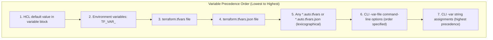
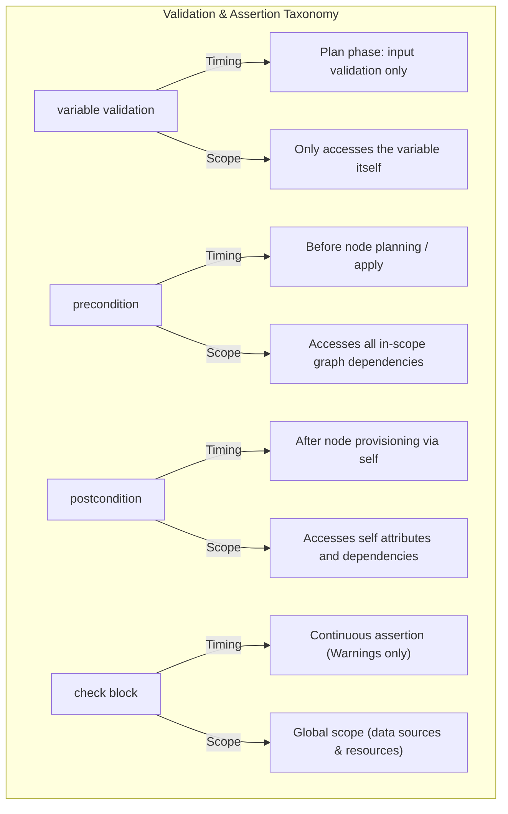
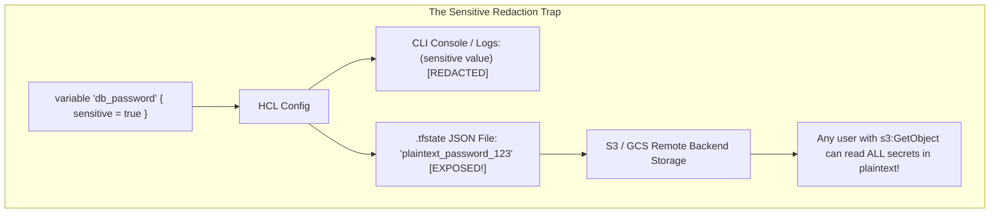
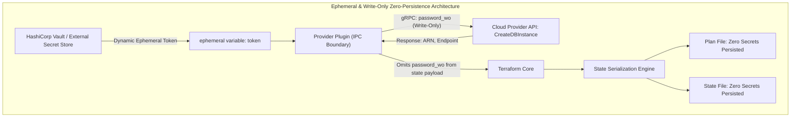

# Module 05: Variables, Outputs, Custom Conditions, Ephemeral Values, and Write-Only Secrets

Welcome to **Module 05** of the Terraform curriculum. This module provides an exhaustive, security-focused exploration of input variables, output values, custom validation assertions, ephemeral value lifecycles, and write-only secret mechanics. We analyze the exact resolution precedence of variable sources, examine the execution timing of preconditions, postconditions, and `check` blocks, deconstruct the critical architectural flaw of `sensitive = true` in state persistence, and demonstrate how Terraform 1.10+ ephemeral values and Terraform 1.11+ write-only arguments guarantee zero plaintext persistence across the state storage boundary.

For formal cryptographic models, secrets-at-rest storage principles, and envelope encryption architectures, refer to the foundational security curriculum in [`architecture/security-identity/modules/03-passwords-and-secrets-at-rest.md`](../../../architecture/security-identity/modules/03-passwords-and-secrets-at-rest.md).

---

## 1. Core Terminology & Formal Mathematical Definitions

- **Input Variable (`variable`)**: A typed, parameterized parameter passed into a root or child module, allowing configurations to be shared and reused across environments without duplicating code.
- **Output Value (`output`)**: An exported property calculated by a module that exposes metadata to parent modules or external state consumers via `terraform output` and remote state references.
- **Variable Precedence Hierarchy**: The deterministic total order of evaluation used by Terraform Core to resolve conflicting definitions for the same input variable identifier.
- **Custom Condition Assertion**: A declarative boolean predicate evaluated at runtime against configuration inputs or resource outputs, raising formal diagnostic errors if violated.
- **Precondition**: An invariant assertion attached to a resource, data source, or output evaluated _before_ the entity is planned or executed, asserting that external dependencies satisfy operational requirements.
- **Postcondition**: An invariant assertion evaluated _after_ resource provisioning or data source retrieval, asserting that the resulting attributes (accessible via `self`) satisfy required security or network invariants before unlocking downstream dependent nodes.
- **`check` Block**: A continuous, out-of-band validation block introduced in Terraform 1.5 that executes assertions during planning and application, emitting diagnostic warnings without blocking graph execution or mutating state.
- **The Sensitive Redaction Fallacy**: The common security misconception that setting `sensitive = true` encrypts or protects secrets. In reality, `sensitive` only masks values in terminal output and CLI logs; values remain unencrypted in plaintext JSON inside the `.tfstate` file.
- **Ephemeral Value (`ephemeral = true`)**: A capability introduced in Terraform 1.10 designating that a variable, local, or output must exist strictly in ephemeral process memory. Ephemeral values are mathematically forbidden from being serialized into plan files or state files.
- **Write-Only Argument (`_wo`)**: A provider schema capability introduced in Terraform 1.11 allowing sensitive arguments (e.g., database passwords or API keys) to be transmitted directly over gRPC to cloud APIs during mutation without ever being returned or persisted in state.

---

## 2. Input Variables, Precedence Hierarchy, and Scoping

Terraform resolves input variables across multiple files, CLI flags, and environment variables according to a strict, non-negotiable precedence hierarchy.



### Detailed Evaluation Precedence

When multiple definitions exist for variable `database_size`, Terraform applies the definition from the highest tier:

1. **Default Value**: Defined in the `variable` block (`default = "db.t3.micro"`).
2. **Environment Variables**: Prefixed with `TF_VAR_` (e.g., `export TF_VAR_database_size="db.t3.small"`).
3. **`terraform.tfvars`**: Automatically loaded if present in the current working directory.
4. **`terraform.tfvars.json`**: JSON equivalent, loaded automatically.
5. **`*.auto.tfvars` & `*.auto.tfvars.json`**: Automatically loaded in lexicographical order (e.g., `01-base.auto.tfvars` is overridden by `02-prod.auto.tfvars`).
6. **CLI `-var-file` Flags**: Explicitly loaded via command line (`-var-file="secrets.tfvars"`). If multiple `-var-file` flags are supplied, they evaluate in the order specified on the command line.
7. **CLI `-var` Flags**: Highest precedence, overriding all file-based declarations (`-var="database_size=db.r6g.xlarge"`).

### Deprecation and Nullability

Terraform provides advanced variable configuration attributes:

- **`nullable = false`**: Enforces that the variable cannot be explicitly assigned `null`. If a caller passes `database_size = null`, Terraform rejects the assignment and falls back to the default or raises a type validation error.
- **`deprecated = "..."` (Terraform 1.15+)**: Allows module authors to mark variables as deprecated, emitting compiler warnings during plan and apply without breaking existing callers.

---

## 3. Custom Validations, Preconditions, Postconditions, and Check Blocks

Modern Terraform provides four distinct assertion mechanisms to enforce security and architectural invariants.



### 1. Variable Custom Validation

Attached directly to `variable` definitions to validate input values before graph execution begins:

```hcl
variable "cidr_block" {
  type        = string
  description = "VPC CIDR block"

  validation {
    condition     = can(cidrnetmask(var.cidr_block))
    error_message = "The cidr_block argument must be a valid IPv4 CIDR string (e.g., 10.0.0.0/16)."
  }

  validation {
    condition     = split("/", var.cidr_block)[1] <= "24"
    error_message = "VPC CIDR mask must be /24 or larger."
  }
}
```

### 2. Lifecycle Preconditions and Postconditions

Introduced in Terraform 1.2, preconditions and postconditions protect resources from invalid operating states.

```hcl
resource "aws_instance" "web" {
  ami           = data.aws_ami.ubuntu.id
  instance_type = var.instance_type
  subnet_id     = aws_subnet.app.id

  lifecycle {
    # Precondition: Assert that the selected subnet resides in an approved AZ
    precondition {
      condition     = contains(["us-east-1a", "us-east-1b"], aws_subnet.app.availability_zone)
      error_message = "Web instances must be deployed into availability zones us-east-1a or us-east-1b."
    }

    # Postcondition: Assert that the newly created instance received an encrypted root block device
    postcondition {
      condition     = self.root_block_device[0].encrypted == true
      error_message = "The root block device must be encrypted at rest with AWS KMS."
    }
  }
}
```

- **`precondition`**: Evaluated before `aws_instance.web` calls the provider's `PlanResourceChange` or `ApplyResourceChange`. If `aws_subnet.app` is unapproved, planning aborts immediately.
- **`postcondition`**: Evaluated after the instance has been applied, using the special `self` identifier to inspect real-world attributes returned by the cloud API. If the root device is unencrypted, the postcondition fails, aborting subsequent downstream dependents.

### 3. Continuous Monitoring with `check` Blocks

Introduced in Terraform 1.5, `check` blocks execute continuous assertion testing without mutating infrastructure or failing the plan:

```hcl
check "website_health" {
  data "http" "endpoint" {
    url = "https://${aws_route53_record.web.fqdn}/healthz"
  }

  assert {
    condition     = data.http.endpoint.status_code == 200
    error_message = "Production healthz endpoint returned HTTP ${data.http.endpoint.status_code}."
  }
}
```

If the health check fails, Terraform emits a visible diagnostic warning in the console output, but **does not halt deployment**.

---

## 4. Secret Management: The Sensitive Redaction Fallacy

A dangerous vulnerability in cloud security operations is relying on `sensitive = true` to protect cryptographic keys and credentials.



### Why `sensitive = true` Is Insufficient

Marking an input variable or output as `sensitive = true`:

1. Tells the CLI renderer to mask the value in `stdout`, `stderr`, and execution plans as `(sensitive value)`.
2. Marks the attribute in the internal `cty.Value` structure with `cty.SensitiveValue`.
3. **DOES NOT ENCRYPT THE STATE FILE**: When Terraform writes the state file, it serializes all resource attributes directly into plaintext JSON:

```json
{
  "mode": "managed",
  "type": "aws_db_instance",
  "name": "primary",
  "instances": [
    {
      "attributes": {
        "identifier": "production-db",
        "password": "SuperSecretPassword123!",
        "username": "admin"
      }
    }
  ]
}
```

Anyone with read permissions to the remote state backend (e.g., S3 bucket, DynamoDB lock table, HCP workspace) can extract production passwords, TLS private keys, and API tokens directly.

---

## 5. Ephemeral Values & Write-Only Secrets (Terraform 1.10 & 1.11+)

To solve the state exposure vulnerability at the language level, modern Terraform introduced two complementary primitives: **Ephemeral Values** and **Write-Only Arguments**.



### 1. Ephemeral Values (Terraform 1.10+)

An ephemeral value is guaranteed never to be persisted to disk:

```hcl
# Declaring an ephemeral input variable
variable "vault_auth_token" {
  type      = string
  ephemeral = true # Value exists strictly in process memory!
}

# Consuming via an ephemeral resource
ephemeral "vault_kv_secret_v2" "db_secret" {
  mount = "secret"
  name  = "database/production"
}
```

**Compiler Invariants**:

- An ephemeral value cannot be assigned to a non-ephemeral variable or argument.
- An ephemeral value cannot be referenced inside standard managed resources that persist their schema to state.
- Ephemeral values are excluded entirely from saved plan files (`-out=tfplan`) and the `.tfstate` JSON file.

### 2. Write-Only Arguments (Terraform 1.11+)

In Terraform 1.11, provider schemas can designate specific resource attributes as write-only (`_wo`). Write-only attributes allow Terraform to transmit passwords and certificates to cloud APIs during resource creation or update without requiring the provider to return them in the state response:

```hcl
resource "aws_db_instance" "production" {
  identifier     = "production-db"
  instance_class = "db.r6g.large"
  username       = "admin"

  # Write-only argument: sent over gRPC, NEVER stored in .tfstate!
  password_wo    = ephemeral.vault_kv_secret_v2.db_secret.data["password"]
}
```

When `terraform apply` runs:

1. Terraform Core passes `password_wo` across the gRPC boundary to the AWS provider binary.
2. The provider calls the AWS RDS `CreateDBInstance` API over TLS.
3. The provider returns the resource state to Core, omitting `password_wo`.
4. The `.tfstate` file stores only the non-sensitive attributes (endpoint, ARN, identifier).

---

## 6. CLRS-Style Custom Condition Evaluation Algorithm

```text
ALGORITHM: EVALUATE-CUSTOM-CONDITIONS(Scope, Preconditions, Postconditions, CheckBlocks)
INPUT: Execution Scope containing bound identifiers, Preconditions list, Postconditions list, and CheckBlocks list.
OUTPUT: Diagnostic collection Diagnostics containing errors and warnings.

PRECONDITIONS:
  1. Scope contains all necessary symbol bindings for currently planned vertices.
  2. All assertions conform to boolean expression schemas.

1. Let Diagnostics = EMPTY_LIST

// Phase 1: Evaluate Preconditions before resource mutation
2. FOR EACH Pre in Preconditions:
3.     LOOP INVARIANT: All preconditions processed prior to current step evaluated to TRUE,
                      or an error diagnostic was appended to Diagnostics.
4.     Let CondVal = EVALUATE-HCL-EXPRESSION(Pre.Condition, Scope)
5.     IF CondVal.IsUnknown:
6.         // Preconditions depending on unknown values cannot be validated; defer or error
7.         Diagnostics.Append(Error("Precondition depends on computed unknown values", Pre.SourceRange))
8.     ELSE IF CondVal.Payload != TRUE:
9.         Let ErrorMsg = EVALUATE-HCL-EXPRESSION(Pre.ErrorMessage, Scope).Payload
10.        Diagnostics.Append(FatalError(ErrorMsg, Pre.SourceRange))

// Phase 2: Evaluate Postconditions after resource mutation via 'self'
11. FOR EACH Post in Postconditions:
12.    LOOP INVARIANT: All postconditions processed prior to current step evaluated to TRUE,
                      or an error diagnostic was appended to Diagnostics.
13.    Let ExtendedScope = Scope.Extend({"self": Scope.Lookup("current_resource_instance")})
14.    Let CondVal = EVALUATE-HCL-EXPRESSION(Post.Condition, ExtendedScope)
15.    IF CondVal.Payload != TRUE:
16.        Let ErrorMsg = EVALUATE-HCL-EXPRESSION(Post.ErrorMessage, ExtendedScope).Payload
17.        Diagnostics.Append(FatalError(ErrorMsg, Post.SourceRange))

// Phase 3: Evaluate Check Blocks (Out-of-band monitoring)
18. FOR EACH Chk in CheckBlocks:
19.    FOR EACH Assertion in Chk.Assertions:
20.        Let CondVal = EVALUATE-HCL-EXPRESSION(Assertion.Condition, Scope)
21.        IF CondVal.Payload != TRUE:
22.            Let WarnMsg = EVALUATE-HCL-EXPRESSION(Assertion.ErrorMessage, Scope).Payload
23.            Diagnostics.Append(Warning(WarnMsg, Assertion.SourceRange))

POSTCONDITIONS:
  1. If Diagnostics contains any FatalError, execution aborts and downstream vertices are canceled.
  2. Warnings in Diagnostics are printed to standard output without halting execution.
24. RETURN Diagnostics
```

---

## 7. Then vs. Now: Secrets & Validation Evolution

| Security & Validation Feature | Legacy Terraform ($\le$ 0.11) | Modern Terraform (0.12 – 1.9) | Current Terraform (1.10 – 1.17) & OpenTofu (1.13) |
| :-- | :-- | :-- | :-- |
| **Sensitive Redaction** | Completely absent; secrets displayed in plaintext in terminal | Introduced `sensitive = true` (0.14); CLI output redacted, state plaintext | `sensitive = true` with fine-grained tracking across expressions |
| **State Secrets Persistence** | Plaintext JSON stored in state | Plaintext JSON stored in state; reliant on KMS | Terraform 1.10+: `ephemeral = true`; 1.11+: write-only `_wo` arguments |
| **Input Validation** | None; required external shell wrappers or pre-commit hooks | Introduced `validation` blocks inside `variable` blocks (0.13) | Multi-rule `validation` with custom diagnostic error messages |
| **Lifecycle Assertions** | External testing tools (Terratest, kitchen-terraform) | Introduced `precondition` and `postcondition` blocks (1.2) | Preconditions/Postconditions standard; native `check` blocks (1.5) |
| **Variable Deprecation** | Unstructured comments in README | Manual code comments | Native `deprecated = "..."` attribute (1.15+) |

---

## 8. Exam Delta: Terraform Associate 004 vs. Modern Realities

> [!NOTE]
> The HashiCorp Certified: Terraform Associate (004) exam targets **Terraform 1.12**. Candidates must understand these exam specifics:
>
> 1. **Sensitive Variables**: The exam heavily tests `sensitive = true`. Candidates must know that `sensitive` suppresses values in CLI output, but does **NOT** encrypt values in the `.tfstate` file.
> 2. **Custom Validation**: Exam 004 tests variable `validation` blocks, requiring knowledge of the `condition` boolean expression and `error_message` string requirement.
> 3. **Preconditions & Postconditions**: Introduced in 1.2, preconditions and postconditions are tested on Exam 004, including the use of `self` inside postcondition blocks.
> 4. **Ephemeral Values**: Exam 004 introduces basic theoretical concepts of ephemeral values and write-only arguments (introduced in 1.10/1.11), but candidates are primarily tested on core `sensitive` flag mechanics and Vault provider patterns.

---

## 9. Production Failure Modes & Operational Gotchas

### 1. Committing `terraform.tfvars` Containing Secrets to Git

Developers often populate `terraform.tfvars` with local testing secrets (e.g., `db_password = "SecretPass123!"`). If `.gitignore` is misconfigured, `terraform.tfvars` is committed to the Git repository. Because Git maintains full historical commit trees, even deleting the file in a subsequent commit leaves the secret permanently exposed in the repository's packfiles. Always use environment variables (`TF_VAR_db_password`) or dynamic secret backends (HashiCorp Vault) rather than static files.

### 2. Preconditions Referencing Computed Unknown Attributes

If a `precondition` references an attribute of another resource that has not yet been applied:

```hcl
resource "aws_route53_record" "app" {
  zone_id = data.aws_route53_zone.primary.zone_id
  name    = "app.example.com"
  type    = "A"
  records = [aws_eip.lb.public_ip]

  lifecycle {
    precondition {
      # aws_eip.lb is being created in this apply run; public_ip is UNKNOWN at plan time!
      condition     = startswith(aws_eip.lb.public_ip, "54.")
      error_message = "Elastic IP must be within AWS public range 54.0.0.0/8."
    }
  }
}
```

During planning, `aws_eip.lb.public_ip` evaluates to `cty.UnknownVal`. Terraform cannot evaluate `startswith(Unknown, "54.")`. The plan fails with: `Condition expression cannot be evaluated because it depends on resource attributes that are unknown until apply`.

**Remediation**: Move post-provisioning attribute checks into a `postcondition` on the resource generating the attribute (`aws_eip.lb`), or use static CIDR checks in the input variable.

---

## Interview Drill

<details><summary>1. Explain the "sensitive redaction fallacy" in Terraform. Why is setting `sensitive = true` insufficient for protecting database passwords?</summary>

Setting `sensitive = true` instructs Terraform Core's UI and logging subsystems to redact the value from standard output, execution plans, and console logs, replacing it with `(sensitive value)`. However, `sensitive = true` does not perform cryptographic encryption on the underlying data. When Terraform persists resource metadata to the state backend (such as an S3 bucket or local `.tfstate` file), the sensitive attribute is written in cleartext, unencrypted JSON. Any user or service account with read access to the state file can extract the password directly. True protection requires client-side state encryption (as in OpenTofu), access-controlled remote backends, or Terraform 1.10+ ephemeral values and write-only arguments.

- Ref: HashiCorp Security Advisory: Sensitive Data in State.
</details>

<details><summary>2. How do Terraform 1.10's `ephemeral` variables and Terraform 1.11's `_wo` write-only arguments eliminate secret persistence in `.tfstate`?</summary>

`ephemeral = true` on a variable mandates that the value exist strictly in volatile memory during the active execution turn. The compiler strictly forbids ephemeral values from being serialized into plan files or standard state resources. Terraform 1.11 pairs this with write-only provider arguments (`_wo`). When an ephemeral secret is passed to a `_wo` argument, Terraform Core transmits the value over the gRPC IPC boundary directly to the provider's `ApplyResourceChange` RPC. The provider sends the secret over TLS to the cloud API, but omits the attribute when returning the resulting state payload back to Core. As a result, the secret is never persisted to `.tfplan` or `.tfstate`.

- Ref: Terraform 1.10 & 1.11 Release Notes: Ephemeral & Write-Only Attributes.
</details>

<details><summary>3. Contrast the operational lifecycle and failure behavior of `precondition`, `postcondition`, and `check` blocks.</summary>

1. `precondition`: Evaluated _before_ a resource is planned or provisioned. It verifies upstream dependencies and environment invariants. If it evaluates to `false`, the resource is not provisioned, planning aborts, and downstream dependants are canceled.
2. `postcondition`: Evaluated _after_ a resource has been planned or provisioned. It inspects the actual realized attributes of the resource via `self`. If it evaluates to `false`, the apply aborts, but the resource itself has already been created in the cloud provider, leaving it in state.
3. `check`: Continuous, out-of-band monitoring evaluated during every plan and apply. If an assertion in a `check` block evaluates to `false`, Terraform emits a diagnostic warning to the console, but **never aborts** graph execution or alters state.

- Ref: Terraform Language: Custom Conditions Specification.
</details>

<details><summary>4. List the variable definition sources in order of evaluation precedence from highest to lowest.</summary>

From highest precedence (overrides all others) to lowest:

1. Command-line flags: `-var` and `-var-file` (in command-line order).
2. Any `*.auto.tfvars` or `*.auto.tfvars.json` files (evaluated in alphabetical order).
3. `terraform.tfvars.json`.
4. `terraform.tfvars`.
5. Environment variables prefixed with `TF_VAR_<name>`.
6. Default values defined in the `variable` block.

- Ref: Terraform CLI: Variable Definition Precedence.
</details>

<details><summary>5. What occurs if a variable is declared with `nullable = false` and a caller explicitly assigns `var_name = null`?</summary>

When `nullable = false` is configured, Terraform forbids explicit assignment of `null`. If a default value is defined, Terraform does not fail; it automatically discards the `null` assignment and substitutes the declared default value. If no default value is defined, Terraform raises an immediate type validation error during the plan phase, stating that the variable does not permit null values.

- Ref: Terraform Language: Variable Configuration Attributes: `nullable`.
</details>

<details><summary>6. Why does evaluating a `precondition` that depends on an unknown value abort execution during `terraform plan`?</summary>

Preconditions are fatal assertion gates. If a precondition's condition expression references an attribute marked `(known after apply)`, the expression evaluates to an unknown boolean (`cty.UnknownVal`) under Kleene logic. Terraform cannot definitively determine whether the invariant is satisfied or violated. To prevent provisioning infrastructure based on unvalidated assumptions, Terraform rejects the plan with an error indicating that the precondition cannot be verified until apply time.

- Ref: Terraform Core Evaluation Engine: Condition Evaluation.
</details>

<details><summary>7. How does HashiCorp Vault integrate with Terraform to provide dynamic, short-lived credentials rather than static secrets?</summary>

Rather than storing static cloud credentials in Terraform variables or configuration files, Terraform leverages the Vault provider (`vault_aws_access_credentials`). Terraform authenticates to Vault using a machine identity (e.g., OIDC or AWS IAM auth) and requests an ephemeral credential lease. Vault dynamically generates short-lived IAM access keys with a bounded time-to-live (e.g., 15 minutes). Terraform consumes these credentials to provision infrastructure, and upon completion of the apply phase, Vault automatically revokes the IAM keys, eliminating long-term credential leakage.

- Ref: HashiCorp Vault Secrets Engine for AWS.
</details>

---

## 11. Proof Map & Executable Verifications

The variable precedence order, custom validation conditions, and ephemeral secret mechanics detailed in this module are backed by executable proofs in the test suite:

| Theoretical Concept | Test Assertion / Specification | Test File Reference |
| :-- | :-- | :-- |
| **Variable Precedence Hierarchy** | Evaluation of override order across CLI, tfvars, and env vars | [`../examples/ts/05-variables-outputs-validation-and-secrets.test.ts`](../examples/ts/05-variables-outputs-validation-and-secrets.test.ts) |
| **Custom Condition Invariants** | Precondition, postcondition, and check block evaluation | [`../examples/ts/05-variables-outputs-validation-and-secrets.test.ts`](../examples/ts/05-variables-outputs-validation-and-secrets.test.ts) |
| **Ephemeral & Write-Only Mechanics** | Zero-persistence verification across state serialization | [`../examples/ts/05-variables-outputs-validation-and-secrets.test.ts`](../examples/ts/05-variables-outputs-validation-and-secrets.test.ts) |
| **Sensitive Redaction Verification** | Masking in CLI plans alongside state file plaintext exposure | [`../examples/ts/05-variables-outputs-validation-and-secrets.test.ts`](../examples/ts/05-variables-outputs-validation-and-secrets.test.ts) |
