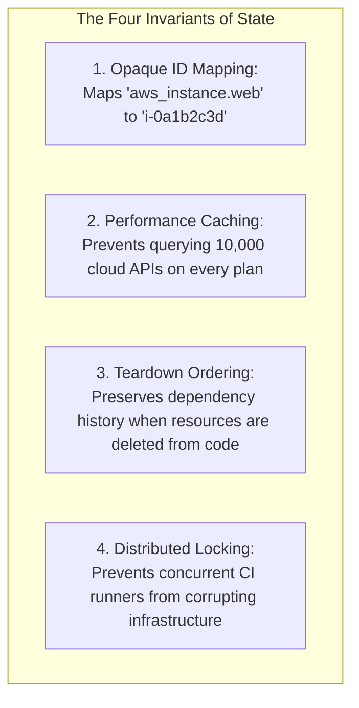
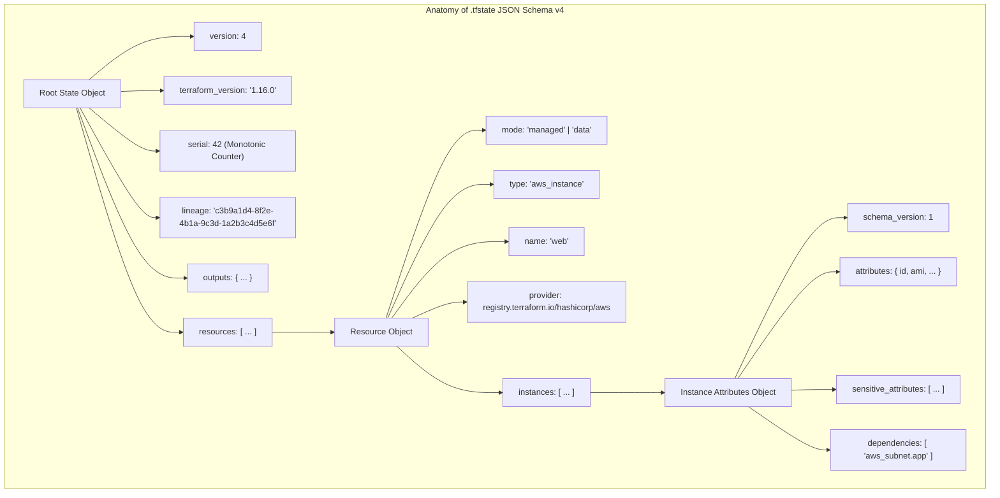
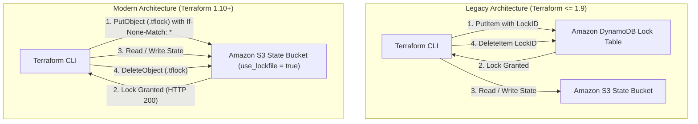
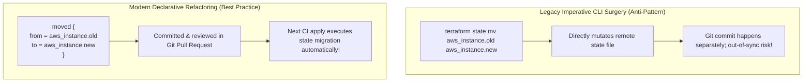

# Module 06: State Internals, Lineage, Remote Backends, S3 Lockfiles, and State Surgery

Welcome to **Module 06** of the Terraform curriculum. This module provides an exhaustive, systems-level analysis of the Terraform state subsystem, remote backend protocols, distributed concurrency locking, and declarative state surgery. We dissect the JSON Schema v4 format of `.tfstate`, formalize the Compare-And-Swap (CAS) invariants of lineage and serial counters, evaluate the architectural shift from DynamoDB locking to S3 native conditional lockfiles (`use_lockfile = true`), and contrast declarative refactoring blocks (`moved`, `import`, `removed`) against imperative CLI surgery.

For formal distributed systems models, consensus protocols, fencing tokens, and distributed locking invariants, refer to the distributed systems curriculum in [`architecture/distributed-systems/modules/08-distributed-coordination-and-locks.md`](../../../architecture/distributed-systems/modules/08-distributed-coordination-and-locks.md).

---

## 1. Core Terminology & Formal Mathematical Definitions

- **State File (`.tfstate`)**: A version-controlled or remote JSON document acting as the authoritative mapping between declarative HCL configuration addresses (e.g., `aws_instance.web["api"]`) and physical cloud infrastructure identifiers (e.g., `i-0a1b2c3d4e5f6g7h8`).
- **Lineage**: A cryptographically random UUID v4 string generated when a state file is first initialized, serving as its permanent, immutable identity. Any state update whose lineage does not match the active state is rejected as an un-mergeable conflict.
- **Serial Counter**: A monotonically increasing 64-bit integer tracking state mutations. Every transaction that modifies `.tfstate` increments `serial` by exactly 1: $$\text{serial}_{t+1} = \text{serial}_t + 1$$
- **Optimistic Concurrency Control (OCC)**: A concurrency control protocol enforcing that a state commit succeeds if and only if the current serial number in storage equals the expected baseline serial read at the beginning of the transaction.
- **Distributed State Lock**: A mutual-exclusion mechanism acquired by Terraform Core prior to initiating any planning or application phase, preventing concurrent processes from reading or modifying state simultaneously.
- **S3 Native Lockfile (`use_lockfile = true`)**: A capability introduced in Terraform 1.10 leveraging Amazon S3's native conditional write primitives (`PutObject` with `If-None-Match: *`) to achieve distributed mutual exclusion directly within S3, eliminating the need for a separate DynamoDB lock table.
- **Declarative Refactoring**: The practice of declaring resource renames, module migrations, and removals directly within HCL code using `moved`, `import`, and `removed` blocks, version-controlling state mutations within Git instead of running manual CLI commands.
- **Imperative State Surgery**: Low-level operational commands (`terraform state mv`, `rm`, `pull`, `push`) executed via the CLI to directly mutate the state file, bypassing configuration declaration.

---

## 2. Why State Is Strictly Necessary

Practitioners often wonder why Terraform requires a persistent state file, whereas tools like Kubernetes rely on in-cluster state. Terraform requires state due to four fundamental systems constraints:



1. **Mapping Configuration to Physical Reality**: Cloud provider APIs assign non-deterministic physical identifiers (e.g., AWS VPC IDs like `vpc-0123456789abcdef0`). HCL code references human-readable identifiers (`aws_vpc.primary`). The state file provides the bijective mapping $f: \text{HCL Address} \longleftrightarrow \text{Physical Cloud ID}$.
2. **Performance at Scale**: In an enterprise infrastructure with 5,000 resources, querying cloud provider APIs for every single resource on every keystroke or plan invocation would exhaust API rate limits (HTTP 429) and take hours. State caches attributes, allowing targeted diffing.
3. **Tracking Dependencies for Destruction**: When an engineer deletes an `aws_subnet` block from their `.tf` files, Terraform no longer has access to the HCL configuration. Without the state file, Terraform would have zero knowledge that the subnet ever existed, stranding the orphaned resource in the cloud account. The state file records the historical existence and dependency relationships of resources until they are formally deleted from the cloud.
4. **Mutual Exclusion**: State stores locking metadata to serialize concurrent team operations.

---

## 3. The `.tfstate` JSON Schema v4 Architecture

Modern Terraform persists state as a JSON document conforming to Schema Version 4.



### Complete State File JSON Excerpt

```json
{
  "version": 4,
  "terraform_version": "1.16.0",
  "serial": 42,
  "lineage": "c3b9a1d4-8f2e-4b1a-9c3d-1a2b3c4d5e6f",
  "outputs": {
    "vpc_id": {
      "value": "vpc-0a1b2c3d4e5f6g7h8",
      "type": "string"
    }
  },
  "resources": [
    {
      "mode": "managed",
      "type": "aws_vpc",
      "name": "primary",
      "provider": "provider[\"registry.terraform.io/hashicorp/aws\"]",
      "instances": [
        {
          "schema_version": 1,
          "attributes": {
            "arn": "arn:aws:ec2:us-east-1:123456789012:vpc/vpc-0a1b2c3d4e5f6g7h8",
            "cidr_block": "10.0.0.0/16",
            "id": "vpc-0a1b2c3d4e5f6g7h8",
            "tags": {
              "Environment": "production"
            }
          },
          "sensitive_attributes": [],
          "dependencies": []
        }
      ]
    }
  ]
}
```

---

## 4. Remote Backends & Distributed Concurrency Locking

Storing state locally in a `terraform.tfstate` file is strictly forbidden in team environments. Local state prevents collaborative deployments, risks accidental deletion, and provides zero concurrency locking.

### Standard Remote Backends

- **`s3`**: Stores state in Amazon S3. Highly durable ($99.999999999\%$). Supports client-side or server-side KMS encryption and state locking.
- **`gcs`**: Stores state in Google Cloud Storage with native bucket-level locking.
- **`azurerm`**: Stores state in Azure Blob Storage with blob lease locking.
- **`remote` / `cloud`**: Integrates natively with HCP Terraform or Terraform Enterprise.

### The S3 Distributed Locking Evolution: DynamoDB vs. Native S3

For over a decade, using the S3 backend required provisioning a separate Amazon DynamoDB table strictly to provide distributed locking:



#### The Legacy DynamoDB Mechanism

Terraform wrote an item to DynamoDB containing primary key `LockID`:

- `LockID = "<bucket>/<key>-md5"`
- DynamoDB conditional write: `attribute_not_exists(LockID)`.
- If two CI runners ran simultaneously, the second runner received `ConditionalCheckFailedException` and halted.

#### The Modern S3 Native Lockfile Mechanism (`use_lockfile = true`)

In August 2024, Amazon S3 introduced support for conditional writes on `PutObject` (`If-None-Match: *`). Terraform 1.10 capitalized on this primitive by introducing native S3 locking:

```hcl
terraform {
  backend "s3" {
    bucket       = "enterprise-production-tfstate"
    key          = "networking/vpc.tfstate"
    region       = "us-east-1"
    encrypt      = true
    use_lockfile = true # Eliminates DynamoDB requirement!
  }
}
```

When `use_lockfile = true` is enabled:

1. Terraform creates a lock file object named `networking/vpc.tfstate.tflock` in S3 using an HTTP `PUT` request with header `If-None-Match: *`.
2. If the lock object already exists, S3 rejects the request with HTTP `412 Precondition Failed`.
3. If the write succeeds, the lock is held. Terraform executes the plan/apply, writes the updated state, and deletes the `.tflock` object upon completion.

### Anatomy of Lock Information Payload

When Terraform acquires a lock, it writes a structured JSON payload:

```json
{
  "ID": "f9b8c7d6-e5a4-3b2c-1d0e-9f8a7b6c5d4e",
  "Operation": "OperationTypeApply",
  "Info": "",
  "Who": "ci-runner-42@ip-10-0-1-100",
  "Version": "1.16.0",
  "Created": "2026-11-07T14:30:00Z",
  "Path": "enterprise-production-tfstate/networking/vpc.tfstate"
}
```

### The `force-unlock` Command and Operational Hazards

If a CI job is terminated ungracefully (`kill -9`, spot instance termination, or network drop), the distributed lock may remain stranded in storage. Any subsequent run aborts with:

```text
Error: Error acquiring the state lock
Lock Info:
  ID:        f9b8c7d6-e5a4-3b2c-1d0e-9f8a7b6c5d4e
  Path:      enterprise-production-tfstate/networking/vpc.tfstate
  Who:       ci-runner-42@ip-10-0-1-100
  Created:   2026-11-07T14:30:00Z
```

An operator can release the stranded lock:

```bash
terraform force-unlock f9b8c7d6-e5a4-3b2c-1d0e-9f8a7b6c5d4e
```

> [!CAUTION]
> Running `force-unlock` while another process is actively writing state results in catastrophic state corruption. Two processes writing to the identical state file simultaneously will trigger split-brain overwrites, causing resources provisioned by the first process to be permanently lost from state. Always verify via process monitoring and network telemetry that the original process is completely dead before unlocking.

---

## 5. Declarative Refactoring vs. Imperative State Surgery

State restructuring occurs when refactoring code (e.g., extracting monolithic resources into reusable child modules, or renaming resources to match new conventions).



### 1. Declarative Refactoring: `moved` Blocks

Introduced in Terraform 1.1, `moved` blocks allow developers to declare renames and module migrations directly inside HCL code:

```hcl
# Renaming a resource instance
moved {
  from = aws_instance.web
  to   = aws_instance.frontend
}

# Migrating a standalone resource into a child module
moved {
  from = aws_security_group.allow_tls
  to   = module.networking.aws_security_group.allow_tls
}

# Migrating an unindexed resource into a for_each map
moved {
  from = aws_subnet.public
  to   = aws_subnet.public["us-east-1a"]
}
```

When `terraform plan` executes:

1. Terraform Core detects the `moved` instruction.
2. It re-addresses the recorded state instance from `aws_instance.web` to `aws_instance.frontend`.
3. It plans zero infrastructure destruction or recreation: the plan indicates that the resource has simply moved addresses.

### 2. Declarative Import: `import` Blocks

Introduced in Terraform 1.5 and expanded to child modules in Terraform 1.16, `import` blocks allow bringing pre-existing infrastructure under management declaratively:

```hcl
import {
  to = aws_s3_bucket.data_lake
  id = "corporate-legacy-data-lake-bucket"
}

resource "aws_s3_bucket" "data_lake" {
  bucket = "corporate-legacy-data-lake-bucket"
}
```

Combined with `terraform plan -generate-config-out=generated.tf`, Terraform automatically generates the corresponding HCL resource block matching the live cloud resource attributes.

### 3. Declarative Unmanagement: `removed` Blocks

Introduced in Terraform 1.7, `removed` blocks allow safe removal of resources from Terraform management without destroying physical cloud infrastructure:

```hcl
removed {
  from = aws_db_instance.legacy_database

  lifecycle {
    destroy = false # Untrack from state, DO NOT delete cloud database!
  }
}
```

### 4. Imperative State CLI Commands

While declarative blocks are preferred, imperative CLI commands are essential for disaster recovery:

- **`terraform state list`**: Enumerates all resource instance addresses in state.
- **`terraform state show <addr>`**: Dumps full JSON attributes of a single resource instance.
- **`terraform state mv <from> <to>`**: Imperatively moves an address.
- **`terraform state rm <addr>`**: Removes a resource from state without deleting physical infrastructure.
- **`terraform state pull > state.json`**: Downloads current raw remote state to a local file.
- **`terraform state push state.json`**: Overwrites remote state with a modified local file (mandates lineage and serial consistency).

---

## 6. OpenTofu Native Client-Side State Encryption

In standard Terraform, state backends rely entirely on cloud-side storage encryption (e.g., S3 SSE-KMS). The state payload is transmitted over HTTPS in plaintext and decrypted by the storage service, exposing sensitive credentials to any identity possessing storage-level read permissions.

OpenTofu 1.7+ introduced native client-side state encryption:

```hcl
terraform {
  encryption {
    key_provider "aws_kms" "production_key" {
      kms_key_id = "arn:aws:kms:us-east-1:123456789012:key/c0a1b2c3-..."
      region     = "us-east-1"
    }

    method "aes_gcm" "app_encryption" {
      keys = key_provider.aws_kms.production_key
    }

    state {
      method   = method.aes_gcm.app_encryption
      enforced = true
    }

    plan {
      method   = method.aes_gcm.app_encryption
      enforced = true
    }
  }
}
```

Under this model:

1. OpenTofu encrypts the state JSON payload locally in client memory using AES-256-GCM before transmitting it to the remote backend.
2. The remote backend stores purely ciphertext bytes.
3. Even a root administrator with full access to the S3 bucket cannot view credentials without possessing explicit decrypt permissions on the KMS key.

---

## 7. CLRS-Style Atomic State Commit Algorithm

```text
ALGORITHM: ATOMIC-STATE-COMMIT-WITH-LOCK-VALIDATION(Backend, ProposedState, ActiveLock)
INPUT: Configured Backend storage client, ProposedState generated from apply walk, and ActiveLock handle.
OUTPUT: Success boolean or raises ConcurrencyConflictError.

PRECONDITIONS:
  1. ActiveLock is held by current process and matches storage lock token.
  2. ProposedState has passed schema validation and cryptographic integrity checks.

1. Let StorageState = Backend.ReadRawState()

// Invariant 1: Lineage must match exactly
2. IF StorageState.Lineage != ProposedState.Lineage:
3.     Backend.ReleaseLock(ActiveLock)
4.     RAISE LineageMismatchError("Lineage mismatch! Attempted to commit state to unrelated backend target")

// Invariant 2: Serial must follow strict monotonic ordering (OCC Check)
5. IF StorageState.Serial != ProposedState.ExpectedBaselineSerial:
6.     Backend.ReleaseLock(ActiveLock)
7.     RAISE ConcurrencyConflictError("State serial conflict! Remote state was modified by a concurrent process")

// Prepare updated state payload
8. ProposedState.Serial = StorageState.Serial + 1
9. ProposedState.TerraformVersion = CURRENT_CLI_VERSION()
10. Let SerializedPayload = JSON-ENCODE(ProposedState)

11. IF Backend.EncryptionEnforced:
12.     SerializedPayload = ENCRYPT-AES-GCM(SerializedPayload, Backend.KeyProvider)

// Execute atomic storage write
13. Let CommitSuccess = Backend.ConditionalWrite(
14.     Key = Backend.StateKey,
15.     Payload = SerializedPayload,
16.     ExpectedETag = StorageState.ETag
17. )

18. IF NOT CommitSuccess:
19.     Backend.ReleaseLock(ActiveLock)
20.     RAISE StorageWriteFailedError("Conditional write failed on remote storage backend")

21. Backend.ReleaseLock(ActiveLock)

POSTCONDITIONS:
  1. Remote state in backend contains ProposedState with Serial incremented by exactly 1.
  2. ActiveLock is completely released from backend storage.
22. RETURN TRUE
```

---

## 8. Then vs. Now: State & Backend Evolution

| State Architecture Dimension | Legacy Terraform ($\le$ 0.11) | Modern Terraform (0.12 – 1.9) | Current Terraform (1.10 – 1.17) & OpenTofu (1.13) |
| :-- | :-- | :-- | :-- |
| **S3 Backend Locking** | Mandatory DynamoDB table required for state locking | Mandatory DynamoDB table required for state locking | Terraform 1.10+: S3 native `use_lockfile = true` eliminates DynamoDB |
| **Resource Refactoring** | Imperative CLI surgery: `terraform state mv` in shell scripts | Introduced declarative `moved` blocks in HCL (1.1+) | Full declarative suite: `moved`, `import`, and `removed` blocks |
| **Infrastructure Import** | Imperative `terraform import <addr> <id>` command only | Imperative CLI only | Declarative `import` blocks (1.5+) + module-level imports (1.16+) |
| **Client-Side State Encryption** | None; completely plaintext JSON payloads | None; relies on remote storage bucket encryption | OpenTofu 1.7–1.13: Native client-side state and plan encryption |
| **State Deletion Safety** | Deleting resource block destroyed infrastructure | Deleting resource block destroyed infrastructure | `removed { lifecycle { destroy = false } }` preserves cloud infra |

---

## 9. Exam Delta: Terraform Associate 004 vs. Modern Realities

> [!NOTE]
> The HashiCorp Certified: Terraform Associate (004) exam targets **Terraform 1.12**. Key distinctions to recognize:
>
> 1. **State Subcommands**: Exam 004 tests `terraform state list`, `terraform state show`, `terraform state mv`, and `terraform state rm`. Candidates must know what each subcommand accomplishes.
> 2. **State Locking & Force Unlock**: The exam tests that backends support locking to prevent race conditions, and tests `terraform force-unlock <ID>` for clearing stale locks.
> 3. **DynamoDB vs. S3**: Exam 004 expects that S3 backends require a DynamoDB table (`dynamodb_table = "..."`) for locking. While Terraform 1.10 introduced `use_lockfile = true`, exam questions reflect the DynamoDB requirement.
> 4. **Declarative Refactoring**: Exam 004 covers `moved` blocks and basic `import` blocks, but does not test `removed` blocks or OpenTofu native state encryption.

---

## 10. Production Failure Modes & Operational Gotchas

### 1. The Catastrophic `force-unlock` Race Condition

A CI/CD pipeline executing `terraform apply` encounters an apparent hang due to a slow AWS API response. An impatient engineer assumes the runner crashed and executes:

```bash
terraform force-unlock a1b2c3d4-e5f6-7890-abcd-ef0123456789
```

Meanwhile, a second CI runner triggers an apply. Both runners now hold valid write paths:

- Runner 1 commits its state update with serial 105.
- Runner 2 finishes moments later and commits its state update with serial 106, overwriting Runner 1's commit.
- All resources provisioned by Runner 1 are erased from `.tfstate`, stranding live, unmanaged resources in the cloud account.

### 2. Renaming Resources in Code Without a `moved` Block

An engineer renames `resource "aws_db_instance" "master"` to `resource "aws_db_instance" "primary"`.

Without a `moved` block:

1. Terraform looks at configuration: `primary` is a new resource (Action: Create).
2. Terraform looks at state: `master` is no longer in configuration (Action: Destroy).
3. The execution plan proposes destroying the existing database and provisioning a brand-new, empty database.

Always commit a `moved` block alongside the HCL rename:

```hcl
moved {
  from = aws_db_instance.master
  to   = aws_db_instance.primary
}
```

---

## Interview Drill

<details><summary>1. Explain the formal systems engineering roles of `lineage` and `serial` in Terraform's state file schema.</summary>

`lineage` is an RFC 4122 UUID generated when a state file is first created. It represents the permanent cryptographic identity of the infrastructure instance. If an operator attempts to push or merge a state file with a different lineage, Terraform rejects the operation, preventing cross-environment state overwrites (e.g., accidentally applying staging state to production). `serial` is a 64-bit monotonically increasing counter tracking state mutation transactions. Terraform utilizes `serial` for Optimistic Concurrency Control (OCC): when committing state, Core verifies that the remote serial matches the baseline read at the start of the transaction. If the remote serial has advanced, the commit fails, preventing lost updates from concurrent writers.

- Ref: Terraform State File Format Specification v4.
</details>

<details><summary>2. How does Terraform 1.10's native S3 lockfile (`use_lockfile = true`) eliminate the requirement for Amazon DynamoDB?</summary>

Historically, Amazon S3 lacked atomic conditional write primitives, requiring an external coordination service (DynamoDB with conditional `attribute_not_exists`) to manage distributed mutual exclusion. In 2024, Amazon S3 introduced conditional writes via HTTP `PUT` requests using header `If-None-Match: *`. Terraform 1.10 leveraged this by writing an ephemeral lock object (`<key>.tflock`) directly to S3. If another process holds the lock, S3 rejects the conditional write with HTTP `412 Precondition Failed`. This provides atomic, distributed mutual exclusion entirely within S3, simplifying backend infrastructure and eliminating DynamoDB costs and IAM permissions.

- Ref: Terraform 1.10 Release Notes & S3 Conditional Writes Specification.
</details>

<details><summary>3. Contrast declarative `moved` blocks against imperative `terraform state mv` commands. Why are `moved` blocks superior in team environments?</summary>

`terraform state mv` is an imperative command executed locally against the active remote state file. It is decoupled from version control: if an engineer runs `state mv` locally, other team members' branches and CI runners will fail until the corresponding HCL code rename is merged. If a branch is rolled back, the state remains modified. In contrast, `moved` blocks are declarative statements embedded directly in version-controlled `.tf` files. They undergo peer review in pull requests, execute atomically during the standard CI plan/apply cycle, and seamlessly migrate state across all developer workstations and environments without manual terminal intervention.

- Ref: HashiCorp Documentation: Refactoring with Moved Blocks.
</details>

<details><summary>4. What is the operational danger of executing `terraform force-unlock`? Under what strict conditions is it safe to execute?</summary>

`terraform force-unlock` forcefully tears down the distributed mutual exclusion lock in the remote backend. If executed while another process is actively planning or applying, it enables concurrent writers, producing split-brain state corruption and permanent loss of managed resources. It is safe to execute _only_ after confirming that the process identified in the lock metadata (`Who`, `Created`, `Path`) is completely dead—verifying that the CI job aborted, the host instance was terminated, and no network sockets or background processes remain active.

- Ref: Terraform CLI: `force-unlock` Safety Protocol.
</details>

<details><summary>5. How does OpenTofu's client-side state encryption differ fundamentally from S3 server-side encryption (SSE-KMS)?</summary>

S3 Server-Side Encryption (SSE-KMS) encrypts data only at rest within storage hardware. The state payload is transmitted over TLS to S3 as plaintext, decrypted by AWS, and stored. Any IAM principal in the AWS account possessing `s3:GetObject` permissions can read the decrypted state file and extract embedded credentials. In contrast, OpenTofu client-side encryption encrypts the state in client RAM using AES-256-GCM before transmitting it over the network. The backend stores purely unreadable ciphertext. An attacker with full read access to the S3 bucket cannot decrypt the state without explicit access to the KMS decryption key.

- Ref: OpenTofu Architecture: State & Plan Encryption.
</details>

<details><summary>6. How does a `removed` block with `lifecycle { destroy = false }` protect infrastructure when retiring code?</summary>

Historically, removing a resource block from HCL caused Terraform to classify the resource as orphaned in state, scheduling it for physical deletion in the cloud provider. Introduced in Terraform 1.7, `removed { from = <addr> lifecycle { destroy = false } }` instructs Terraform Core to remove the resource from the state file during the next apply without calling the provider's `DeleteResource` API. The physical infrastructure remains running in the cloud, unmanaged, while the code is cleanly retired from the repository.

- Ref: Terraform 1.7 Release Notes: `removed` Blocks.
</details>

<details><summary>7. Why can't Terraform store state directly inside Git alongside `.tf` configuration files?</summary>

Storing state in Git introduces three critical failures:

1. **Concurrency Race Conditions**: Git possesses no distributed locking mechanism. Two developers running plans or applies concurrently will generate conflicting merge commits, risking lost state updates.
2. **Security & Plaintext Secrets**: Git histories are immutable append-only logs. Once a secret is written to `.tfstate` in Git, it remains permanently stored in commit packfiles even if deleted in future commits.
3. **State Freshness**: Git pull/push cycles are manual. Applying against an un-pulled, stale local state file risks executing destructive operations against live infrastructure.

- Ref: Production IaC Architectural Antipatterns.
</details>

---

## 12. Proof Map & Executable Verifications

The state serialization schemas, S3 locking invariants, and declarative refactoring mechanics detailed in this module are backed by executable proofs in the test suite:

| Theoretical Concept | Test Assertion / Specification | Test File Reference |
| :-- | :-- | :-- |
| **State Schema v4 Validation** | Invariant checking on lineage, serial, and resource records | [`../examples/ts/06-state-internals-and-backends.test.ts`](../examples/ts/06-state-internals-and-backends.test.ts) |
| **Optimistic Concurrency Control** | Compare-And-Swap rejection on serial mismatch | [`../examples/ts/06-state-internals-and-backends.test.ts`](../examples/ts/06-state-internals-and-backends.test.ts) |
| **S3 Native Lockfile Protocol** | Conditional write simulation and lock contention | [`../examples/ts/06-state-internals-and-backends.test.ts`](../examples/ts/06-state-internals-and-backends.test.ts) |
| **Declarative `moved` Blocks** | Readdressing verification without resource recreation | [`../examples/ts/06-state-internals-and-backends.test.ts`](../examples/ts/06-state-internals-and-backends.test.ts) |
