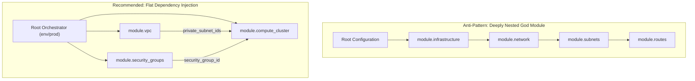

# Module 07: Module Design, Scoping, Versioning, OCI Sources, and Declarative Refactoring

Reusable infrastructure components require strict encapsulation boundaries, deterministic interface contracts, and automated state refactoring mechanisms. In Infrastructure as Code, modules function as the fundamental unit of abstraction, parameterization, and composition. As infrastructure estates scale from dozens to tens of thousands of managed cloud resources, poorly architected modules deteriorate into tightly coupled monolithic antipatterns that amplify blast radiuses and impede organizational velocity.

This module examines the formal semantics of the Terraform module system, lexical variable scoping, hierarchical composition models, module distribution protocols across private registries, Git subtrees, and OpenContainer Initiative (OCI) registries, and the algorithmic mechanics of state namespace translation using declarative `moved` blocks.

---

## 1. Formal Module Architecture and Variable Scoping Model

Formally, a Terraform configuration consists of a hierarchical tree of modules $T = (V, E)$, rooted at the root module $R \in V$. Each child module node $M_i \in V$ represents a self-contained execution context defined within a distinct directory or remote repository. The directed edges $e = (M_p, M_c) \in E$ represent parent-child invocations declared via `module` blocks.

```
Module Invocation Hierarchy:
        +-----------------------------+
        |         Root Module         |
        |           (env/prod)        |
        +--------------+--------------+
                       |
        +--------------+--------------+
        |                             |
+-------v-------+             +-------v-------+
|  module.vpc   |             | module.db_rds |
|  (networking) |             |  (persistence)|
+-------+-------+             +---------------+
        |
+-------v-------+
| module.subnet |
|  (sub-module) |
+---------------+
```

### Lexical Scope Isolation Invariants

Terraform enforces strict lexical scope isolation across module boundaries. A module is a closed lexical environment with controlled boundaries:

1. **Explicit Ingress (Input Parameters)**: A child module $M_c$ has zero visibility into the variables, locals, or resource attributes of its parent $M_p$. Every input required by $M_c$ must be explicitly passed as an argument in the parent's `module` block and declared within $M_c$'s `variable` definitions. Unpassed variables evaluate to their declared default values; if no default is declared, evaluation halts with a fatal configuration error.
2. **Explicit Egress (Output Interfaces)**: A parent module $M_p$ has zero visibility into the internal resources or local values of a child module $M_c$. The parent can only observe attributes explicitly exposed through $M_c$'s `output` declarations, referenced via the address syntax `module.<MODULE_NAME>.<OUTPUT_NAME>`. Unexported internal resources remain completely private to $M_c$.
3. **No Sibling Leakage**: Sibling modules $M_a, M_b$ invoked by parent $M_p$ cannot communicate directly. Data exchange between siblings requires explicit dependency injection mediated by the parent: $M_p$ reads `module.ma.output_x` and passes it as an input argument to `module.mb.input_y`. The Terraform compiler translates this into an explicit directed edge in the evaluation graph: $M_a \to M_p \to M_b$.
4. **Provider Scope Separation**: By default, child modules inherit default provider configurations from the parent context. However, child modules must never define `provider` configuration blocks internally when designed for reuse. Defining providers within child modules disables the meta-arguments `count` and `for_each` on the `module` block and causes provider destruction deadlocks during resource deletion.

```hcl
# Root module: env/prod/main.tf
module "vpc" {
  source = "../../modules/networking/vpc"

  cidr_block           = var.vpc_cidr
  availability_zones   = ["eu-central-1a", "eu-central-1b"]
  enable_dns_hostnames = true
}

module "database" {
  source = "../../modules/database/rds"

  # Dependency injection between sibling modules mediated by root orchestrator
  subnet_ids         = module.vpc.private_subnet_ids
  security_group_ids = [module.vpc.db_security_group_id]
  allocated_storage  = 100
  instance_class     = "db.r6g.large"
}
```

---

## 2. Module Composition Patterns: Flat vs Nested and Dependency Injection

Module design in large-scale infrastructure environments balances two competing architectural topologies: deeply nested hierarchical inheritance versus flat service-oriented composition.



### The God Module Anti-Pattern

A "God Module" attempts to encapsulate an entire infrastructure environment (network, compute, storage, DNS, identity) within a single deeply nested tree. This topology exhibits critical failure modes:

- **Massive Graph Construction Overhead**: Terraform must construct and evaluate the full Directed Acyclic Graph (DAG) for every plan and apply operation, leading to multi-minute runs and upstream cloud API throttling.
- **Cascading Unintended Recreations**: Changes to low-level network primitives invalidate downstream node calculations, causing unexpected replacements of stateful persistence clusters.
- **Rigid Interface Bloat**: The root module must pass through hundreds of passthrough variables to reach leaf modules, creating fragile boilerplate that resists refactoring.
- **Inability to Parallelize Team Workflows**: Because all resources reside in a single state file and module tree, multiple development teams step on each other's execution locks and code merges.

### Flat Service Composition via Dependency Injection

The recommended pattern decomposes infrastructure into narrow, single-responsibility modules composed at the root orchestrator level. Modules interact exclusively via dependency injection of output IDs and attribute objects:

```hcl
# modules/compute/ecs_service/variables.tf
variable "service_name" {
  type        = string
  description = "Name of the ECS service and corresponding cloud resources."
}

variable "network_configuration" {
  description = "Structural typing ensures strong contracts between composed modules"
  type = object({
    vpc_id             = string
    private_subnet_ids = list(string)
    security_group_ids = list(string)
  })
}

# Root module invocation: env/prod/main.tf
module "api_service" {
  source = "../../modules/compute/ecs_service"

  service_name = "order-processing"
  network_configuration = {
    vpc_id             = module.vpc.vpc_id
    private_subnet_ids = module.vpc.private_subnet_ids
    security_group_ids = [module.security.api_security_group_id]
  }
}
```

### Explicit Provider Passing via Configuration Aliases

When child modules require alternate provider configurations (such as multi-region deployments, multi-account routing, or cross-account IAM role assumption), the parent passes providers explicitly via the `providers` map argument:

```hcl
# Parent configuration passing explicit provider aliases
module "cross_region_backup" {
  source = "../../modules/storage/s3_replica"

  providers = {
    aws.source      = aws.primary_region
    aws.destination = aws.replica_region
  }

  source_bucket_name = "production-assets-primary"
}
```

Within the child module, proxy provider configurations declare the expected aliases without specifying configuration parameters or credentials:

```hcl
# modules/storage/s3_replica/main.tf
terraform {
  required_providers {
    aws = {
      source                = "hashicorp/aws"
      version               = ">= 5.0.0"
      configuration_aliases = [aws.source, aws.destination]
    }
  }
}

resource "aws_s3_bucket" "source" {
  provider = aws.source
  bucket   = var.source_bucket_name
}

resource "aws_s3_bucket" "replica" {
  provider = aws.destination
  bucket   = "${var.source_bucket_name}-replica"
}
```

---

## 3. Module Distribution Protocols and Source Addressing

Terraform and OpenTofu support diverse distribution protocols for pulling module source trees into the local `.terraform/modules` directory during `terraform init`. Understanding the exact URL parsing and download semantics is essential for secure enterprise packaging.

```
Module Source URI Taxonomy:
+-------------------------------------------------------------------------------+
| Source Protocol    | Address Format                                           |
+--------------------+----------------------------------------------------------+
| Local Filesystem   | ./modules/vpc or ../../modules/database                  |
| Public Registry    | hashicorp/consul/aws                                     |
| Private Registry   | app.terraform.io/example-corp/vpc/aws                    |
| Git HTTPS          | git::https://github.com/org/repo.git?ref=v2.4.0          |
| Git SSH            | git::git@github.com:org/repo.git//modules/vpc?ref=v2.4.0|
| OCI Registry (Tofu)| oci://ghcr.io/org/modules/vpc:2.4.0                      |
+-------------------------------------------------------------------------------+
```

### Git Subtree and Ref Constraints

When consuming Git repositories, module authors must lock installations to immutable cryptographic tags rather than mutable branches:

- **Immutable Tag Pinning**: `source = "git::https://github.com/corporation/terraform-aws-eks.git?ref=v1.14.0"` ensures deterministic execution across CI runners. Pinning to a branch (e.g., `?ref=main`) causes non-reproducible plans and unexpected updates whenever the branch advances.
- **Subdirectory Parsing (`//`)**: The double-slash delimiter separates the repository root from the module subdirectory: `source = "git::ssh://git@github.com/corp/monorepo.git//infra/modules/aurora?ref=v3.2.1"`. The downloader clones the entire repository at the specified revision, but Terraform exposes only the subdirectory as the module root.
- **Shallow Cloning**: Modern Terraform CLI implementations perform shallow Git fetches (`--depth 1`) when an exact commit SHA or tag is requested, minimizing bandwidth consumption on CI workers.

### OpenTofu OCI Module Distribution

OpenTofu (1.7+ and 1.13.2) introduces native support for publishing and consuming modules as OpenContainer Initiative (OCI) artifacts:

```hcl
# OpenTofu OCI source resolution
module "secure_s3" {
  source = "oci://ghcr.io/enterprise-infra/modules/s3-bucket:1.5.0"

  bucket_name = "enterprise-audit-logs"
  kms_key_arn = module.kms.key_arn
}
```

OCI module sources provide distinct architectural advantages:

- **Container Registry Alignment**: Modules are stored, replicated, and permissioned in the exact same registry used for Docker and OCI container images (Harbor, AWS ECR, Google Artifact Registry, GitHub Packages).
- **Vulnerability & Compliance Scanning**: OCI registries can scan module packages for embedded secrets, unencrypted configs, and misconfigurations using standard container scanners.
- **No Local Git Client**: CI workers do not require `git`, `ssh-agent`, or deployment keys installed in their container images; they authenticate to the OCI registry using standard token exchange.

### Dynamic Module Sources and Versions (Terraform 1.15+)

Beginning in Terraform 1.15, module blocks support variables and local values within `source` and `version` expressions under restricted evaluation phases:

```hcl
locals {
  module_channel = var.is_production ? "stable" : "canary"
}

module "platform_core" {
  source  = "app.terraform.io/corp/core/aws"
  version = "~> 2.0"

  environment = local.module_channel
}
```

This capability eliminates manual copy-pasting of module blocks across multiple environments while maintaining static graph discoverability during `terraform init`.

---

## 4. Declarative State Refactoring with Moved Blocks

Historically, restructuring Terraform configurations (such as moving a resource into a child module or renaming a module) required operators to perform imperative, error-prone `terraform state mv` commands out-of-band. If an operator renamed a resource in HCL without running `state mv`, Terraform planned a destructive replacement: destroying the live infrastructure and recreating it from scratch.

Terraform 1.1 introduced declarative `moved` blocks, extending them across complex module topologies in versions 1.5, 1.8, and 1.16. Declarative refactoring records state namespace migrations directly in version control.

### Mathematical Model of State Address Migration

Let $\mathcal{S}$ denote the Terraform state file, consisting of a set of resource instances indexed by unique addresses $\mathcal{A}$:

$$\mathcal{S} = \{ (a, D) \mid a \in \mathcal{A}, D \in \mathcal{D} \}$$

Where $D$ represents the provider-specific resource attribute dictionary. A refactoring transformation is a bijection $f: \mathcal{A}_{\text{old}} \to \mathcal{A}_{\text{new}}$ that rebinds data $D$ to a new address without modifying the underlying remote infrastructure:

$$\mathcal{S}' = (\mathcal{S} \setminus \{ (a_{\text{old}}, D) \}) \cup \{ (f(a_{\text{old}}), D) \}$$

### Core Moved Block Topologies

#### 1. Migrating an Existing Resource into a Child Module

```hcl
# Moving aws_security_group.web into module.network
moved {
  from = aws_security_group.web
  to   = module.network.aws_security_group.web
}
```

#### 2. Migrating Resources Between Sibling Modules

```hcl
# Reorganizing networking into a dedicated cluster module
moved {
  from = module.old_vpc.aws_subnet.private
  to   = module.new_network.aws_subnet.private
}
```

#### 3. Transforming a Singleton Resource into a `for_each` Collection

```hcl
# Refactoring a single instance into a map collection with key "primary"
moved {
  from = aws_instance.worker
  to   = aws_instance.worker["primary"]
}
```

#### 4. Renaming an Entire Child Module

```hcl
# Renaming module invocation without recreating any child resources
moved {
  from = module.app_cluster
  to   = module.frontend_cluster
}
```

### Module Refactoring Graph Resolution Algorithm

During the compilation of the planning graph, Terraform evaluates all declared `moved` statements and resolves transitive chains ($A \to B \to C$) using topological sorting and cycle detection:

```
Algorithm: ResolveMovedBlockChains
Input: StateAddressSet A_state, MovedStatementList M
Output: StateMigrationMap MigrationMap

1. Initialize MigrationMap as empty map
2. Initialize DirectedGraph G = (V, E) where V = {}, E = {}
3. for each statement m in M do:
4.     Add vertex m.from to V if not present
5.     Add vertex m.to to V if not present
6.     if edge (m.from, m.to) creates a cycle in G then:
7.         raise DiagnosticError("Cyclic moved block chain detected between " + m.from + " and " + m.to)
8.     Add directed edge (m.from, m.to) to E
9. end for
10. // Invariant: G is a Directed Acyclic Graph (DAG) of address transformations
11. for each address a in A_state do:
12.     current = a
13.     visited = { current }
14.     while exists edge (current, next) in E do:
15.         if next in visited then:
16.             raise DiagnosticError("Cycle detected during address traversal: " + next)
17.         end if
18.         visited = visited union { next }
19.         current = next
20.     end while
21.     if current != a then:
22.         MigrationMap[a] = current
23.     end if
24. end for
25. return MigrationMap
```

The algorithm guarantees:

- **Loop Invariant**: At the start of each iteration in Step 11, `MigrationMap` contains only cycle-free, resolved mappings for the subset of addresses inspected so far.
- **Convergence**: Because $G$ is guaranteed to be a DAG after Step 9, the while loop in Step 14 terminates in at most $|V|$ steps.

---

## 5. Modern Module Controls: Deprecation, Preconditions, and Validation

Modern Terraform versions equip module authors with expressive language constructs to validate inputs, guard invariant postconditions, and signal API deprecation to consumers.

```hcl
# modules/database/rds/variables.tf
variable "storage_size_gb" {
  type        = number
  description = "Allocated database disk storage in gigabytes."

  validation {
    condition     = var.storage_size_gb >= 20 && var.storage_size_gb <= 65536
    error_message = "Storage size must be between 20 GB and 65,536 GB (64 TB)."
  }

  validation {
    condition     = var.storage_size_gb % 10 == 0
    error_message = "Storage size must be allocated in increments of 10 GB."
  }
}

variable "database_tier" {
  type        = string
  description = "Architectural sizing tier."

  # Terraform 1.15+ variable deprecation warning
  deprecated = "The database_tier variable is deprecated. Use instance_class directly to specify instance types."
}
```

Output postconditions enforce service level guarantees before allowing downstream dependent modules to execute:

```hcl
# modules/database/rds/outputs.tf
output "endpoint" {
  value       = aws_db_instance.primary.endpoint
  description = "The connection endpoint for the database."

  precondition {
    condition     = aws_db_instance.primary.status == "available"
    error_message = "Database instance failed to transition to 'available' state."
  }
}
```

Cross-object validation rules (introduced in Terraform 1.8 and expanded in 1.9) allow variable validation conditions to compare multiple variables within the module:

```hcl
variable "enable_tls" {
  type        = bool
  description = "Whether to enforce TLS termination."
}

variable "certificate_arn" {
  type        = string
  description = "ARN of the ACM certificate."
  default     = null

  validation {
    condition     = !var.enable_tls || var.certificate_arn != null
    error_message = "When enable_tls is true, certificate_arn must be specified."
  }
}
```

---

## 6. Then vs Now Comparison

| Dimension | Legacy Terraform (0.12 - 1.0) | Modern Terraform (1.1 - 1.17) & OpenTofu (1.13) | Architectural Rationale |
| :-- | :-- | :-- | :-- |
| **State Refactoring** | Imperative `terraform state mv` executed out-of-band. | Declarative `moved` blocks committed directly in HCL. | Eliminates manual state surgery; coordinates multi-engineer team refactors without drift. |
| **Module Iteration** | `count` and `for_each` unsupported on `module` blocks. | First-class `for_each` and `count` on all child modules. | Allows dynamic multi-instance and multi-region module instantiation from maps and sets. |
| **Module Distribution** | Git URLs and HTTP/Registry endpoints only. | Native OCI registry artifacts (OpenTofu) and dynamic sources (TF 1.15+). | Enables container registry integration, image vulnerability scanning, and dynamic source paths. |
| **Provider Passing** | Implicit inheritance; provider blocks permitted inside child modules. | Explicit proxy configuration via `configuration_aliases`. | Forbids internal provider blocks to avoid destroy graph deadlocks and module uninstantiability. |
| **Deprecation Lifecycle** | Free-form text comments in `description`. | Native `deprecated` parameter on `variable` and `output` (1.15+). | Surfaces compiler-grade warning diagnostics during `terraform plan` and `terraform validate`. |
| **Cross-Variable Validation** | Single variable self-inspection only (`var.self`). | Cross-variable inspection in validation blocks (1.8+). | Prevents conflicting or incompatible module argument combinations at compile time. |

---

## 7. Exam Delta: Associate 004 vs Modern Capabilities

> [!IMPORTANT]
> The HashiCorp Certified: Terraform Associate (004) exam is pegged to **Terraform 1.12**. While modern production environments leverage Terraform 1.16/1.17 and OpenTofu 1.13, candidates must master the exam baseline expectations.

- **Exam Baseline (1.12)**:
  - Candidates must understand module inputs (`variable`), outputs (`output`), and the exact syntax for consuming outputs: `module.<NAME>.<OUTPUT>`.
  - Candidates must know how `source` and `version` work with the public and private Terraform Registry.
  - Understand basic `moved` block mechanics for renaming resources within the same file.
  - Understand why provider blocks should NOT be placed inside child modules.
  - Understand `count` and `for_each` on module calls and how indexing changes resource addressing (`module.vpc[0]` vs `module.vpc["prod"]`).
- **Modern Delta (1.15 - 1.17)**:
  - The exam does NOT test `deprecated` attributes on variables and outputs (introduced in 1.15).
  - The exam does NOT test dynamic module sources or variables in `version` constraints (introduced in 1.15).
  - The exam does NOT test OpenTofu OCI module distribution (`oci://`).
  - The exam does NOT test `import` blocks placed inside child modules (introduced in 1.16).
  - The exam does NOT test provider requirement expressions containing variables (introduced in 1.17).

---

## 8. Production Failure Modes and Operational Post-Mortems

### Failure Mode 1: Provider Inside Child Module Destroy Deadlock

- **Root Cause**: An author declares `provider "aws" { region = "eu-west-1" }` inside a child module `modules/s3_storage`. The root module later removes the `module "s3_storage"` block.
- **Failure Mechanics**: When Terraform attempts to generate a destruction plan, it reads the desired state (where the module configuration is gone) and inspects the stored state. To destroy the S3 bucket, it requires the provider configuration. But because the provider was defined inside the deleted module, the provider instantiation logic no longer exists in configuration. Terraform halts with an unresolvable graph cycle: `Error: Provider configuration not present`.
- **Remediation**: Never declare provider configurations inside reusable child modules. Always pass providers via root orchestrators using `configuration_aliases`.

### Failure Mode 2: Premature Removal of Moved Blocks

- **Root Cause**: A platform team refactors `aws_s3_bucket.logs` to `module.logging.aws_s3_bucket.logs` with a `moved` block in version `v2.0.0`. In version `v2.1.0` one week later, the team deletes the `moved` block to "clean up" the codebase.
- **Failure Mechanics**: Consumers upgrading directly from `v1.9.0` to `v2.1.0` miss the refactoring directive. Terraform evaluates the configuration without the `moved` instruction, schedules a `Destroy` of `aws_s3_bucket.logs` and a `Create` of `module.logging.aws_s3_bucket.logs`, causing production data loss.
- **Remediation**: Maintain `moved` blocks across at least one major release cycle or deprecation window. Treat `moved` blocks as append-only migration metadata.

### Failure Mode 3: Variable Count Expansion Breaking Resource Indexes

- **Root Cause**: A child module creates subnets using `count = length(var.subnet_cidrs)`. An engineer inserts a new CIDR at index 0 of the list: `["10.0.0.0/24", "10.0.1.0/24", ...]`.
- **Failure Mechanics**: Subnet at index 0 (`aws_subnet.this[0]`) changes CIDR block from `10.0.1.0/24` to `10.0.0.0/24`. Cloud provider APIs prohibit in-place CIDR changes on active subnets. Terraform plans destruction and recreation of ALL subnets and all attached network interfaces, taking down compute workloads.
- **Remediation**: Use `for_each` with deterministic map keys (e.g., availability zone names or logical subnet names) instead of `count` over lists.

### Failure Mode 4: Git Source Branch Drift Leading to Non-Deterministic CI Runs

- **Root Cause**: A module source is configured as `source = "git::https://github.com/org/modules.git//vpc?ref=main"`.
- **Failure Mechanics**: An engineer tests a breaking change on `main` in the module repository. Concurrently, a production CI pipeline runs `terraform init -upgrade` on an unrelated microservice. The pipeline pulls the breaking module commit, causing plan failures and broken deployments.
- **Remediation**: Enforce strict semver tag pinning (`?ref=v2.1.4`) or immutable Git commit SHAs in production module references.

### Failure Mode 5: Circular Module Output References Triggering Graph Cycles

- **Root Cause**: Module `network` requires `security_group_id` from module `security`, while module `security` requires `vpc_id` from module `network`. Both are configured with mutual argument bindings.
- **Failure Mechanics**: The Terraform DAG compiler detects a cycle: `module.network -> module.security -> module.network`. Execution aborts with `Error: Cycle: module.network, module.security`.
- **Remediation**: Decompose circular dependencies by extracting the shared resource (e.g., the security group) into the root module or into a separate foundational tier module, then injecting the resulting ID into both consumers.

---

## Interview Drill

<details><summary>1. Why does placing a `provider` block inside a child module prevent the use of `count` or `for_each` on the `module` call?</summary>

**Dynamic Provider Graph Ambiguity.**

- When `count` or `for_each` is applied to a `module` block, Terraform must evaluate the collection to determine the exact number of module instances $N$.
- If a child module contains a `provider` block, instantiating $N$ module instances implies instantiating $N$ distinct provider instances dynamically.
- However, Terraform's execution engine compiles the provider plugin initialization and configuration graph _before_ dynamic resource evaluation occurs. The provider lifecycle cannot depend on dynamic expressions that might require provider reads to resolve.
- Furthermore, during destruction, if a module instance is removed, its internal provider configuration disappears from the config tree before the resources managed by that provider can be safely torn down.
- Ref: HashiCorp Terraform Core Architectural Specification; Module Providers Guidance.

</details>

<details><summary>2. How does a declarative `moved` block differ fundamentally from executing `terraform state mv` via the CLI?</summary>

**Version-Controlled Collaboration vs Imperative State Modification.**

- `terraform state mv` is an imperative, out-of-band mutation performed on the remote state backend by a single operator. It does not record the migration intent in Git. If multiple engineers or CI pipelines run against the same repository, they cannot know when or why the address changed.
- A `moved` block is declarative, immutable code committed alongside HCL changes. When any operator or CI runner runs `terraform plan`, Terraform detects that the state contains the `from` address while the config contains the `to` address. It automatically performs the address translation in-memory during plan computation without modifying the cloud infrastructure.
- The state migration occurs automatically and atomically upon `terraform apply`.
- Ref: Terraform Language Documentation: Refactoring.

</details>

<details><summary>3. How do OpenTofu OCI module sources improve supply chain security compared to traditional Git-based module sources?</summary>

**Immutability, Vulnerability Scanning, and Credential Consolidation.**

- Traditional Git module sources require every CI worker to have SSH or HTTPS read access to the Git repositories, and Git tags can be forcibly updated or deleted upstream.
- OCI module sources package Terraform configurations as standard OCI artifacts stored in container registries (e.g., Harbor, AWS ECR, GitHub Packages).
- This enables:
  1. **Content Digest Addressing**: Pinning modules by SHA256 image digest guarantees byte-level immutability.
  2. **Vulnerability & Compliance Scanning**: OCI registries can scan module packages for embedded secrets, unencrypted configs, and misconfigurations using Trivy or Grype.
  3. **Unified Identity**: Workers authenticate to OCI registries using short-lived container registry credentials or cloud IAM roles, avoiding persistent Git deployment keys.
- Ref: OpenTofu Specification: OCI Registry Support.

</details>

<details><summary>4. What is the exact sequence of evaluation when chaining multiple `moved` blocks (e.g., A -> B and B -> C)?</summary>

**Transitive Directed Acyclic Graph (DAG) Traversal.**

- Terraform compiles all `moved` statements within the root and child module tree into a directed graph where nodes are resource addresses and edges represent address renames.
- The engine checks for cycles; if a cycle exists (e.g., $A \to B \to A$), compilation fails with a diagnostic error.
- For each resource address currently recorded in state, Terraform walks the outgoing edges in the graph until reaching a sink node (a node with out-degree zero).
- If state contains resource $A$, and the graph contains $A \to B$ and $B \to C$, Terraform evaluates the chain transitively and migrates the resource directly from address $A$ to address $C$ in the proposed plan.
- Ref: Terraform Language Engine Internals.

</details>

<details><summary>5. In what scenario does a module output `precondition` prevent cloud provider drift from corrupting downstream infrastructure?</summary>

**Fail-Fast Invariant Verification Before Consumer Execution.**

- Consider an IAM module that provisions a security role and outputs its ARN. A downstream Kubernetes module consumes that role ARN to bind pod permissions.
- If out-of-band drift or an IAM policy propagation race leaves the role in a deleted or malformed state, Terraform's provider might still read the resource without an error.
- Adding a `precondition` to the output block (e.g., verifying that the role contains a specific trust policy document) causes Terraform to halt execution immediately during the IAM module phase.
- This prevents the plan/apply cycle from executing the downstream Kubernetes module with an invalid ARN, avoiding partial rollouts and silent security regressions.
- Ref: Terraform Language Reference: Custom Conditions.

</details>

<details><summary>6. Why is `count` on child modules considered dangerous when sizing compute resources based on a variable list?</summary>

**Index-Shift Cascade Recreations.**

- `count` addresses module instances by contiguous integer indices: `module.cluster[0]`, `module.cluster[1]`, etc.
- If a list element is inserted at the beginning or middle of the input list, all subsequent elements shift index positions by +1.
- Terraform associates each state resource with its specific index address. When the index shifts, Terraform interprets this as destroying the resource at the old index and creating a new resource with the new configuration.
- Stateful resources (databases, storage volumes, DNS records) will experience catastrophic destruction and recreation.
- Using `for_each` with deterministic string keys (e.g., availability zones or service names) ensures that each instance retains a stable address independent of array positioning.
- Ref: Terraform Language Reference: Module Meta-Arguments.

</details>

<details><summary>7. Explain how Terraform resolves relative file paths inside child modules when using `file()` or `templatefile()` functions.</summary>

**`path.module` vs `path.root` vs `path.cwd`.**

- Relative paths passed to `file("./script.sh")` resolve relative to the current working directory where the `terraform` CLI was invoked (typically the root module directory).
- If a child module attempts to load a file relative to its own location using `./script.sh`, the file read fails unless the root module runs from that exact directory.
- Module authors must explicitly qualify local paths using `path.module`: `${path.module}/scripts/bootstrap.sh`.
- `path.module` returns the filesystem path to the child module's directory, `path.root` returns the path to the root module, and `path.cwd` returns the current operating system working directory.
- Ref: Terraform Language Reference: Filesystem and Workspace Context.

</details>

---

## 10. Proof Map

Every theoretical assertion and design pattern in this module is verified deterministically in the local test suite:

- **Hermetic Test File**: [`../examples/ts/07-module-design-and-composition.test.ts`](../examples/ts/07-module-design-and-composition.test.ts)
  - `testResolveMovedBlockChains()`: Proves the DAG resolution algorithm for transitive `moved` blocks, including cycle detection and map transformation.
  - `testLexicalScopeIsolation()`: Verifies parameter ingress/egress validation, asserting that child modules cannot access unpassed parent variables.
  - `testModuleCompositionGraph()`: Validates dependency injection topology and ensures cyclic sibling dependencies are rejected.
  - `testOciSourceParsing()`: Verifies OCI and Git URI parsing with subdirectory and tag constraints.
