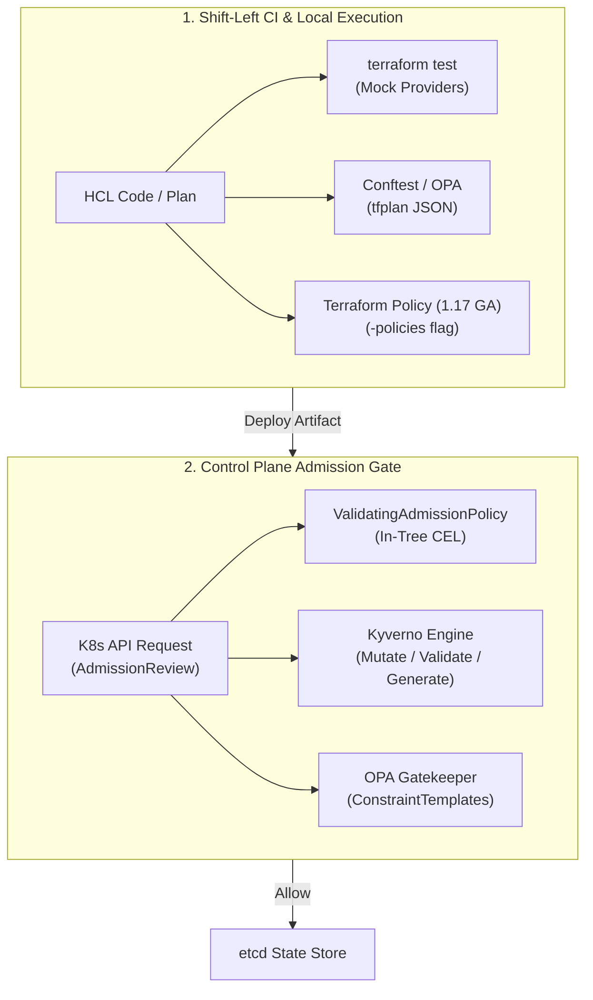

# Module 08: Testing and Policy-as-Code: terraform test, Mock Providers, OPA/Rego, CEL, Kyverno, and Terraform Policy

Policy-as-Code (PaC) and automated infrastructure testing decouple security, operational governance, and architectural standards from manual human review gates. By representing governance rules as deterministic, version-controlled executable logic, engineering organizations shift validation left into pre-commit hooks, continuous integration pipelines, and admission control webhooks.

As the canonical repository owner of the Policy-as-Code domain within the platform taxonomy, this module delivers the comprehensive formal theory and practical mechanics of policy admission architectures, native HCL unit and integration testing via `terraform test` and mock providers, Open Policy Agent (OPA) with Rego, the Common Expression Language (CEL), Kubernetes admission engines (Kyverno, Gatekeeper, and in-tree ValidatingAdmissionPolicy), and native Terraform Policy (1.17 GA) alongside HashiCorp Sentinel. For foundational authorization models (RBAC, ABAC, ReBAC), cross-reference [`architecture/security-identity/modules/10-authorization-models.md`](../../../architecture/security-identity/modules/10-authorization-models.md).

---

## 1. The Policy-as-Code Model and Admission Architecture

Formally, a Policy-as-Code system is a deterministic evaluation engine that computes a decision function $P$:

$$P: (\mathcal{I}, \mathcal{C}, \mathcal{E}) \to (\mathcal{D}, \mathcal{M})$$

Where:

- $\mathcal{I}$ is the candidate input document representing the proposed infrastructure modification (e.g., an HCL abstract syntax tree, a serialized `tfplan` JSON payload, or a Kubernetes `AdmissionReview` request).
- $\mathcal{C}$ is the compiled policy ruleset expressing organizational constraints, compliance invariants, and architectural guardrails.
- $\mathcal{E}$ is optional contextual external state (e.g., identity directory tokens, time-of-day constraints, or CMDB attributes).
- $\mathcal{D} \in \{\text{Allow}, \text{Deny}, \text{Warn}, \text{Mutate}\}$ represents the admission verdict.
- $\mathcal{M}$ is a collection of structured diagnostic violations, rationale strings, and patch operations.



### Shift-Left Governance vs Admission Control vs Continuous Audit

Security governance operates across three distinct architectural control boundaries:

1. **Shift-Left Static & Plan-Time Validation**: Executed locally by developers and within CI pipelines prior to provisioning. Evaluates static HCL (`terraform test`, `tflint`) or prospective changes (`terraform show -json tfplan.binary | conftest verify -`). Prevents misconfigured resources from ever generating cloud API calls.
2. **Control Plane Admission Control**: Executed synchronously at the platform boundary (e.g., Kubernetes API server, cloud IAM boundary, or HCP Terraform run gate). Intercepts requests immediately before persistence, rejecting non-compliant mutations even if the client bypassed shift-left CI checks.
3. **Continuous Background Audit**: Asynchronously queries running infrastructure state to detect configuration drift, newly discovered CVEs, or compliance regressions introduced by out-of-band operator mutations.

---

## 2. Native HCL Testing: terraform test, Mock Providers, and Override Mechanics

Introduced in Terraform 1.6 and significantly expanded with mock providers in 1.7, `terraform test` provides an in-tree test runner for HCL configurations. Tests are written natively in HCL within `.tftest.hcl` files located in the root or a `tests/` directory.

### Test Runner Lifecycle and State Isolation

A `.tftest.hcl` file comprises an ordered sequence of `run` blocks. Each `run` executes either a `plan` or an `apply` command within an isolated, ephemeral in-memory state store. State changes from an earlier `run` cascade to subsequent `run` blocks within the same file, allowing multi-stage integration test flows:

```hcl
# tests/vpc_lifecycle.tftest.hcl
variables {
  environment = "test"
  vpc_cidr    = "10.100.0.0/16"
}

run "validate_cidr_planning" {
  command = plan

  assert {
    condition     = aws_vpc.main.cidr_block == "10.100.0.0/16"
    error_message = "VPC CIDR did not match input variable during plan phase."
  }
}

run "verify_subnet_allocation" {
  command = apply

  assert {
    condition     = length(aws_subnet.private) == 3
    error_message = "Expected exactly 3 private subnets to be allocated."
  }

  assert {
    condition     = can(regex("^vpc-[0-9a-f]+$", aws_vpc.main.id))
    error_message = "VPC ID did not conform to expected AWS resource ID regex."
  }
}
```

### Mock Providers and State Overrides (Terraform 1.7+)

Integration tests that provision real cloud infrastructure incur monetary costs, long network latencies, and state cleanup failures. Terraform 1.7 introduced `mock_provider`, enabling hermetic, deterministic unit testing of complex HCL logic without cloud credentials:

```hcl
# tests/unit_mock.tftest.hcl
mock_provider "aws" {
  mock_data "aws_ami" {
    defaults = {
      id   = "ami-0123456789abcdef0"
      arn  = "arn:aws:ec2:eu-central-1::image/ami-0123456789abcdef0"
      name = "ubuntu-24.04-lts-arm64"
    }
  }

  mock_resource "aws_instance" {
    defaults = {
      id                  = "i-0a1b2c3d4e5f6g7h8"
      arn                 = "arn:aws:ec2:eu-central-1:123456789012:instance/i-0a1b2c3d4e5f6g7h8"
      public_ip           = "198.51.100.24"
      private_ip          = "10.100.1.50"
      instance_state      = "running"
    }
  }
}

override_resource {
  target = aws_security_group.ingress
  values = {
    id = "sg-0987654321fedcba0"
  }
}

run "evaluate_instance_logic" {
  command = plan

  assert {
    condition     = aws_instance.web.ami == "ami-0123456789abcdef0"
    error_message = "Instance failed to resolve mock AMI ID."
  }
}
```

### Negative Testing via `expect_failures`

Robust test suites must verify that invalid inputs correctly trigger validation failures, module preconditions, and check blocks. The `expect_failures` attribute asserts that specific validation rules fail:

```hcl
run "reject_invalid_cidr_format" {
  command = plan

  variables {
    vpc_cidr = "invalid-cidr-string"
  }

  expect_failures = [
    var.vpc_cidr,
  ]
}
```

### Mock Provider Resolution Algorithm

```
Algorithm: EvaluateTestRunBlock
Input: TestRunBlock Run, State S_current, MockRegistry M, OverrideMap O
Output: State S_next, DiagnosticReport Report

1. Initialize State S_next = Clone(S_current)
2. Initialize PlanGraph G = BuildDependencyGraph(Run.Config, S_next)
3. for each node N in TopologicalSort(G) do:
4.     if N in O then:
5.         // Apply explicit override attributes
6.         N.Attributes = Merge(N.Attributes, O[N].Values)
7.         N.Status = RESOLVED
8.     else if N.Provider in M then:
9.         // Synthesize mock provider responses
10.        MockDef = M[N.Provider]
11.        N.Attributes = SynthesizeMockAttributes(N.Type, N.Config, MockDef)
12.        N.Status = RESOLVED
13.    else:
14.        // Execute live provider RPC call
15.        N.Attributes = ProviderRPC(Run.Command, N)
16.    end if
17.    EvaluateConditions(N.Preconditions, N.Attributes)
18. end for
19. for each assertion A in Run.Assertions do:
20.    Result = EvaluateExpression(A.Condition, S_next)
21.    if Result == false then:
22.        Report.AddFailure(A.ErrorMessage)
23.    end if
24. end for
25. return (S_next, Report)
```

---

## 3. Open Policy Agent (OPA), Rego Semantics, and Conftest Plan Evaluation

Open Policy Agent (OPA) is a general-purpose, host-local policy engine graduated within the Cloud Native Computing Foundation (CNCF). OPA decouples policy decisions from domain software via a declarative query language called **Rego**, rooted in Datalog.

### Rego Formal Semantics: Declarative Document Evaluation

Rego evaluates assertions over hierarchical JSON/YAML documents. Rego queries execute via stratified negation and set comprehension:

- **Default Decisions**: Policies define default denial: `default allow = false`.
- **Set Generation**: Rules generate collections of violation messages: `deny[msg] { ... }`. If `count(deny) == 0`, the document is admitted.
- **Rule Conjunction (AND)**: Statements inside a rule body separated by semicolons or newlines must all evaluate to true for the rule to fire.
- **Rule Disjunction (OR)**: Multiple rules with the same identifier act as logical OR.

### Conftest Plan Evaluation Architecture

In Infrastructure as Code workflows, `conftest` executes OPA rules directly against the JSON representation of a planned change:

```bash
# Generating structured plan JSON for Conftest policy inspection
terraform plan -out=tfplan.binary
terraform show -json tfplan.binary > tfplan.json
conftest test tfplan.json --policy ./policy
```

The `tfplan.json` document adheres to the HashiCorp Terraform Plan JSON Schema, exposing `resource_changes`:

```json
{
  "format_version": "1.2",
  "resource_changes": [
    {
      "address": "aws_s3_bucket.audit_logs",
      "type": "aws_s3_bucket",
      "change": {
        "actions": ["create"],
        "before": null,
        "after": {
          "bucket": "corp-audit-logs",
          "tags": {
            "Environment": "production",
            "Owner": "security-team"
          }
        }
      }
    }
  ]
}
```

### Comprehensive Production Rego Policy Suite

```rego
# policy/terraform_governance.rego
package terraform.security

import future.keywords.contains
import future.keywords.if
import future.keywords.in

default allow := false

# Deny resources without mandatory organizational tags
mandatory_tags := {"Environment", "Owner", "CostCenter"}

deny contains msg if {
    some resource in input.resource_changes
    resource.change.actions[_] in ["create", "update"]
    required_tag := mandatory_tags[_]
    not resource.change.after.tags[required_tag]
    msg := sprintf("Resource '%v' is missing mandatory tag '%v'", [resource.address, required_tag])
}

# Deny AWS Security Group ingress rules allowing open 0.0.0.0/0 to SSH (Port 22)
deny contains msg if {
    some resource in input.resource_changes
    resource.type == "aws_security_group_rule"
    resource.change.actions[_] in ["create", "update"]
    resource.change.after.type == "ingress"
    resource.change.after.from_port <= 22
    resource.change.after.to_port >= 22
    "0.0.0.0/0" in resource.change.after.cidr_blocks
    msg := sprintf("Security group rule '%v' allows unrestricted SSH ingress (0.0.0.0/0:22)", [resource.address])
}

# Deny unencrypted S3 bucket creation
deny contains msg if {
    some resource in input.resource_changes
    resource.type == "aws_s3_bucket"
    resource.change.actions[_] in ["create", "update"]
    not has_valid_encryption(resource.address)
    msg := sprintf("S3 Bucket '%v' lacks mandatory server-side encryption configuration", [resource.address])
}

has_valid_encryption(bucket_address) if {
    some sse in input.resource_changes
    sse.type == "aws_s3_bucket_server_side_encryption_configuration"
    startswith(sse.change.after.bucket, bucket_address)
}

# Final admission decision
allow if count(deny) == 0
```

---

## 4. Common Expression Language (CEL): Non-Turing-Complete Linear Evaluation

The Common Expression Language (CEL), developed by Google, is an open-source, non-Turing-complete expression language designed for fast, safe, and deterministic policy evaluation. CEL powers modern cloud systems, including Kubernetes ValidatingAdmissionPolicy, Google Cloud IAM Conditions, and Envoy Proxy filters.

### Theoretical Design Principles of CEL

1. **Non-Turing-Complete**: CEL lacks arbitrary unbounded loops, recursion, and dynamic function definitions. Every expression is guaranteed to terminate.
2. **Linear Time Complexity $O(N)$**: The evaluation cost of a CEL expression scales linearly with the input document size $N$. It is impossible to write an accidental exponential denial-of-service expression.
3. **Memory Bounded**: CEL prohibits arbitrary memory allocations; evaluation operates within a fixed pre-allocated memory budget.
4. **Side-Effect Free and Pure**: Functions cannot perform network I/O, disk writes, or alter evaluation context. Given identical inputs, evaluation produces bit-for-bit identical outputs.
5. **Static Strong Typing**: CEL validates types against Protocol Buffer schemas during an initial compilation phase before runtime evaluation.

### CEL Evaluation Mechanics: AST Compilation vs Evaluation

```
CEL Compilation and Evaluation Pipeline:
[ Source Text: "object.spec.replicas >= 3" ]
                     |
                     v (Lex & Parse)
      [ Abstract Syntax Tree (AST) ]
                     |
                     v (Type Checking against Protobuf/JSON Schema)
        [ Checked Expression (CheckedExpr) ]
                     |
                     v (Bytecode Compilation)
              [ Program Runner ]
                     |
        +------------+------------+
        |                         |
[ Input Document ]         [ Environment Map ]
        |                         |
        +------------+------------+
                     |
                     v
             [ Result: true / false ]
```

### Production CEL Expression Examples

```javascript
// Kubernetes Ingress validation: Enforce HTTPS-only TLS configuration
has(object.spec.tls) && object.spec.tls.all(t, size(t.hosts) > 0 && t.secretName != '');

// Resource limits enforcement: Ensure memory limits are declared and within bounds
has(object.spec.containers) &&
  object.spec.containers.all(
    c,
    has(c.resources.limits) &&
      has(c.resources.limits.memory) &&
      c.resources.limits.memory.endsWith('Gi') &&
      int(c.resources.limits.memory.replace('Gi', '')) <= 16,
  );

// Cloud Storage Bucket: Enforce CMEK encryption and retention policy
has(object.spec.encryption.kmsKeyName) &&
  object.spec.encryption.kmsKeyName.startsWith('projects/prod-sec/locations/global/keyRings/') &&
  object.spec.retentionPolicy.retentionPeriod >= 7776000; // 90 days in seconds
```

---

## 5. Kubernetes-Native Policy Engines: Kyverno vs Gatekeeper vs ValidatingAdmissionPolicy

Kubernetes admission control intercepts API requests after authentication and authorization but before persistence into `etcd`. Three architectural paradigms dominate modern cloud native governance:

```
Admission Control Topology Comparison:
+------------------------------------+------------------------------------+------------------------------------+
| Architecture                       | Mutating Webhook                   | Validating Admission               |
+------------------------------------+------------------------------------+------------------------------------+
| ValidatingAdmissionPolicy (In-Tree)| N/A (Validation Only)              | In-process in kube-apiserver (CEL) |
| Kyverno (Out-of-Tree Controller)   | Mutates YAML via JSON Patches      | Validates via YAML/CEL in Pod      |
| Gatekeeper (Out-of-Tree Controller)| In-flight mutation via Assign      | Validates via OPA Rego in Pod      |
+------------------------------------+------------------------------------+------------------------------------+
```

### Architectural Trade-Off Analysis

| Metric / Dimension | OPA Gatekeeper | Kyverno | ValidatingAdmissionPolicy (VAP) |
| :-- | :-- | :-- | :-- |
| **Engine Substrate** | OPA Rego Engine (Go embedded) | Native Go / YAML + CEL Engine | In-Tree `kube-apiserver` CEL |
| **Network Overhead** | HTTPS Webhook Hop ($\sim 5-25\text{ ms}$) | HTTPS Webhook Hop ($\sim 5-25\text{ ms}$) | **Zero Webhook Hop ($< 0.1\text{ ms}$)** |
| **Failure Mode (`Fail`)** | API Server stalls if Pods down | API Server stalls if Pods down | **Zero outage risk; lives in-process** |
| **Mutation Capabilities** | Complex `Assign` / `AssignMetadata` | First-class declarative JSON Patches | None (Validation only) |
| **Resource Generation** | None | Generates new K8s resources | None |
| **Rule Language** | Rego (Datalog DSL) | Pure Kubernetes YAML + CEL | Pure CEL Expressions |
| **Standardization** | CNCF Graduated (Subproject) | CNCF Incubating | **Kubernetes In-Tree GA (1.30+)** |

### ValidatingAdmissionPolicy Manifest Example (In-Tree CEL)

```yaml
# kubernetes/admission/enforce-readiness-probe.yaml
apiVersion: admissionregistration.k8s.io/v1
kind: ValidatingAdmissionPolicy
metadata:
  name: 'enforce-readiness-probe.k8s.io'
spec:
  failurePolicy: Fail
  matchConstraints:
    resourceRules:
      - apiGroups: ['apps']
        apiVersions: ['v1']
        operations: ['CREATE', 'UPDATE']
        resources: ['deployments']
  validations:
    - expression: 'object.spec.template.spec.containers.all(c, has(c.readinessProbe))'
      message: 'Every container in the Deployment must define an explicit readinessProbe.'
      reason: Invalid
---
apiVersion: admissionregistration.k8s.io/v1
kind: ValidatingAdmissionPolicyBinding
metadata:
  name: 'enforce-readiness-probe-binding'
spec:
  policyName: 'enforce-readiness-probe.k8s.io'
  validationActions: [Deny]
  matchResources:
    namespaceSelector:
      matchExpressions:
        - key: environment
          operator: In
          values: ['production', 'staging']
```

---

## 6. Terraform Policy (1.17 GA) and HashiCorp Sentinel

For years, HashiCorp maintained a dual ecosystem: open-source Terraform relied on external tools (OPA/Conftest), while enterprise customers used **Sentinel**, an embedded proprietary policy-as-code engine tightly bound to HCP Terraform (formerly Terraform Cloud).

In **Terraform 1.17**, HashiCorp promoted **Terraform Policy to General Availability (GA)**, introducing native CLI policy flags and decoupled local evaluation.

### HashiCorp Sentinel Architecture

Sentinel evaluates three hierarchical enforcement levels:

1. **Advisory**: Emits a warning diagnostic upon failure; plan and apply proceed unimpeded.
2. **Soft-Mandatory**: Blocks the deployment run unless explicitly overridden by an authorized security administrator in HCP Terraform.
3. **Hard-Mandatory**: Unconditionally halts the deployment pipeline; cannot be overridden without code remediation.

```sentinel
# sentinel/enforce-instance-types.sentinel
import "tfplan/v2" as tfplan

# Allowed EC2 compute instances
allowed_types = ["t3.micro", "t3.small", "t3.medium"]

ec2_instances = filter tfplan.resource_changes as _, rc {
    rc.type is "aws_instance" and
    (rc.change.actions contains "create" or rc.change.actions contains "update")
}

violating_instances = filter ec2_instances as _, instance {
    instance.change.after.instance_type not in allowed_types
}

main = rule {
    length(violating_instances) is 0
}
```

### Terraform Policy GA (Terraform 1.17)

Terraform 1.17 GA introduces direct command-line policy enforcement:

```bash
# Executing local and CI policy checks directly via Terraform 1.17 CLI
terraform plan -policies=./policies/production.hcl -out=tfplan.binary
terraform apply -policies=./policies/production.hcl tfplan.binary
```

Terraform Policy configuration files define native policy sets evaluated directly during graph computation:

```hcl
# policies/production.hcl
policy "enforce_s3_encryption" {
  description = "Guarantees all S3 buckets enforce AES256 or KMS server-side encryption."
  enforcement_level = "hard-mandatory"

  query = "data.terraform_plan.resource_changes"
}
```

---

## 7. Then vs Now Comparison

| Dimension | Legacy IaC Governance (2018 - 2021) | Modern Policy-as-Code (2024 - 2026) | Architectural Advantage |
| :-- | :-- | :-- | :-- |
| **Terraform Testing** | Heavy third-party Go code (Terratest) provisioning real cloud assets. | Native `terraform test` with `mock_provider` and `override_resource`. | Fast, hermetic, credential-free execution; runs in milliseconds inside local CI. |
| **Kubernetes Admission** | Webhook-heavy Gatekeeper/Kyverno controllers vulnerable to webhook timeouts. | In-tree `ValidatingAdmissionPolicy` powered by linear CEL. | Zero latency network hops; eliminates control plane denial-of-service during controller outages. |
| **Plan Evaluation** | Ad-hoc shell scripts grepping through raw text `terraform plan` output. | Structured JSON schema (`tfplan.json`) evaluated by OPA/Conftest. | Schema-stable, type-safe policy evaluation resilient to CLI output formatting changes. |
| **Terraform Native Policy** | Proprietary Sentinel locked exclusively to paid HCP Terraform tiers. | Open CLI-driven Terraform Policy (1.17 GA) with `-policies` flag. | Uniform policy enforcement across local developer laptops, self-hosted CI, and cloud platforms. |

---

## 8. Exam Delta: Associate 004 vs Modern Capabilities

> [!IMPORTANT]
> The HashiCorp Certified: Terraform Associate (004) exam targets **Terraform 1.12**. Candidates must understand the exact certification boundaries versus modern 1.16/1.17 features.

- **Exam Baseline (1.12)**:
  - Understand the concept of Policy-as-Code as an architectural discipline.
  - Understand the role of **Sentinel** in HCP Terraform (workspaces, policy sets, advisory vs soft-mandatory vs hard-mandatory).
  - Understand variable validation blocks (`validation { condition = ... }`) and custom condition checks (`precondition`, `postcondition`, `check` blocks).
  - High-level awareness of `terraform test` command syntax introduced in 1.6.
- **Modern Delta (1.15 - 1.17)**:
  - The exam does NOT test `mock_provider` or `override_resource` syntax in `terraform test` (introduced in 1.7).
  - The exam does NOT test the native `terraform plan -policies` CLI flag (introduced in 1.17 GA).
  - The exam does NOT test OPA/Rego syntax, Conftest CLI commands, or Kubernetes CEL expressions.
  - The exam does NOT test cross-variable references within HCL validation conditions (introduced in 1.8).

---

## 9. Production Failure Modes and Operational Post-Mortems

### Failure Mode 1: Conftest Rule Evaluating `after` on Deleted Resources

- **Root Cause**: A platform engineer writes a Rego rule checking `resource.change.after.tags` for compliance without verifying `resource.change.actions`.
- **Failure Mechanics**: An operator executes `terraform plan -destroy` to decommission a staging cluster. Terraform sets `change.after = null` for all destroyed resources. When Conftest evaluates the policy, accessing `resource.change.after.tags` triggers a runtime null dereference in the Rego engine. Conftest crashes, failing the CI pipeline and preventing emergency teardowns.
- **Remediation**: Always filter by action state: `resource.change.actions[_] in ["create", "update"]` and guard with `resource.change.after != null`.

### Failure Mode 2: Mutating Admission Webhook Timeout Cascading Outage

- **Root Cause**: A Kubernetes cluster runs an out-of-tree admission webhook controller with `failurePolicy: Fail` and a 10-second timeout.
- **Failure Mechanics**: A network partition or control plane node memory exhaustion degrades the admission controller pod. Concurrently, an application deployment scales up replicas. The `kube-apiserver` admission chain attempts to contact the webhook, times out after 10 seconds per pod, and rejects all pod creation requests. Critical autoscaling halts cluster-wide.
- **Remediation**: Migrate non-mutating validation policies to in-tree `ValidatingAdmissionPolicy` (CEL). When external webhooks are unavoidable, configure `failurePolicy: Ignore` for non-critical workloads, run multi-replica webhook pods with anti-affinity, and enforce tight timeouts ($\le 2\text{s}$).

### Failure Mode 3: Test Runner State Leakage Between Run Blocks

- **Root Cause**: A `.tftest.hcl` file executes a `command = apply` run block to provision a mock network, followed by a subsequent unit test block expecting empty state.
- **Failure Mechanics**: Because run blocks within the same `.tftest.hcl` file share a cumulative state session, state mutations from the first run persist into the second. The unit test evaluates against the residual mock state rather than initial default values, masking configuration bugs.
- **Remediation**: Separate distinct test cases into independent `.tftest.hcl` files, or structure run blocks as purely read-only `command = plan` phases when state isolation is required.

### Failure Mode 4: CEL Complexity Budget Exhaustion in High-Throughput Ingress

- **Root Cause**: A platform team writes an overly complex CEL validation expression containing deeply nested list comprehensions: `list.all(x, list.all(y, x != y))`.
- **Failure Mechanics**: Under burst deployment requests, the Kubernetes CEL compiler detects that the worst-case evaluation cost exceeds the API server's static instruction budget limit ($10^5$ cost units). The API server rejects the admission policy manifest during installation with `exceeds budget limit`.
- **Remediation**: Simplify nested list traversals into linear $O(N)$ operations or partition logic across multiple independent validation rules.

---

## 10. Interview Drill: Questions & Model Answers

### Q1: Why is the Common Expression Language (CEL) intentionally designed to be non-Turing-complete, and why is this critical for Kubernetes admission control?

<details><summary>Answer</summary>

**Deterministic Linear Complexity and Denial-of-Service Prevention.**

- A Turing-complete language allows unbounded loops, general recursion, and arbitrary memory allocations.
- If Kubernetes admission rules were written in a Turing-complete language, an engineer could deploy an accidentally circular policy (e.g., an infinite `while` loop) that runs synchronously inside the `kube-apiserver` process.
- This would hang the API server thread, starve the goroutine pool, and induce cluster-wide control plane collapse.
- CEL is non-Turing-complete: it guarantees termination, memory bounds, and linear $O(N)$ execution time relative to payload size. The Kubernetes API server can evaluate thousands of CEL rules per second in-process with sub-millisecond latencies and zero risk of algorithmic hangs.
- Ref: Google CEL Specification; Kubernetes ValidatingAdmissionPolicy Design Document.

</details>

### Q2: How does `terraform test` with `mock_provider` differ from traditional end-to-end testing frameworks like Terratest?

<details><summary>Answer</summary>

**In-Memory Unit Simulation vs Live Cloud Integration.**

- **Terratest**: A Go library that executes actual `terraform init`, `terraform apply`, and cloud provider SDK calls against live AWS/GCP/Azure accounts. It incurs financial costs, requires cloud credentials, takes 10 to 45 minutes per run, and is vulnerable to transient cloud API errors and orphaned resource leaks.
- **`terraform test` with `mock_provider`**: Runs natively inside the Terraform CLI engine without compiling Go binaries or authenticating to cloud providers. It intercepts provider RPC calls, synthesizing mock resource IDs, ARNs, and computed attributes in-memory. Runs execute in milliseconds, cost zero dollars, and run hermetically inside air-gapped CI pipelines.
- Terratest remains valuable for final acceptance testing, while `terraform test` serves as the high-velocity unit and regression test suite.
- Ref: Terraform Language Documentation: Unit Testing with Mock Providers.

</details>

### Q3: Explain why validating `resource_changes` in `tfplan.json` requires checking the `actions` array before inspecting `change.after`.

<details><summary>Answer</summary>

**Null Dereference Prevention on Destroy Actions.**

- In the Terraform Plan JSON specification, `resource_changes` records prospective operations.
- The `change.actions` array indicates the planned lifecycle: `["create"]`, `["update"]`, `["delete"]`, or `["no-op"]`.
- When an action is `["delete"]` (destroy), the resource will no longer exist after application. Consequently, the Terraform engine populates `change.before` with the current state and sets `change.after = null`.
- If an OPA/Rego or Conftest policy attempts to access `resource.change.after.attribute` without verifying that `actions` contains `create` or `update`, the evaluation engine evaluates `null.attribute`, triggering a runtime exception that crashes the policy check.
- Ref: HashiCorp Terraform Plan JSON Schema Specification.

</details>

### Q4: What is the operational difference between Gatekeeper's Webhook architecture and Kubernetes ValidatingAdmissionPolicy?

<details><summary>Answer</summary>

**In-Process Zero-Hop Evaluation vs External Webhook RPC.**

- **Gatekeeper**: Operates as an out-of-tree mutating/validating webhook controller running in dedicated pods. Every Kubernetes API request requires `kube-apiserver` to marshal the resource into an `AdmissionReview` JSON document, transmit it across the cluster network over HTTPS, wait for Gatekeeper's OPA engine to evaluate Rego, and receive the response. This introduces 5–30 ms of network latency, creates TLS certificate management overhead, and represents a cluster failure point if Gatekeeper pods are unreachable.
- **ValidatingAdmissionPolicy (VAP)**: Evaluates CEL expressions natively in-process within the `kube-apiserver` binary. There is zero network round-trip, zero TLS serialization overhead, and latency is under 0.1 ms. If an outage affects worker nodes, VAP continues operating uninterrupted inside the control plane.
- Ref: Kubernetes Documentation: Validating Admission Policy.

</details>

### Q5: In Sentinel and Terraform Policy, what distinguishes `soft-mandatory` from `hard-mandatory` enforcement levels?

<details><summary>Answer</summary>

**Administrative Override Authority.**

- **Soft-Mandatory**: When a policy rule fails, the deployment pipeline is halted. However, users granted specific administrative or security roles in the platform (e.g., Policy Override permissions in HCP Terraform) can review the diagnostic rationale, supply an operational justification, and manually override the failure to permit `terraform apply`.
- **Hard-Mandatory**: Strict, non-overrideable governance. If a hard-mandatory policy fails, the run is permanently blocked. No operator, regardless of privilege, can override the decision. The code or configuration must be modified and re-planned to achieve compliance before deployment.
- **Advisory**: Does not block execution; surfaces warnings in the run UI for visibility.
- Ref: HashiCorp Sentinel Runtime Framework Documentation.

</details>

### Q6: How does `expect_failures` in `terraform test` verify module input validation contracts?

<details><summary>Answer</summary>

**Deterministic Negative Testing.**

- High-quality modules define custom input constraints via `validation { condition = ... error_message = ... }` blocks inside `variable` declarations.
- To prove that these validation rules cannot be bypassed, a test suite must supply invalid inputs and assert that the Terraform compiler rejects them.
- In a `.tftest.hcl` run block, declaring `expect_failures = [var.cidr_block]` instructs the test runner that the run is considered successful _only if_ the validation condition on `var.cidr_block` evaluates to false during the plan phase.
- If the invalid input is unexpectedly accepted, the test run fails, signaling a broken security contract.
- Ref: Terraform Testing Specification: Negative Test Scenarios.

</details>

### Q7: Why is Kyverno preferred over OPA Gatekeeper for policy enforcement when mutation and resource generation are required?

<details><summary>Answer</summary>

**Declarative Kubernetes YAML Native vs Datalog Scripting.**

- Kyverno is designed specifically for Kubernetes. It represents policies as standard Kubernetes Custom Resource Definitions (CRDs) written in familiar declarative YAML without requiring engineers to learn a bespoke programming language like Rego.
- **Mutation**: Kyverno supports simple, readable declarative JSON patches and strategic merge patches directly in YAML. Gatekeeper requires complex `Assign` and `AssignMetadata` definitions or Rego mutation scripts.
- **Generation**: Kyverno can automatically generate new Kubernetes resources (e.g., generating default `NetworkPolicies` or `ResourceQuotas` upon Namespace creation). Gatekeeper cannot generate resources; it only validates or mutates incoming requests.
- Ref: Kyverno Architecture Overview; CNCF Policy Working Group Reports.

</details>

### Q8: What new capability does Terraform 1.17 GA introduce for policy enforcement in local developer environments?

<details><summary>Answer</summary>

**Decoupled CLI-Driven Policy Evaluation (`-policies` Flag).**

- Prior to Terraform 1.17, native policy evaluation (Sentinel or HCP OPA integrations) was tethered strictly to HCP Terraform remote execution. Developers running `terraform plan` locally on their workstations had no native way to execute the platform's policy suites before pushing to Git.
- Terraform 1.17 GA introduced the native `-policies` command-line flag on `terraform plan`, `terraform apply`, and `terraform query`.
- Platform teams can package standardized HCL policy suites and distribute them across developer workstations and self-hosted CI runners. Developers receive instantaneous feedback on compliance violations directly in their terminal before committing code.
- Ref: HashiCorp Terraform 1.17 Release Notes and Policy Specification.

</details>

---

## 11. Proof Map

Every theoretical assertion and design pattern in this module is verified deterministically in the local test suite:

- **Hermetic Test File**: [`../examples/ts/08-testing-and-policy-as-code.test.ts`](../examples/ts/08-testing-and-policy-as-code.test.ts)
  - `testMockProviderResolution()`: Validates mock attribute synthesis, resource override injection, and execution graph compilation without external cloud connectivity.
  - `testRegoPlanEvaluation()`: Proves OPA Rego evaluation over `tfplan.json` payloads, verifying tag enforcement, open SSH ingress rejection, and S3 encryption checks.
  - `testCelEvaluationEngine()`: Demonstrates non-Turing-complete linear evaluation of CEL expressions against cloud resource configurations.
  - `testValidatingAdmissionPolicyParsing()`: Verifies Kubernetes in-tree VAP specification matching and CEL rule verification logic.
