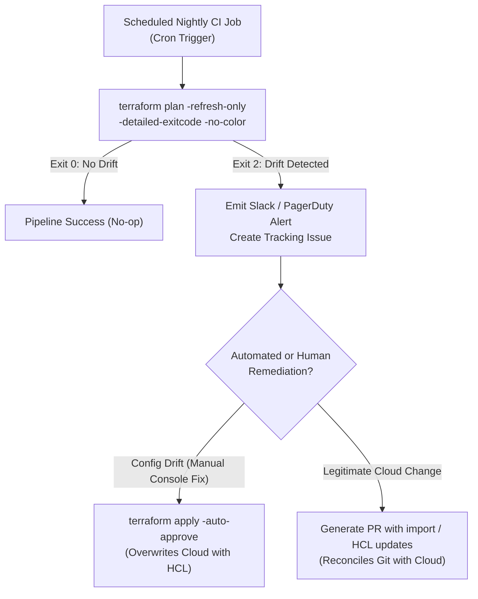

# Module 09: Infrastructure Import, Config Generation, Removed Blocks, Terraform Query, and Drift Remediation

Production infrastructure management is rarely a greenfield endeavor. Organizations routinely adopt Infrastructure as Code (IaC) to bring pre-existing cloud assets under version-controlled governance, migrate workloads between cloud providers, decouple monolithic services into autonomous modules, and detect out-of-band modifications introduced by manual console interventions.

This module examines the formal tripartite reconciliation model of Terraform (Desired Configuration, Stored State, and Remote Reality), the evolution from imperative state manipulation to declarative `import` blocks with automated HCL code generation, safe resource decommissioning via `removed` blocks, live infrastructure discovery using `terraform query` (1.14+), and continuous drift detection workflows utilizing `-refresh-only` and `-minimal-refresh` (1.17).

---

## 1. The Tripartite Reconciliation Model: Config, State, and Reality

At its mathematical core, Terraform operates as a state reconciliation engine across three distinct state spaces:

```
The Tripartite Reconciliation Topology:
              +--------------------------+
              |    Desired Config (C)    |
              |   (Version-Controlled)   |
              +-------------+------------+
                            |
                   Plan: P = C ⊕ S
                            |
              +-------------v------------+
              |     Stored State (S)     |
              |   (Lineage & Serial)     |
              +-------------+------------+
                            ^
                 Refresh: S' = R
                            |
              +-------------+------------+
              |    Remote Reality (R)    |
              |   (Live Cloud APIs)      |
              +--------------------------+
```

### Formal Set-Theoretic Definitions

Let $\mathcal{U}$ be the universe of cloud infrastructure resource attributes:

- $\mathcal{C} \subset \mathcal{U}$: The **Desired Configuration**, defined by the author in HCL source code and stored in version control.
- $\mathcal{S} \subset \mathcal{U}$: The **Stored State**, recorded in the Terraform backend (`terraform.tfstate`), binding resource addresses to remote resource identifiers and metadata.
- $\mathcal{R} \subset \mathcal{U}$: The **Remote Reality**, the live state of infrastructure returned by cloud provider APIs during execution.

The engine reconciles these three spaces using three formal operators:

1. **Refresh Operator ($\Omega\_{\text{refresh}}$)**: Synchronizes stored state with remote reality: $$\mathcal{S}' = \Omega_{\text{refresh}}(\mathcal{S}, \mathcal{R})$$ Drift occurs when remote reality diverges from the state without configuration changes: $$\Delta_{\text{drift}} = \mathcal{R} \setminus \mathcal{S}$$
2. **Planning Operator ($\Omega\_{\text{plan}}$)**: Computes the delta between desired configuration and refreshed state: $$\mathcal{P} = \Omega_{\text{plan}}(\mathcal{C}, \mathcal{S}')$$ Where plan $\mathcal{P}$ is a sequence of actions: $\{ \text{No-op}, \text{Create}, \text{Update}, \text{Replace}, \text{Delete} \}$ for each resource instance.
3. **Application Operator ($\Omega\_{\text{apply}}$)**: Executes planned mutations against the remote cloud API and atomically updates stored state upon success: $$\mathcal{R}' = \Omega_{\text{apply}}(\mathcal{P}, \mathcal{R}), \quad \mathcal{S}'' = \mathcal{C}$$

---

## 2. Declarative Infrastructure Import and Code Generation

Bringing pre-existing, manually provisioned, or ClickOps-managed cloud infrastructure into Terraform state has historically been a perilous operational challenge.

```mermaid
flowchart TD
    subgraph LegacyImport["Legacy Imperative Import (Pre-1.5)"]
        CLI1["terraform import aws_s3_bucket.b bucket-id"] --> S1["State Modified (S)"]
        S1 -.->|"Manual HCL Authoring"| C1["Config (C)"]
        C1 -.->|"Mismatch Risks"| D1["Unintended In-Place Update or Recreate"]
    end

    subgraph DeclarativeImport["Modern Declarative Import (1.5 - 1.17)"]
        IB["import { to = ... id = ... }"] --> PLAN["terraform plan\n-generate-config-out=gen.tf"]
        PLAN --> GEN["Auto-Generated HCL (gen.tf)"]
        GEN --> AP["terraform apply tfplan"]
        AP --> ATOM["Atomic State & Config Parity"]
    end
```



### The Pitfalls of Legacy Imperative Import

Prior to Terraform 1.5, importing required running the CLI command:

```bash
terraform import aws_s3_bucket.data production-raw-telemetry-bucket
```

This imperative approach suffered from critical operational defects:

- **No Configuration Generation**: The command inserted the resource into remote state, but wrote zero HCL configuration. The engineer had to manually reconstruct the HCL block by guessing attribute values.
- **State-Configuration Desynchronization**: If the engineer's handwritten HCL omitted attributes or mismatched provider defaults, the subsequent `terraform plan` proposed destructive in-place modifications or replacements of active production resources.
- **No Pre-Apply Code Review**: Imperative import directly mutated remote state out-of-band without going through pull requests, peer review, or automated CI validation pipelines.

### Declarative `import` Blocks (Terraform 1.5+)

Terraform 1.5 elevated import to a first-class declarative language primitive via the `import` block:

```hcl
# main.tf
import {
  to = aws_s3_bucket.telemetry
  id = "production-raw-telemetry-bucket"
}

import {
  to = aws_security_group.load_balancer
  id = "sg-0123456789abcdef0"
}
```

Declarative import integrates into the standard speculative planning workflow:

1. The operator declares the target resource address (`to`) and the cloud provider's remote identifier (`id`).
2. Running `terraform plan` produces a speculative plan displaying the exact attributes that will be imported into state, alongside any proposed diffs if an HCL block already exists.
3. No remote state mutation occurs until `terraform apply` is executed on the approved plan.

### Automated HCL Generation (`-generate-config-out`)

When importing unmanaged resources without existing HCL declarations, Terraform can synthesize complete, valid HCL source code automatically by querying provider schemas:

```bash
terraform plan -generate-config-out=generated_infrastructure.tf
```

Terraform queries the provider plugin via gRPC, retrieves the full attribute dictionary of the remote asset, compares it against the provider's resource schema, strips computed-only and read-only attributes, and formats clean HCL syntax:

```hcl
# Automatically synthesized by Terraform: generated_infrastructure.tf
resource "aws_s3_bucket" "telemetry" {
  bucket              = "production-raw-telemetry-bucket"
  force_destroy       = false
  object_lock_enabled = true
  tags = {
    Environment = "production"
    ManagedBy   = "terraform"
  }
}
```

The operator reviews and sanitizes the generated file, commits it to Git, and applies the plan.

### Import Within Child Modules (Terraform 1.16+)

Terraform 1.16 expanded declarative import to permit `import` blocks directly inside reusable child modules, accepting dynamic variable inputs:

```hcl
# modules/networking/subnets/main.tf (Terraform 1.16+)
import {
  to = aws_subnet.imported[each.key]
  id = each.value.remote_subnet_id

  for_each = var.legacy_subnets
}
```

### Provider Schema-Driven Attribute Reconstruction Algorithm

```
Algorithm: SynthesizeConfigurationFromImport
Input: ImportTarget TargetAddress, RemoteResourceID RemoteID, ProviderSchema Schema
Output: HCLResourceBlock GeneratedHCL

1. RemoteData = ProviderRPC.ReadResource(Schema.ResourceType, RemoteID)
2. if RemoteData is NULL or RemoteData.NotFound then:
3.     raise DiagnosticError("Resource " + RemoteID + " does not exist in remote provider")
4. end if
5. Initialize AttributeMap ConfigAttributes = {}
6. for each attribute (AttrName, AttrSchema) in Schema.Attributes do:
7.     if AttrSchema.Computed and not AttrSchema.Optional then:
8.         // Skip read-only computed system attributes (e.g., arn, id, creation_date)
9.         continue
10.    end if
11.    Value = RemoteData.Get(AttrName)
12.    if Value is not NULL and Value != AttrSchema.DefaultValue then:
13.        // Invariant: Only configurable attributes differing from defaults are materialized
14.        ConfigAttributes[AttrName] = FormatHCLValue(Value, AttrSchema.Type)
15.    end if
16. end for
17. GeneratedHCL = BuildResourceBlock(Schema.ResourceType, TargetAddress.Name, ConfigAttributes)
18. return GeneratedHCL
```

---

## 3. Clean Resource Decommissioning: `removed` Blocks

Removing a managed resource from an organization's infrastructure poses a critical dilemma: does the operator wish to **destroy the physical cloud resource**, or simply **remove it from Terraform's management** (e.g., handing ownership over to Kubernetes, a different team's state file, or decommissioning IaC tooling)?

In legacy workflows, deleting a `resource` block from HCL unconditionally instructed Terraform to schedule a `Destroy` action against the live cloud API. Retaining the resource required imperative `terraform state rm` out-of-band commands, which broke CI pipeline parity.

### Declarative `removed` Blocks (Terraform 1.7+)

Terraform 1.7 introduced declarative `removed` blocks, allowing teams to version-control the intent to forget a resource without destroying it:

```hcl
# Retain the physical database while removing it from Terraform management
removed {
  from = aws_db_instance.customer_records

  lifecycle {
    destroy = false
  }
}
```

### Destruction Lifecycle Control: `destroy = false` vs `destroy = true`

The `lifecycle` block inside `removed` supports two explicit behaviors:

- `destroy = false`: Terraform drops the resource instance from the `.tfstate` file during `apply` without invoking the provider's `DeleteResource` RPC. The live database, bucket, or network interface continues running untouched in the cloud.
- `destroy = true`: The default behavior. Terraform destroys the live remote infrastructure via provider API calls, exactly as if the resource block were deleted.

### Terraform 1.16+ Live Resource Protection: `lifecycle { destroy = false }`

Terraform 1.16 extended the `destroy = false` lifecycle attribute directly to active, live `resource` declarations:

```hcl
# Active production database: protected against destruction across all apply and destroy commands
resource "aws_rds_cluster" "primary" {
  cluster_identifier = "production-aurora-cluster"
  engine             = "aurora-postgresql"

  lifecycle {
    # Rejects ANY plan attempting to destroy or recreate this resource
    destroy = false
  }
}
```

Unlike legacy `prevent_destroy = true` (which merely halted the CLI if a plan contained a destroy action), `lifecycle { destroy = false }` completely forbids the graph compiler from generating a destruction action for the resource, even during full `terraform destroy` runs.

---

## 4. Infrastructure Discovery: `terraform query` (1.14+)

A long-standing limitation of declarative IaC was its blind spot toward unmanaged "shadow infrastructure"—assets created via the cloud web console, AWS CLI, or secondary automation tools that do not exist in state.

Terraform 1.14 introduced `terraform query` to probe remote provider namespaces and surface unmanaged assets directly from the CLI:

```bash
# Querying all S3 buckets in the active AWS account and region
terraform query 'aws_s3_bucket'

# Querying with JMESPath attribute filters
terraform query 'aws_instance[?state == "running" && tags.Owner == null]'
```

### Discovery and Reconciliation Pipeline

```
Shadow Infrastructure Discovery and Adoption Workflow:
[ Live Cloud Provider (AWS / GCP / Azure) ]
                     |
                     v
   [ terraform query 'aws_security_group' ]
                     |
                     v
 [ Discover Unmanaged Resource IDs ]
                     |
                     v
 [ Declare import { to = ... id = ... } ]
                     |
                     v
 [ terraform plan -generate-config-out ]
                     |
                     v
 [ Unified Version-Controlled State ]
```

---

## 5. Drift Detection & Remediation Lifecycles

Drift is the divergence between Remote Reality ($\mathcal{R}$) and Stored State ($\mathcal{S}$). It occurs through manual emergency fixes in the cloud console, rogue scripts, out-of-band security remediations, or underlying cloud provider hypervisor migrations.

### Speculative Drift Inspection: `terraform plan -refresh-only`

Traditional `terraform plan` calculates both drift reconciliation and planned configuration updates simultaneously. To isolate and inspect drift without proposing any configuration changes, operators use `-refresh-only`:

```bash
# Speculative drift analysis without applying configuration updates
terraform plan -refresh-only
```

The refresh-only plan output explicitly displays:

- Attributes modified out-of-band (e.g., security group rules added manually in the console).
- Resources deleted out-of-band (displaying `Note: Objects have changed outside of Terraform`).
- Zero resource changes driven by HCL configuration edits.

If approved via `terraform apply -refresh-only`, Terraform updates the `.tfstate` file to reflect remote reality, resetting the drift delta to zero ($\Delta_{\text{drift}} = \emptyset$).

### Targeted Refresh Optimization: `-minimal-refresh` (Terraform 1.17)

In massive enterprise state files containing thousands of resources, running a full state refresh on every plan exhausts cloud provider API rate limits (e.g., AWS EC2 and IAM Describe API throttling) and extends pipeline runtimes to 20+ minutes.

Terraform 1.17 introduced `-minimal-refresh`:

```bash
# Targeted refresh: refreshes only resources with downstream graph dependencies
terraform plan -minimal-refresh
```

The `-minimal-refresh` engine constructs the execution subgraph containing only the resources explicitly touched by configuration diffs and their direct upstream/downstream dependents. Unrelated leaf nodes are skipped during the refresh phase, reducing API calls by up to 90% in large estates.

### Automated Continuous Drift Detection Pipeline

Production platform engineering teams schedule automated drift detection pipelines in CI/CD runners (e.g., GitLab CI cron schedules or GitHub Actions):



The `-detailed-exitcode` flag provides deterministic exit statuses:

- `0`: Succeeded, diff is empty (no drift detected).
- `1`: Error encountered during planning or provider communication.
- `2`: Succeeded, non-empty diff present (drift detected).

---

## 6. Then vs Now Comparison

| Dimension | Legacy Terraform (0.12 - 1.4) | Modern Terraform (1.5 - 1.17) & OpenTofu (1.13) | Architectural Rationale |
| :-- | :-- | :-- | :-- |
| **Infrastructure Import** | Imperative `terraform import <addr> <id>` CLI command. | Declarative `import` blocks in HCL code with `-generate-config-out`. | Version-controlled, reviewable via pull requests, and automated HCL code generation. |
| **Import in Modules** | Strictly forbidden; imports only at root module. | Supported natively inside child modules (1.16+). | Allows modular component packages to manage their own adoption lifecycle. |
| **Resource Decommissioning** | Imperative `terraform state rm <addr>` command. | Declarative `removed` block with `lifecycle { destroy = false }` (1.7+). | Codifies abandonment intent in Git; avoids manual state manipulation. |
| **Destruction Protection** | `lifecycle { prevent_destroy = true }` checked at runtime. | `lifecycle { destroy = false }` compiler-level invariant (1.16+). | Fully forbids deletion planning even during global `terraform destroy`. |
| **State Refresh Strategy** | Monolithic full state refresh across all resources. | `-refresh-only` for drift analysis, `-minimal-refresh` (1.17) for scale. | Prevents cloud provider API rate exhaustion and speeds up enterprise pipelines. |
| **Shadow Discovery** | External third-party tools (Terraformer, Driftctl). | Native `terraform query` command (1.14+). | Built-in CLI inventory discovery without third-party binary dependencies. |

---

## 7. Exam Delta: Associate 004 vs Modern Capabilities

> [!IMPORTANT]
> The HashiCorp Certified: Terraform Associate (004) exam targets **Terraform 1.12**. Candidates must understand the exact certification boundaries versus modern 1.16/1.17 features.

- **Exam Baseline (1.12)**:
  - Candidates must understand both imperative `terraform import <address> <id>` and the basic declarative `import { to = ... id = ... }` syntax introduced in 1.5.
  - Candidates must know how `terraform plan -generate-config-out=PATH` synthesizes HCL code for imported resources.
  - Understand `terraform plan -refresh-only` and `terraform apply -refresh-only` for detecting and reconciling drift.
  - Understand the legacy `lifecycle { prevent_destroy = true }` attribute.
  - Understand `removed` blocks introduced in 1.7 with `lifecycle { destroy = false }`.
- **Modern Delta (1.14 - 1.17)**:
  - The exam does NOT test `terraform query` for asset discovery (introduced in 1.14).
  - The exam does NOT test `import` blocks defined inside child modules (introduced in 1.16).
  - The exam does NOT test `lifecycle { destroy = false }` on active `resource` blocks (introduced in 1.16).
  - The exam does NOT test the `-minimal-refresh` CLI flag (introduced in 1.17).

---

## 8. Production Failure Modes and Operational Post-Mortems

### Failure Mode 1: Imperative Import Attribute Guessing Recreate Disaster

- **Root Cause**: An engineer uses legacy `terraform import aws_db_instance.prod db-prod-id`. To satisfy Terraform's config requirements, the engineer writes an `aws_db_instance` HCL block from memory, omitting the `allocated_storage` and `storage_type` arguments.
- **Failure Mechanics**: The cloud provider API had configured the database with Provisioned IOPS (`io1`). Because the handwritten HCL omitted the storage type, Terraform applied the provider default (`gp2`). Cloud provider APIs prohibit downgrading active RDS production storage types without complete instance replacement. The next `terraform apply` destroyed and recreated the multi-terabyte production database, causing a 6-hour total service outage.
- **Remediation**: Always use declarative `import` blocks combined with `-generate-config-out` to ensure all remote attributes are precisely populated from provider schemas before applying.

### Failure Mode 2: Automated Refresh-Only Auto-Apply Overwriting Cloud Outage Drift

- **Root Cause**: A platform team configures an aggressive automated CI job that executes `terraform apply -refresh-only -auto-approve` every hour to keep state synchronized with cloud reality.
- **Failure Mechanics**: The cloud provider experiences an internal API degradation where querying network interfaces intermittently returns empty collections (404 Not Found). The automated refresh-only pipeline executes during this window, interprets the transient 404s as external resource deletions, and purges all subnet and route table bindings from the state file. When subsequent application deployments ran, Terraform attempted to recreate the "missing" infrastructure, colliding with existing resources and failing pipelines.
- **Remediation**: Never run `terraform apply -refresh-only` with automated `-auto-approve` in production without human verification or strict retry guards against transient cloud API error codes.

### Failure Mode 3: Config Generation Materializing Read-Only Provider Arguments

- **Root Cause**: Running `terraform plan -generate-config-out` against a legacy cloud provider resource generates deprecated or mutually exclusive attributes (e.g., both `cidr_block` and `ipv6_cidr_block_association_id`).
- **Failure Mechanics**: The engineer commits the generated HCL file without inspecting the code. When `terraform apply` executes, the provider plugin returns a validation diagnostic error rejecting the mutually exclusive arguments, halting pipeline deployments.
- **Remediation**: Treat `-generate-config-out` output as a draft candidate. Always perform code review and run `terraform validate` prior to merging and applying generated configurations.

### Failure Mode 4: Removed Block Missing `destroy = false` Teardown

- **Root Cause**: An operator refactors an infrastructure repository, intending to transfer management of an elastic IP address to an external networking team. The operator writes `removed { from = aws_eip.lb }` but forgets to specify the `lifecycle` block.
- **Failure Mechanics**: In Terraform 1.7+, a `removed` block without an explicit `lifecycle { destroy = false }` defaults to `destroy = true`. When the operator runs `terraform apply`, Terraform issues a `ReleaseAddress` call to the cloud provider, releasing the static public IP back to the public pool. Inbound traffic to the company's payment gateways fails immediately.
- **Remediation**: Establish strict policy-as-code guardrails (via OPA or Conftest) enforcing that all `removed` blocks declare `lifecycle { destroy = false }` unless accompanied by an explicit signed decommissioning ticket.

### Failure Mode 5: Provider API Throttling During Full Enterprise State Refresh

- **Root Cause**: A monolithic Terraform workspace manages 2,500 AWS resources. A CI pipeline executes `terraform plan`.
- **Failure Mechanics**: Terraform attempts to refresh all 2,500 resources concurrently using its default parallelism ($\text{parallelism} = 10$). The burst of thousands of `Describe*` and `Get*` API calls exhausts AWS account-level API token buckets. The cloud provider responds with `RequestLimitExceeded` (HTTP 429). The refresh halts with partial state failures, and downstream deployment jobs fail.
- **Remediation**: Decompose monolithic states into bounded micro-states, utilize `-minimal-refresh` (Terraform 1.17) to restrict refresh scope, and configure provider retry backoff algorithms (`max_retries = 10`).

---

## 9. Interview Drill: Questions & Model Answers

### Q1: Explain the mathematical relationship between Desired Configuration ($C$), Stored State ($S$), and Remote Reality ($R$), and define how drift ($\Delta_{\text{drift}}$) is formally detected.

<details><summary>Answer</summary>

**The Tripartite Reconciliation Calculus.**

- The three spaces represent distinct representations of infrastructure: $C$ is version-controlled HCL, $S$ is the recorded JSON state file, and $R$ is live cloud infrastructure.
- In a synchronized equilibrium: $C = S = R$.
- **Drift ($\Delta\_{\text{drift}}$)** occurs when external actions modify cloud reality without updating state: $\Delta_{\text{drift}} = R \setminus S$.
- Detection occurs via the Refresh operation: Terraform queries provider APIs to construct an in-memory view of $R$. If $R \ne S$, Terraform records the differences.
- In `terraform plan -refresh-only`, Terraform displays $\Delta_{\text{drift}}$ and proposes modifying $S$ to match $R$ ($S' = R$) without applying any changes from $C$.
- In a standard `terraform plan`, Terraform first refreshes $S \to S'$, and then computes the planning delta: $\Delta_{\text{plan}} = C \setminus S'$.
- Ref: HashiCorp Terraform State Operations Architecture; OpenTofu State Engine Design.

</details>

### Q2: Why is the declarative `import` block superior to the legacy imperative `terraform import` CLI command in collaborative GitOps environments?

<details><summary>Answer</summary>

**Peer Reviewability, Speculative Planning, and State Safety.**

- **Declarative & Version-Controlled**: The `import` block is written directly in HCL code and committed to Git. It can be reviewed by team members in pull requests before execution. Imperative CLI import is executed directly against the remote state by a single engineer on their local terminal without review.
- **Speculative Planning**: Running `terraform plan` with an `import` block generates a dry-run speculative execution plan that details the exact attribute mappings before any state mutation occurs. Imperative import mutates the remote state immediately upon command execution.
- **Config Generation**: Combined with `-generate-config-out`, declarative import automatically generates valid, schema-compliant HCL source code, preventing human transcription errors that lead to accidental resource recreation.
- Ref: Terraform Language Documentation: Importing Infrastructure.

</details>

### Q3: What is the exact behavior of a `removed` block when `lifecycle { destroy = false }` is specified versus when it is omitted?

<details><summary>Answer</summary>

**State Forgetting vs Physical Teardown.**

- **When `destroy = false`**: Terraform removes the resource instance from the `.tfstate` file during `terraform apply`. It does NOT issue any API calls to destroy the resource in the cloud. The physical cloud infrastructure (e.g., EC2 instance, S3 bucket, RDS cluster) continues running unmanaged.
- **When omitted (or `destroy = true`)**: The default behavior of a `removed` block is identical to deleting the resource block from HCL. Terraform generates a `Destroy` plan action and issues the provider's `DeleteResource` API call to tear down the live physical cloud asset during `apply`.
- Ref: Terraform Language Reference: Removed Blocks.

</details>

### Q4: How does `terraform plan -minimal-refresh` (introduced in Terraform 1.17) prevent cloud provider API rate limit exhaustion?

<details><summary>Answer</summary>

**Dependency Subgraph Targeted Refresh.**

- Traditional `terraform plan` refreshes every single resource address present in the state file, regardless of whether that resource is touched by configuration changes. In large estates with thousands of resources, this burst of API queries triggers HTTP 429 throttling.
- `-minimal-refresh` alters graph compilation: it inspects the diff between configuration and state to identify the set of directly modified resources.
- It then walks the dependency graph to construct a restricted subgraph containing only the modified nodes and their direct upstream and downstream dependencies.
- It executes refresh RPC calls _only_ for nodes within that subgraph. Untouched, independent resources retain their existing state attributes without querying cloud APIs, cutting network overhead and avoiding rate limits.
- Ref: HashiCorp Terraform 1.17 Release Notes: Minimal Refresh Architecture.

</details>

### Q5: In what scenario does running `terraform apply -refresh-only` with automated `-auto-approve` cause catastrophic state loss?

<details><summary>Answer</summary>

**Transient Cloud API 404s Interpreted as Deletions.**

- Cloud provider APIs occasionally experience transient control plane degradation where list or get endpoints return empty collections, HTTP 500 errors, or HTTP 404 Not Found for existing resources.
- If a CI runner executes `terraform apply -refresh-only -auto-approve` during an API glitch, the Terraform provider may interpret the 404 response as proof that the resource was destroyed out-of-band.
- The refresh-only apply automatically purges the resource from `.tfstate`.
- On the next standard `terraform plan`, Terraform believes the resource no longer exists and attempts to create it from scratch. This causes naming collisions, resource duplications, and corrupts multi-tenant infrastructure.
- Ref: Production SRE Post-Mortems: Automated Drift Remediation Pitfalls.

</details>

### Q6: How does the `terraform query` command (introduced in Terraform 1.14) assist in eliminating "shadow infrastructure"?

<details><summary>Answer</summary>

**Native Provider Inventory Discovery.**

- Traditional Terraform commands operate strictly on resources already declared in HCL or tracked in state; they cannot inspect unmanaged cloud assets.
- `terraform query` exposes an inventory discovery interface that queries the configured provider directly for live resources matching a type or query filter (e.g., `terraform query 'aws_s3_bucket'`).
- Platform teams can scan cloud accounts to discover shadow infrastructure provisioned manually via the cloud console or external scripts.
- The discovered resource IDs can immediately be fed into declarative `import` blocks to bring the shadow infrastructure under version-controlled IaC governance.
- Ref: Terraform 1.14 Core Feature Specification.

</details>

### Q7: What is the purpose of the `-detailed-exitcode` flag when running drift detection in automated CI pipelines?

<details><summary>Answer</summary>

**Deterministic Machine-Readable Pipeline Branching.**

- Standard CLI execution returns exit code `0` on success and non-zero on failure. Under standard behavior, `terraform plan` returns `0` whether changes are detected or not.
- Adding `-detailed-exitcode` changes the exit codes to convey semantic plan outcomes:
  - `0`: Succeeded with empty diff (state matches reality and config; no drift).
  - `1`: Fatal error encountered (network failure, syntax error, permission denied).
  - `2`: Succeeded with non-empty diff (drift or configuration differences exist).
- CI/CD pipelines can evaluate the exit code in shell scripts: code `2` can trigger a notification to security teams or open an automated reconciliation ticket, while code `0` silently passes.
- Ref: Terraform CLI Specification: Plan Command Flags.

</details>

### Q8: How does Terraform 1.16's `lifecycle { destroy = false }` attribute on live resources differ from the legacy `lifecycle { prevent_destroy = true }`?

<details><summary>Answer</summary>

**Compiler-Level Invariant vs Runtime Command Guard.**

- `prevent_destroy = true` was a runtime safety guard. If an operator ran a plan that included a destruction action (e.g., due to an in-place replacement), Terraform generated the plan and then aborted during validation with an error. Crucially, running `terraform destroy` would fail unless the operator manually removed `prevent_destroy` from the code.
- `destroy = false` (introduced in 1.16) is a structural invariant enforced by the graph compiler. The compiler refuses to emit a destruction action node into the execution DAG under any circumstances. Even if an operator runs `terraform destroy`, resources marked `destroy = false` are excluded from the destruction graph, preserving critical persistence assets permanently.
- Ref: HashiCorp Terraform 1.16 Core Engine Updates.

</details>

---

## 10. Proof Map

Every theoretical assertion and design pattern in this module is verified deterministically in the local test suite:

- **Hermetic Test File**: [`../examples/ts/09-import-refactoring-and-drift.test.ts`](../examples/ts/09-import-refactoring-and-drift.test.ts)
  - `testReconciliationModel()`: Simulates the tripartite state reconciliation calculus ($\Omega_{\text{refresh}}, \Omega_{\text{plan}}, \Omega_{\text{apply}}$), verifying drift identification and resolution.
  - `testDeclarativeImportSynthesis()`: Proves the schema-driven configuration synthesis algorithm, ensuring computed-only attributes are pruned and valid HCL blocks are generated.
  - `testRemovedBlockLifecycle()`: Validates state pruning behavior when `destroy = false` is specified versus live resource destruction planning.
  - `testMinimalRefreshSubgraph()`: Verifies execution graph pruning during `-minimal-refresh`, demonstrating that untouched leaf nodes bypass provider refresh RPCs.
