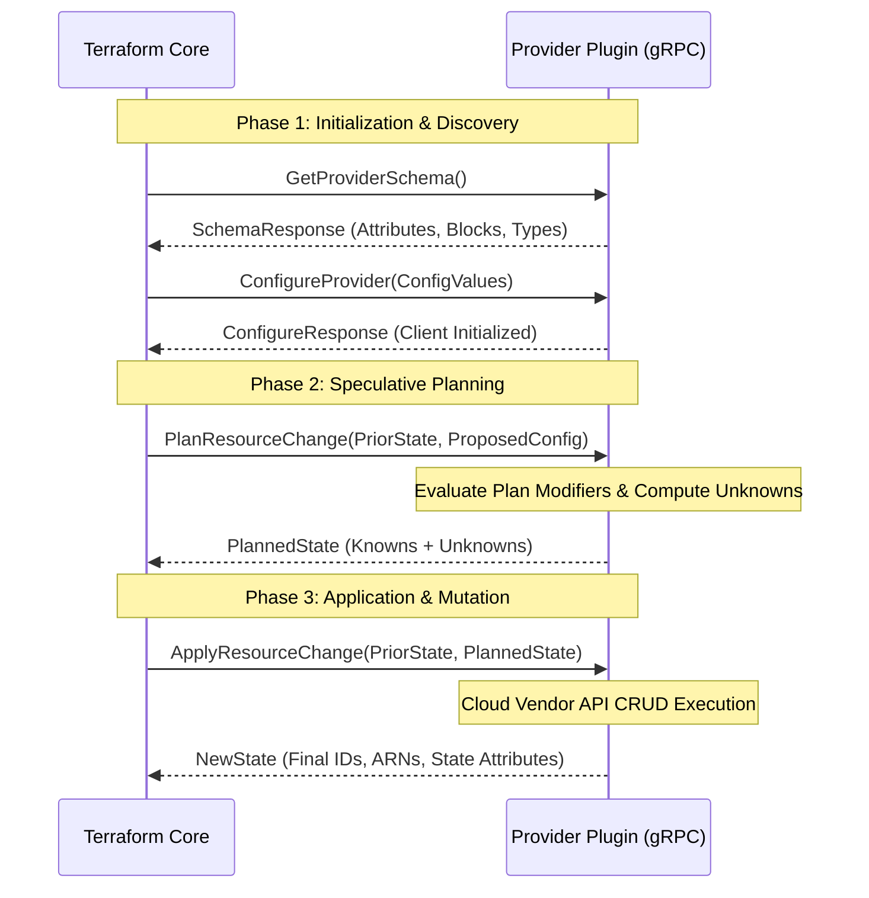
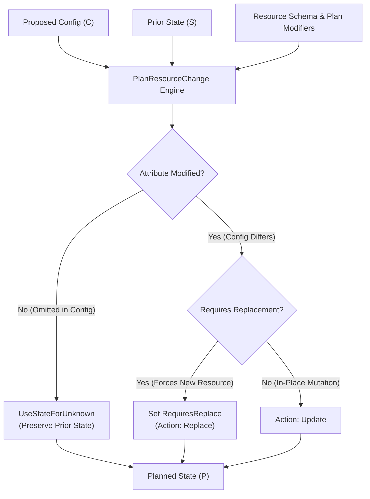

# Module 11: Provider Internals and the Plugin Framework: gRPC Protocol, Schemas, Plan Modifiers, and CRUD

The extensibility of Terraform and OpenTofu rests upon a decentralized plugin architecture. Unlike monolithic Infrastructure as Code engines that bundle cloud SDKs into the core CLI binary, Terraform treats every cloud platform, SaaS API, and bare-metal hypervisor as an external plugin process. The Terraform CLI core serves purely as an orchestrator: constructing dependency graphs, calculating state diffs, and managing the state storage lifecycle, while delegating domain-specific schema definitions, attribute validations, and CRUD executions to standalone provider processes over high-performance inter-process communication (IPC).

This module examines the internal mechanics of the Terraform provider ecosystem: the `go-plugin` IPC subsystem, the gRPC Protocol v6 wire specification, ternary type systems (Null, Unknown, Known), schema compilation, the mathematical engine of plan modification, CRUD lifecycle execution, and acceptance test harnesses. For foundational distributed communication and remote procedure calls, cross-reference [`architecture/distributed-systems/modules/02-networks-rpc-and-failure-detection.md`](../../../architecture/distributed-systems/modules/02-networks-rpc-and-failure-detection.md).

---

## 1. Provider Architecture and the go-plugin Subsystem

Terraform Core executes as a client process that dynamically spawns provider binaries as child OS processes during initialization and workflow execution.

```
Process Boundary & IPC Topology:
+-------------------------------------------------------------------------------+
|                       Terraform Core CLI Binary                               |
|                  (Graph Engine, HCL Parser, State Store)                      |
+---------------------------------------+---------------------------------------+
                                        |
               gRPC Protocol v6 over    | Handshake: TF_PLUGIN_MAGIC_COOKIE
               UNIX Domain Socket /     | Mutual mTLS Authentication
               Windows Named Pipe       |
                                        v
+---------------------------------------+---------------------------------------+
|                    Provider Plugin Binary (Child Process)                     |
|           terraform-provider-aws / terraform-provider-kubernetes              |
|        (Plugin Framework, Schema Registry, Cloud Vendor SDK Client)           |
+-------------------------------------------------------------------------------+
```

### Why Out-of-Process Plugins?

The decision to execute providers as isolated operating system processes rather than statically linked libraries or shared objects (`.so` / `.dylib`) reflects deliberate architectural invariants:

1. **Failure Domain Isolation**: Cloud SDKs frequently encounter unhandled memory faults, panics, or CGO segmentation violations. Running providers out-of-process ensures that a crash inside a vendor SDK cannot corrupt the Terraform Core process memory or destroy the active state file.
2. **Licensing Segregation**: Terraform Core (under BSL 1.1) and OpenTofu (under MPL-2.0) can invoke providers licensed under Apache 2.0, MIT, or proprietary commercial licenses without triggering viral copyleft contamination across the IPC boundary.
3. **Decoupled Release Cadences**: Providers release patches, new resource schemas, and bug fixes independently of Terraform CLI version milestones.
4. **Independent Dependency Management**: Compiling multiple massive cloud SDKs (AWS, Azure, Google Cloud) into a single Go binary would result in unresolvable Go module dependency conflicts and multi-gigabyte binaries.

### The go-plugin Handshake Protocol

When Terraform Core launches a provider binary, the two processes coordinate via the **HashiCorp `go-plugin` handshake**:

1. **Environment Verification**: Terraform Core sets an agreed magic cookie environment variable:
   ```bash
   TF_PLUGIN_MAGIC_COOKIE=d602bf8f470bc67ca7fafec7654afd27b5779a53893760213d1f3643805a9ee2
   ```
   If a user executes the provider binary directly in their terminal without this cookie, the binary prints an explanatory human-readable message and exits immediately.
2. **Listener Creation**: The provider process creates a local IPC listener:
   - On POSIX systems (Linux, macOS): A temporary **UNIX Domain Socket** (`/tmp/plugin123456789`).
   - On Windows: A **Named Pipe** (`\\.\pipe\plugin123456789`).
3. **Handshake Emission**: The provider prints a single structured handshake line to `stdout` containing connection parameters:
   ```
   1|6|unix|/tmp/plugin123456789|grpc|BASE64_SERVER_CERTIFICATE
   ```
   Where:
   - `1`: Handshake protocol core version.
   - `6`: Provider gRPC protocol version (Protocol v6).
   - `unix`: Network protocol family (`unix` or `tcp`).
   - `/tmp/...`: Socket filesystem path or TCP host:port.
   - `grpc`: RPC wire protocol format.
   - `BASE64_...`: Self-signed X.509 certificate used for ephemeral mutual TLS (mTLS) over the local IPC channel.
4. **mTLS Handshake & Pipe Closure**: Core reads `stdout`, validates the certificate, establishes a secure gRPC connection over the socket, and redirects the child process's `stdout` and `stderr` to Core's diagnostic log streaming engine (`TF_LOG`).

---

## 2. The gRPC Protocol v6 Wire Interface

Communication between Terraform Core and modern provider plugins adheres to **gRPC Protocol v6**. The protocol defines strongly typed RPC services declared in Protocol Buffers.



### Core gRPC RPC Methods

| RPC Method | Execution Trigger | Responsibility |
| :-- | :-- | :-- |
| `GetProviderSchema` | `terraform init` / `plan` | Returns the complete structural schema, types, and descriptions of the provider and all supported resources and data sources. |
| `ValidateProviderConfig` | `terraform validate` / `plan` | Checks provider-level inputs (e.g., credentials, endpoints) before initializing connections. |
| `ConfigureProvider` | `terraform plan` / `apply` | Instantiates upstream vendor API clients using resolved configuration variables. |
| `ValidateResourceConfig` | `terraform validate` / `plan` | Executes schema-level syntax and semantic validation over resource arguments. |
| `UpgradeResourceState` | `terraform plan` | Migrates legacy state schemas across provider versions using declared state upgraders. |
| `ReadResource` | `terraform plan` (refresh) | Queries remote cloud APIs to refresh the active state of an existing resource. |
| `PlanResourceChange` | `terraform plan` | Merges prior state and desired config to generate the planned state, resolving computed values and replacement flags. |
| `ApplyResourceChange` | `terraform apply` | Executes the definitive create, update, or delete operations against external cloud APIs. |
| `ImportResourceState` | `terraform plan` (import) | Translates a raw remote resource identifier into one or more structured state objects. |

### Dynamic Value Serialization

Because HCL configurations contain dynamic, user-defined nested structures, attributes cannot always map to static Protobuf messages. Protocol v6 utilizes **Dynamic Values** (`DynamicValue`):

- Payloads are serialized using **MessagePack** or **JSON**.
- The binary payload is accompanied by a type definition contract, enabling Terraform Core and the provider to negotiate complex object schemas without regenerating `.proto` compilation targets.

---

## 3. Terraform Plugin Framework Type System and Ternary Logic

Modern providers are authored using the **Terraform Plugin Framework** (`terraform-plugin-framework`), which superseded the legacy SDKv2. The framework introduces a formal type system designed around **three-state ternary logic**.

```
The Ternary Logic Model:
               +----------------------------------+
               |          Ternary Value           |
               +-----------------+----------------+
                                 |
         +-----------------------+-----------------------+
         |                       |                       |
+--------v-------+       +-------v--------+      +-------v--------+
|     Known      |       |      Null      |      |    Unknown     |
| (Concrete Val) |       | (Unset / None) |      | (Computed Post)|
+----------------+       +----------------+      +----------------+
```

### Null vs Unknown vs Known Values

In general programming languages, variables are either populated or `null`/`nil`. In declarative IaC planning, Terraform must reason about values that do not yet exist:

1. **Known**: A concrete, deterministic value known at plan time (e.g., `cidr_block = "10.0.0.0/16"`).
2. **Null**: An explicitly unconfigured or omitted argument. A null attribute indicates that no value was supplied and no provider default applies.
3. **Unknown**: A value whose exact content cannot be resolved until the resource (or an upstream resource) is physically provisioned during `apply` (e.g., an auto-generated AWS RDS endpoint, a generated RSA private key, or a KMS key ARN).

The Plugin Framework models these states through dedicated wrapper types:

```go
// Example Plugin Framework resource model struct
type DatabaseResourceModel struct {
    ID          types.String `tfsdk:"id"`
    ClusterName types.String `tfsdk:"cluster_name"`
    AllocatedGB types.Int64  `tfsdk:"allocated_storage_gb"`
    Endpoint    types.String `tfsdk:"endpoint"`     // Unknown during plan; Known after apply
    MasterPass  types.String `tfsdk:"master_password"` // Sensitive string
}
```

### Schema Attribute Definition

Resource schemas define the boundary contracts enforced by the framework:

```go
func (r *DatabaseResource) Schema(ctx context.Context, req resource.SchemaRequest, resp *resource.SchemaResponse) {
    resp.Schema = schema.Schema{
        Description: "Manages a high-availability cloud database instance.",
        Attributes: map[string]schema.Attribute{
            "id": schema.StringAttribute{
                Computed:            true,
                Description:         "Unique identifier of the provisioned database.",
                PlanModifiers: []planmodifier.String{
                    stringplanmodifier.UseStateForUnknown(),
                },
            },
            "cluster_name": schema.StringAttribute{
                Required:    true,
                Description: "The name of the database cluster.",
                PlanModifiers: []planmodifier.String{
                    stringplanmodifier.RequiresReplace(),
                },
            },
            "allocated_storage_gb": schema.Int64Attribute{
                Optional:    true,
                Computed:    true,
                Description: "Disk size in gigabytes. Defaults to 20 if unconfigured.",
            },
            "endpoint": schema.StringAttribute{
                Computed:    true,
                Description: "Connection endpoint hostname. Computed after provisioning.",
            },
            "master_password": schema.StringAttribute{
                Required:    true,
                Sensitive:   true,
                Description: "Administrative password. Masked in CLI output and logs.",
            },
        },
    }
}
```

---

## 4. The Plan Modification Engine and CRUD Execution

The heart of provider business logic resides in the **Plan Modification Engine**. When an operator executes `terraform plan`, Terraform Core transmits the prior state and proposed configuration to the provider's `PlanResourceChange` RPC.



### Plan Modifier Mechanics

Plan modifiers allow provider authors to dynamically compute attributes or alter execution plans:

1. **`UseStateForUnknown()`**: When an attribute is `Computed`, Terraform sets its planned value to `Unknown` by default. If the attribute is already known in Prior State and has not been modified in Configuration, `UseStateForUnknown` copies the prior state value into the plan, preventing unnecessary "known after apply" diffs.
2. **`RequiresReplace()`**: If an attribute represents an immutable cloud property (e.g., an AWS S3 bucket name or an Azure subscription ID), changing it requires destroying and recreating the resource. Marking an attribute with `RequiresReplace` instructs Terraform Core to plan a `Replace` action instead of an in-place `Update`.
3. **Custom Dynamic Modifiers**: Authors can inject custom validation or calculate default values based on surrounding attributes.

### Plan Modification State Calculation Algorithm

```
Algorithm: ComputePlannedResourceState
Input: State PriorState, Config ProposedConfig, Schema ResourceSchema
Output: State PlannedState, PlanAction PlannedAction

1. Initialize PlannedState = Clone(ProposedConfig)
2. Initialize PlannedAction = ACTION_NOOP
3. if PriorState is NULL then:
4.     PlannedAction = ACTION_CREATE
5.     for each attr in ResourceSchema.ComputedAttributes do:
6.         if PlannedState.Get(attr) is NULL then:
7.             PlannedState.Set(attr, VALUE_UNKNOWN)
8.         end if
9.     end for
10.    return (PlannedState, PlannedAction)
11. end if
12. // Resource exists; determine if Update or Replace is required
13. for each (attr, schemaDef) in ResourceSchema.Attributes do:
14.    PriorVal = PriorState.Get(attr)
15.    ConfigVal = ProposedConfig.Get(attr)
16.    if ConfigVal is NULL and schemaDef.Computed then:
17.        // Apply UseStateForUnknown logic
18.        PlannedState.Set(attr, PriorVal)
19.    else if ConfigVal != PriorVal then:
20.        if schemaDef.HasModifier(RequiresReplace) then:
21.            PlannedAction = ACTION_REPLACE
22.        else if PlannedAction != ACTION_REPLACE then:
23.            PlannedAction = ACTION_UPDATE
24.        end if
25.    end if
26. end for
27. return (PlannedState, PlannedAction)
```

### CRUD Lifecycle Implementation Mechanics

The provider implements four foundational CRUD methods:

#### 1. Create Method

- Resolves unknown inputs from configuration.
- Calls the external cloud SDK to initiate resource provisioning.
- If the remote API is asynchronous (e.g., creating an RDS cluster takes 15 minutes), the provider initiates an active polling loop using a retry backoff helper until the resource status becomes `available`.
- Populates the generated `id`, `arn`, and computed attributes into state and calls `resp.State.Set()`.

#### 2. Read Method (Refresh)

- Reads the resource identifier from stored state: `req.State.Get(ctx, &state)`.
- Calls the external cloud API to fetch the latest attributes.
- **Handling Out-of-Band Deletion**: If the cloud API returns a `404 Not Found` or `ResourceNotFoundException`, the provider MUST call `resp.State.RemoveResource(ctx)` and exit without error. This signals to Terraform Core that the asset was deleted out-of-band and must be planned for recreation.

#### 3. Update Method

- Calculates attribute diffs between `req.Plan` and `req.State`.
- Issues target patch/put requests to cloud APIs to alter in-place attributes (e.g., updating tags or memory allocations).
- Updates state with new values returned by the cloud API.

#### 4. Delete Method

- Calls the cloud API's teardown endpoint.
- Polls until the resource is fully purged from the provider namespace.
- If deletion succeeds, Terraform automatically drops the resource address from state.

---

## 5. Acceptance Testing and Provider Observability

Provider engineering requires rigorous acceptance testing against live cloud infrastructure or local containerized mock services (such as LocalStack or Docker).

```go
// Example Terraform acceptance test using resource.Test
func TestAccDatabaseResource_basic(t *testing.T) {
    resource.Test(t, resource.TestCase{
        PreCheck:                 func() { testAccPreCheck(t) },
        ProtoV6ProviderFactories: testAccProtoV6ProviderFactories,
        Steps: []resource.TestStep{
            // Step 1: Initial Provisioning
            {
                Config: testAccDatabaseConfig("prod-db", 20),
                Check: resource.ComposeAggregateTestCheckFunc(
                    resource.TestCheckResourceAttr("custom_db.primary", "cluster_name", "prod-db"),
                    resource.TestCheckResourceAttr("custom_db.primary", "allocated_storage_gb", "20"),
                    resource.TestCheckResourceAttrSet("custom_db.primary", "endpoint"),
                ),
            },
            // Step 2: In-Place Storage Expansion Update
            {
                Config: testAccDatabaseConfig("prod-db", 40),
                Check: resource.ComposeAggregateTestCheckFunc(
                    resource.TestCheckResourceAttr("custom_db.primary", "allocated_storage_gb", "40"),
                ),
            },
            // Step 3: Drift Detection Test (ImportState)
            {
                ResourceName:      "custom_db.primary",
                ImportState:       true,
                ImportStateVerify: true,
            },
        },
    })
}
```

### The `TF_ACC` Environment Variable

Acceptance tests are gated behind the `TF_ACC=1` environment variable. When executing `go test ./...`, tests requiring live cloud credentials and incurring monetary costs are skipped automatically unless `TF_ACC=1` is explicitly set in the test runner environment.

---

## 6. Then vs Now Comparison

| Dimension | Legacy SDKv2 (2015 - 2021) | Modern Plugin Framework (2022 - 2026) | Architectural Advantage |
| :-- | :-- | :-- | :-- |
| **Type System** | Untyped `map[string]interface{}`; primitive Go reflection. | Strongly typed structs with ternary logic (`types.String`, `types.Int64`). | Eliminates runtime type casting panics; compile-time schema safety. |
| **Wire Protocol** | Legacy RPC Protocol v5 (custom net/rpc serialization). | Standardized gRPC Protocol v6 over Protobuf & MessagePack. | High performance, reduced memory serialization overhead, language agnostic. |
| **Plan Modifiers** | Primitive `CustomizeDiff` functions with fragile state overrides. | First-class declarative and custom `PlanModifiers` per attribute. | Clean, composable plan adjustments with deterministic replacement triggering. |
| **Unknown Value Handling** | Fragile zero-value confusion (empty string `""` treated as unset). | Explicit distinction between `Null`, `Unknown`, and concrete `Known` values. | Eliminates perpetual diffs and prevents premature application crashes. |
| **Diagnostics** | Basic `error` and free-form strings. | Structured `diag.Diagnostics` with severity, summary, and contextual detail. | Surfaces actionable, user-friendly error messages with source HCL line numbers. |

---

## 7. Exam Delta: Associate 004 vs Modern Capabilities

> [!IMPORTANT]
> The HashiCorp Certified: Terraform Associate (004) exam targets **Terraform 1.12**. Candidates must understand the exact certification boundaries versus modern 1.16/1.17 features.

- **Exam Baseline (1.12)**:
  - Candidates must understand that providers are plugins installed into `.terraform/providers`.
  - Understand the role of `.terraform.lock.hcl` in recording provider versions and checksums.
  - Understand how provider configurations and alias arguments operate in HCL.
  - Understand that providers communicate via an external RPC plugin system.
- **Modern Delta (1.14 - 1.17)**:
  - The exam does NOT require writing Go code for the Terraform Plugin Framework.
  - The exam does NOT test gRPC Protocol v6 wire message structures or Protobuf payloads.
  - The exam does NOT test internal plan modifier algorithms or `TF_ACC` acceptance harness code.
  - The exam does NOT test provider-defined functions (introduced in Terraform 1.8).

---

## 8. Production Failure Modes and Operational Post-Mortems

### Failure Mode 1: Inconsistent Result After Apply

- **Root Cause**: A provider author writes an `Update` method that computes a default attribute value differently than the `PlanResourceChange` method had promised.
- **Failure Mechanics**: During `terraform plan`, the provider sets an attribute to `"default-alpha"`. During `terraform apply`, the provider's `Update` logic inadvertently writes `"default-beta"` to state. Terraform Core compares the post-apply state with the planned state. Because they diverge, Core immediately aborts with: `Error: Provider produced inconsistent result after apply`. The transaction is aborted mid-flight.
- **Remediation**: Invariant: The `Apply` method MUST write values that strictly conform to what was promised in `PlannedState`. Never introduce dynamic computations in `Apply` that were not marked `Unknown` or calculated during `PlanResourceChange`.

### Failure Mode 2: Read Function Failing to Remove Deleted Resource

- **Root Cause**: An operator deletes an S3 bucket manually in the AWS console. During the next `terraform plan`, Terraform calls the provider's `ReadResource` RPC. The cloud SDK returns an HTTP 404 error, and the provider author logs an error and returns `diag.NewError("S3 bucket not found")`.
- **Failure Mechanics**: Instead of interpreting the 404 as normal external drift, Terraform treats the error as a fatal network failure. The plan aborts, and the user is permanently blocked from regenerating or recreating the missing infrastructure.
- **Remediation**: Inside `ReadResource`, explicitly inspect cloud API error responses for `NotFound` / `404`. When detected, call `resp.State.RemoveResource(ctx)` and return zero diagnostic errors.

### Failure Mode 3: Provider Process Crash Orphaned State

- **Root Cause**: A third-party provider binary suffers a nil-pointer dereference in its Go codebase while applying a large cluster resource.
- **Failure Mechanics**: The provider OS process crashes abruptly (`SIGSEGV`). The UNIX domain socket closes violently. Terraform Core catches the broken pipe: `Error: plugin process exited unexpectedly`. The remote cloud asset was physically provisioned by the cloud API, but the provider process died before transmitting the generated `id` back to Core. The state file contains no record of the new asset, creating unmanaged orphan infrastructure.
- **Remediation**: Use `import` blocks to adopt the orphaned cloud resource into state, and report the panic stack trace to the upstream provider repository.

### Failure Mode 4: Leaking Unknown Values into Required Arguments

- **Root Cause**: A provider attempts to set an `Unknown` value for a child attribute during `PlanResourceChange` that a downstream resource schema declares as strictly non-computed and required.
- **Failure Mechanics**: Terraform Core halts during graph compilation with `Error: Attribute cannot be unknown`.
- **Remediation**: Ensure that attributes populated from unknowns are explicitly declared as `Computed: true` in the downstream schema.

### Failure Mode 5: gRPC Buffer Overflow on Massive State Responses

- **Root Cause**: A data source queries a cloud provider for all VPC flow logs across an entire enterprise AWS organization, returning 50,000 log stream records in a single RPC response.
- **Failure Mechanics**: The serialized MessagePack payload exceeds gRPC's default maximum message size (4 MB). The IPC transport terminates with `grpc: received message larger than max (5242880 vs 4194304)`.
- **Remediation**: Implement server-side pagination in the provider data source, fetching records in batches of 100 and appending them incrementally to the state list.

---

## Interview Drill

<details><summary>1. Why does Terraform execute providers as independent child operating system processes over gRPC rather than linking them as dynamic shared libraries (`.so`)?</summary>

**Memory Fault Isolation, Licensing Segregation, and Dependency Decoupling.**

- **Fault Isolation**: Vendor cloud SDKs (AWS, Azure, GCP) contain millions of lines of complex code and CGO bindings. If a provider executes as a statically or dynamically linked library, any unhandled nil-pointer panic or segmentation fault terminates the entire Terraform CLI process, corrupting memory and risking state file destruction. Process isolation ensures that a provider crash cleanly kills only the child process, allowing Core to safely abort and report diagnostics.
- **Licensing**: Terraform Core (under BSL 1.1) can invoke providers licensed under Apache 2.0 or commercial licenses without violating open-source copyleft boundaries across the IPC transport.
- **Dependency Hell**: Linking dozens of disparate cloud SDKs into one binary would create unresolvable Go module version conflicts and multi-gigabyte binary bloat.
- Ref: HashiCorp go-plugin Architectural Whitepaper; Terraform Core Provider Subsystem Design.

</details>

<details><summary>2. What are the three states in the Terraform Plugin Framework ternary logic model, and why is `Unknown` distinct from `Null`?</summary>

**Known, Null, and Unknown Tri-State Logic.**

- **Known**: A concrete value resolved at plan time (e.g., `allocated_storage = 20`).
- **Null**: An unconfigured, omitted argument representing absence of data.
- **Unknown**: A placeholder indicating that a value will exist, but its exact content cannot be known until the resource is physically created during `terraform apply` (e.g., an auto-generated RDS hostname or EC2 private IP).
- `Unknown` is distinct from `Null` because downstream dependent resources need to know during the planning phase that a valid value _will_ be provided. If an attribute were treated as `Null`, downstream validation rules (e.g., checking string length or IP formatting) would falsely fail or assume the argument was omitted.
- Ref: Terraform Plugin Framework Specification: Types and Values.

</details>

<details><summary>3. What occurs when a provider's `ReadResource` method encounters an HTTP 404 Not Found error from a cloud API, and what is the required implementation?</summary>

**State Pruning for Drift Remediation.**

- An HTTP 404 indicates that the physical cloud resource was deleted out-of-band (e.g., via the cloud web console or external script).
- The provider MUST NOT return a fatal diagnostic error. Returning an error signals a broken network or API failure, halting the plan.
- Instead, the provider must call `resp.State.RemoveResource(ctx)` and return cleanly with empty diagnostics.
- This instructs Terraform Core to remove the resource address from the refreshed state. During the subsequent planning phase, Terraform detects that the resource is declared in configuration but absent from state, correctly scheduling a `Create` action to recreate the missing asset.
- Ref: Terraform Provider Development Guide: Implementing Read.

</details>

<details><summary>4. Explain the cause and operational consequence of the error: "Provider produced inconsistent result after apply".</summary>

**Contract Breach Between Plan and Apply.**

- When `terraform plan` runs, the provider emits a `PlannedState` document that promises the exact attribute values (or unknown flags) that will result from the mutation.
- When `terraform apply` executes, the provider's `Create` or `Update` method writes the final `NewState` back to Core.
- Terraform Core performs an assertion check: every attribute that was declared as a known value in `PlannedState` must be bit-for-bit identical in `NewState`.
- If a provider author inadvertently modifies a known value during `Apply` (e.g., normalizing an input string or applying a server-side default that was not marked `Computed` in schema), Core detects the divergence and aborts with `Provider produced inconsistent result after apply`.
- This fail-safe prevents silent configuration corruption.
- Ref: HashiCorp Terraform Core Engine Invariants.

</details>

<details><summary>5. How does the `RequiresReplace` plan modifier alter the Terraform Directed Acyclic Graph (DAG)?</summary>

**Action Transformation from In-Place Update to Destroy-and-Create.**

- By default, modifying an attribute on an existing resource schedules an in-place `Update` action node in the DAG.
- When an attribute is tagged with `RequiresReplace()`, the provider's `PlanResourceChange` method informs Core that the underlying cloud API does not support modifying this property on a live asset (e.g., changing the `name` of an AWS S3 bucket).
- Core converts the planned action to `Replace`.
- In the execution graph, Core splits the resource execution into two distinct operations: a `Destroy` node and a `Create` node.
- Depending on the resource's `lifecycle` settings, Core orders the graph as either `Destroy-then-Create` (default) or `Create-before-Destroy` (`create_before_destroy = true`), ensuring all downstream dependencies are re-evaluated against the new resource instance.
- Ref: Terraform Plugin Framework Documentation: Plan Modifiers.

</details>

<details><summary>6. What is the role of `TF_ACC` in provider development and CI pipelines?</summary>

**Gating Real Cloud Acceptance Tests from Hermetic Unit Tests.**

- In Go provider repositories, unit tests (mock schema validation, type parsing) run hermetically without network access in milliseconds.
- Acceptance tests (`resource.Test`) execute actual Terraform CLI commands that make live network calls to cloud providers, creating real cloud resources that incur financial costs and take minutes to complete.
- The testing framework checks `os.Getenv("TF_ACC")`. If `TF_ACC` is not set to `1` or `true`, all acceptance test cases are skipped automatically during standard `go test ./...` invocations.
- CI pipelines set `TF_ACC=1` only in dedicated integration testing environments equipped with cloud sandbox credentials.
- Ref: HashiCorp Provider Acceptance Testing Specification.

</details>

<details><summary>7. How does gRPC Protocol v6 handle dynamic values whose structural schema is not statically known at Protobuf compile time?</summary>

**MessagePack Binary Payloads Paired with Dynamic Type Signatures.**

- Traditional gRPC requires fixed Protobuf message structures. However, HCL allows arbitrary user-defined object maps and tuple types.
- Protocol v6 addresses this via `DynamicValue` messages.
- The attribute data is encoded as a raw binary **MessagePack** payload.
- Accompanying the payload is a serialized type signature describing the attribute structure (primitive types, list elements, object attribute maps).
- The receiving engine (Core or Provider) uses the type signature to unpack and validate the MessagePack stream in-memory, achieving structural typing without requiring dynamic Protobuf re-compilation.
- Ref: Terraform Provider Protocol v6 Wire Specification.

</details>

---

## 10. Proof Map

Every theoretical assertion and design pattern in this module is verified deterministically in the local test suite:

- **Hermetic Test File**: [`../examples/ts/11-provider-internals-and-plugin-framework.test.ts`](../examples/ts/11-provider-internals-and-plugin-framework.test.ts)
  - `testTernaryLogic()`: Validates Null, Unknown, and Known value states and proves ternary assertion behavior.
  - `testPlanModificationEngine()`: Simulates `PlanResourceChange`, verifying `UseStateForUnknown` and `RequiresReplace` action transformations.
  - `testReadDriftRemoval()`: Proves that receiving a 404 response in `ReadResource` triggers state removal rather than a fatal diagnostic error.
  - `testInconsistentPlanDetection()`: Asserts that modifications to known attributes during `Apply` are detected and flagged as fatal protocol violations.
