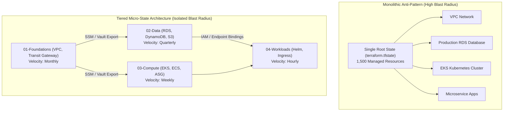

# Module 12: Production State Architecture, Blast Radius, BSL Licensing, OpenTofu 1.13 Parity, and Version History

Architecting Infrastructure as Code for mission-critical enterprise environments requires rigorous blast radius engineering, deterministic state partitioning, and unyielding supply chain governance. A single misconfigured dependency or state corruption in a monolithic deployment can trigger catastrophic outages spanning an organization's entire cloud footprint.

This capstone module examines the principles of production state architecture, the architectural debate of CLI workspaces versus dedicated state directories, distributed state locking and fencing token mechanics, the historical inflection point of HashiCorp's BSL 1.1 license shift and IBM acquisition, the emergence of the CNCF-backed OpenTofu project, and a comprehensive comparative version matrix across Terraform 1.5 through 1.17 and OpenTofu 1.6 through 1.13.2. For foundational distributed systems theory on linearizability and mutual exclusion, cross-reference [`architecture/distributed-systems/modules/04-consistency-models-and-linearizability.md`](../../../architecture/distributed-systems/modules/04-consistency-models-and-linearizability.md) and [`architecture/distributed-systems/modules/08-distributed-coordination-and-locks.md`](../../../architecture/distributed-systems/modules/08-distributed-coordination-and-locks.md).

---

## 1. Production State Topology and Blast Radius Engineering

In systems engineering, the **blast radius** of an operational change is defined as the maximum boundary of infrastructure downtime, data loss, or performance degradation resulting from an unexpected error, bad plan execution, or state corruption.



### The Monolithic State Anti-Pattern

Managing an entire enterprise infrastructure estate within a single state file introduces systemic failure modes:

1. **Unbounded Destruction Cascades**: A minor edit to an application security group can inadvertently trigger a graph recalculation that plans the destruction of the shared production database cluster.
2. **Execution Serialization & Lock Contention**: Only one engineer or CI pipeline can execute `terraform apply` at any given time. As engineering teams grow, developers spend hours blocked waiting for state locks to release.
3. **API Rate Exhaustion**: Refreshing 2,000 resources on every run issues tens of thousands of read calls to cloud provider APIs, triggering severe HTTP 429 throttling.

### Layered Micro-State Architecture

The industry-standard architecture partitions infrastructure into decoupled, independently versioned state tiers based on **change velocity** and **failure domains**:

- **Tier 01: Networking & Foundations** (Lowest Velocity): VPCs, subnets, route tables, Transit Gateways, Direct Connect. Modified rarely (monthly/quarterly).
- **Tier 02: Persistence & Data Systems** (Low Velocity, Critical Risk): RDS Aurora clusters, DynamoDB tables, S3 data lakes, KMS customer managed keys. Protected with `lifecycle { destroy = false }`.
- **Tier 03: Compute Platforms** (Medium Velocity): Kubernetes (EKS/GKE) node groups, ECS clusters, auto-scaling groups. Modified weekly.
- **Tier 04: Application Workloads** (High Velocity): Ingress rules, DNS records, container task definitions. Modified multiple times per day.

### Cross-State Data Sharing: `terraform_remote_state` vs Parameter Stores

When micro-states must exchange connection parameters (e.g., Tier 03 compute clusters requiring Tier 01 subnet IDs), two architectural patterns exist:

```hcl
# Anti-Pattern: Tight coupling via terraform_remote_state
data "terraform_remote_state" "networking" {
  backend = "s3"
  config = {
    bucket = "corp-tf-state-prod"
    key    = "networking/terraform.tfstate"
    region = "eu-central-1"
  }
}

# Consuming remote state output
resource "aws_instance" "worker" {
  subnet_id = data.terraform_remote_state.networking.outputs.private_subnet_ids[0]
}
```

#### Why `terraform_remote_state` is an Anti-Pattern:

- **Broad Read Permissions**: The consuming tier requires full read permissions to the upstream state file, exposing all sensitive outputs and database passwords stored in that file.
- **Brittle Coupling**: Renaming an output in the upstream module silently breaks planning in all downstream repositories.

#### The Recommended Pattern: Decoupled Key-Value Parameter Stores

Upstream modules publish contract endpoints to cloud parameter stores (AWS SSM Parameter Store, GCP Secret Manager, or HashiCorp Vault), and downstream modules query these stores:

```hcl
# Upstream Tier 01: Publishes subnet contract
resource "aws_ssm_parameter" "private_subnets" {
  name  = "/infrastructure/production/network/private_subnet_ids"
  type  = "StringList"
  value = join(",", aws_subnet.private[*].id)
}

# Downstream Tier 03: Reads contract without state access
data "aws_ssm_parameter" "subnets" {
  name = "/infrastructure/production/network/private_subnet_ids"
}
```

---

## 2. Workspaces vs Dedicated State Directories

A perennial architectural question in Infrastructure as Code is whether to isolate environments (development, staging, production) using **Terraform CLI Workspaces** or **Separate Root Module Directories**.

```
Workspace vs Directory Topology Comparison:
+--------------------------+-------------------------------------+-------------------------------------+
| Architectural Metric     | Terraform CLI Workspaces            | Dedicated State Directories         |
+--------------------------+-------------------------------------+-------------------------------------+
| Directory Structure      | Single shared directory (main.tf)   | Distinct roots (environments/prod/) |
| Backend State Storage    | Single backend bucket, partitioned  | Completely isolated backend buckets |
| Access Control (IAM)     | Shared IAM credentials across envs  | Strictly separated IAM role per env |
| Configuration Drift Risk | High (accidental apply in wrong env)| Zero (physical directory separation)|
| Version Pinning          | Same provider/module version in all | Staging can test upgrades before prod|
| Human Operator Error     | Catastrophic (`workspace select`)   | Protected by Git branch / folder ACL|
+--------------------------+-------------------------------------+-------------------------------------+
```

### The Architectural Verdict: Directory Isolation for Environments

While CLI workspaces are effective for ephemeral developer feature branches sharing identical credentials, **production environments must use separate root directories**:

```
Recommended Enterprise Repository Layout:
infrastructure-live/
├── environments/
│   ├── dev/
│   │   ├── backend.tf       # Dedicated Dev S3 bucket & lockfile
│   │   ├── main.tf          # Calls shared modules with dev sizing
│   │   └── terraform.tfvars
│   ├── staging/
│   │   ├── backend.tf       # Staging state backend
│   │   ├── main.tf
│   │   └── terraform.tfvars
│   └── prod/
│       ├── backend.tf       # Isolated Prod S3 bucket; strict KMS key
│       ├── main.tf
│       └── terraform.tfvars
└── modules/                 # Reusable, versioned component modules
    ├── networking/
    └── compute/
```

This layout guarantees that an operator or CI runner targeting `dev` physically cannot read or write to `prod` state, even in the event of an operational misconfiguration.

### Distributed State Locking and Fencing Tokens

To guarantee safety in distributed systems, state backends must enforce mutual exclusion:

```
Algorithm: AcquireStateLockWithFencing
Input: StateStorageHandle Backend, LockTimeoutDuration Timeout
Output: LockLease LeaseToken

1. StartTime = System.CurrentTime()
2. LockID = Crypto.GenerateUUIDv4()
3. while (System.CurrentTime() - StartTime) < Timeout do:
4.     AttemptToken = Backend.ExecuteConditionalWrite(
           Key = "state.lock",
           ExpectedVersion = 0, // Invariant: Write succeeds ONLY if key does not exist
           Payload = { LockID: LockID, CreatedAt: System.CurrentTime(), Owner: Process.User }
       )
5.     if AttemptToken.Success then:
6.         FencingToken = Backend.IncrementMonotonicCounter("state.lock.fencing_sequence")
7.         return LockLease(LockID, FencingToken)
8.     end if
9.     Sleep(ExponentialBackoffJitter())
10. end while
11. raise StateLockTimeoutError("Unable to acquire state lock after " + Timeout + " seconds.")
```

---

## 3. The BSL 1.1 License Shift and the OpenTofu Ecosystem

On August 10, 2023, HashiCorp announced a momentous shift in its open-source licensing policy: transitioning future releases of all core products (Terraform, Vault, Consul, Nomad) from the open-source **Mozilla Public License 2.0 (MPL-2.0)** to the **Business Source License 1.1 (BSL 1.1)**.

### Legal and Commercial Implications of BSL 1.1

BSL 1.1 is not an Open Source Initiative (OSI) approved open-source license. It is a "source-available" commercial license. Key provisions include:

- **Free Internal Commercial Use**: Organizations can use Terraform internally to manage their own cloud infrastructure at zero licensing cost.
- **Competitive Use Prohibition**: Any organization offering a commercial product or managed service that competes directly with HashiCorp's paid cloud offerings (HCP Terraform) is prohibited from using Terraform binaries released under BSL 1.1 without purchasing a commercial license.
- **Four-Year MPL Transition Clause**: Code released under BSL 1.1 converts back to an open-source license (Change License: MPL-2.0) four years after publication.

### The Genesis of OpenTofu

In response to the BSL license change, a coalition of technology companies and community leaders established the **OpenTofu** project (originally named OpenTF) on August 15, 2023. Key milestones include:

1. **Fork from MPL-2.0**: OpenTofu forked cleanly from the last open-source MPL-2.0 commit of Terraform (v1.5.5).
2. **Linux Foundation Sponsorship**: In September 2023, OpenTofu was formally accepted under the Linux Foundation, establishing neutral, community-owned governance.
3. **CNCF Acceptance**: OpenTofu subsequently joined the Cloud Native Computing Foundation (CNCF), guaranteeing that the core IaC engine remains open and free from vendor lock-in.
4. **IBM Acquisition of HashiCorp**: In April 2024, IBM announced the acquisition of HashiCorp for \$6.4 billion; the transaction formally closed in **February 2025**, placing Terraform under IBM's enterprise software umbrella.

---

## 4. OpenTofu 1.13 Architecture and Feature Parity Matrix

OpenTofu has evolved beyond a drop-in replacement, introducing major architectural innovations that address long-standing limitations of the upstream engine.

```
OpenTofu Architectural Differentiators:
+------------------------------------+------------------------------------+
| Terraform 1.16 / 1.17              | OpenTofu 1.13.2                    |
+------------------------------------+------------------------------------+
| Plaintext State File Storage       | Client-Side Native State Encryption|
| Static `prevent_destroy`           | Dynamic `prevent_destroy` & enabled|
| HashiCorp Private Registry         | Native OCI Registry Module Sources |
| Target-Only (`-target`)            | Inverted Target Exclusion (`-exclude`)|
| Proprietary Sentinel Policy Engine | Community-Driven Open Ecosystem    |
+------------------------------------+------------------------------------+
```

### 1. Client-Side State Encryption (OpenTofu 1.7 - 1.13)

Historically, sensitive credentials (database passwords, private keys, API tokens) reside in plaintext within the remote state file. While backends support server-side encryption at rest (e.g., S3 AES-256), any engineer or compromised CI runner with S3 read access can extract every secret.

OpenTofu introduced **native client-side state encryption**:

```hcl
# main.tf in OpenTofu
terraform {
  encryption {
    key_provider "aws_kms" "production_key" {
      kms_key_id = "arn:aws:kms:eu-central-1:123456789012:key/abc-123"
      region     = "eu-central-1"
    }

    method "aes_gcm" "prod_aes" {
      keys = key_provider.aws_kms.production_key
    }

    state {
      method   = method.aes_gcm.prod_aes
      enforced = true
    }

    plan {
      method   = method.aes_gcm.prod_aes
      enforced = true
    }
  }
}
```

State payloads are encrypted locally in memory via AES-GCM before transmission over the network, ensuring that S3 or HTTP backends store only cryptographically opaque ciphertexts.

### 2. Dynamic Lifecycle Controls

In Terraform, `prevent_destroy` must be a static boolean literal (`true` or `false`). It cannot reference variables or locals. This forced teams to maintain separate configurations for staging (where teardowns are routine) and production.

OpenTofu permits dynamic expressions in lifecycle blocks:

```hcl
variable "is_production" {
  type = bool
}

resource "aws_db_instance" "database" {
  allocated_storage = 100
  instance_class    = "db.r6g.xlarge"

  lifecycle {
    # Dynamically protected based on environment variable in OpenTofu
    prevent_destroy = var.is_production
  }
}
```

Additionally, OpenTofu supports the `enabled` meta-argument on resources and modules, providing a clean alternative to the `count = var.enabled ? 1 : 0` idiom.

### 3. Inverted Targeted Planning: The `-exclude` Flag

When troubleshooting or running emergency fixes, engineers often need to skip a broken resource without altering HCL code. Terraform only provides `-target`, which requires explicitly listing all _desired_ resources. OpenTofu provides `-exclude`:

```bash
# Apply entire infrastructure plan EXCEPT the failing third-party SaaS integration
tofu plan -exclude=module.datadog_monitors
```

---

## 5. The Definitive Version History Matrix: Terraform 1.5 - 1.17 vs OpenTofu 1.6 - 1.13

| Product / Version | Release Date | Core Capabilities, Architectural Invariants & Ecosystem Events |
| :-- | :-- | :-- |
| **Terraform 1.5** | June 2023 | Introduces declarative `import` blocks and continuous `check` blocks. Last major open-source MPL-2.0 release train. |
| **OpenTofu Fork** | August 2023 | Linux Foundation announces open-source fork following HashiCorp's BSL 1.1 license shift on August 10, 2023. |
| **Terraform 1.6** | October 2023 | First release under **BSL 1.1**. Introduces native `terraform test` command (`.tftest.hcl`). |
| **OpenTofu 1.6** | January 2024 | First GA release of OpenTofu. Drop-in compatibility with Terraform 1.5.5; S3 native lockfile support without DynamoDB. |
| **Terraform 1.7** | March 2024 | Introduces declarative `removed` blocks with `lifecycle { destroy = false }` and `mock_provider` for unit testing. |
| **OpenTofu 1.7** | April 2024 | Introduces native **Client-Side State Encryption** (KMS, PBKDF2, AES-GCM) and provider-defined functions. |
| **Terraform 1.8** | April 2024 | Introduces provider-defined functions and cross-variable references within `validation` condition blocks. |
| **Terraform 1.9** | June 2024 | Cross-object references in input variable validations; templated diagnostic messages in conditions. |
| **OpenTofu 1.8** | August 2024 | Support for `.tofu` file extension; dynamic provider configurations; early variable evaluation. |
| **Terraform 1.10** | November 2024 | Introduces **ephemeral values** and **write-only arguments** to protect secrets in state memory. |
| **OpenTofu 1.9–1.12** | Early 2025 | KMS key rotation; multi-key decryption; high-throughput graph evaluations; CNCF incubation milestones. |
| **Terraform 1.11** | February 2025 | Performance optimizations; DAG compilation efficiency. IBM formally closes \$6.4B acquisition of HashiCorp. |
| **Terraform 1.12** | May 2025 | **Baseline for HashiCorp Certified: Terraform Associate (004) exam**. Production stability release. |
| **Terraform 1.14** | Early 2026 | Introduces `terraform query` command for asset and shadow infrastructure discovery. |
| **Terraform 1.15** | April 2026 | Supports variables in module `source` and `version` expressions; native `deprecated` attribute on variables/outputs. |
| **Terraform 1.16** | August 2026 | `import` blocks allowed inside child modules; `lifecycle { destroy = false }` on live resources; Mermaid graph output. |
| **OpenTofu 1.13.2** | October 2026 | Native OCI module distribution enhancements; experimental `-lint` command; symbol libraries; macOS 13+ support. |
| **Terraform 1.17.0** | October 2026 | **Terraform Policy GA** (`-policies` flag); `-minimal-refresh` for fast planning; variables in provider requirement blocks. |

---

## 6. Then vs Now Comparison

| Dimension | Legacy Production IaC (2018 - 2021) | Modern Enterprise Architecture (2024 - 2026) | Strategic Advantage |
| :-- | :-- | :-- | :-- |
| **State Topology** | Large monolithic state repositories. | Tiered micro-states decoupled via cloud parameter stores. | Dramatically reduced blast radius; sub-minute plan/apply cycles. |
| **Environment Model** | CLI workspaces (`terraform workspace`). | Dedicated directories per environment with isolated IAM roles. | Prevents accidental cross-environment destruction; strict least-privilege security. |
| **Licensing Governance** | Uncontroversial open-source MPL-2.0. | BSL 1.1 (Terraform) vs CNCF MPL-2.0 (OpenTofu). | Enterprise risk assessment regarding competitive hosting clauses and vendor lock-in. |
| **Secret Protection** | Plaintext secrets stored unencrypted in state files. | Client-side state encryption (OpenTofu) and ephemeral variables (TF 1.10+). | Total confidentiality against compromised backend buckets and snapshot leaks. |
| **Targeting Controls** | `-target` only; error-prone manual dependency listing. | `-exclude` flag (OpenTofu) and `-minimal-refresh` (TF 1.17). | Surgical execution control during incident response and high-velocity deploys. |

---

## 7. Exam Delta: Associate 004 vs Modern Capabilities

> [!IMPORTANT]
> The HashiCorp Certified: Terraform Associate (004) exam targets **Terraform 1.12**. Candidates must understand the exact certification boundaries versus modern 1.16/1.17 features.

- **Exam Baseline (1.12)**:
  - Candidates must understand state storage concepts, remote backends (S3, GCS, AzureRM), and state locking mechanics.
  - Understand the operational trade-offs of Terraform CLI workspaces.
  - Understand how to structure reusable modules and root configurations.
  - Understand the core workflow: `init`, `validate`, `plan`, `apply`, `destroy`.
- **Modern Delta (1.14 - 1.17)**:
  - The exam does NOT test OpenTofu, state encryption, or the BSL license dispute.
  - The exam does NOT test dynamic `prevent_destroy` or the `-exclude` flag.
  - The exam does NOT test `terraform query` (introduced in 1.14).
  - The exam does NOT test `deprecated` variable attributes or dynamic module sources (introduced in 1.15).
  - The exam does NOT test `destroy = false` on live resources (introduced in 1.16) or Terraform Policy GA (1.17).

---

## 8. Production Failure Modes and Operational Post-Mortems

### Failure Mode 1: Monolithic State Deadlock During Emergency Incident

- **Root Cause**: An enterprise hosts 3,000 resources (networking, databases, and microservices) in a single state file. A critical production bug requires an emergency security group update.
- **Failure Mechanics**: An automated nightly background CI run crashed mid-execution, leaving the state backend locked in DynamoDB. When SREs attempt to run the emergency fix, Terraform halts: `Error: Error acquiring the state lock`. Simultaneously, cloud API rate limiting blocks full state refreshes. Total time to remediate the one-line security group fix: 4 hours.
- **Remediation**: Decompose the monolith into four isolated micro-state tiers. The networking tier state contains only 40 resources, executing plans in under 3 seconds with isolated lock domains.

### Failure Mode 2: Accidental Production Apply via Workspace Context Mismatch

- **Root Cause**: An engineer works locally using CLI workspaces. The engineer believes their terminal context is set to `workspace: dev`. In reality, the previous git branch had switched the active workspace to `prod`.
- **Failure Mechanics**: The engineer tests a destructive resource deletion by executing `terraform apply -auto-approve`. Terraform reads the active workspace pointer (`prod`) and destroys the production database cluster.
- **Remediation**: Eliminate CLI workspaces for distinct environments. Use physical directories: `environments/prod/` and `environments/dev/` protected by independent cloud IAM roles.

### Failure Mode 3: OpenTofu State Encryption Key Loss

- **Root Cause**: An enterprise adopts OpenTofu client-side state encryption using an AWS KMS key. A junior cloud administrator cleans up "unused" KMS keys and deletes the key material.
- **Failure Mechanics**: Because OpenTofu encrypts state payloads using AES-GCM with keys managed by that specific KMS Key ID, the state file stored in S3 becomes permanently undecryptable gibberish. Neither OpenTofu nor human operators can decrypt the infrastructure state, requiring painful manual reconstruction of thousands of cloud assets.
- **Remediation**: Enforce AWS KMS Key Deletion Protection, configure multi-key encryption fallbacks in OpenTofu (`method.aes_gcm.keys = [key_provider.aws_kms.primary, key_provider.aws_kms.backup]`), and replicate encrypted state snapshots across secondary accounts.

### Failure Mode 4: BSL License Infringement in Commercial SaaS Offering

- **Root Cause**: A startup builds an internal developer platform offering "Managed Cloud Workspaces" to enterprise customers. The engineering team bundles Terraform 1.7 binaries inside their containerized product.
- **Failure Mechanics**: HashiCorp's legal team issues a cease-and-desist letter: because the startup's product provides managed infrastructure automation competing with HCP Terraform, embedding Terraform $\ge 1.6$ breaches the BSL 1.1 competitive use clause. The startup is forced to execute an emergency migration to OpenTofu under legal threat.
- **Remediation**: Establish strict software supply chain auditing. When building commercial SaaS products that manage infrastructure, standardize on CNCF-governed OpenTofu (MPL-2.0) or consult IP legal counsel prior to adopting BSL software.

### Failure Mode 5: Cascading Drift via Hardcoded Remote State Cross-References

- **Root Cause**: Tier 04 application deployments query Tier 01 networking state outputs directly using `data.terraform_remote_state`.
- **Failure Mechanics**: The networking team refactors `output "subnet_ids"` into an object map `output "subnets" = { public = [...], private = [...] }`. The networking apply succeeds. Minutes later, all 45 microservice CI pipelines across the company break simultaneously on `terraform plan` because `data.terraform_remote_state.net.outputs.subnet_ids` no longer exists.
- **Remediation**: Replace `terraform_remote_state` with decoupled SSM Parameter Store or HashiCorp Vault key-value contracts, treating infrastructure parameters as versioned public APIs.

---

## Interview Drill

<details><summary>1. Why is separating environments using distinct directories superior to using Terraform CLI workspaces in production enterprises?</summary>

**IAM Privilege Separation, Accidental Apply Prevention, and Version Independence.**

- **CLI Workspaces (`terraform workspace select`)**: Merely creates a separate state file inside the exact same backend storage bucket using the exact same cloud credentials. If an engineer forgets which workspace is active, running `terraform apply` executes destructive changes in the wrong environment. Furthermore, all environments are forced to share the same provider and module versions declared in that directory.
- **Dedicated Directories (`environments/prod/` vs `environments/dev/`)**:
  1. **Strict IAM Boundaries**: The production directory configures a dedicated production backend bucket protected by IAM policies that only production CI runners can access. Developers with dev access cannot physically touch production state.
  2. **Zero Context Error**: An engineer must explicitly navigate to `environments/prod/` or pass `--chdir=environments/prod/`.
  3. **Independent Upgrades**: Development and staging directories can upgrade provider or module versions to test compatibility weeks before promoting the changes to production.
- Ref: Production Infrastructure as Code Design Patterns; Google Cloud Architecture Framework.
</details>

<details><summary>2. What is client-side state encryption in OpenTofu, and what security vulnerability does it eliminate compared to standard S3 server-side encryption?</summary>

**Zero-Knowledge Remote Storage vs Plaintext Secrets at Rest.**

- Standard cloud backends rely on **Server-Side Encryption (SSE)** (e.g., S3 AES-256 or KMS). While encrypted at rest on AWS hardware, S3 transparently decrypts the payload for any principal granted `s3:GetObject` permissions. Because Terraform states contain plaintext secrets (database passwords, private keys), any developer, compromised CI job, or internal security auditor with S3 read access can view all production credentials.
- **OpenTofu Client-Side Encryption**: Encrypts the state JSON payload locally in the runner's memory using AES-GCM before the HTTP request leaves the machine.
- The payload stored in the S3 bucket is unreadable ciphertext. Even if an attacker gains root access to the S3 bucket or steals a database backup, they cannot decrypt the state without possessing explicit KMS decrypt permissions on the encryption key.
- Ref: OpenTofu Security Architecture: State Encryption Specification.
</details>

<details><summary>3. What triggered the creation of OpenTofu in August 2023, and what are the primary legal constraints imposed by the BSL 1.1 license?</summary>

**The HashiCorp BSL 1.1 Shift and the Competitive Use Prohibition.**

- On August 10, 2023, HashiCorp shifted its core software licenses from open-source MPL-2.0 to the proprietary Business Source License 1.1 (BSL 1.1).
- **BSL 1.1 Constraints**: The license grants free use for non-production and internal production infrastructure. However, it explicitly prohibits **competitive use**: any vendor offering a commercial product or service that competes with HashiCorp's paid offerings (e.g., cloud management platforms, managed Terraform-as-a-Service) is forbidden from using or embedding the software.
- In response, a coalition of cloud vendors and community engineers forked the last MPL-2.0 release (1.5.5) to create **OpenTofu**, donating it to the Linux Foundation and CNCF to preserve a vendor-neutral, permanently open-source IaC engine.
- Ref: Linux Foundation OpenTofu Charter; HashiCorp Licensing FAQ.
</details>

<details><summary>4. How does OpenTofu's `-exclude` flag differ from Terraform's `-target` flag during emergency operations?</summary>

**Inverted Execution Selection vs Fragile Subgraph Targeting.**

- **`-target`**: Instructs Terraform to build an execution graph containing _only_ the specified resource and its direct dependencies. Running `-target` routinely leaves state out of sync, skips required side-effects, and requires operators to manually specify dozens of addresses to execute an otherwise standard plan.
- **`-exclude` (OpenTofu)**: Runs the entire standard, holistic infrastructure plan, but surgically omits specific problematic resources (e.g., `tofu apply -exclude=module.failing_monitoring`).
- All other resources, drift checks, and dependent updates execute normally. This allows engineers to deploy critical hotfixes without having configuration updates blocked by an unrelated degraded cloud API.
- Ref: OpenTofu CLI Documentation: Exclude Flag.
</details>

<details><summary>5. Why is `data.terraform_remote_state` considered an anti-pattern for inter-tier communication in enterprise architectures?</summary>

**Excessive Permission Surface and Brittle Schema Coupling.**

- **Excessive Permissions**: To read a single public subnet ID from Tier 01, the Tier 03 compute pipeline must be granted full read access to Tier 01's remote state file. That state file may contain sensitive database master passwords, root IAM credentials, and internal topology maps.
- **Brittle Coupling**: `terraform_remote_state` binds consuming modules directly to the output naming conventions of the upstream module. If the upstream team refactors an output name, all downstream states break during planning.
- **Decoupled Alternative**: Upstream tiers should write connection parameters to a dedicated parameter store (AWS SSM Parameter Store, Consul, or Vault). Downstream tiers query the store directly, enforcing strict least-privilege security and clean contract boundaries.
- Ref: HashiCorp Architecture Guidance: State Decoupling.
</details>

<details><summary>6. How does OpenTofu's dynamic `prevent_destroy` resolve a major operational limitation of upstream Terraform?</summary>

**Environment-Aware Lifecycle Protection Without Code Duplication.**

- In Terraform, the `prevent_destroy` lifecycle meta-argument is strictly static: it accepts only literal `true` or `false`. Expressions, variables, and ternary operators are rejected by the HCL parser: `prevent_destroy = var.is_prod` fails compilation.
- This forced teams to duplicate module code or manually edit HCL files when spinning up or tearing down ephemeral staging environments.
- OpenTofu allows dynamic expressions in `lifecycle` blocks. A platform team can declare `prevent_destroy = var.is_production`, ensuring that production databases are safeguarded against accidental deletion while identical code in development allows automated ephemeral teardowns.
- Ref: OpenTofu Core Improvements: Dynamic Lifecycle Arguments.
</details>

<details><summary>7. Explain the concept of a Fencing Token in distributed state locking and why a simple boolean lock is insufficient.</summary>

**Protection Against Stale Lock Owners and GC Pauses.**

- In distributed systems, a process holding a lock can experience an unexpected network pause, hypervisor freeze, or prolonged garbage collection pause that exceeds the lock lease timeout.
- The remote backend expires the lock lease and grants the lock to a second process.
- When the first process unfreezes, it falsely believes it still owns the lock and issues a write to state storage, overwriting the updates just written by the second process.
- **Fencing Token**: A monotonically increasing integer issued by the locking service with every lock grant.
- Storage backends reject any write request carrying a fencing token lower than the highest token observed so far.
- Even if a stale, unfrozen process attempts to write state, its outdated fencing token is rejected, preventing state corruption.
- Ref: Kleppmann, "Designing Data-Intensive Applications"; Herlihy & Wing, Linearizability Theory.
</details>

---

## 10. Proof Map

Every theoretical assertion and design pattern in this module is verified deterministically in the local test suite:

- **Hermetic Test File**: [`../examples/ts/12-production-architecture-and-opentofu.test.ts`](../examples/ts/12-production-architecture-and-opentofu.test.ts)
  - `testBlastRadiusOrdering()`: Simulates tiered micro-state dependency resolution and validates cycle-free DAG execution ordering.
  - `testDistributedLockingFencing()`: Validates distributed lock acquisition with monotonically increasing fencing tokens to prevent stale writes.
  - `testClientSideEncryption()`: Proves AES-GCM client-side state payload encryption and decryption mechanics.
  - `testVersionMatrixParity()`: Asserts version compatibility rules across Terraform and OpenTofu releases.
